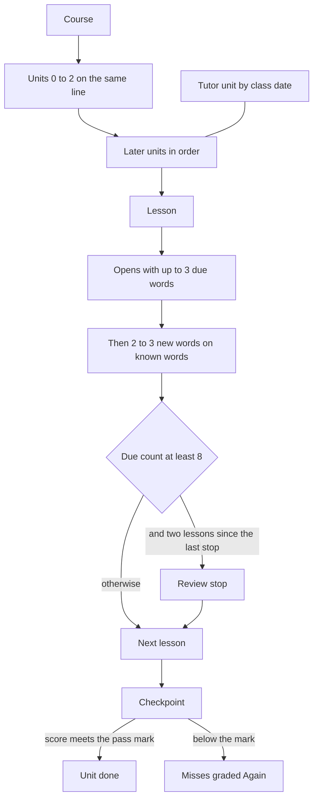

# ADR-0017: Learning path: units, word stacking, plan schema 1.3.0

## Metadata

| Field | Value |
|-------|-------|
| **Status** | Proposed |
| **Date** | 2026-10-18 |
| **Authored by** | Hebrew Dev, recording decisions of 2026-10-18 made on Brian Nelson's behalf |
| **Initiative** | — |
| **Research grounding** | [RSCH-001](../../sdd/research/RSCH-001-english-to-hebrew-learning/RSCH-001-english-to-hebrew-learning-report.md) (session shape; pointed-then-unpointed is untested); [RSCH-003](../../sdd/research/RSCH-003-language-learning-science/RSCH-003-language-learning-science-report.md) (spacing High; retrieval over rereading Moderate; encounters r = .34); [RSCH-004](../../sdd/research/RSCH-004-course-design-and-lesson-types/RSCH-004-course-design-and-lesson-types-report.md) (frequency × situation spine, rule 14); [RSCH-006](../../sdd/research/RSCH-006-learner-interface-design/RSCH-006-learner-interface-design-report.md) (no points, streaks, or leaderboards); [RSCH-010](../../sdd/research/RSCH-010-lesson-program-layouts/RSCH-010-lesson-program-layouts-report.md) (one next step, linear path) |
| **Extends** | [ADR-0003](ADR-0003-course-and-lesson-plan-language.md) (plan → unit → lesson → block; N1–N12). [ADR-0009](ADR-0009-learner-model-and-language-program.md) (FSRS-6, strength, daily mix, schema 1.1.0). [ADR-0013](ADR-0013-research-shaped-plans.md) (research checks warn and do not block publish). [ADR-0014](ADR-0014-lesson-type-coverage.md) (schema 1.2.0 stays the exercise / assignment / future-tense version). |
| **Supersedes** | — |
| **Superseded by** | — |
| **Figma source** | File [`NJ8HfTPCQgrFty2VVQBMhY`](https://www.figma.com/design/NJ8HfTPCQgrFty2VVQBMhY?node-id=71-2) · page **Learning Path** · node `71:2` |

Brian Nelson does not approve pull requests himself. Hebrew PR Reviewer approves and merges. This record is Proposed. It decides the path. It does not change the schema file, the validator, the database, the MCP tools, the lesson files, or the screens.

## Summary

The learner follows one course on one visible line: **course → unit → lesson → activity**. A unit is a situation on the frequency spine. Lessons stack a few new words on words the path has already introduced, and FSRS review is inserted into that line instead of living only beside it.

The plan document gains optional fields at schema **1.3.0**. Schema 1.2.0 is already Accepted ([ADR-0014](ADR-0014-lesson-type-coverage.md)) for `exercise`, `assignment`, and `tense: "future"`. The design spec of 2026-10-18 called this change 1.2.0. That number is already taken, so this record uses the next minor. Documents at 1.0.0, 1.1.0, and 1.2.0 stay valid. Worksheets stay worksheets.

One new table, `unit_progress`, stores a checkpoint score, the time the unit was passed, and a flag that the soft-gate warning has been shown. Node state, strength, and review stops are computed from data the app already stores. The FSRS scheduler, the lexicon, and the grammar-concept list do not change.

Hebrew Dev decided the following on 2026-10-18, on Brian Nelson's behalf:

- No XP, no streaks, no leaderboards ([RSCH-006](../../sdd/research/RSCH-006-learner-interface-design/RSCH-006-learner-interface-design-report.md)). Progress on the unit reads **x of y new words this unit**.
- The checkpoint pass mark is **80%** (for example 16 of 20). The mark is a config value, not a literal in the checker.
- The next unit is reachable. The first visit to a not-yet unit shows a warning and offers the checkpoint as a way to test out. Later visits to that same unit skip the warning. A passed checkpoint marks the unit done. Nothing is hard-locked.
- A review stop appears when the FSRS due count is **8 or more**. That threshold is config. A stop appears at most once per 2 lessons.
- Each lesson opens with **up to 3** due words.
- Tutor units (Aaron's classes) sit inline on the main path, ordered by class date.
- The reading track folds into Units 0–2. Hebrew stays pointed for now. Dropping points on a word whose strength is `solid` is a later, data-driven decision. `reading_stage` stays in the schema.

The 13 published lessons observed on 2026-10-18 are the migration source for five draft units. Nothing is unpublished by this record, and nothing is moved. The shelf stays at `/lessons/` until the path ships, and then remains available at `/lessons/all`.

---

## Context

### Problem statement

[ADR-0003](ADR-0003-course-and-lesson-plan-language.md) already describes a plan as ordered units of ordered lessons of ordered blocks, with `newWords`, `buildsOn`, `recycles`, and rule N7 (language-focused blocks at most about a quarter of the unit). [ADR-0009](ADR-0009-learner-model-and-language-program.md) already schedules review with FSRS-6, buckets retrievability into `fragile`, `shaky`, `steady`, and `solid`, keeps a closed grammar-concept registry, names six lesson `recipe`s, and builds a daily mix at read time. [ADR-0013](ADR-0013-research-shaped-plans.md) already says research checks warn and do not block publish.

The live shelf does not use that shape. Lessons are separate worksheets. Level filters them. It does not order them, and it does not record that one grammar point depends on another. Review sits on `/review` and on Today. A lesson does not open with due words, and the shelf does not show strength.

### What was checked on 2026-10-18

Read-only MCP calls `list_lessons`, `list_plans`, and `list_words`, plus the tree those calls are defined against.

**Plans.** `list_plans` returned no plans. Units, recycling, and recipes are unused on the live shelf. The published lessons are worksheets.

**Lessons.** `list_lessons` returned **13** published lessons. Levels on that pull:

| Level | Count | Slugs |
|-------|-------|-------|
| `basic` | 10 | `my-morning`, `plane-small-talk-yesh-li`, `test`, `date-night-maadif-infinitive`, `say-it-again-efshar`, `next-weekend-going-to`, `last-weekend-past-ti`, `steakhouse-et`, `israel-trip-kshe`, `he-said-that-retell` |
| `intermediate` | 2 | `shai-date-indirect-speech`, `anal-sex-vocab` |
| empty | 1 | `my-morning-one-verb-two-verbs` |

`test` is one of the 10 basic lessons. It is published. Its title is `test` and its only vocab item is שָׁלוֹם.

**Shelf order.** The learner shelf (`shared/lessons-page.js`) sorts by lesson-status rank, then by catalog index. Due lessons come first, then new lessons, then in-progress and done lessons (`shared/player/utils.js`). The catalog entry has no publish-date field. `upsert_lesson` appends a new entry. Nothing in that sort is series order or concept order. Level changes quiz defaults (choices, bank, timer). It is not a prerequisite.

**Words.** `list_words` returned **135** vocab items across those 13 lessons.

Counted with nikud stripped, **94** forms remain: **66** appear in one lesson only, 19 in two, and 9 in three or four (6 in three, 3 in four). 66 of 94 is about 70%. That is the figure in the design spec, restated here as an observation from 2026-10-18. The strip merges שׁוֹתֶה with שׁוֹתָה, and לְאִט with לְאַט.

The word key in force is [ADR-0001](ADR-0001-learner-review-model.md) `exactKey`: NFC, whitespace collapsed, trimmed, **nikud kept**. Under that key the same pull is **96** words: **69** appear in one lesson only, 18 in two, 6 in three, and 3 in four. This record uses `exactKey`. The unpointed fold is not a second identity.

Vocab-item counts on that pull are not 10–12 in every lesson. They are 8 (`my-morning`), 10 (`shai-date-indirect-speech`), 12, 12, 11, 1 (`test`), 11, 12, 12, 12, 11, 12, and 11, in catalog order.

In that same catalog order, the share of a lesson's distinct pointed words that had already appeared in an earlier lesson ran from 0% to 50%. The median is 33%. [RSCH-003](../../sdd/research/RSCH-003-language-learning-science/RSCH-003-language-learning-science-report.md) discusses roughly 95–98% known words for **reading** comfort (Low for the reading thresholds; applying them to listening is an extrapolation). [ADR-0003](ADR-0003-course-and-lesson-plan-language.md) N3 already warns below 95% on `graded-story` and `listening`. The shelf does not meet that reading bar, and it has no path to.

**Code the spec described and this tree does not have.**

- There is no route `/lessons/all`. The shelf is `/lessons/` (`shared/app-shell.js`).
- The shell has no "Daily goal" block and no "5 days" streak. `data-shell-sync` is the sync line. `review_items.streak` is the ladder counter from [ADR-0001](ADR-0001-learner-review-model.md), not a displayed streak. [ADR-0006](ADR-0006-visual-language-and-interface-rules.md), [ADR-0009](ADR-0009-learner-model-and-language-program.md), and [ADR-0010](ADR-0010-player-visual-language-and-competence-feedback.md) already leave points, streaks, and leaderboards off the screen.
- `docs/decisions/ADR-0003-assets/lesson-plan.schema.json` accepts `schemaVersion` `1.0.0`, `1.1.0`, or `1.2.0`. There is no 1.3.0 yet. A unit today is `id`, `title`, `theme`, optional `frequencyBand`, and `lessons`. Order is array order. A lesson already has `newWords`, `buildsOn`, and `recycles`. `exercise.kind` is `choose`, `true-false`, `unscramble`, `translate`, or `dictation`. That block field is not a lesson kind.
- The file the spec cites as `/workspace/hebrew/aaron-lesson-patterns.md` is not in this repository. This record does not depend on a count of class worksheets from that file.

### What the research supports, at the grade the reports give

- **Spacing** of retrieval across days is High in [RSCH-003](../../sdd/research/RSCH-003-language-learning-science/RSCH-003-language-learning-science-report.md) §1.1. **Retrieval over rereading** is Moderate there, not High. Interleaving different patterns in one practice set is Moderate, and the second-language experiment found a larger benefit for learners with less prior knowledge. Encounters correlate with incidental word learning at r = .34 (Moderate). No encounter count guarantees a word is learned (Low for the absence of a threshold).
- [RSCH-004](../../sdd/research/RSCH-004-course-design-and-lesson-types/RSCH-004-course-design-and-lesson-types-report.md) recommends a fixed spine of frequency band × situation, grouping a lesson by the situation rather than by a semantic category (Low for the thematic-cluster result). About a quarter of a unit is deliberate study and about three quarters is meaning. Nation calls the equal split arbitrary, and N7 is the adapted check. There is **no evidenced cap** on new words per lesson. Rule 14 (Low): a personal queue may insert a due review, or skip a word the learner already knows. It may not reorder unseen words off the spine.
- [RSCH-010](../../sdd/research/RSCH-010-lesson-program-layouts/RSCH-010-lesson-program-layouts-report.md): the program list marks the current lesson and names one next lesson. Duolingo's move from a tree to a linear path of units is Low as a learning result, because the comparison also changed the lessons. WCAG 2.2 asks for consistent repeated navigation (3.2.3, AA), more than one way to locate a page in a set (2.4.5, AA), and a "you are here" (2.4.8, AAA).
- [RSCH-006](../../sdd/research/RSCH-006-learner-interface-design/RSCH-006-learner-interface-design-report.md): show progress as what the learner can now do. Leaving out points, streaks, and leaderboards is a product choice aligned with a Low grade. It is not a finding that those widgets harm learning.
- [RSCH-001](../../sdd/research/RSCH-001-english-to-hebrew-learning/RSCH-001-english-to-hebrew-learning-report.md): a session mixes comprehensible Hebrew, delayed recall, one explicit pattern, pronunciation in a real phrase, and message-focused speech (Moderate for the session shape). Fading vowel points once a word is known is untested.

### Requirements this record satisfies

| Id | Requirement |
|----|-------------|
| R1 | One visible linear path: course, unit, lesson, activity. |
| R2 | Additive plan fields at the next free minor version, valid for older plans and for worksheets. |
| R3 | One stored progress table. Computed path state stays computed. FSRS, the lexicon, and the concept registry stay as they are. |
| R4 | Validator checks N24–N29 for the new-word caps, the known-word band, and the reuse ladder. They warn. Go adds them after the cutover. Node does not. |
| R5 | Record the 2026-10-18 product decisions: no XP / streaks / leaderboards, the unit word-count line, the 80% pass mark, the one-time soft-gate warning, the review stop, the warm-up, inline tutor units, and reading folded into Units 0–2 with pointing unchanged for now. |
| R6 | Name the migration of the 13 published lessons into five draft units, without unpublishing or moving anything in this change. |
| R7 | Point the later `/lessons/` and Today work at the Learning Path page in Figma, and hold those screens until this ADR is accepted. |

### Constraints

- This change is the decision record only. No schema edit, no validator edit, no migration, no MCP tool change, no worksheet edit, no visibility change, no screen change.
- Word identity stays `exactKey`. Review rows already stored still apply.
- N1, N3, and N18 stay in force. The new checks do not lower a block threshold.
- [ADR-0013](ADR-0013-research-shaped-plans.md): a plan has no maximum lesson count. A typical unit shape is guidance, not a new cap.
- [ADR-0001](ADR-0001-learner-review-model.md) constraint 5: no forced vowel fading, until a later decision says otherwise.
- Plan text stays untrusted. Learner answers stay out of the plan.

---

## Options considered

| Option | What it is | Outcome |
|--------|------------|---------|
| A. Keep levels as the only structure | The shelf stays a filterable list of worksheets | **Set aside.** Level does not express order or prerequisites. The 2026-10-18 shelf is the evidence. |
| B. A skill tree | The learner chooses a branch | **Set aside.** [RSCH-010](../../sdd/research/RSCH-010-lesson-program-layouts/RSCH-010-lesson-program-layouts-report.md) records the move to a linear path so the learner can see what is next. The Duolingo comparison is Low, and it is still the layout this product chooses. |
| C. Hard gating | The next unit stays unreachable until the checkpoint passes. Locked nodes are `aria-disabled`. | **Set aside.** The next unit stays reachable. See Decision 4. |
| D. Put these fields on schema 1.2.0 | The design spec's version number | **Set aside.** 1.2.0 is [ADR-0014](ADR-0014-lesson-type-coverage.md). |
| E. Parallel reading track | Letters → nikud → unpointed beside the units | **Set aside.** Reading folds into Units 0–2 on the same path. |
| F. **One path, schema 1.3.0, computed review, one progress table** | This record | **Chosen.** |

---

## Decision

### 1. The path

One course, one line.

A **unit** is one situation and at most one grammar concept. The authoring target is about 8 new words in the unit, across lessons that each add 2 or 3, plus a checkpoint. A review stop is not a stored lesson. A tutor class is a unit on this same line, not a second lane.

An **activity** is a block the plan already knows, or a worksheet activity the player already runs. This record adds no activity type. The illustration below is the shape of one lesson (the design spec's "Out the door"), not a lesson to author here.

| Step | Activity already in the player | Skill |
|------|--------------------------------|-------|
| 1 | Warm-up: up to 3 due cards | recall of due words, not a new-word rung |
| 2 | `words` | `recognize` |
| 3 | `listen-pick` | `listen` |
| 4 | `build-sentence` | `build` |
| 5 | `pattern` | the unit's one concept, not a word-ladder rung |
| 6 | `type-it`, or speaking the same prompt | `produce` |
| 7 | `story` and `retell` | `use` |

`type-it` already exists on the worksheet player. Whether the plan player runs it stays where [ADR-0013](ADR-0013-research-shaped-plans.md) left it.

The known-word band for a **lesson** is a product choice: about 70–80% of activity word tokens already introduced earlier on the path, and about 20–30% new. That band is not the reading threshold. Story and listening text stay on N3: warn below **95%** known. [RSCH-003](../../sdd/research/RSCH-003-language-learning-science/RSCH-003-language-learning-science-report.md)'s 95–98% figure is that reading claim (Low), and this record does not move it onto every activity.

**Stacking ladder.** Each new word, after the lesson that introduces it, is touched at least **4** more times across at least **3** later lessons. `target_skill` along those later touches follows this order and does not go backwards:

`recognize` → `listen` → `build` → `produce` → `use`

Those five names are the enum. "Listen-choose" is `listen`. "Build phrase" is `build`. "Use in a sentence" is `use`. Equal rungs in a row are allowed. The last later touch is further along the ladder than the first. A word does not have to land on every rung. There is no stored "graduated" flag. A later unit counts an earlier unit's `introduces_words` as introduced for the authoring ratio. The learner's memory stays FSRS.

Later units reuse at least **30%** of the previous unit's introduced words. That figure is a product choice. [RSCH-004](../../sdd/research/RSCH-004-course-design-and-lesson-types/RSCH-004-course-design-and-lesson-types-report.md) requires a later appearance, and it sets no percentage.

[RSCH-004](../../sdd/research/RSCH-004-course-design-and-lesson-types/RSCH-004-course-design-and-lesson-types-report.md) rule 14 allows the warm-up and the review stop. Both insert due review. Neither reorders unseen lessons.

### 2. Plan schema 1.3.0

Same rule as [ADR-0009](ADR-0009-learner-model-and-language-program.md) Decision 7 and [ADR-0014](ADR-0014-lesson-type-coverage.md) §7. A later minor version adds optional fields by publishing a schema that names that version. A reader of an older version rejects fields it does not know. Unknown properties still fail. When Go owns plan writes, a part operation that sets a 1.3.0 field raises `schemaVersion` to `1.3.0` in that same revision. The version never goes down.

**Backward compatible** means a 1.0.0, 1.1.0, or 1.2.0 plan still validates, and a worksheet still loads as a worksheet. It does not mean a 1.2.0 reader accepts a 1.3.0 document. Worksheets have no `schemaVersion`. This record does not rewrite them.

The schema file is still `docs/decisions/ADR-0003-assets/lesson-plan.schema.json`. Node keeps accepting `1.0.0`, `1.1.0`, and `1.2.0` only. Go adds `1.3.0` to that file after the cutover. This record does not edit it.

Fields already required stay required: unit `id`, `title`, `theme`, `lessons`; lesson `id`, `title`, `level`, `visibility`, `buildsOn`, `newWords`, `recycles`, `blocks`. `frequencyBand`, `recipe`, and array order stay. New fields are optional. When a 1.3.0 lesson sets both `newWords` and `introduces_words`, they are the same `exactKey` list; a difference blocks, because the document would introduce two lists. `recycles` stays the `{ word, fromLessonId }` list. `reuses_words` is the flat key list the ratio uses. A disagreement between those two lists warns.

**Unit fields added at 1.3.0**

| Field | Rule |
|-------|------|
| `order` | Integer, unique in the plan. The path sorts by it when any unit sets it. Otherwise array order stands, as in ADR-0003. |
| `concept` | One grammar-concept key (`family:key`) from the registry [ADR-0009](ADR-0009-learner-model-and-language-program.md) Decision 4 already seeds, or absent. At most one. The registry is not extended here. |
| `introduces_words` | `exactKey`s this unit introduces. Authoring target about 8 for a core unit. |
| `prerequisites` | Unit ids in the same plan. |
| `source` | `core` or `tutor`. Absent means `core`. |
| `tutor_class_date` | `YYYY-MM-DD`. Required when `source` is `tutor`. Absent on a core unit. |
| `reading_stage` | `letters`, `nikud`, `pointed`, `partial`, or `unpointed`. Absent means the unit makes no reading-stage claim. |

**Lesson fields added at 1.3.0**

| Field | Rule |
|-------|------|
| `introduces_words` | `exactKey`s this lesson introduces. Authoring target 2 or 3 when `kind` is `lesson`. |
| `reuses_words` | `exactKey`s already introduced earlier on the path. |
| `kind` | `lesson`, `review`, or `checkpoint`. Absent means `lesson`. This is the lesson object. It is not `exercise.kind`. |
| `target_skill` | On a word touch inside an activity: `recognize`, `listen`, `build`, `produce`, or `use`. |

`buildsOn` stays a list of lesson ids. `prerequisites` is the unit-level list. Both may be set.

A tutor unit's lessons use the same `kind` values. `tutor` is a unit `source`, not a lesson kind.

Setting any field in these two tables is what raises the document to 1.3.0. Go does that raise after the cutover. Node's part operations do not.

### 3. `unit_progress`

Node state, strength, fading, the review stop, and the warm-up pick are **computed** on read. They are not columns.

One new table holds the three facts that have to be remembered:

| Column | Meaning |
|--------|---------|
| `user_id` | The learner. Same foreign key as the other learner tables (`users.id`). The design spec's `user` is this column. |
| `plan_id` | The plan. Unit ids are unique inside a plan ([ADR-0003](ADR-0003-course-and-lesson-plan-language.md) §1), not across plans. The key includes `plan_id` so two plans can reuse a unit id. |
| `unit_id` | The unit. |
| `checkpoint_score` | Latest fraction correct, from 0 to 1, or null when the learner has not submitted the checkpoint. 16 of 20 is 0.80. |
| `passed_at` | ISO timestamp set when a score first meets the pass mark. A later lower score does not clear it. |
| `gate_warning_seen` | `0` or `1`, default `0`. Set to `1` when the soft-gate warning is shown. |

Primary key: `(user_id, plan_id, unit_id)`.

The pass mark and the review-stop threshold are config. The defaults are below. The checker reads them and does not embed the numbers. Go adds the keys after the cutover, with N24–N29. They are not added to the Node module `server/learner/thresholds.js` ahead of that. This record does not add them.

| Key | Default | What reads it |
|-----|---------|----------------|
| `checkpoint_pass_mark` | `0.80` | Compare to `checkpoint_score`. The checker reads the config. It does not embed `0.80` or `16` or `20`. |
| `review_stop_due_count` | `8` | Insert a review stop when the due count is at least this value. |
| `review_stop_gap_lessons` | `2` | At most one review stop per this many lessons along the path. |
| `lesson_warmup_due` | `3` | A lesson opens with at most this many due words. |

The due count is the number of due review rows the review queue already counts. A suspended card is not due ([ADR-0009](ADR-0009-learner-model-and-language-program.md) §2). A word with two due directions counts as two rows. That is the existing queue, not a new definition.

### 4. Scheduling on the path

**Warm-up.** Every lesson opens with up to 3 due words, oldest due first. Directions follow the interleave the daily mix already uses. Fewer than 3 due words means a shorter warm-up. The lesson does not invent due words to fill the cap. The cap is `lesson_warmup_due`.

**Review stop.** When the due count is at least `review_stop_due_count`, a review-stop node is inserted after the current lesson. After a stop, the next `review_stop_gap_lessons` lessons do not get another stop. The stop uses activity types the player already has. It is computed per learner. It is not a plan lesson and it has no slug. The design spec's trigger ("8 words below `steady`", or every 3 lessons) is not the rule.

**Checkpoint.** The unit ends with an authored lesson of `kind: checkpoint`. The learner passes when `checkpoint_score` is at least `checkpoint_pass_mark`. The example of that ratio is 16 correct out of 20. The example is not a required length. A missed item is graded **Again** through the existing FSRS path. The scheduler is unchanged. `SRS_SCHEDULER` is not switched.

Passing sets `passed_at` and marks the unit done.

**Test out.** The checkpoint of a unit can be opened before that unit's lessons are finished. A passing score marks the unit done the same way.

**Soft gate.** A unit is **not-yet** when at least one unit in its `prerequisites` has no `passed_at` for this learner. The first visit to a not-yet unit shows a warning: the earlier unit is unfinished, the learner may continue, and the checkpoint is there to test out. That visit sets `gate_warning_seen` to `1`. Later visits to that same unit do not show the warning again. The flag is not cleared by leaving, by failing the checkpoint, or by passing it.

The current unit (prerequisites satisfied, or no prerequisites) does not show this warning. No node is disabled. The design spec's locked state, `aria-disabled`, and the tooltip "Finish X first" are not the gate. A not-yet unit stays focusable and activatable. [RSCH-010](../../sdd/research/RSCH-010-lesson-program-layouts/RSCH-010-lesson-program-layouts-report.md) Multiple Ways (2.4.5) is the access rule this choice is aiming at: the later unit is still a page the learner can open.

### 5. Validator rules

Cite these by id. They apply to `schemaVersion` `1.3.0` documents. Older plans and all worksheets are outside them. The pedagogy checks warn and do not block publish ([ADR-0013](ADR-0013-research-shaped-plans.md)). A later decision may raise one of those warns to **Block** after real plans have been checked. That promotion is not made here. N28 also blocks an unknown unit id or a prerequisite cycle, which is a broken reference rather than a pedagogy cap. Go applies N24–N29 after the cutover. Node's validator does not gain them.

N1 still blocks a non-legacy lesson above 8 `newWords` on publish. N18 still has its own thresholds for `topic-conversation`. N25 warns inside the 2–3 band and does not change N1 or N18. N3 still warns below 95% on story and listening text and is not restated as a new id.

| Id | Rule | Severity |
|----|------|----------|
| N24 | A `source: core` unit lists more than 8 `introduces_words`. Fewer than 8 does not warn. | **Warn** |
| N25 | A lesson with `kind` `lesson` or omitted lists an `introduces_words` count other than 2 or 3. `review` and `checkpoint` are exempt; they are expected to introduce none. | **Warn** |
| N26 | Of the lesson's activity word tokens, the share whose `exactKey` was introduced on an earlier lesson of the path is outside 70–80%. | **Warn** |
| N27 | A word in `introduces_words` has fewer than 4 later touches, or those touches sit in fewer than 3 later lessons, or a later touch uses an earlier `target_skill` than a touch before it, or the last later touch is not further along the ladder than the first. | **Warn** |
| N28 | `prerequisites` names an unknown unit id, a cycle, or omits the unit that immediately precedes this one in `order`. A concept is used on a lesson whose unit does not introduce it and does not list, directly or through prerequisites, the unit that does. Two tutor units are out of `tutor_class_date` order. | **Warn** for a missing predecessor, a concept used early, or tutor units out of class-date order. **Block** for an unknown id or a cycle, because the path cannot be ordered. |
| N29 | A unit other than the first reuses fewer than 30% of the previous unit's `introduces_words`. | **Warn** |

N24's cap of 8 per unit, and N25's 2 or 3 per lesson, are product choices. [RSCH-004](../../sdd/research/RSCH-004-course-design-and-lesson-types/RSCH-004-course-design-and-lesson-types-report.md) §3 rule 7 already says no source sets a per-lesson cap. The same is true of a per-unit cap.

### 6. Reading and pointing

There is no parallel reading track. Units 0, 1, and 2 are ordinary units on the front of the same path. They carry `reading_stage`.

Display stays pointed everywhere, including after Unit 2. `reading_stage` is stored so a later decision can read it. The player does not change pointing from that field yet. [ADR-0001](ADR-0001-learner-review-model.md) constraint 5 stays in force.

Dropping nikud on a single word once its strength bucket is `solid` is explicitly deferred. [RSCH-001](../../sdd/research/RSCH-001-english-to-hebrew-learning/RSCH-001-english-to-hebrew-learning-report.md) marks a pointed-then-unpointed sequence as untested. The later decision waits on data. It is not taken here.

### 7. Tutor units

An Aaron class series is a unit with `source: tutor`, a `tutor_class_date`, its own lessons, and a checkpoint. It sits on the main path. The author sets `order` so tutor units follow class date: an earlier class has the lower `order`. N28 warns when two tutor units disagree with that date order.

The design spec's other placement (after the current unit, or just before the checkpoint when known-word coverage is at least 70%) is not the rule. New words in a tutor unit use the same ladder. Later core units count them in `introduces_words` as introduced.

The path may show a tutor unit as a class node with the class date. The screen work is Decision 10. This record does not draw it.

### 8. Progress display

No XP. No streak widget. No leaderboard. The progress line on the current unit is **x of y new words this unit**.

`y` is the length of that unit's `introduces_words`. `x` is how many of those keys sit in `introduces_words` of a lesson on this unit that the learner has finished. A lesson in progress does not add its new words to `x` until it is finished. The line is exposure along the unit. Strength stays the four [ADR-0009](ADR-0009-learner-model-and-language-program.md) buckets, drawn from retrievability when a screen needs pips. Fading (a lesson whose words are at least 30% `fragile`) is computed the same way. Neither pips nor fading are stored. The journey-stage label from ADR-0009 §5 stays, and it still gates nothing.

The 30% fading figure is a product choice.

### 9. Migration

Observed on 2026-10-18: 13 published lessons, no plans. After this ADR is **accepted**, Hebrew Lesson Builder may draft the plan with the unit and lesson fields schema 1.2.0 already has. That draft does not run as part of accepting the ADR, and it does not run in the pull request that adds this file.

Eleven series lessons become five **draft** units. Draft means the plan's `status` is draft ([ADR-0003](ADR-0003-course-and-lesson-plan-language.md) Decision 7). Learners do not see it until it is published, which is a later step.

| Draft unit | Lessons, in the order below |
|------------|-----------------------------|
| Routine | `my-morning` (שגרה 1), `my-morning-one-verb-two-verbs` (same title, empty level) |
| Conversation | `plane-small-talk-yesh-li` (שיחה 1, יש לי), `say-it-again-efshar` (שיחה 2, אפשר) |
| Preferences | `shai-date-indirect-speech` (המלצות 1), `date-night-maadif-infinitive` (המלצות 2) |
| Time | `last-weekend-past-ti` (עבר 1), `next-weekend-going-to` (עתיד 1), `israel-trip-kshe` (כש) |
| Narration | `he-said-that-retell` (סיפור 1, אמר ש׳), `steakhouse-et` (מסעדה 3, את) |

The design spec's sentence that all 13 become those five units does not survive the titles. Two of the 13 are not series lessons:

- `anal-sex-vocab` is the explicit-vocab worksheet. The follow-up drafts it as an opt-in personal plan (`audience: personal`), not as one of the five.
- `test` is not placed in a unit. After acceptance, the follow-up may unpublish `test`. It does not unpublish the other twelve. **Nothing is unpublished by this record**, and nothing is unpublished merely because the ADR is accepted. Unpublishing waits for that follow-up.

`shai-date-indirect-speech` is המלצות 1, so it sits in Preferences. Indirect speech as a pattern of סיפור 1 is `he-said-that-retell`, in Narration. The lesson is not in both units. מסעדה has a lesson numbered 3 and no lesson numbered 1 or 2 on the shelf. The draft does not invent the missing numbers.

The draft uses `newWords` and `recycles`, filled from `list_words` with `exactKey`, and it writes toward the stacking ladder. `introduces_words`, `reuses_words`, `kind`, and `target_skill` stay unset until Go accepts them. The 69 pointed words that appear in only one lesson still need later touches. N27 is the Go check for that, after the cutover. Review stops are computed at read time, so the draft does not store them. Until `kind` exists, a checkpoint is a lesson of the checkpoint activities the player already has. It gains `kind: checkpoint` when Go supports that field.

FSRS rows carry over. They are keyed by word, not by unit. A finished worksheet maps to a done node through the lesson progress the server already stores. That mapping is computed. It does not copy progress into `unit_progress` except when a checkpoint is later submitted.

The shelf stays at `/lessons/` until the path ships. When the path takes `/lessons/`, the same shelf stays reachable at `/lessons/all`. That route does not exist today. Adding it is part of shipping the path, not part of this record.

### 10. UI

The path map (`/lessons/`) and Today are designed on Figma page **Learning Path** (file `NJ8HfTPCQgrFty2VVQBMhY`, node `71:2`). [ADR-0015](ADR-0015-responsive-desktop-mobile-architecture.md) already cites that file for the shell.

Until this ADR is accepted, the frontend holds `/lessons/` and Today. No screen in this change.

When a later spec implements the page, it keeps these decisions:

- One column of units on phones, the current unit expanded, later units reachable.
- The progress line is the **x of y** line from Decision 8. There is no streak to remove from the shell, because the shell does not show one.
- Not-yet units are reachable. The one-time warning is Decision 4. Nodes are not hard-locked.
- A tutor unit shows the class date.
- Strength pips, when shown, use the four ADR-0009 buckets. They are computed.
- Lesson URLs for the existing worksheets stay `/worksheets/<slug>/` until a plan lesson replaces that worksheet. This record does not retarget them.

### 11. Who builds it after acceptance

The frontend follow-up for `/lessons/` and Today waits on acceptance and on the Figma page named above. Accepting this ADR does not change the MCP contract the Node server validates. Sequencing, below, says when Go takes schema 1.3.0, N24–N29, and `unit_progress`.

This record does not start that work.

#### Sequencing

1. The MCP contract is frozen for the Go port ([ADR-0016](ADR-0016-go-server-port.md) keeps the same tool names and schemas through the port). Plan schema 1.3.0 and validators N24–N29 are built in Go after the cutover, not in Node.
2. Until then, Hebrew Lesson Builder can start authoring the five draft units right away, using the unit and lesson structure schema 1.2.0 already supports (units, `newWords`, `recycles`) and writing toward the stacking ladder.
3. The 1.3.0 fields (`unit_progress`, the gate warning flag, checkpoint score and `passed_at`, and the plan fields in Decision 2) get filled in once Go supports them.

---

## Consequences

- The path has a place to say what comes next, which the level shelf does not have.
- Older plans and every worksheet keep validating. A 1.2.0 reader will reject a 1.3.0 document, which is the same rule 1.1.0 and 1.2.0 already use.
- Once Go runs N24–N29, those checks warn instead of blocking publish, including the warn half of N28. A 1.2.0 draft can be saved before that, with no N24–N29 result from Node. A plan can still ship while reuse is short of the ladder. That matches ADR-0013.
- One small table remembers the checkpoint and the warning. Everything else on the path is derived, so a strength change does not need a second write.
- The pass mark and the due-count threshold can change without a schema change, because they are config.
- The soft gate can be walked past. A learner can open a later unit after one warning. The checkpoint is how that unit becomes done.
- Pointing does not change. `reading_stage` will sit unused by the player until a later decision.
- MCP clients that only know 1.2.0 will fail a 1.3.0 plan closed, which is what the version rule is for. Go lands the schema and the MCP reader together, after the cutover. Node does not grow a 1.3.0 reader before then.
- Once Go runs N27, the 69 single-lesson words (pointed) warn until the plan reuses them. Node does not emit that warning before the cutover.

| Risk | What this record does about it |
|------|--------------------------------|
| Treating 1.2.0 as free and colliding with exercise / future tense | The version is 1.3.0. |
| A hard lock shipped from the Figma locked state | Decision 4 and Decision 10 forbid the lock. |
| Two word identities (nikud stripped versus `exactKey`) | Counts and lists use `exactKey`. The 66-of-94 figure is recorded as the stripped observation only. |
| Unpublishing `test` or any other lesson in the same change as this ADR | Forbidden until a follow-up after acceptance. |
| A second mastery store beside FSRS | Not added. `passed_at` is the unit checkpoint, not a word score. |

---

## Security considerations

`unit_progress` is learner state. A signed-in learner reads and writes their own rows. Another learner's rows stay on the server. The plan document still holds no answers, no scores, and no account ids beyond the assignee [ADR-0003](ADR-0003-course-and-lesson-plan-language.md) already allows. Checkpoint items in a plan are not secret, for the same reason [ADR-0014](ADR-0014-lesson-type-coverage.md) D6 gives: answers in a plan are checked in the browser.

This record adds no MCP tool. A later tool that returned `checkpoint_score` or `gate_warning_seen` would be a profile change and would go through [ADR-0009](ADR-0009-learner-model-and-language-program.md) §1 and the AI-planning switch. It is not granted here.

---

## Open questions

1. How long a checkpoint is, and what share of its items come from earlier units. The design spec suggests 15–20 items and about 20% from earlier units. This record locks the pass **ratio** only.
2. Whether a failed checkpoint also inserts a targeted practice lesson. Misses are graded Again either way. The extra lesson is not decided.
3. Which `reading_stage` value each of Units 0, 1, and 2 stores. The fold into those three units is decided. The five enum values are not yet assigned.
4. When N24–N29, or the warn half of N28, move from Warn to Block. That waits until a draft path exists and the warnings have been read.

---

## Rollback

Delete this file. No application file, schema file, database, worksheet, or screen changes with it.

## References

- [ADR-0001](ADR-0001-learner-review-model.md) `exactKey`; no forced vowel fading; ladder `streak` column
- [ADR-0003](ADR-0003-course-and-lesson-plan-language.md) plan shape, N1–N12, schema file `docs/decisions/ADR-0003-assets/lesson-plan.schema.json`
- [ADR-0006](ADR-0006-visual-language-and-interface-rules.md), [ADR-0010](ADR-0010-player-visual-language-and-competence-feedback.md) competence feedback, no streak display
- [ADR-0009](ADR-0009-learner-model-and-language-program.md) FSRS-6, strength buckets, concept registry, daily mix, schema 1.1.0
- [ADR-0013](ADR-0013-research-shaped-plans.md) warnings do not block publish; no maximum lesson count
- [ADR-0014](ADR-0014-lesson-type-coverage.md) schema 1.2.0
- [ADR-0015](ADR-0015-responsive-desktop-mobile-architecture.md) same Figma file, shell
- [ADR-0016](ADR-0016-go-server-port.md) same MCP tool names and schemas through the port; schema 1.3.0 and N24–N29 land in Go after the cutover
- [RSCH-001](../../sdd/research/RSCH-001-english-to-hebrew-learning/RSCH-001-english-to-hebrew-learning-report.md), [RSCH-003](../../sdd/research/RSCH-003-language-learning-science/RSCH-003-language-learning-science-report.md), [RSCH-004](../../sdd/research/RSCH-004-course-design-and-lesson-types/RSCH-004-course-design-and-lesson-types-report.md), [RSCH-006](../../sdd/research/RSCH-006-learner-interface-design/RSCH-006-learner-interface-design-report.md), [RSCH-010](../../sdd/research/RSCH-010-lesson-program-layouts/RSCH-010-lesson-program-layouts-report.md)
- Live shelf, 2026-10-18: MCP `list_lessons`, `list_plans`, `list_words`
- Figma Learning Path: <https://www.figma.com/design/NJ8HfTPCQgrFty2VVQBMhY?node-id=71-2>

## Changelog

| Date | Change |
|------|--------|
| 2026-10-18 | Proposed. Records the learning path, schema 1.3.0 (the design spec said 1.2.0, which ADR-0014 already uses), `unit_progress` including the one-time soft-gate flag, the 80% config pass mark, and the migration plan. No schema, code, or lesson file changes with this record. |
| 2026-10-18 | Sequencing under §11. Schema 1.3.0 and N24–N29 are a Go change after the ADR-0016 cutover. Hebrew Lesson Builder may draft the five units on schema 1.2.0 before that. |
