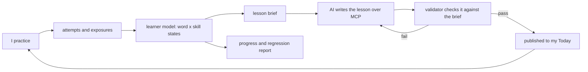

# North Star: a Hebrew program that knows what you know

**Status:** Draft for the operator, 2026-10-19
**Applies to:** v2 (the Go app on `origin/v2`, served at hebrew.ibhacked.us)
**Research it rests on:** RSCH-001, RSCH-003, RSCH-004, RSCH-005, RSCH-006, RSCH-008

## 1. The goal

The app knows, for every Hebrew word, whether I can **hear** it, **read** it, **recall** it, and **spell** it. It knows which words I have only seen, which I am still learning, which I struggle with, which I know well, and which I used to know and am losing. It hands that picture to an AI through MCP. The AI uses it to write my next lesson: a few new words, the words I struggle with brought back more than once, and words I already know used to make the reading and listening comfortable. Every answer I give updates the picture, so the next lesson is different from the last one.

Six questions the app must be able to answer at any time:

1. Which words do I know, per skill?
2. Which words have I seen but not learned?
3. Which words do I struggle with, and why: hearing, reading, recalling, spelling, or mixing up two words?
4. What did I gain this week, and what did I lose?
5. What should the next lesson teach, review, and reuse?
6. How many words do I know, and is that number going up?

## 2. Principles

- **The code picks the words. The AI writes the lesson.** Choosing words is counting and scheduling. It must be repeatable and testable. Writing a story or dialogue around those words is the creative part, and the AI does it. The validator checks the AI's lesson against the code's word plan before it can be published.
- **Measure, don't ask.** Wherever an answer can be checked (a picked meaning, a typed word), the app grades it. Self-rating ("Again / Hard / Good / Easy") stays only where nothing can be checked, and it uses plain words.
- **One skill per question.** A listening question shows no Hebrew text. A reading question has no audio and no transliteration. Otherwise you can't tell what was tested.
- **Teach with help, test without it.** Transliteration is hidden only while a word is being tested. Lessons, stories, and dialogues keep transliteration and a gloss on every word (section 6.1). Fading transliteration is an opt-in setting, never the default.
- **Every Hebrew word can be heard.** No word reaches a listening question, a lesson, or the placement without an audio clip.
- **Research rules run as code, not as prompt advice.** Spacing, both recall directions, the known-word coverage target (95% at full strength, staged for beginners, section 7.3), and limits on new words are checked by the validator and the scheduler.
- **One look.** One action color, one set of components, the same layout on every learning screen (section 9).

## 3. What v2 already has, and what is missing

| Area | Built on v2 | Missing |
| --- | --- | --- |
| Scheduling | FSRS cards per word, in two directions (`he_en`, `en_he`). Review log. Session mix with a target success rate of 85% and a cap on new words. The 85% becomes the one adjustable retention target (section 4.4). | Cards for hearing and spelling. Hearing and reading are both treated as `he_en`. |
| Evidence | `review_log` with rating, `peeked`, and the wrong option chosen. `confusion_misses` for letter pairs and gender agreement. | Which skill and which activity produced each answer. How long the answer took. What was typed. Exposure in stories, and taps on a gloss. |
| Placement | Frequency-band deck of 100 words in 5 bands, sittings, band stop rule, estimated known words, suggested start unit. | An objective test. Today it is a self-graded flashcard, transliteration on the front gives the reading away, and audio shows up only when a clip happens to exist. |
| Struggles | `StruggleStats`: misses in 7 days, lapses, Again rate, confusion keys. | Diagnosis by skill (for example "reads it, can't hear it"). Regression events. |
| Lessons | Units with `shared` or `learner:<id>` scope. `put_unit`, `validate_unit`, and `publish_unit`. Lesson runs with a score. | A word plan per learner ("lesson brief"). Validator checks for coverage and for reusing struggle words. |
| MCP | OAuth 2.1, `get_context`, `get_learner_words`, coach data, `lookup`, `upsert_lexemes`, `generate_audio`, `put_unit`, `validate_unit`, `publish_unit`. | A per-skill learner model, progress over time, and the lesson brief. |
| Audio | ElevenLabs generation, an audio import, lookup by pointed text. | A rule that nothing without audio is shown where listening is needed. |

## 4. The learner model: word × skill

### 4.1 Skills

Each word is tracked separately in each skill. Knowing a word when reading it says little about catching it in speech, and the research says each recall direction builds its own knowledge (RSCH-003, Moderate).

| Skill | Prompt | Answer | What it shows |
| --- | --- | --- | --- |
| `listen` | Audio only | Pick or type the meaning | I recognize the word in speech |
| `read` | Pointed Hebrew, no audio, no transliteration | Pick or type the meaning | I can decode it and know it |
| `recall` | English meaning or a picture | Type or pick the Hebrew | I can produce it |
| `spell` | Audio only | Type the Hebrew | I can write what I hear (dictation) |

**Unlock order.** `listen` is open from the start, and so is `recall` by picking, with audio options (below). `read` and `spell` are held back until the letters check is passed: five or more of six in placement Part 0, or the letters unit completed. Dictation asks for script I can't yet read, so it would measure the alphabet, not the word.

**The rule behind the gate: any question that shows written Hebrew waits for it.** That covers read-and-pick, word match, story questions that show text, the prefix, agreement, and root-family drills, build the sentence, typing from English, and dictation. Picking the right Hebrew word from four options is a reading task, so before the gate `recall` by picking shows four audio clips (a play button for each) instead of four written words. The prompt is the English meaning or a picture. After the gate the options become pointed Hebrew, and the same card can be asked either way. Audio match is the pre-gate stand-in for word match. Until the gate opens, no `read` or `spell` card is created, no dictation is dealt, and the lesson brief never picks `read` or `spell` as the skill focus. Lessons still teach through audio, transliteration, and gloss (section 6.1), and their passages are heard, not read.

`speak` (pronunciation) is a later skill. It needs speech scoring we don't have yet.

Unpointed reading (`read_unpointed`) is a later fifth skill, for when pointed reading is solid.

### 4.2 Every answer is an event

Add one append-only table. Every activity writes to it: placement, flashcards, match, typing, dictation, and lessons.

```sql
CREATE TABLE attempts (
    id INTEGER PRIMARY KEY,
    user_id INTEGER NOT NULL REFERENCES users (id) ON DELETE CASCADE,
    lexeme_id INTEGER NOT NULL REFERENCES lexemes (id),
    skill TEXT NOT NULL CHECK (skill IN ('listen', 'read', 'recall', 'spell')),
    activity TEXT NOT NULL,          -- placement_listen, flashcard, match, type_it, dictation, story_question, ...
    source TEXT NOT NULL,            -- placement, session, lesson
    unit_id INTEGER REFERENCES units (id),
    correct INTEGER CHECK (correct IN (0, 1)),  -- NULL when nothing could be checked (self-graded)
    grade INTEGER NOT NULL CHECK (grade BETWEEN 0 AND 4),  -- 0 "I don't know", then 1..4 as FSRS
    response_ms INTEGER,
    form TEXT,                       -- grammar form asked, e.g. 'past.1sg' or 'prefix:ha'; NULL for the base form
    expected TEXT,                   -- pointed NFC
    answer TEXT,                     -- what was typed or picked
    replays INTEGER NOT NULL DEFAULT 0,
    hinted INTEGER NOT NULL DEFAULT 0,
    at TEXT NOT NULL
);

CREATE TABLE exposures (            -- seen in a story or dialogue, no question asked
    user_id INTEGER NOT NULL REFERENCES users (id) ON DELETE CASCADE,
    lexeme_id INTEGER NOT NULL REFERENCES lexemes (id),
    unit_id INTEGER REFERENCES units (id),
    tapped_gloss INTEGER NOT NULL DEFAULT 0,  -- 1 when I tapped it to see the meaning
    at TEXT NOT NULL
);
```

`cards.dir` becomes `cards.skill`. The migration maps `he_en` to `read` and `en_he` to `recall`. `listen` and `spell` cards are new. FSRS keeps scheduling cards. `attempts` is what the learner model and the AI read.

**Grading checked answers.** Wrong is Again. Right after a replay or a hint is Hard. Right is Good. Right and faster than my own median for that activity is Easy. The latency rule is a product choice, not a research finding. It is tuned from my own data, not a fixed number.

### 4.3 Word states

States are computed from cards, attempts, and exposures. They are never typed in by hand. Each skill has its own state, and the state belongs to the word's dictionary form (section 4.6). A word's overall state is its weakest *unlocked* core skill (`listen`, `read`, `recall`), using the order in the precedence list below. A locked skill (section 4.1) shows as `locked`, not `unseen`, and is left out of the overall state, the "words I know" count, and the vocabulary estimate. Before the letters gate opens, `read` is locked, so a word's overall state comes from `listen` and `recall` only. When the gate opens, `read` joins in as `unseen` for every word, and the overall states are recomputed. The known-word count can drop on that day, and the Progress screen says why.

**Precedence.** A word can meet several rules at once. Rules are checked top to bottom, and the first match wins:

| # | State | Rule (starting values, tuned later) |
| --- | --- | --- |
| 1 | `unseen` | No attempt and no exposure |
| 2 | `seen` | An exposure or an introduction, and no correct answer yet |
| 3 | `struggling` | In the last 30 days: 2 or more lapses, or 40% or more wrong in the last 10 attempts, or a confusion seen 3 or more times in 7 days |
| 4 | `regressed` | Was `known` or `solid`, then missed 2 of its last 3 attempts (see below). Stays until it is answered right twice in a row |
| 5 | `solid` | Stability of 30 days or more and predicted recall of 90% or more |
| 6 | `known` | Stability of 7 days or more |
| 7 | `learning` | Has a card, and none of the above apply (stability under 7 days) |

`struggling` wins over everything with a card, because it is the state the lesson brief acts on. A word that is both `struggling` and recently `regressed` shows as `struggling`, and the regression event is still logged. The weakest-skill order for a word's overall state is the same list read from the top: `unseen`, `seen`, `struggling`, `regressed`, `learning`, `known`, `solid`. Lapses count only over the last 30 days, so two misses a year ago don't hold a word in `struggling` forever.

**One wrong answer does not demote a known word.** A single miss on a `known` or `solid` word is a `slip`. It is logged in `attempts`, FSRS reschedules the card sooner, and the state does not change. A second miss within the next 3 attempts turns the slip into a `regressed` event, logged with the date. If a drop in stability turns out to be a steadier signal in real data, it replaces the second-miss rule. Both are starting values.

### 4.4 Progression and regression

A daily snapshot table stores, per skill: the count in each state, the estimated vocabulary size, the real retention rate (share of due reviews answered right), and mean stability. That gives a week-over-week chart without re-reading the whole history.

**One retention target.** A per-learner setting, `desired_retention`, defaults to 85% and can be set between 80% and 95%. The FSRS scheduler, the session mix, and every "near target" check in this document read the same setting. Nothing hard-codes 85% or 90%. Higher means more reviews and fewer forgotten words. Lower means fewer reviews and more lapses.

- **Progression:** words moving up a state, growth in estimated vocabulary, retention near the target.
- **Regression:** `regressed` events, a retention rate falling below target, and a whole band slipping (for example, five band-1 words lapsing in a week).

### 4.5 Finding the real struggle

The evidence by skill is what turns "you miss this word" into a reason:

| Pattern | Likely cause | What the next lesson does |
| --- | --- | --- |
| `read` right, `listen` wrong | Hearing | Audio-first drills, similar-sounding pairs, more listening |
| `listen` right, `read` wrong | Decoding | Letter and niqqud drills on the letters involved |
| Recognizes it, can't recall it | Production | Typing and recall from English |
| Typed one letter off, the same pair again and again (ט/ת, כ/ח, ס/ש, א/ע, and the new ב/ו, ק/כ, א/ה/ע) | Spelling | Letter-pair drill (already exists as `letter_pair`, with the new pairs added) |
| Knows the word alone, misses it with a prefix (וְהַבַּיִת) | Prefix parsing | Prefix drill (section 6) |
| Knows the singular or masculine, misses the plural or feminine, or picks the wrong agreeing form | Gender and number agreement | Agreement drill (section 6) |
| Misses several words from one root | Root not noticed | Root-family practice (section 6) |
| Picks the same wrong word again and again | Two words mixed up | Contrast drill with both words side by side |
| Right but slow | Not yet automatic | A fluency pass using known words only |
| Gloss tapped in stories again and again | Meaning not stuck | Promote it to a deliberate review card |

### 4.6 What counts as a word

Hebrew attaches prefixes (וְהַבַּיִת is *ve-ha-bayit*, "and the house") and inflects heavily (כּוֹתֵב *kotev* "writes", כָּתַבְתִּי *katavti* "I wrote"). Without one counting rule, coverage, word states, and the lesson brief each count differently. The rule:

- **The unit is the lemma**: the dictionary form that has a `lexemes` row (for a verb, the form Pealim lists first). Word states, the learner model, the lesson brief, the vocabulary estimate, and the placement bands all count lemmas. *kotev* and *katavti* are one word, כתב, and one entry in "how many words do I know".
- **Every token in a text is matched back to a lemma, whole word first.** A `forms` table holds one row per inflected pointed form, with its lemma and its grammar features (tense, person, gender, number). `upsert_lexemes` loads it from the Pealim table. Each token is matched in this order:
  1. **The whole token.** Look it up as written (pointed, NFC), then by its consonant skeleton. A hit ends the search. This is what keeps בַּיִת (*bayit*, "house"), מִשְׂרָד (*misrad*, "office"), and כֶּלֶב (*kelev*, "dog") from being split into a prefix and a leftover.
  2. **Only if there is no whole-token hit, remove prefixes.** Try the closed prefix list, longest chain first: ו (and), ה (the), ב (in), כ (like), ל (to), מ (from), ש (that), and stacks such as וְהַ. Look the remainder up by consonant skeleton.
  3. **Still nothing: the token is unknown** (see below).
- **Matching ignores vowel points on the remainder, because a prefix changes them.** Compare skeletons (letters only, niqqud, dagesh, and cantillation removed). After a prefix a word's pointing shifts: ב in בַּיִת loses its dagesh in וּבַיִת, and a reduced vowel appears. Storing every pointed variant would multiply the table, so only the whole-token step compares pointing, and an exact pointed match beats a skeleton match. The prefixes themselves are stored with their surface variants in a small prefix table: וְ becomes וּ before ב, מ, פ and before a letter carrying a shva; ל, ב, and כ absorb the article, so לַ can mean "to" or "to the"; and מִ and מֵ both mean "from". Each variant is stored with its grammatical reading.
- **If a skeleton matches more than one lemma, or both a whole-token and a prefixed reading are possible, the whole token wins by default.** The AI can override it by marking the intended lemma and form on the token in the unit. Unmarked, truly ambiguous tokens fail validation with both readings listed.
- **Prefixes are a closed set, so they are taught once and then free.** After the prefix drill is passed for a prefix (section 6), a known lemma with that prefix counts as known. Before that, it counts as taught-this-lesson only if the brief lists it.
- **Inflected forms are a second, smaller thing to know.** A form counts as known for coverage when the lemma is known and either the form is the base form or its grammar feature (for example `past.1sg`) has been passed in a form drill. Otherwise it counts as an unknown token and needs a gloss, the same as a new word. This is what stops "knows *kotev*" from silently covering *katavti*. Form-level answers are stored in `attempts.form`, so the diagnosis can say "knows the word, misses the past tense".
- **Unmatched tokens count as unknown.** If a token can't be parsed to a lemma and form, the validator reports it and the AI has to add it through `upsert_lexemes` or gloss it. Proper names and numerals are excluded from the coverage count.
- **Words don't leave the count when forms are added.** Adding forms to a lexeme never changes its state or the vocabulary estimate. It changes only which tokens the matcher can resolve.

## 5. Placement, rebuilt

### 5.1 Why the current one doesn't work

- It is a flashcard review, not a test. I grade myself with Again, Hard, Good, and Easy, and "Again" means nothing on a word I've never been taught.
- The front shows the transliteration, so a reading question can be answered without reading Hebrew.
- Audio appears only if a clip exists for that exact pointed text. When there is no clip, the card is silent and nothing says so.
- It measures one thing ("do I think I know it"), not hearing and reading separately.

### 5.2 New design

A vocabulary-size test, adaptive by frequency band, with separate listening and reading sections. Nation recommends a size test so a learner starts in the right band (RSCH-004 [4]). Whether a placement test improves long-term outcomes has not been tested (RSCH-004, open question), so it is kept short and treated as a starting estimate that daily practice keeps correcting.

**Part 0 · Letters (about 1 minute, only if needed).** Six items: hear a syllable, pick the letter with its vowel. Five or more right skips ahead. Fewer means reading is not tested yet, and the first lessons start with letters.

**Part 1 · Listening.** The audio plays by itself, with a large replay button and no Hebrew text on screen. I pick the meaning from four English options, or tap "I don't know". The wrong options come from the same band and the same part of speech, so I can't guess by elimination.

**Part 2 · Reading.** Pointed Hebrew, no audio, no transliteration. Same four options plus "I don't know".

**Part 3 · Typing (optional, about 2 minutes).** English meaning, and I type the Hebrew with an on-screen Hebrew keyboard. Only words I got right in Parts 1–2 appear. This measures recall and typing. It is skipped when the letters check in Part 0 was failed (section 4.1).

**Adaptive rule (per skill):**

- Start in band 1. Six items per band.
- 5 or 6 right: move up a band.
- 3 or 4 right: six more items in the same band, then decide on all twelve.
- 0 to 2 right: stop that skill. This band is the ceiling.
- A word is never asked in both listening and reading in the same placement, because the second answer would be contaminated by the first.
- Roughly 40 to 60 items in total, about 10 to 12 minutes, with a break offered at the end of each part.

**Scoring.** With four options, a known share per band is corrected for guessing: (right − wrong ÷ 3) ÷ asked. "I don't know" counts as neither right nor wrong, which is why it exists: it replaces guessing. Estimated words known = sum over bands of (known share × band width). Listening and reading get separate estimates.

**No right/wrong feedback during the test.** That keeps it fast and avoids teaching mid-test. A tapped answer shows a neutral "picked" state and moves on. At the end, a review screen lists each miss with the right answer, its audio, and its pointed form (section 12, decision 1).

**What it writes.** One `attempts` row per item with `source = placement`. A right answer seeds that skill's card as Good. A wrong answer or "I don't know" marks the word `seen` for that skill and does not create a card. Words are taught before they are scheduled.

**Result screen.** Listening level and reading level, estimated words known per skill, the start unit, and "Start my first lesson".

**Re-check.** Every 4 to 6 weeks, a 3-minute re-test of the band at my boundary only.

### 5.3 Audio rule

Before the deck ships, every placement word gets a clip through `generate_audio`. A word with no clip is not dealt in listening or dictation. A test fails the build if a listening item has no audio.

### 5.4 The deck has to grow

Five bands of 20 words is too few for adaptive sampling without repeats. Target: 40 words per band, all verified against Pealim, with pointing, gloss, part of speech, gender, and audio.

## 6. Activities, and the skill each one trains

| Activity | Skill | Graded by |
| --- | --- | --- |
| Listen and pick | `listen` | Checked |
| Read and pick | `read` | Checked |
| Word match (Hebrew ↔ English pairs) | `read` | Checked. Each wrong pairing is logged as a confusion |
| Audio match (clip ↔ English) | `listen` | Checked |
| Pick the Hebrew (English or picture → one of four) | `recall` | Checked. Options are audio clips before the letters gate, pointed Hebrew after it (section 4.1) |
| Type it (English → Hebrew) | `recall` | Checked with the existing typed grader (exact is Good, one letter off is Hard). Held back until the letters check is passed |
| Dictation (audio → type) | `spell` | Checked. The wrong letter is logged as a letter pair. Held back until the letters check is passed (section 4.1) |
| Build the sentence | `recall` | Checked |
| Prefix drill: split and build (וְהַבַּיִת → and + the + house; or pick the form for "in the house") | `read`, form `prefix:*` | Checked. Passing a prefix makes that prefix free for coverage (section 4.6) |
| Agreement drill: pick the form that matches (a feminine plural noun with its adjective or verb; masculine or feminine "writes") | `recall`, form-level | Checked. Wrong picks are logged in `confusion_misses` as gender or number agreement |
| Root-family practice: which words share this root (כ-ת-ב: כּוֹתֵב, מִכְתָּב, כְּתִיבָה), odd one out, and root plus pattern → word | `read` | Checked. Each word in the question gets its own attempt row |
| Story or dialogue with tap-for-gloss | exposure | Taps logged |
| Story question | `read` or `listen` | Checked |
| Flashcard (self-graded) | the card's skill | Self-graded, with plain labels: "Forgot", "Hard", "Got it", "Easy" |

**Letter pairs.** The `letter_pair` drill and dictation grading cover ט/ת, כ/ח, ס/ש, and א/ע today. Add three more: ב/ו (both can sound like *v*), ק/כ (both *k*), and א/ה/ע (often silent, so easy to drop or swap in dictation). The pair a learner confuses is logged with the letters involved, and the diagnosis in section 4.5 reads it from there.

**Typing help.** A Hebrew on-screen keyboard in the standard Israeli layout, the physical-key mapping shown during the first sessions, final letters handled, and niqqud ignored when grading (that is already in `GradeTyped`). Typing errors feed the letter-pair confusion log.

### 6.1 Transliteration and gloss: shown while teaching, hidden while testing

| Where | Transliteration | Gloss |
| --- | --- | --- |
| Lessons, stories, dialogues (teaching) | Shown on every word | Every word has one. Tap shows it, and the tap is logged as an exposure signal |
| A test or review question (`read`, `listen`, placement) | Hidden, so the skill is tested alone | Not shown |
| Feedback after an answer, and the placement review screen | Shown with the pointed form | Shown |

Transliteration fading is an opt-in learner setting (`fade_translit`, off by default). When it is on, it can hide transliteration on words that are `known` for `read`, and the learner can turn it back on at any time. The validator requires transliteration and a gloss for every Hebrew word in a lesson, so that the display setting can always show them.

**The session mix picks the skill.** The existing mix chooses cards. It also chooses the activity: the weakest skill for that word gets the question, and a checked activity is used over a self-graded one wherever one exists.

## 7. From static lessons to lessons built for me

### 7.1 The lesson brief (code)

A new service function, `LessonBrief(learner, theme?)`, returns the word plan for the next lesson:

- **New words:** 5 to 8 (3 to 4 while I know fewer than 100 words, so a short passage can stay mostly known; section 7.3), from the lowest frequency band that still has `unseen` words, fitting the theme. Never a word that is currently `struggling`. Existing unit budgets still apply.
- **Struggle words:** the top 3 to 5 from the struggle list. Each one must appear at least 3 times, practiced through the skill that is failing (section 4.5).
- **Comfortable words:** `known` and `solid` words that the AI uses to write the story and dialogue, so that the running text meets the coverage target for my vocabulary size (section 7.3; 95% at full strength, RSCH-003, RSCH-004). The brief states the tier and the maximum text length.
- **Skill focus:** the weakest skill overall gets the most activities.
- **Activities:** chosen from section 6 to cover the skill focus.
- **Recall later:** every new word is due for recall on a later day, which FSRS already schedules (spacing is High in RSCH-003).

### 7.2 The lesson (AI)

The AI reads the brief and writes a learner-scoped unit: a short story or dialogue, the activities, and glosses for any word outside the brief. It calls `validate_unit` with the brief id. The validator checks:

- coverage in reading and listening passages meets the tier's rule (section 7.3), with every token matched to a lemma and form (section 4.6);
- every new word introduced before it is tested, and appearing at least 3 times;
- every struggle word reused as many times as the brief asks, in the right skill;
- no word outside the brief without a gloss;
- transliteration and a gloss for every Hebrew word (section 6.1);
- audio for every Hebrew text (the AI calls `generate_audio`, which already exists).

If it passes, `put_unit` with `scope = learner:<id>` and `publish = true`, which is already allowed for learner scope. The lesson appears on Today.

### 7.3 Coverage for beginners

With 30 known words, a story with 5 to 8 new words can't be 95% known, and a strict validator would reject every early lesson. Coverage is therefore staged by how many lemmas I know (`known` or `solid` in the skill the passage uses). Starting values, tuned from real data:

| Known words | Passage | What counts toward coverage | Target |
| --- | --- | --- | --- |
| Under 100 | One sentence, or a dialogue of 2 to 4 short lines. At most 20 tokens. 3 to 4 new words | Known words, words taught earlier in this same lesson, and inline-glossed words | At least 60% already known before the lesson. All the rest taught or glossed. No unglossed unknown token |
| 100 to 299 | Up to about 60 tokens | Known words and words taught earlier in this same lesson. A gloss does not count | 90% or more |
| 300 or more | Free length within the unit budget | Known words and words taught earlier in this same lesson. A gloss does not count | 95% or more |

**The arithmetic for the first tier.** In 20 tokens, 60% known leaves at most 8 taught or glossed tokens. Four new words used twice each is exactly 8, and three new words is 6, which leaves room for a gloss or two. The rule "each new word appears at least 3 times" is counted across the whole lesson, activities included, so the passage uses each new word once or twice and the questions supply the rest. The same holds for struggle-word reuse. That is also why the cap drops to 3 to 4: at 5 to 8 new words, a 20-token passage would be mostly new.

A word taught earlier in this lesson means it was introduced and tested in an activity before the passage. Proper names and numerals are left out of the count. The tiers use the same brief checks (new-word cap, struggle reuse, audio); only the coverage rule and the text length change. The validator reports which tier it applied and the measured coverage, so a failure says what to fix. The 95% figure for listening is a product choice, not a finding (section 13), and the beginner tiers are looser still, so they are the first thing to check against my own data.

### 7.4 The loop



## 8. MCP: what the AI sees and does

Any MCP client with OAuth (Muse, Grok, Claude, Cursor) gets the same tools. A learner token reads only that learner's data. Publishing goes through the validator either way.

**Already there:** `get_context`, `get_learner_words`, coach data, `lookup`, `upsert_lexemes`, `generate_audio`, `validate_unit`, `put_unit`, `publish_unit`, and the `hebrew://rules` resource.

**To add:**

| Tool | Returns |
| --- | --- |
| `get_learner_model` | Per word, per skill: state, attempts, accuracy, last seen, stability, and the diagnosed cause (section 4.5). Filter by state or skill. Paged. |
| `get_progress` | Daily snapshots over a date range, regression events, words gained and lost, retention against target, placement history. |
| `get_lesson_brief` | The word plan from section 7.1, with a `briefId`. |
| `validate_unit` (extended) | Takes `briefId` and adds the brief checks from section 7.2. |
| `add_coach_note` | A short note the AI leaves for the next session ("ח/כ keeps coming up in dictation"), read back in `get_context`. |

**One authoring skill for every bot.** A single prompt document (served as an MCP resource and mirrored into the repo skill) gives every AI the same steps: read the brief, write within it, validate, generate audio, publish, and leave a coach note. Muse and Grok then build lessons the same way.

**Later: a scheduled coach.** Once a week an automation asks the AI to read `get_progress`, write a short report, and draft the next lesson. It starts manual ("build my next lesson") until the briefs are trusted.

## 9. One look

The colors are inconsistent today. The tokens define both a gold action color and a blue primary color, and the placement card adds four more tones for the grade buttons. The rules:

- **Gold (`--lamp`) marks the one main action on a screen.** Exactly one per screen.
- **Secondary actions are neutral:** outlined or text. No second fill color.
- **Green and red only mean right and wrong**, and only in feedback after an answer.
- **No colored grade buttons.** Self-grade buttons share one neutral style.
- **Every learning screen uses the same frame:** progress at top, prompt in the middle, answers in the thumb zone, and one main action.
- **Motion follows RSCH-008:** short transitions that show what changed (card flip, answer feedback), off when reduced motion is set.
- **Enforced by tests:** extend `csslint_test.go` so feedback tones can't be used outside feedback, and capture every learning screen in light and dark for review.

## 10. Build order

| Phase | What | Done when |
| --- | --- | --- |
| 0 · Placement that works | Audio for every deck word. Listening and reading sections with multiple choice and "I don't know". No transliteration on reading items. The adaptive rule. The one-look rules on the placement screens. | I finish a placement, hear every listening word, and see separate listening and reading levels. |
| 1 · Evidence | `attempts`, `exposures`, `cards.skill`, and the migration from `dir`. Every existing activity writes attempts. The `forms` table and the prefix and form matcher (section 4.6). The `desired_retention` setting. | Each answer I give can be traced to a word, skill, activity, time, and what I typed or picked. |
| 2 · Learner model | Word states, daily snapshots, regression events, and the diagnosis. `get_learner_model` and `get_progress`. A Progress screen per skill. | The AI and I see the same answers to the six questions in section 1. |
| 3 · Activities | Listen-and-pick, read-and-pick, word match, audio match, type it, dictation (behind the letters gate), prefix, agreement, and root-family drills, the added letter pairs, and the Hebrew keyboard. The session mix chooses the skill. | A review session uses the weakest skill for each word. |
| 4 · Built-for-me lessons | `LessonBrief`, `get_lesson_brief`, validator brief checks (with the staged coverage tiers), and the shared authoring skill. | An AI over MCP builds a lesson from my brief, it passes validation, and it appears on Today. |
| 5 · Coaching | Weekly report, coach notes, boundary re-checks, and band-slip alerts. | Each week I get a report naming what I gained, what I lost, and why. |
| 6 · Hybrid | The course around the brief: a default path for a learner without a tutor, tutor input through MCP, explainers, roots, mistakes lists, success-rate tuning. Decided in [ADR-0019](decisions/ADR-0019-hybrid-learning-model.md) and planned in [the hybrid model](design/learner-without-a-tutor.md). | A learner with or without a tutor gets lessons tuned to their record, and a tutor's class data changes the next lesson. |

## 11. How we'll know it works

- Real retention on due reviews stays within 3 points of the learner's `desired_retention` (default 85%).
- Estimated known words per skill goes up month over month.
- Regressed words return to `known` within two weeks.
- Measured coverage in my lessons meets the tier for my vocabulary size (section 7.3), and reaches 95% once I know 300 words.
- No early lesson is rejected for coverage alone: the validator's coverage failures in the first 20 lessons stay rare.
- Struggle words leave `struggling` within a set number of lessons.
- Time from opening the app to starting a lesson is under 15 seconds.
- No listening item is ever shown without audio.

## 12. Decisions

Decided 2026-10-19. The operator asked for whatever the evidence supports on 1–4, and for no human approval step on 5. INIT-015 builds these.

1. **Placement feedback: none during the test, a review at the end.** A tapped answer shows a neutral "picked" state and moves on. The review screen at the end lists each miss with the right answer, its audio, and its pointed form. Feedback that shows the correct response beats right/wrong-only feedback (0.32 against 0.05 in the RSCH-006 [11] meta-analysis), and immediate and delayed feedback gave the same result in RSCH-006 [13], so waiting until the end costs nothing. Feedback mid-test would also teach words before they are measured, which spoils the next items.
2. **Placement into FSRS: only right answers become cards.** A right answer seeds that skill's card as Good. A wrong answer or "I don't know" marks the word `seen` and creates no card. A card for a word I never learned would schedule a failure, not a review. Words are taught before they are tested (section 7.2), and spacing does its work after that (RSCH-003, High).
3. **Self-graded flashcards stay, with plain labels, behind checked activities.** The labels are "Forgot", "Hard", "Got it", and "Easy". The session mix uses a checked activity wherever one exists (section 6), because learners overrate what they know (RSCH-005 [4]). A flashcard remains for items nothing can check, such as a whole phrase said aloud.
4. **Unpointed reading waits.** It becomes a fifth skill once pointed reading is `solid` for band 1. Pointing helps early decoding and readers then move off it (RSCH-005 [16], Low for adults). No study tested when an adult should switch (RSCH-001, RSCH-004), so the trigger is my own band 1 data.
5. **AI lessons publish without a human step.** A learner-scoped unit that passes the validator, including the brief checks in section 7.2, goes straight to Today. That path already exists (`put_unit` with `publish = true`). In place of approval: the validator gets stricter, every auto-publish is logged, I can hide a lesson with "Report a problem" from inside it, and the AI can unpublish its own learner unit.

## 13. Evidence notes

- **Strong:** spaced recall on later days; retrieval over rereading (RSCH-003, High and Moderate).
- **Moderate:** practice both directions; many encounters in different contexts; mixing item types; perception training with feedback for hard sounds; glosses in English (RSCH-003).
- **Low or product choice:** recall versus recognition formats (leans toward recall); the 95% coverage target for listening; whether a placement test improves outcomes; grading by response time; the staged beginner coverage tiers; the lemma and form counting rule and the word-state thresholds and precedence (all starting values); ordering lessons from a learner's known words. RSCH-004 found no trial of known-word lesson ordering beating a fixed frequency-and-theme order. This design is a bet that it helps one motivated learner, and section 11's measures are how we check that bet.
