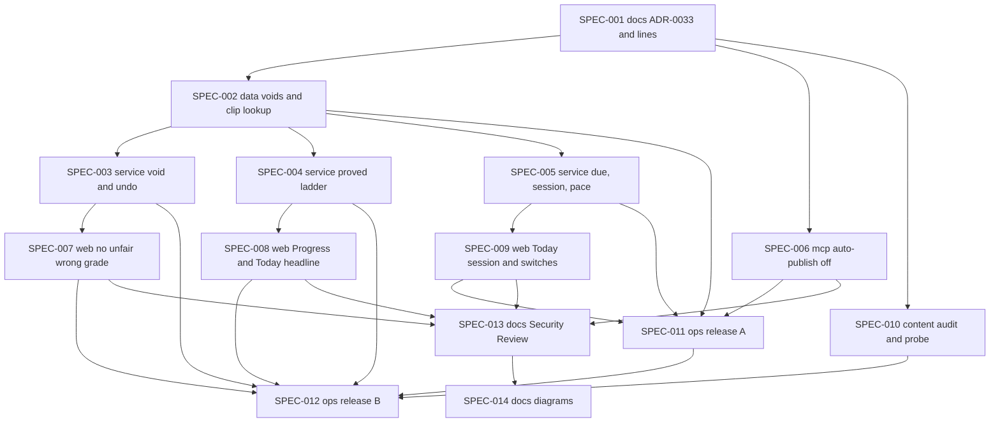

# EPIC Spec Skeleton: Stage 1, trust and measurement

**Date:** 2026-11-09
**Source:** Brainstorm session BRAIN-001 (Quick Cross-Domain EPIC), "Is the Hebrew app built right?" The decision is Option B, staged. This skeleton covers **Stage 1 only**. See [session-context.md](session-context.md) and [full-transcript.md](full-transcript.md), section "Consensus recommendation".
**Handoff target:** SDD `create-initiative` (`c:\Users\BrianNelson\.claude\skills\sdd\assets\modes\create-initiative.md`)
**Status:** Skeleton. `create-initiative` will refine sizing, autonomy levels, and gates.
**Proposed ids (taken by hand, as INIT-037 did, because the kit's numbering tools are missing on this machine):** INIT-038, since INIT-037 is the highest folder. ADR-0033, since ADR-0032 is the highest file and ADR-0029 is expected to go to INIT-032.
**Discipline profile:** `software`. Spec domains follow this repo's set: data, service, web, mcp, content, ops, docs.

---

## 1. EPIC summary and recommended direction

Stage 1 makes the app trustworthy and measurable before anything new is built. It takes back wrong grades the app cannot prove (as a flag, never a delete), stops grading questions that can have more than one right answer, turns listening review back on, makes "due" and pacing honest, replaces "known" with one frozen "proved" ladder counted out of the words he was taught, and stops AI-written units from reaching Today. Three measurements run alongside it with no new subsystem (a day-0 baseline with a held-out probe, a cold check of about 40 words, and an agent's audit of the tutor's Drive folder), judged against pass and fail lines written down before anything ships. Stage 1 is a closed list that must finish within 21 days of Brian's go, and Stage 2 (re-centering the app on the tutor's lessons) is a separate initiative that opens only if the gate in section 4 passes.

---

## 2. Domain decomposition

| Domain | Touched? | Responsibility in Stage 1 |
| --- | --- | --- |
| data | yes | One additive migration: a table of voids that sits beside the answers it covers, and evidence reads that skip voided answers. One way to find a word's clip, used by review, standing, due counts, and every place a listening card is created. The first and last checked-success study day per word and skill, which the ladder needs. |
| service | yes | The void and its true undo (the card is replayed without the voided answer), voids from a report, and the one-time void command. The "proved" ladder at rule version 5. Honest due dates, one 20 to 30 minute session weighted toward typing, and pace gates that read review load instead of "learning" counts. |
| web | yes | No unfair wrong grade in the player: blanks ungraded, fairer wrong buttons, a "My answer was also right" tap, and reports that void. Progress and Today lead with the ladder and show the old and new numbers once. Today offers one session, and side features sit behind switches. |
| mcp | yes | Learner units can no longer publish themselves. Server instructions and tool descriptions stop restating the "known" rule, so they cannot drift from the code again. |
| content | yes | Agent work with no code: the tutor-material audit (an agent reads the Drive folder; Brian does nothing) and the held-out probe (choose, voice, run, score). |
| ops | yes | Two releases. Release A turns listening on, ships the session and the switches, makes word clips, and starts the cold check. Release B is the one announced change: backup, the void run, the history rebuild under rule version 5, the correctness sweep, and the day-0 baseline. |
| docs | yes | ADR-0033 with every pass, fail, and abandon line; deleting the stale `hebrew-worksheet` skill and pausing the author and reviser skills. The two mandatory final specs: Security Review, then Architecture and Design Diagrams. |

---

## 3. Proposed specs

| Spec | Domain | Title | One-line scope | What Brian will see differently | Primary prompt | Blocked by | Effort (h) |
| --- | --- | --- | --- | --- | --- | --- | --- |
| SPEC-001 | docs | ADR-0033 and the pass and fail lines | Records Stage 1's decisions and writes every pass, fail, and abandon line before anything ships, deletes the stale `hebrew-worksheet` skill, and pauses the author and reviser skills. | Nothing in the app. He reads one page and gives his go; the lines must exist before any number moves so they cannot be moved later. | none | — | 3 |
| SPEC-002 | data | Voids beside answers, and one way to find a word's clip | Adds an additive table of voids that every evidence read skips, lets review and due counts find a clip by its text as lessons already do, and creates a listening card only when a word clip exists. | Nothing on its own. It lets a wrong grade be taken back without deleting a row, and lets review see clips the app already stores. | none | SPEC-001 | 6 |
| SPEC-003 | service | Void with a true undo, and the one-time void command | Voids an answer and replays its card so every scheduler field returns to its value before that answer, voids a reported unit's wrong answers, and adds a dry-run-first command for units 12 to 34 and blanks with no English cue. | Nothing on its own. It is the engine behind the "also right" tap (SPEC-007) and the cleanup in SPEC-012. | none | SPEC-001, SPEC-002 | 6 |
| SPEC-004 | service | The "proved" ladder at rule version 5 | Replaces "known" with proved, recalled later, slipping, and not yet asked, per skill, counted out of taught words, with no calendar decay; the lesson tier reads it. | Nothing on its own; SPEC-008 shows it to him. The AI's view of him in the digest and context changes with it. | none | SPEC-001, SPEC-002 | 6 |
| SPEC-005 | service | Due means due today, one session, and pace that reads review load | Moves same-day learning steps to the next study day, sizes one session to 20 to 30 minutes weighted toward typing, and replaces the 40-learning-words and 75% gates with a review-load gate and a later-day production rate. | The due count shows only cards he can be asked today, review stops after about 25 minutes, and more questions ask him to type the Hebrew. | none | SPEC-001, SPEC-002 | 6 |
| SPEC-006 | mcp | Auto-publish off, and tool text that stops restating rules | `put_unit` with `publish: true` saves a learner unit as a draft behind a config switch, and the server instructions and tool descriptions stop restating the "known" rule and its version. | No AI-written lesson can reach Today. Today shows none now, so this turns that into a guarantee rather than a visible change. | none | SPEC-001 | 3 |
| SPEC-007 | web | No unfair wrong grade | Lesson blanks become ungraded reveals in every unit, wrong buttons use review's gloss-overlap check, a "My answer was also right" tap voids a wrong grade, and Report a problem voids that unit's wrong answers. | Blanks no longer mark him wrong, one tap takes back a wrong grade he disagrees with, and reporting a lesson clears its wrong answers. | none | SPEC-001, SPEC-003 | 6 |
| SPEC-008 | web | Progress and Today lead with the ladder | Progress leads with "Understand by ear" and "Say it from English" out of taught words, shows the old, after-void, and new numbers side by side once, and drops the numbers that contradict each other. | Progress says what he can do, in his terms, and shows once why the numbers moved. | none | SPEC-002, SPEC-004 | 5 |
| SPEC-009 | web | Today offers one session, and side features sit behind switches | Today's main action is one session with its length in minutes, and Isaiah, Roots, placement, and the check-in are hidden by config switches without deleting code. | Today shows one "Today's session, about 25 minutes" button, and the side features are gone from Today and the menu. | none | SPEC-001, SPEC-005 | 3 |
| SPEC-010 | content | Tutor-material audit and the held-out probe | An agent reads the Drive class folder and counts usable tutor-written lines per class; a held-out probe of about 20 listening items and 10 English prompts is chosen, voiced, taken, and scored by a fixed comparison. | Nothing in the app. He takes one short check of about 10 minutes, and the audit asks nothing of him. | none | SPEC-001 | 4 |
| SPEC-011 | ops | Release A: listening on, one session, and the cold check | Backs up, deploys SPEC-002, SPEC-005, SPEC-006, and SPEC-009, makes a clip for every taught word, and records about 40 cold-check words so that their first review asks are the check. | Listening questions come back in review, Today shows one session, and about 40 words he may already know appear as a quick check. | none | SPEC-002, SPEC-005, SPEC-006, SPEC-009 | 3 |
| SPEC-012 | ops | Release B: one announced change | Backs up, deploys SPEC-003, SPEC-004, SPEC-007, and SPEC-008, runs the void (dry run, then apply on Brian's approval), rebuilds history under rule version 5, runs the correctness sweep, and records the day-0 baseline. | His numbers move once, with the reason and the old numbers beside the new, and answers from lessons 12 to 34 and from unfair blanks stop counting against him. | none | SPEC-003, SPEC-004, SPEC-007, SPEC-008, SPEC-010 (probe step only), SPEC-011 | 4 |
| SPEC-013 | docs | Security Review | Reviews every code spec: the learner-facing void, the void command, the config switches, the auto-publish switch, and the audit's read of Drive. | Nothing. It is needed because Stage 1 adds an action that changes his record, plus two production data jobs. | none (template default: security-specialist) | SPEC-002, SPEC-003, SPEC-004, SPEC-005, SPEC-006, SPEC-007, SPEC-008, SPEC-009 | 3 |
| SPEC-014 | docs | Architecture and Design Diagrams | Diagrams of the answer, void, and replay flow, the clip lookup, the ladder states, and the order of the two releases and the one-time jobs. | Nothing. It is needed so Stage 2 starts from an accurate picture, including the rule that voiding comes before any archive. | none (template default: aws-solutions-architect-aiml, a poor fit for this Go and SQLite app) | SPEC-013 | 2 |

> One spec is one domain. Sizes target about 200 to 800 lines of change, or 2 to 6 hours. SPEC-002, SPEC-003, SPEC-004, SPEC-005, and SPEC-007 sit at the 6-hour ceiling; `create-initiative` should split any of them that sizes over 6 hours into two specs of the same domain. The primary prompt is `none` throughout because that is this repo's convention (INIT-037, "Disclosures"); `create-initiative`'s prompt selection may set one.

### Count, effort, and timeline

- **Spec count: 14.** That is twelve work specs plus the two mandatory final specs. The brief asked for about 12 in total. Merging further would break either the one-domain rule or the 6-hour ceiling, and every spec maps to an item on the closed list (see the traceability table below), so the count reflects the domain split, not added scope.
- **Total effort:** 60 hours, of which about 41 hours are code (SPEC-002 to SPEC-009).
- **Critical path:** SPEC-001, then SPEC-002, then SPEC-003, then SPEC-007, then SPEC-013, then SPEC-014, which is 26 hours. Realistic: 26 hours times 1.3 is about 34 hours, or about 6 calendar days at 6 productive hours a day.
- **Release timing:** Release A (SPEC-011) can land around day 4 or 5, which gives Brian a visible change in week 1. Release B (SPEC-012) can land around day 6. The Stage 1 exit needs a week of use after release B, so Stage 1 can close around day 13 to 15. **Release B must land by day 14**, or the 21-day limit cannot be met.

### Two releases

- **Release A (week 1):** SPEC-002, SPEC-005, SPEC-006, and SPEC-009, shipped by SPEC-011. None of these changes what any Progress number means. With no void rows yet, the void-aware reads in SPEC-002 change nothing. Listening coming back changes his numbers only through real answers.
- **Release B (week 2):** SPEC-003, SPEC-004, SPEC-007, and SPEC-008, shipped by SPEC-012. Together they are the one announced change: the void, the ladder, and the side-by-side numbers land on the same day.
- The blanks fix (SPEC-007) waits for release B. That costs little, because Today offers review only since INIT-037 SPEC-001, and review has no sentence blanks (`internal/activity/types.go:15-23` lists only meaning picks, typing, and dictation).

### Traceability: closed list to specs

| Stage 1 item (transcript, "Consensus recommendation") | Specs |
| --- | --- |
| 1. Void unprovable wrong answers as a flag with a reason, before any archive | SPEC-002, SPEC-003, SPEC-012 |
| 2. "My answer was also right" as a true undo; reporting a lesson voids its wrong answers | SPEC-003, SPEC-007 |
| 3. Stop grading word-choice blanks everywhere; lessons use review's gloss-overlap check | SPEC-007 |
| 4. Listening on: a clip for every taught word, and no listening card without one | SPEC-002, SPEC-011 |
| 5. Honest due and pacing | SPEC-002 (clipless cards leave "due"), SPEC-005 |
| 6. One frozen "proved" ladder, shown once beside the old numbers, then frozen for 90 days | SPEC-001 (definition and freeze date), SPEC-002 (study-day span), SPEC-004, SPEC-008, SPEC-012 (rebuild) |
| 7. Auto-publish off; Today a capped session weighted toward production; side features behind switches; delete the stale skill | SPEC-006, SPEC-005, SPEC-009, SPEC-001 |
| Measurement: day-0 baseline and held-out probe | SPEC-012 (baseline), SPEC-010 (probe) |
| Measurement: cold check of about 40 words | SPEC-011 (run), SPEC-004 (passes count as "recalled", never "proved") |
| Measurement: tutor-material audit | SPEC-010 |
| Measurement: pass and fail lines written before Stage 1 ships | SPEC-001 |
| Mandatory final specs | SPEC-013, SPEC-014 |

### Dependency graph

**Parallel tracks after SPEC-002.** The void track (SPEC-003, then SPEC-007), the ladder track (SPEC-004, then SPEC-008), and the session track (SPEC-005, then SPEC-009) can run side by side. SPEC-006 and SPEC-010 need only SPEC-001.

**Files that more than one spec edits, so land them in sequence:**
- `internal/brief/build.go`: SPEC-004 changes what `TierFor` reads, and SPEC-005 changes `PaceFor`.
- `internal/db/learner.go`: SPEC-002 adds the study-day span, and SPEC-004 replaces the second copy of the known rule.
- `internal/web/views/today.templ`: SPEC-008 changes the headline, and SPEC-009 changes the main action.
- `internal/evidence`: SPEC-003 adds the void, and SPEC-005 may move the next-due rule into the recorder.

### Spec notes (files, what each removes, scope out, key acceptance)

**SPEC-001 · docs · ADR-0033 and the pass and fail lines**
- Writes `docs/decisions/ADR-0033-stage-1-trust-and-measurement.md`. It decides: a void is a flag with a reason, never a delete; an answer the app cannot prove wrong records nothing; no graded word-choice blanks; no AI-written sentence is graded, and no judge model is built; the "proved" definition (right on 3 study days spanning at least 7 days, latest answer right, no calendar decay) and the date its 90-day freeze ends; which words count as taught; which readers use "proved" and which use "recalled or proved"; auto-publish off; units are archived, never deleted; the freeze list.
- Writes the pass and fail lines in the ADR or a sibling file: the Stage 1 exit, the gate to Stage 2, the "also right" stop line, the two success numbers, the guardrail measures, what "the probe rose" means (set in advance; on a 30-item probe only a gain of about 7 items is readable), and the abandon conditions. It names the existing validator rule ids that count as correctness rules for the exit sweep.
- Writes down the one-command local Docker check (formatting, `templ generate` with a drift check, vet, affected tests) as a documented command, with no new script.
- **Removes:** `.cursor/skills/hebrew-worksheet/` (the skill still tells agents to call `create_plan`, which no longer exists). Marks `.cursor/skills/hebrew-lesson-author/SKILL.md` and `.cursor/skills/hebrew-lesson-reviser/SKILL.md` paused for Stage 1. Marks INIT-036 SPEC-008 to SPEC-012 (the sound-pair queue) deferred.
- **Scope out:** any code.

**SPEC-002 · data · Voids beside answers, and one way to find a word's clip**
- `migrations/023_answer_voids.sql`, additive: one table holding the voided attempt, the `review_log` row and confusion row it covers, a reason (`unit_12_34`, `no_cue_blank`, `also_right`, `report`), the actor, a batch id, and the time. No existing row is edited or removed. A separate table avoids rebuilding `attempts`, whose `source` column is a fixed CHECK list (`migrations/015_attempt_source_self.sql:12`).
- Evidence reads skip voided answers, with an include-voided option for audits and for the one-time comparison in SPEC-008: `internal/db/learner.go` (the evidence reader that sets `SuccessDays` at about line 421), `internal/db/evidence.go`, and the later-day and confusion queries.
- The same reader also returns the first and last checked-success study day per word and skill, for the ladder's "spanning a week".
- One clip lookup: `ActivityPool` (`internal/db/activity.go`, the select at line 34) and `CountLexemesWithAudio` (`internal/db/standing.go:71-81`) find a clip by `lexemes.audio_id` or by an `audio_assets` row for the exact text, as `internal/db/taught.go:212` already does. Today review reads only `lexemes.audio_id` (`internal/session/ask.go:72`), which nothing ever sets (`internal/web/learn.go:712-714`). This is a second cause of the listening trap that the brainstorm did not name.
- Every card-creation path creates a listen card only with a word clip: `internal/db/lesson.go:825-835`, `internal/db/cards_new.go` (`CreateNewCards`), and `insertCardTx` in `internal/db/evidence.go`. Due counts leave out listen cards with no clip.
- **Acceptance:** with 0 void rows every reader returns what it returns today; a voided fixture answer is invisible to every learner reader; on a fixture where clips exist only in `audio_assets`, review asks listening.

**SPEC-003 · service · Void with a true undo, and the one-time void command**
- `internal/evidence` gains a void that writes the void row, voids the answer's confusion row, and replays the card from its remaining `review_log` rows through `internal/fsrs`. Fuzz is off (`internal/fsrs/review.go:30`), so the replay is deterministic. `review_log` keeps rating and time but not the card's prior state (`migrations/001_init.sql:107-115`), which is why the undo is a replay.
- A unit void for Report a problem, used by SPEC-007.
- `hebrew void-evidence` in `cmd/hebrew`, modeled on `cmd/hebrew/backfill_spell.go`: a dry run by default that prints counts by word and skill, `--apply` only with `--backup-taken` (after `hebrew backup --to`), and an undo by batch id. It selects answers from units 12 to 34 and lesson blanks whose step had no English cue.
- **Acceptance:** after a void, the card's state, stability, difficulty, due date, reps, and lapses equal their values before that answer, and its confusion row no longer counts. A void followed by its undo restores the card exactly. The dry run on a production copy prints counts and writes nothing.
- **Scope out:** the tap and the report button (SPEC-007), and running the command (SPEC-012).

**SPEC-004 · service · The "proved" ladder at rule version 5**
- `internal/learner/state.go` (the constants at lines 56 to 74, `IsKnown` at 157, `StateOf` at 176) and `internal/learner/standing.go`: per word and skill, the states are proved, recalled later, slipping, and not yet asked, counted out of taught words. FSRS recall probability stays for scheduling only. The internal scheduler states stay as they are.
- Rule version 5 (`internal/jobs/daily.go:40`). History is rebuilt by the existing `hebrew history rebuild` (`cmd/hebrew/history.go`), run in SPEC-012.
- The rule-4 function stays callable for 14 days so SPEC-008 can show the old number beside the new one.
- `TierFor`'s input (`internal/brief/build.go:384`) reads "recalled or proved in any skill", so cold-check passes lift his practice level without counting as proved.
- `internal/db/learner.go:566-600` holds a second copy of the known rule (`skillOldKnown`). This spec replaces it with the learner package's rule, or `create-initiative` moves that edit into SPEC-002 to keep one domain per spec.
- **Acceptance:** a word right on 3 study days spanning 7 or more days, with the latest answer right, is proved however late its card is; one right answer after the taught day is "recalled later", never proved; a voided answer counts for nothing.

**SPEC-005 · service · Due means due today, one session, and pace that reads review load**
- A review whose next due date falls inside the same study day is due at the next study-day cutoff (`studyday.DueCutoff`, `internal/studyday/studyday.go:150`), applied where the recorder schedules (`internal/evidence/recorder.go`, `internal/fsrs/review.go`). Existing cards due minutes after their last review count as due at the next cutoff.
- One session sized to a 20 to 30 minute budget from his recent seconds per answer, in place of the fixed `SessionCap = 20` (`internal/session/mix.go:18`). The skill choice prefers typing from English (`type_it`) and dictation where a clip exists.
- `PaceFor` (`internal/brief/build.go:425`) drops the more-than-40-learning gate and the under-75%-Good-or-Easy gate (`reviewAccuracy`, `internal/brief/progression.go:228`) for a review-load gate (reviewable cards due at the start of the day under about one day's budget) and a later-day production rate (at least 80% over the last 50 delayed answers, with Hard counted as right). `ErrReviewFirst` (`build.go:154-162`, returned at `:600`) counts reviewable cards only.
- **Acceptance:** on a copy of learner 1's cards, the due count drops by the clipless listening cards and the same-day steps; one session ends within the budget; a fixture with 88 learning words and a light review load is not forced to consolidate.

**SPEC-006 · mcp · Auto-publish off, and tool text that stops restating rules**
- `publishLearnerDraft` (`internal/mcp/tool_publish_unit.go:134`) and `AutoPublishLearner` (`internal/mcpstore/learner.go:136`): while the switch is off, `put_unit` with `publish: true` on a learner scope saves a draft and returns a note naming ADR-0033, and `publish_unit` refuses learner units. The switch is a config value (`internal/app` Config, read in `cmd/hebrew/config.go`), so one change undoes it.
- **Removes:** the restated rule text in the server instructions (`internal/mcp/server.go`) and the tool descriptions (`internal/mcp/tools.go`; the Technical Architect found the `get_context` description at line 628 already wrong). They point to the `ruleVersion` each response carries instead, so a rule change no longer needs a matching text edit.
- **Scope out:** generating docs from the rule catalog (Stage 2).

**SPEC-007 · web · No unfair wrong grade**
- In `internal/web/lesson.go`, a lesson `cloze` that would show buttons uses the existing reveal for fewer than three buttons instead, in every unit, finished units 1 to 11 included. The render and post paths (`askChoiceCount`) still agree.
- Wrong buttons drop an option with `activity.GlossesOverlap` (`internal/activity/distractors.go:76`) instead of the exact `glossKey` match (`lesson.go:1678`), in `wideChoices` (`:1386`) and `lessonChoices` (`:1557`).
- To honor "no AI-written sentence is ever graded", `order` steps and multi-word `listen_pick` steps in AI-written units become ungraded too, because their answer key is an AI-written sentence. This is a reading of the decision; see open question B9.
- A test pins that review has no sentence-blank kind (`internal/activity/types.go:15-23`).
- A "My answer was also right" tap on the feedback after any wrong graded answer, in lessons and in review (`internal/web/learn.go`, `internal/web/views/player.go`). It calls SPEC-003's void with reason `also_right`, only for the signed-in learner's own answer, and is CSRF-checked. Templates are regenerated with `templ generate`, never edited by hand.
- The Report a problem handler, which calls `ReportUnit` (`internal/db/learner_publish.go:296`), also calls SPEC-003's unit void.
- **Acceptance:** across 50 seeds, no lesson blank writes an attempt; after a tap, the card equals its state before the answer (the SPEC-003 test, run through the handler); a second learner's answer cannot be voided.

**SPEC-008 · web · Progress and Today lead with the ladder**
- `internal/web/progress.go` (`serveProgress` at line 69, `fillSkillPanel` at 263, `fillOverview` at 316), `internal/web/views/progress.templ`, and `internal/web/views/today.templ`.
- The top rows are "Understand by ear" and "Say it from English": proved, recalled later, not yet asked, and slipping, out of N taught, each count clickable to its words. Until tutor words are recorded, the label says "out of words the app has taught you". Reading and spelling sit below as smaller rows. Every percentage carries its count.
- A one-time "what changed" panel, shown for 14 days: the old number (rule 4, voided answers included), the number after the void, and the number under the ladder, with a one-line reason. The explanation sentence states the whole rule. The history chart is drawn under one rule version only.
- Today's "Words you know" becomes the "Say it from English" proved count.
- **Removes from the headline:** the any-skill count, placement estimates, band verdicts under 30 answers, and the weekly "gained N words" sentence.
- A screenshot of the new Progress page goes in the completion summary.

**SPEC-009 · web · Today offers one session, and side features sit behind switches**
- Today's main action is "Today's session, about N minutes", from SPEC-005's session size, counting reviewable cards only (`internal/web/shell.go:72-86`, `internal/web/views/today.templ`).
- Config switches, off by default: the Roots and Isaiah menu links and routes (`shell.go:191-202`, `:234-268`), and the placement start and the check-in (`shell.go:79-86`, `:594-635`). No code is deleted, and each switch is undone by one config change.
- Multi-user and teacher features, and the sound-pair queue, are frozen by SPEC-001 as "no new work" (assumption: they have no surface on Brian's path).
- A screenshot of the new Today goes in the completion summary.

**SPEC-010 · content · Tutor-material audit and the held-out probe**
- **Audit.** An agent that will build nothing in Stage 2 reads the Drive class folder (about 85 class docs, per the INIT-012 source line) through the Google Drive connection. For the last 10 classes it counts tutor-written lines and Brian's typed lines separately, lines with vowel points, words missing from the lexicon (`lookup`), and corrections, and records whether each class loads without Brian's help. It writes counts only, with no tutor text copied into the repo until Brian decides on reuse, and states pass or fail against SPEC-001's line. Brian does nothing.
- **Probe.** About 20 normal-speed listening items and 10 English prompts, never practised and never AI-written: tutor lines held out of any future class pack if Brian allows private reuse, otherwise exact lexicon entries. Clips come from `generate_audio`. Scoring is a fixed comparison (unpointed, with the same normalization as `fsrs.GradeTyped`), and English prompts are graded on the target words only. The dated result is stored outside the learner model, so the items stay unpractised. Take it before release B, and before release A if the items are ready.
- **Scope out:** loading any class into the app (Stage 2).

**SPEC-011 · ops · Release A: listening on, one session, and the cold check**
- Backup first (`hebrew backup --to`). Migration 023 is a `db_migration` gate item. Deploy by pinning the image in `home_k3` (the image auto-updater is out of sync) and check `/version`.
- Make a word clip for every taught word, and for the about 40 cold-check words, with `generate_audio` texts. Check the ElevenLabs balance first.
- Then record the cold-check words (taken from tutor material and the mistakes bank, all ones the app calls unseen or learning) with `record_taught_words`, dated within 30 days (`maxTaughtAge`, `internal/evidence/taught.go:14`), and leave a dated coach note. Clips come first, because a taught word gets a listening card only if it has a clip.
- Confirm that `CountReviewSkippedNoAudio` (`internal/learner/audit.go:244`) is 0, that one listening review card plays, and that `put_unit` with `publish: true` saves a draft. Run `scripts/smoke-v3.sh` if it still fits.
- Gates: `db_migration`, `deploy`, `production_content_write`, and voice-credit cost.

**SPEC-012 · ops · Release B: one announced change**
- In this order: backup; deploy SPEC-003, SPEC-004, SPEC-007, and SPEC-008; run `hebrew void-evidence` as a dry run and record the counts by word and skill; get Brian's approval; apply; rebuild with `hebrew history rebuild --learner 1 --apply` under rule version 5; confirm with `hebrew audit` that no day is stamped below rule 5.
- No unit is archived in Stage 1. The void runs before any archive could ever happen, because the void needs `unit_id`.
- Run the INIT-037 SPEC-009 read-only sweep, restricted to SPEC-001's correctness rules, over everything reachable from Today.
- Record the day-0 baseline from the rebuilt history for the day Brian gave his go, so the baseline predates every Stage 1 change: the three side-by-side numbers, the share of words taught 14 or more days ago that are proved in "Say it from English", and the guardrail measures. Start the 90-day freeze and the one-week exit window.
- Gates: `deploy`, `production_data_write`, and Brian's approval of the void counts.

**SPEC-013 · docs · Security Review**
- Reviews SPEC-002 to SPEC-009. The void tap: own answers only, CSRF, and no way to name another learner's attempt id. The read-only MCP token cannot void. The void command: backup required, dry run by default, and no answer text printed. The switches: safe defaults, and `publish_unit` cannot bypass the auto-publish switch. The audit's Drive read: read-only, counts only, and no tutor text or Brian's typed lines committed to the repo.
- Measurement integrity: an "also right" tap voids and never credits, and the stop line (more than 1 tap per 50 graded items in a week) catches overuse.
- Blocks completion if any Critical or High finding is unresolved.

**SPEC-014 · docs · Architecture and Design Diagrams**
- Diagrams of the answer, void, and card replay flow; the clip lookup and every place a listening card is created; the ladder states per skill; and the order of the two releases and the one-time jobs, including "void before archive".

---

## 4. Stage 1 acceptance and the gate to Stage 2

### Stage 1 exit

All of these must hold. They are checked at `complete-initiative`, at least 7 days after release B, by an agent that built none of the specs.

1. **Zero graded steps reachable from Today fail a correctness rule.** This uses the INIT-037 SPEC-009 read-only sweep, restricted to the rule ids SPEC-001 names.
2. **At most one "My answer was also right" tap per 50 graded items** over the 7 days before the check. It is counted from void rows with reason `also_right` against graded attempts, so no new logging is needed.
3. **Brian answers yes to "Do I trust Today now?"** The answer is recorded with the date, next to his study minutes for that week.
4. **Time:** all of it within 21 days of Brian's go.

These mechanized checks must also hold, and the spec acceptance criteria prove them:
- After a void, a card equals its state before the answer.
- No listening card exists without a word clip, and `CountReviewSkippedNoAudio` is 0.
- Every daily snapshot is stamped rule version 5.
- `put_unit` with `publish: true` on a learner scope saves a draft.
- No lesson blank writes an attempt.

### Gate to Stage 2

Stage 2 is a separate initiative. It opens only when all of these hold, and only with Brian's explicit go:

1. The Stage 1 exit is met.
2. **The tutor-material audit passes:** about 150 or more usable tutor-written lines, and 5 of the last 10 classes loadable without Brian. Both are required.
3. **Brian decides whether the tutor's text may be reused privately.** He may ask the tutor.
4. **Enough evidence under the new rules:** about 150 graded answers, with the "also right" rate under the stop line, and at least 50 delayed reviews, and at least one week after release B, whichever comes later.
5. No abandon condition in section 6 has fired.

**If the audit fails:** Stage 2's import is not built. Brian adds words through the existing tools (`record_taught_words`), and practice stays review plus ungraded stories (transcript, Round 4, group response 1).

### Success measures (written into SPEC-001)

- **Primary:** study minutes (64 a week now, at least 120 by week 4); the share of words taught 14 or more days ago that are proved in "Say it from English"; the monthly held-out probe.
- **Guardrails:** study days per week; the lesson abandon rate (computable from `lesson_runs.started_at` and `finished_at`, with no new logging); the "also right" tap rate; reviewable cards due at the start of the day.

---

## 5. Deferred to Stage 2, and the provisional Stage 2 outline

### Deferred to Stage 2 (tempting, and deliberately not in Stage 1)

The Devil's Advocate's dissent is that the other specialists' conditions keep growing Stage 1 into the treadmill it is meant to stop. These items were raised in the session and are held out of Stage 1 on purpose.

| Item | Raised by | Why it waits |
| --- | --- | --- |
| A robot run-through that plays every graded item before Today | QA Advocate | Stage 2 produces the class packs it would check. The consensus moved it to Stage 2. |
| One question engine: merge the lesson and review button engines | Technical Architect, QA Advocate | A refactor. Stage 1 only switches lessons to review's gloss-overlap check. |
| Generate the authoring guide, skills, and tool descriptions from the rule catalog, with a test | Technical Architect, QA Advocate | Stage 1 only deletes restated rule text (SPEC-006). |
| Rule classes (correctness, teaching shape, mechanical), rule-set version stamps, a nightly sweep | QA Advocate | New machinery. SPEC-001 lists the correctness rule ids by hand for the exit sweep instead. |
| Buttons frozen per published revision, an ambiguity detector, a judge model | QA Advocate | Stage 1 stops grading blanks instead. The judge model is rejected in both stages. |
| New logging: playback speed, replay count, number of options, a near-miss flag, a disputed flag, the step where a lesson stopped | Data Analyst | New logging is out of Stage 1. Every Stage 1 line is computable from existing columns and void rows. |
| A per-step exclusion list and a regression suite built from "also right" taps | QA Advocate | Stage 1 counts taps; it does not learn from them yet. |
| Stop creating reading and spelling cards, and credit those skills from production answers | Data Analyst, Technical Architect | Not on the closed list. It changes the card model. |
| A speech-to-text round trip on new clips | QA Advocate (reservation) | Not on the closed list. See open question A4. |
| A pre-push hook script for the local Docker check | Technical Architect | SPEC-001 writes the command down. Building and wiring the hook is dev-loop work. |
| A scripted post-deploy smoke test, and a repair of the image auto-updater | QA Advocate, Technical Architect | Stage 1 runs the smoke by hand and pins the image by hand. |
| A closing summary at the end of Today's session | Product Strategist | Not on the closed list. Today shows the session length in Stage 1. |
| Fitting FSRS weights, or lowering desired retention | Data Analyst | Needs about 1,000 delayed reviews and a calibration check first. |
| Within-learner experiments | Data Analyst | Need about 120 words per arm over 8 to 10 weeks. |
| A self-rating after each tutor class, and a weekly note for the tutor | Product Strategist | Part of the "AI as tutor" work in Stage 2. |
| Archiving units 12 to 34, and retiring the unit pipeline | All | Stage 2, after the void, and after two to three weeks of using the new session. |
| Deleting placement, Isaiah, Roots, or multi-user code | Product Strategist | Stage 1 freezes them behind switches. Deletion, if ever, is a Stage 2 decision. |

### Stage 2 outline (separate future initiative, not to be created until the gate passes)

**Provisional.** This list is a sketch for planning. It is not a spec set, and nothing here should be created before the gate in section 4 passes and Brian gives his go.

Direction, from the transcript:
- An agent imports each class from Drive into a class pack. The tutor's lines and Brian's typed lines are stored in separate fields, never split on punctuation.
- Graded practice uses trusted keys only, starting with dictation, "which line did you hear", and sentence order. Typed production is graded on the target words only, compared without vowel points, accepting both full and short spellings.
- The tutor's reading texts and AI stories built from taught words are never graded. A comprehension question is graded only when its answer is a span of the story.
- The AI acts as tutor: where he is, what to practise next, and a weekly note for the tutor.
- One question engine. The authoring docs are generated from the rule catalog. Replays, playback speed, and the number of options are logged.
- The unit pipeline retires after two to three weeks of use. Units are archived, never deleted.

| Provisional spec | Domain | Provisional title |
| --- | --- | --- |
| P-01 | docs | ADR: class packs, trusted keys, and what the AI may write |
| P-02 | data | Class pack tables: a tutor lesson record and a sentence bank with separate tutor and learner text fields, source, token-to-word links, target, and a retired time |
| P-03 | mcp | Import a class from Drive into a pack, with per-item checks; add and retire single items |
| P-04 | content | Backfill the last 8 to 10 classes into packs |
| P-05 | service | Sentence items as a new kind in the existing review and session code (dictation, "which line did you hear", sentence order) |
| P-06 | service | Typed production graded on target words, unpointed, with full and short spellings |
| P-07 | web | Class practice inside Today's session, and an ungraded reading view with span-graded comprehension |
| P-08 | data | Log playback speed, replays, and the number of options per answer |
| P-09 | mcp | Authoring docs and tool descriptions generated from the rule catalog, with a test |
| P-10 | service | The weekly note for the tutor in the digest |
| P-11 | ops | Archive units 12 to 34, then retire the unit pipeline after two to three weeks of use |
| P-12 | docs | Security Review, and Architecture and Design Diagrams (as the convention in open question B1 settles) |

---

## 6. Initiative-level constraints

### Process guardrails (part of the decision, not advice)

- **One initiative in flight at a time, each with Brian's explicit go.** See open question A2: at least ten initiative files still show a status other than complete.
- **Every spec carries a line saying what Brian will see differently.** Where the change is visible, the completion summary includes a screenshot. Where it is not, the spec says why it is still needed, as the table in section 3 does.
- **Complaints go on one list that Brian reviews weekly, after a 24-hour cooling-off.** A same-day "fix this" goes on the list; it does not become a spec.
- **A rule budget:** a new validator rule retires an old one. Stage 1 adds no validator rule. Ungraded blanks are a player change, not a rule.
- **Delete first:** every spec lists what it removes. SPEC-001 removes the stale skill, SPEC-006 removes restated rule text, SPEC-008 removes contradicting numbers, and SPEC-009 hides side features.
- **No agent assesses its own work.** The audit, the exit check, and the Security Review are done by agents that built none of the specs they judge. Any plan-quality score is labelled a self-review.
- **A one-command local Docker check runs before every push.** SPEC-001 writes the command down.
- **Generated code is never edited by hand.** Every `*_templ.go` change comes from `templ generate`.

### Data safety and decision rules

- **A void is a flag with a reason, never a delete.** No `attempts`, `review_log`, or `confusion_misses` row is removed or edited. A void can be undone by batch.
- **Voiding runs before any unit is archived,** because the void needs `unit_id`. No unit is archived in Stage 1.
- **Units are archived, never deleted.** Deleting a unit row deletes its `unit_revisions`, `lesson_items`, `lesson_runs`, and `unit_reports` (`migrations/001_init.sql:67`, `:77`, `:123`; `migrations/008_learner_model.sql:97`). Attempts and exposures only lose their `unit_id` (`migrations/006_evidence.sql:15`, `:37`).
- **A backup comes before every production data job,** and migrations are additive.
- **The ladder ships as one announced change,** shown beside the old numbers, then frozen for 90 days. Cold-check passes count as "recalled", never "proved".
- **No AI-written sentence is ever graded,** including probe items. No judge model is built.
- **Switches, not rewrites:** each freeze and the auto-publish stop are undone by one config change or one commit.

### Fallback (Option D) and abandon conditions

Stop building, make the app review-only, and move tutor material to Anki or the worksheet player in `Aharon's code/` if any of these happens:
- Stage 1 is not finished within 21 days of Brian's go;
- a second initiative opens before Stage 1 closes;
- Brian's study time has not reached about 120 minutes a week by week 4;
- the monthly held-out probe is flat for two months.

---

## 7. Open questions and assumptions

### A. Brian must answer before the initiative opens

1. **His go, and his agreement to the guardrails.** This includes the weekly complaints list with a 24-hour cooling-off, which means same-day "fix this, fix that" requests stop becoming work. It also means deciding where that list lives; `sdd/complaints.md` is a suggestion.
2. **The other open initiatives.** INIT-010, INIT-011, both INIT-014 folders, INIT-023, INIT-024, INIT-028, INIT-031, INIT-032, and INIT-036 still show a status other than complete. Under "one initiative in flight", each must be closed, paused, or marked deferred before INIT-038 opens. INIT-036's sound-pair specs are the queue this decision freezes. INIT-032 SPEC-005 (an `accept` list on a cloze) overlaps SPEC-007. The recommendation is to pause all of them, with one line each.
3. **Private reuse of the tutor's text.** It is needed for the Stage 2 gate, and sooner if the probe uses tutor lines. He should also confirm who "Aharon" is (the session assumes the tutor Aaron).
4. **A speech-to-text check on the new clips.** The QA Advocate's reservation is that word clips put a large batch of unchecked text-to-speech audio into the goal skill. It is not on the closed list. The recommendation is to ship the clips without it, and make it the first content-quality item in Stage 2 if a Hebrew speech-to-text service is cheap and available.
5. **The pace and tier gate change touches `internal/brief`, which Stage 2 plans to retire.** It is on the closed list, so this skeleton keeps it in SPEC-004 and SPEC-005. Brian may prefer to drop it under "delete first".

### B. `create-initiative` must decide

1. **The Security Review and Diagrams specs.** INIT-036 and INIT-037 did not include them. INIT-012 ran them as completion phases 3.5 and 3.6. The current `create-initiative` mode says not to add them as specs: they now run as `complete-initiative` Phase 3.5 and Phase 3.6 (ADR-0060, `create-initiative.md` lines 540 to 564). This skeleton includes them as SPEC-013 and SPEC-014 because the brainstorm handoff required it. `create-initiative` should confirm which convention applies and, if it is the phases, drop both specs and keep their scope notes as phase input.
2. **The exact probe items.** They must not be AI-written, must be held out of all practice, must be voiced at normal speed, and must be scored by a fixed comparison. English prompts are graded on target words only. SPEC-001 fixes in advance what "the probe rose" means.
3. **How the cold check is delivered without a new subsystem.** The recommendation is `record_taught_words` for about 40 words from the tutor material and the mistakes bank, then normal review, so their first asks are the check. Count only typed and listening answers, because a first ask may be a multiple-choice pick. Passes show as "recalled later" under the ladder and cannot be proved from one sitting. The alternative is a fixed check set in review with its own source value. That is new code and a table rebuild (the `attempts.source` CHECK list, `migrations/015_attempt_source_self.sql:12`), and it would add a spec.
4. **How the probe is delivered, and what "scored by code" means.** The recommendation is an agent-led sitting with clips from `generate_audio`, Brian's typed answers, and a fixed comparison (unpointed, the `fsrs.GradeTyped` normalization), with a dated result kept outside the learner model. Two alternatives were rejected: a shared probe unit, because a lesson creates cards and logs evidence, so the items would become practice; and an in-app check mode, which is new code.
5. **The timing of the cold check against "the numbers move once".** The cold check needs listening, so it runs after release A, and its results first show under the ladder in release B. Because passes only ever count as "recalled", they never move the frozen "proved" numbers. Confirm that this satisfies the Devil's Advocate's condition that voiding, the ladder, and cold-check seeding land as one change.
6. **The audit pass line (settled).** Both counts are required: about 150 or more usable tutor-written lines, and 5 of the last 10 classes loadable without Brian. SPEC-001 writes this down as given.
7. **Which words count as taught.** ADR-0032 D1 counts any word with a card, but placement also creates cards (`internal/db/placement.go:280`). The recommendation is ADR-0032 D1 minus cards that only placement created.
8. **Which readers use "proved" and which use "recalled or proved".** The recommendation is that the headline reads "proved", and the tier and `knownLexemes` read "recalled or proved", so cold-check passes lift his practice level.
9. **"No AI-written sentence is ever graded" in finished units 1 to 11.** SPEC-007 reads this as also making `order` and multi-word `listen_pick` steps ungraded in AI-written units, which slightly widens item 3. If Brian prefers the narrower reading (blanks only), drop that line from SPEC-007.
10. **The correctness rule ids for the exit sweep.** SPEC-001 lists them by hand, because rule classes are deferred to Stage 2.
11. **The second copy of the known rule** (`skillOldKnown`, `internal/db/learner.go:566-600`). Either SPEC-004 edits it, or the edit moves into SPEC-002 to keep one domain per spec.
12. **Finding "blanks with no English cue" in past answers.** Attempts store `unit_id`, `activity`, and `prompt` but no step index, so SPEC-003 must match each lesson cloze answer to its step in the unit revision. If that match is unreliable, the fallback is to void every wrong lesson cloze answer.
13. **The local Docker check.** No script exists: `scripts/` holds only `check-image-name.sh` and `smoke-v3.sh`. The recommendation is that SPEC-001 writes the one command down, and that Brian confirms a documented command satisfies the guardrail until Stage 2.
14. **Security Review timing.** SPEC-013 is listed last, but release B writes to production data. `create-initiative` may make SPEC-012 wait for SPEC-013.
15. **Sizing.** SPEC-002, SPEC-003, SPEC-004, SPEC-005, and SPEC-007 are at the 6-hour ceiling. Split any that sizes over.

### C. Assumptions

- Today offers review only (since INIT-037 SPEC-001), and finished units 1 to 11 are reachable only as past lessons.
- Multi-user and teacher features have no surface on Brian's path, so freezing them means "no new work", written in SPEC-001, with no switch.
- The ElevenLabs balance covers clips for every taught word (on the order of 110 to 250 words), the cold-check words, and about 30 probe items.
- Deploys need a manual image pin in `home_k3`, because the image auto-updater is out of sync.
- Brian studies on at least 4 days in the week after release B, so the exit's tap rate is measurable.
- The 21-day clock starts on the day Brian gives his go for INIT-038.
- The Google Drive connection can read the class folder. If it cannot, the audit fails as "not loadable without Brian", which is itself a gate result.

---

## 8. Handoff note

Run **SDD `create-initiative`** (`c:\Users\BrianNelson\.claude\skills\sdd\assets\modes\create-initiative.md`) with this skeleton as the starting spec set, and set the initiative's **Source** to **BRAIN-001** ([session-context.md](session-context.md), [full-transcript.md](full-transcript.md), and this file). `create-initiative` will assign the `INIT-###` id (INIT-038 is proposed), finalize domains and sizing, tag `autonomy_level` and `gate_action`s, build the dependency graph, and write the initiative and spec files.

Before writing specs, resolve the questions in 7A with Brian, and settle 7B1 (whether Security Review and Diagrams are specs or completion phases). Carry section 4 into the initiative as its "Done when" and gate, section 6 into its constraints, and section 5 into a "Deferred to Stage 2" section, so the closed list stays closed. Do not create the Stage 2 initiative until the gate passes.
