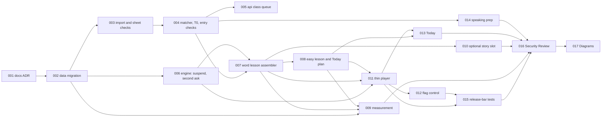

# EPIC Spec Skeleton: Stage 2, lessons that teach (word lesson and easy lesson)

**Date:** 2026-11-10
**Source:** Brainstorm session **BRAIN-002** (Product / Feature, Standard depth), "Lesson types done right". The decision is Option D, amended by information injection R1. See [consensus.md](consensus.md), [session-context.md](session-context.md), [dialogue.md](dialogue.md), and the specialist files (code facts at file and line in `specialists/technical-architect.md`, release bar in `specialists/qa-advocate.md`).
**Replaces:** the provisional Stage 2 list **P-01 to P-13** in [BRAIN-001 `spec-skeleton.md`](../BRAIN-001-is-the-hebrew-app-built-right/spec-skeleton.md) section 5. Section 8 below maps each old item to its new home.
**Handoff target:** SDD `create-initiative` (Create Initiative & Specs)
**Status:** Skeleton. Do **not** run `create-initiative` yet. See the handoff note (section 10). `create-initiative` will refine sizing, autonomy levels, and gates.
**Placeholder ids:** SPEC-001 and up. `create-initiative` renumbers them. The `INIT-###` number is assigned when the gate passes.
**Domain mapping used here:** this app is server-rendered Go. **`frontend`** means `internal/web` handlers and templ views together. **`api`** means MCP tools. BRAIN-001 called these `web` and `mcp`. `create-initiative` should confirm the mapping (open question 8).

---

## 1. EPIC summary and recommended direction

Stage 2 re-centers the app on the tutor's classes, but not only on the newest class. Brian will often study days after a class, so there must always be something new to learn. **Code assembles every lesson.** The AI writes at most one optional story, and nothing it writes is graded. Words come from a ranked pool of tutor-attested (T0) words across every loaded class sheet. Each sheet must pass its own check first.

Slice 1 builds two lessons on one new thin player:
- the **word lesson**, with about 4 new words, a grid, a meaning check with a second ask, a passage of the tutor's own lines, typed write, and word order as an ungraded reveal;
- the **easy lesson**, with no new words, which Today offers on heavy-review days.

Today puts review first with a soft cap. It always reserves one lesson slot. One flag control takes back a bad grade, flags the item, and suspends it. Release is judged by three tests, not nine gates. A retire rule and a "same again" tripwire are written down before the build. Slice 2 (conjugation) and the retirement of the old unit pipeline are separate later groups (section 7).

Before the gate (now to 2026-11-30) there are **no new specs**. There is only data entry and studying (section 5).

**Design reference:** File `NJ8HfTPCQgrFty2VVQBMhY`, page `255:71` ([Lesson types — Nov 2026](https://www.figma.com/design/NJ8HfTPCQgrFty2VVQBMhY?node-id=255-71)), board `255:82`.

| Screen | Node | Spec |
| --- | --- | --- |
| Today. Review, then one lesson. | `255:87` | SPEC-013 |
| See. One word card. | `255:111` | SPEC-011 |
| Check. Pick the English. | `255:134` | SPEC-011 |
| Read. Her sentences, not graded. | `255:160` | SPEC-011 |
| Write. Type it, and flag a bad question. | `255:182` | SPEC-011 and SPEC-012. The grade itself is [INIT-038/SPEC-015](../../initiatives/INIT-038-today-you-can-trust/specs/SPEC-015-service-typed-full-spelling.md). |
| Use. The sentence, not a score. | `255:204` | SPEC-011 |
| Easy lesson. No new words. | `255:230` | SPEC-008 and SPEC-013 |

---

## 2. Domain decomposition

| SDD Domain | Touched? | Responsibility in this EPIC |
| --- | --- | --- |
| data | yes | One additive migration: lesson type on code-built units, a new void reason for flag and suspend, full spelling on words (only if INIT-038 did not add it), class sheet and class line tables, a sheet reference on taught words, a run id on attempts, and the optional story slot table. |
| service | yes | Class import with per-sheet checks, the matcher, the T0 test, and lexicon entry checks. Lesson engine changes (taught-first buttons, unrecorded second ask, suspension). The word lesson assembler, the easy lesson assembler, and the Today plan. Minimal measurement. Release-bar tests. |
| api | yes | MCP tools to import a class sheet and read the checked queue. `record_taught_words` carries a sheet reference. `upsert_lexemes` returns entry-check results. The optional story slot. |
| event | no | Nothing is event-driven. |
| scheduled | no | No new job. The weekly readout rides on the existing weekly report. |
| infrastructure | no | No new infrastructure. Release uses the existing deploy path. If the open question on a Drive credential (6) goes the other way, an infrastructure spec is added. |
| frontend | yes | The thin lesson player (word and easy lessons), the flag control, Today changes, and the speaking-prep page. |
| docs | yes | A short ADR, then the mandatory Security Review and Architecture / Design Diagrams specs. |

---

## 3. Proposed specs

| Spec | Domain | Title | One-line scope | What Brian will see differently | Primary prompt | Blocked by | Effort (h) |
| --- | --- | --- | --- | --- | --- | --- | --- |
| SPEC-001 | docs | ADR: the Stage 2 lesson decision | Records code-built lessons, the ranked T0 pool, tutor lines as the passage, the easy lesson on heavy days, the release bar, the retire rule and tripwire, and what retires when. Supersedes ADR-0026's lesson shape. | Nothing in the app. He reads one page and gives his go. The lines exist before any number moves. | implementation-planner | — | 2 |
| SPEC-002 | data | Migration: lesson type, flag void, class sheets, sheet reference, run id | One additive migration (see detail). | Nothing on its own. It lets later specs store what they need. | database-architect | SPEC-001 | 4 |
| SPEC-003 | service | Class sheet import with per-sheet checks | Stores a dated class sheet's lines verbatim (tutor text and Brian's text in separate fields), runs the per-sheet check, holds bad lines with a reason, and does nothing on a repeat import. | Nothing on its own. Old sheets can now join the queue one at a time. | principal-backend-developer | SPEC-002 | 5 |
| SPEC-004 | service | Matcher, T0 test, and lexicon entry checks | Matches class tokens to the lexicon, decides T0 per word, counts true misses, checks lexicon entries before a word can be a key, and builds the checked T0 queue with its ranking signals. | Nothing on its own. It is the supply for every lesson. | principal-backend-developer | SPEC-003 | 6 |
| SPEC-005 | api | MCP tools for the class queue | `import_class_sheet`, `get_class_queue`, a required sheet reference on `record_taught_words`, and entry-check results from `upsert_lexemes`. | Nothing in the app. His AI can now load a class and fill misses with checks. | principal-backend-developer | SPEC-004 | 3 |
| SPEC-006 | service | Lesson engine: suspension, taught-first buttons, second ask | Skips a flagged item in lessons and review, ranks taught words first for wrong buttons in lessons, adds an unrecorded second ask, and adds the flag, undo, and per-item report writes. | Nothing on its own. It is the engine behind the flag tap and the second ask. | principal-backend-developer | SPEC-002 | 5 |
| SPEC-007 | service | Word lesson picker and assembler | Picks 4 words from the ranked pool, applies the floor and variety rule, picks the tutor-line passage, runs the pre-flight, and freezes the lesson at Start. | Nothing on its own. SPEC-011 shows it to him. | principal-backend-developer | SPEC-004, SPEC-006 | 6 |
| SPEC-008 | service | Easy lesson assembler and the Today plan | Builds the easy lesson from taught words and a tutor passage, and decides what Today offers: review cap, reserved slot, heavy-day rule, source label. | Nothing on its own. SPEC-013 shows it to him. | principal-backend-developer | SPEC-007 | 5 |
| SPEC-009 | service | Minimal measurement and the weekly readout | Active ungraded time, voids as a range, runs per type, the day-14 and day-28 inputs, and a five-line weekly readout with pool depth and heavy days. | A short weekly readout. It says "too early" when counts are small. | principal-backend-developer | SPEC-002, SPEC-007, SPEC-008 | 4 |
| SPEC-010 | api | Optional: the story slot | `get_story_request` and `put_story` let an outside AI fill the one optional story, checked by the existing story rules. The lesson never waits for it. | A story appears in a lesson only when one passed its checks. | principal-backend-developer | SPEC-002, SPEC-007 | 3 |
| SPEC-011 | frontend | Thin lesson player: word lesson and easy lesson | One new player on review's engine: grid, meaning check with a second ask, passage with step-drop, typed write, order reveal, and the easy lesson's passage and questions. | The new lessons. Steps change with the class: a different passage, word count, and "use it" each time. | principal-frontend-developer | SPEC-006, SPEC-007, SPEC-008 | 6 |
| SPEC-012 | frontend | Flag control | Extends `internal/web/also_right.go`: one tap voids, flags, and suspends one item, on right answers too, with Undo. Report acts on one item. | A small control after each graded answer: "I was right" on a miss, "This question is wrong" on a right answer. | principal-frontend-developer | SPEC-006, SPEC-011 | 4 |
| SPEC-013 | frontend | Today: review first, reserved lesson slot, source label | Review first with a soft cap, one reserved lesson slot, the easy lesson on heavy days, the class date as the first label, and a plain message when no lesson passes. | Today always offers one lesson after review. It says where the words come from. | principal-frontend-developer | SPEC-008, SPEC-011 | 4 |
| SPEC-014 | frontend | Speaking-prep page | A copyable "this week's words and the tutor's sentences" page for Brian's own AI. | One page he can copy into his AI before a speaking session. | principal-frontend-developer | SPEC-004 | 2 |
| SPEC-015 | service | Release-bar tests | Fixed sample lessons with a perfect-student and a wrong-student run, the typed accept-set table in the release gate, and the T0-only key check. | Nothing. It is the proof that a right answer is not marked wrong. | principal-backend-developer | SPEC-007, SPEC-008, SPEC-011, SPEC-012 | 5 |
| SPEC-016 | docs | Security Review | Reviews every code spec (see detail). | Nothing. | implementation-planner (template default: security-specialist) | SPEC-002 to SPEC-015 | 3 |
| SPEC-017 | docs | Architecture and Design Diagrams | Diagrams of class load, the T0 queue, assemble-and-freeze, the flag loop, and Today's plan. | Nothing. It keeps the picture accurate for slice 2. | implementation-planner (template default: aws-solutions-architect-aiml, a poor fit for Go and SQLite) | SPEC-016 | 2 |

> One spec is one domain. Sizes target about 200 to 800 lines or 2 to 6 hours. SPEC-004, SPEC-007, and SPEC-011 sit at the ceiling. `create-initiative` should split any that sizes over 6 hours. Natural split points: SPEC-004 into "matcher and T0" and "entry checks"; SPEC-011 into "word lesson player" and "easy lesson screens". The primary prompts follow the task's rule (docs maps to implementation-planner). The two template defaults are noted for `create-initiative` to choose.

### Count, effort, and timeline

- **Spec count: 17.** That is 15 work specs plus the two mandatory final specs. **Two work specs are cuttable:** SPEC-010 (story slot) and SPEC-014 (speaking-prep page). Cut them first if time is short. Slice 1 without them is 15 specs.
- **Total effort:** about 69 hours, or about 64 without the two cuttable specs. About 52 hours are code.
- **Delete first (D13):** slice 1 adds **no validator rule**. Built lessons are checked by the pre-flight and by tests, not by rules. Slice 1 also deletes nothing, because the old pieces guard the old units until those are archived (section 6). This is stated on purpose. If Brian wants one old piece deleted with the first new one, see open question 10.
- **Minimum path to the first lesson Brian can study:** SPEC-001, 002, 003, 004, 005, 006, 007, 011, 013. That is 41 hours. At 6 productive hours a day and a 1.3 factor, that is about 9 calendar days. If work starts on 2026-12-01, the first lesson lands around **2026-12-10**. That is **after the 2026-12-07 start-by date**. See open question 11.
- **Order after the first lesson:** SPEC-012 (flag control) should land in the same release as the player. SPEC-008, 009, 015 follow. SPEC-016 and SPEC-017 come last.

### Dependency graph

---

## 4. Spec detail

Each spec lists its scope, what Brian sees, and what it removes. Slice 1 removes nothing (see section 6).

**SPEC-001 · docs · ADR: the Stage 2 lesson decision.** Write the next free ADR number. It supersedes ADR-0026's lesson-shape decisions. It must record:
- code builds every lesson; the AI writes at most one optional, ungraded story;
- the T0 rule, applied **per dated class sheet**, never to study notes, the zip, or the html;
- the ranked pool and its order (words the tutor corrected, words used in two or more classes, words in a tutor line, newest class only as a tie-break), with no words from outside the classes in the first release;
- the floor (at least 2 new T0 words and 4 graded items, else the easy lesson), and the easy lesson on heavy-review days;
- the three-test release bar (section 4A);
- the retire rule and the "same again" tripwire (below);
- the decisions on open questions 1 and 2 once Brian answers them;
- the retire list and its dates (section 6).

*Retire rule, counted from a type's first run on Today.* **Day 14 (use only):** retire if fewer than 6 runs, or Brian finished fewer than half of his last 6 or more runs. If more than 10% of answers are flagged, the type gets one fix, not retirement. "Runs" means lessons offered and started under the written rotation. **Day 28 (proof):** needs at least 8 runs and 15 words. Retire if the later-day right rate is 15 points or more below the baseline. With fewer runs or words, wait until day 42 and decide on use alone. **Start-by date:** 2026-12-07 (see open question 11). **Tripwire:** if lessons feel the same in week 2, change the content mix (passage source, word count, form of the "use it" step). Do not add a lesson type.

**SPEC-002 · data · Migration.** One additive migration at the next free number. Back up first. It contains:
- **Lesson type** (`word` or `easy`) stored on the code-built unit. A run gets its type through its unit. Add an indexed column only if the readout query needs one.
- **A new void reason `flag`** in `answer_voids`, for flag-and-suspend. The reason list is closed today (`unit_12_34`, `no_cue_blank`, `also_right`, `report`), so this needs a table rebuild.
- **Full spelling and accept-set support.** Add `lexemes.full_spelling` **only if the INIT-038 typed-grading fix did not already add it** (open question 7). If it did, drop this item.
- **Class sheet and class line tables.** A sheet row holds the file reference, class date, kind, modified time, content hash, the per-sheet check result with its reason, and status. A line row holds the sheet, line number, tutor text and Brian's text in separate fields, a hash, a held reason, and a retired time.
- **A sheet reference on taught words,** so every taught word has a source. Use the table that records taught words today.
- **The attempts-to-runs join.** Default: add a nullable `run_id` to `attempts` (open question 2). It beats joining by unit and time window, because resume breaks time windows.
- **A hold-until date** on the frozen baseline words, only if Brian agrees (open question 1).
- **A `story_slots` table,** used only by SPEC-010. Drop it from the migration if SPEC-010 is cut.

Voids stay rows beside answers. Nothing is deleted. Migrations stay additive.

**SPEC-003 · service · Class sheet import with per-sheet checks.** Accepts a sheet's exported text, its file reference, and modified time (source of the text: open question 6). Rules:
- Only a **dated class sheet** is loadable. Study notes, the zip, and the html are refused.
- The per-sheet check confirms the date, a loadable layout, and that tutor lines exist. A sheet that fails stays out of the queue.
- Lines are stored verbatim. Tutor text and Brian's text are separate fields. Lines are never split on punctuation.
- A garbled or cut-off line is held with a reason code. It is never shown and never deleted.
- A held line is retried when the lexicon grows or a new import lands.
- Importing the same modified time again does nothing.
- Unpointed text stays unpointed. Points are never invented.

**SPEC-004 · service · Matcher, T0 test, and lexicon entry checks.**
- **Matcher.** Try in order: exact pointed form, skeleton, full spelling, `verb_forms`, `noun_forms`. Then strip one known prefix (ו ה ב כ ל מ ש, and pairs) and try again. Two candidates is a miss, never a guess.
- **T0 test.** A word is T0 when a checked class sheet shows it with its English gloss beside it. Decided per sheet.
- **True-miss count** across all loaded sheets, after the matcher.
- **Entry checks,** run before a word can be a key: the entry carries the tutor's token as `full_spelling`, and the pointed form stripped equals it or differs only by added ו or י; every letter that needs a vowel has one; the gloss is 1 to 4 English words with no Hebrew or markup; part of speech is from the fixed list; a noun has a gender; a verb has a root, a binyan, and present-tense forms. A failing entry is held out with the failing check named.
- **The checked T0 queue.** Each row carries the ranking signals: corrected by the tutor, number of classes that use it, appears in a tutor line, most recent class.
- T1 (a second source) does not exist in the first release. In practice every key is T0.

**SPEC-005 · api · MCP tools for the class queue.**
- `import_class_sheet`: calls SPEC-003 and returns the per-sheet check and the matches.
- `get_class_queue`: ready T0 words, true misses, held lines by reason, and pool depth.
- `record_taught_words` requires a sheet reference.
- `upsert_lexemes` returns entry-check results and marks pre-gate entries for re-checking.
- No other tool is added. `hebrew://tutor` is updated to name the new tools.

**SPEC-006 · service · Lesson engine changes.** Three changes to `activity.Engine`, plus the flag writes:
- **Suspension.** While a `flag` void is open, the engine will not grade that word in that question kind again, in lessons or in review. It is one indexed query in `Build`.
- **Taught-first buttons for the lesson source.** Rank seen words and this lesson's new words first, then fall back to the lexicon. Any Hebrew button is taught-only (ADR-0032 D1).
- **An unrecorded second ask.** After a miss, show the meaning and build the same word again with an option that records nothing. Only the first answer counts.
- **Flag, undo, and per-item report writes,** which SPEC-012 calls. One call voids the answer, marks the flag, and suspends the item. Undo reverses it.
- Lesson-source answers carry `unit_id` and `run_id`. A lesson-source answer leaves cards alone, as today.
- The current item is rebuilt on every load, because pending tokens live in memory.

**SPEC-007 · service · Word lesson picker and assembler.** `lessons.Assemble(learner, now)` is deterministic, so Today can call it as a dry run.
- **The pool:** every T0 word from a checked class sheet that Brian has no card for, that has no open flag or suspension, that is not in the frozen baseline set, and that passes the entry checks.
- **Order:** corrected words, then words used in two or more classes, then words in a tutor line, then the most recent class as a tie-break only.
- **Variety:** each lesson draws from a class other than the previous lesson's.
- **Words:** up to 4, with no two sharing a gloss. Overlapping words go to different lessons.
- **Floor:** at least 2 new T0 words and 4 graded items. Under that, offer the easy lesson.
- **Passage:** up to three consecutive tutor lines with at least 90% of tokens taught. Unknown tokens show with tap-for-meaning, which is ungraded. If no line fits, the step is **dropped**, never filled with an AI sentence. A passing story from the slot is used only if present and passing at Start.
- **Pre-flight at Start:** the same robot as the tests builds each graded item and answers it. A failing step is dropped, and the drop is written into the frozen document with its check id. A lesson with zero graded keys never opens.
- **Freeze at Start** through `PutUnit` with the lesson type. Resume reopens the same unit. Wrong-answer buttons are drawn fresh at each question.
- It does not call the old validator. The old validator, its rules, and its Today gate stay untouched.

**SPEC-008 · service · Easy lesson assembler and the Today plan.**
- **Easy lesson:** no new words. A tutor passage built only from taught words, then the usual questions on taught T0 words. It runs on the same thin player.
- **Today plan:** review first with a soft cap (about 12 to 15 minutes; the number is set in the ADR). Due cards that do not fit roll over, and the most overdue go first. **One lesson slot is reserved before review is counted.**
  - Review under the cap: a word lesson.
  - Review over the cap: the easy lesson, with no new words.
  - No passage passes its checks: review only, and Today says so.
- **Source label data:** the class date first, the topic second.
- Runs on heavy days are tagged `heavy-day`.

**SPEC-009 · service · Minimal measurement.** No new tables beyond SPEC-002.
- **S1:** add active ungraded time (input within the last 60 seconds) and show it separately from graded time. Use existing answer and step timestamps. If that is too coarse, ask Brian before adding a ping.
- **Voids:** kept on file. A voided answer counts as neither right nor wrong. Accuracy shows as a range: voids counted as misses, and voids dropped.
- **Per type:** runs offered, runs started, share finished, flag rate (about 3% is healthy, over 10% means one fix), and the later-day right rate against the frozen baseline.
- **Weekly five-line readout** on the existing weekly report. It labels "too early" when counts are small and never tells him to retire a type. It adds **pool depth** (ready, untaught T0 words) and the **number of heavy days**.
- **Class usefulness:** class words proved, grouped by class age, split by whether the word was first met in a lesson or only in review. No hold-out group.

**SPEC-010 · api · Optional: the story slot.** `get_story_request` runs `Assemble` as a dry run and returns the next word lesson's new words, the known-word list, the coverage target, and the length. `put_story` stores the text and returns pass or fail with rule ids. Checks reuse the existing story rules (`story.unpointed`, `story.unmapped`, coverage, `brief.text_too_long`, `unit.no_markup`, `unit.story_repeat`, `unit.meta_text`) in one call with a closed list of ids. At most one open slot per lesson type. The story is rechecked at Start. It is never graded. A missing or failing story drops the step and the lesson runs.

**SPEC-011 · frontend · Thin lesson player.** A new file in `internal/web`, about 300 to 400 lines plus views. Every graded step calls `activity.Engine` with the lesson source and the unit id. The old `lesson.go` is **frozen, not edited**.
1. **Grid** of the new words: one card at a time on a phone, the full grid on a desktop. Pointed form, part of speech, binyan, meaning, one example. Verb forms closed. Listen appears only where a clip exists.
2. **Meaning check:** English buttons, with a second ask after a miss.
3. **Passage** of the tutor's lines, with tap-for-meaning. If the step was dropped, the stage bar shows only the stages that remain.
4. **Typed write:** English shown, Hebrew hidden, graded with the accept-sets.
5. **Word order** as an ungraded reveal.
- **Easy lesson:** the passage and the usual questions, on the same player.
- No audio is needed. Every audio step hides itself when no clip exists, so a voice later turns them on with no code change.
- Resume reuses `lesson_runs` and rebuilds the current item.

**SPEC-012 · frontend · Flag control.** Extend `internal/web/also_right.go` so one tap voids, flags, and suspends one item. It shows after every graded answer, including right ones ("This question is wrong"), and has Undo. Report now acts on one item, not the whole lesson. It works in lessons and in review. A browser-level test proves the void, the flag, and the suspension happen in one request. **No flag table and no fix-queue tool** until there is real flag data.

**SPEC-013 · frontend · Today changes.** Review first with the soft cap. The reserved lesson slot. The easy lesson on heavy days. The class date as the first label ("from class of 14 Oct"), the topic second. When no passage passes: "no lesson today: nothing passed its checks". Today offers built lessons through `Assemble`, not through the old `nextTodayLesson` validator gate. That gate stays in place for old units.

**SPEC-014 · frontend · Speaking-prep page.** **Checked:** `hebrew://tutor` is a guide that names tools (`get_study_digest`, `record_taught_words`, and others). `get_study_digest` returns recently taught words, struggle words, and corrections. **Neither carries the tutor's sentences,** so a page is needed. It lists this week's words and the tutor's sentences from the class line table, as copyable text, for Brian's own AI. Re-check at spec time. If the digest has gained tutor sentences, cut this spec.

**SPEC-015 · service · Release-bar tests.** See section 4A.

**SPEC-016 · docs · Security Review.** Reviews every code spec, by an agent that built none of them. Scope: the import tool taking outside text (size, hash, injection into stored lines); the flag, undo, and report endpoints (a learner can touch only their own items; CSRF); learner-scoped units and the read-only token; class text kept private (G3: private reuse only, never shared or published); the migration's backup and rollback. Blocked by all code specs.

**SPEC-017 · docs · Architecture and Design Diagrams.** Class load and the T0 queue; assemble, freeze, and draw-at-ask; the flag loop; Today's plan; and the order of retirement.

### 4A. Release bar for slice 1: three tests, not nine gates

All three run in `go test` and are built in SPEC-015.

1. **Perfect-student run.** It passes on at least 6 fixed sample lessons, and a wrong-student run fails on every graded step.
   - The fixed set includes at least 2 lessons from sheets **outside the newest 10 classes**, and at least 1 with a **held line**.
   - A lesson with **zero graded keys fails**.
2. **Typed accept-set table** (about 150 rows) passes, including the lesson's write step. The table itself ships in INIT-038.
3. **T0 only.** No graded key is below T0, and no word on screen is untaught. T1 is unavailable in the first release.

Everything else is handled by the flag loop. Tests replace new validator rules (D13).

---

## 5. Pre-gate work (not part of this initiative)

Between now and the gate (Stage 1 exit by 2026-11-30), there are no new specs. This work happens now.

| Item | Where it lives | What it is | Status |
| --- | --- | --- | --- |
| Typed-grading accept-set fix | **A spec inside INIT-038** (a Stage 1 trust bug, approved by Brian on 2026-11-10) | An accept-set per word. A safe fold of ו and י, allowed only when no other taught word folds to the same letters (so בית and בת stay apart). A fixed test table of about 150 rows. Today `internal/fsrs/typed.go` grades one extra letter Hard and two Again. | Approved. If it does not ship, keep backfilled words out of typed review. |
| Agent-run backfill | **Data entry, no spec, no code** | The agent adds T0 entries through `upsert_lexemes` and records them with `record_taught_words` (every word with its sheet reference). Newest 3 classes first. T0 only: the tutor's own document shows the word with its English gloss beside it. Each entry is marked for re-checking once the full-spelling checks exist. | Brian decided on 2026-11-10: this agent runs it. |
| True-miss count | Data entry | Count the missing words after stripping prefixes and inflected forms. Count across **all 10 audited classes**, so the size of the archive is known. | Before the gate. |
| Study in review | Using the existing app | The backfilled words go into today's review. This makes a baseline and tests the glosses before any lesson grades from them. | From the first backfill. |
| Agree the retire rule and tripwire | Brian, written up in SPEC-001 | Section 4, SPEC-001. | Before slice 1. |

---

## 6. Old pieces: what retires, and when

**Rule: nothing below is deleted until the old units are archived.** Units are archived, never deleted (deleting a unit row also deletes its revisions, items, runs, and reports). The void already exists from Stage 1, and voiding runs before any archive.

**In slice 1 (this initiative):** nothing is deleted. The old player `lesson.go` is frozen and not edited. The old validator stays in place and still guards old units. Built lessons reach Today through `Assemble`, which bypasses the old Today gate. No validator rule is added.

**In the retirement group (section 7), after all of these are true:** the first built lesson has been on Today for **at least 3 weeks**, the day-14 use check has passed, and Brian gives his go.

| Piece | Retires when | Note |
| --- | --- | --- |
| Units 12 to 34 | Archived first, in the retirement group | Archived, not deleted. |
| `put_unit`, `publish_unit`, `unpublish_unit`, `validate_unit` | After units 12 to 34 are archived | Not before. |
| `get_lesson_brief` and `hebrew://authoring` | After archive | |
| The unit shape rules (`unit.drill_share`, `brief.story_length`, `unit.same_shape`, `budget.*`, `recycle.*`, `worksheet.shape`) and `audio.missing` for old units | After archive | About 50 rules and 30 guidance lines in all. A rule that still guards the story slot stays. |
| Today's `WriteModeBlocks` gate | After archive | |
| `internal/brief` (about 1,800 lines) | After archive and once the story slot ships | |
| Old `lesson.go`, `internal/choices`, `listenlines.go` | After archive | The old player only opens old units until then. |
| Paused skills `hebrew-lesson-author` and `hebrew-lesson-reviser`, and the worksheet templates | After archive | They stay paused until then (ADR-0033 D11). |
| `record_taught_words` | After import is proven | It skips the word lesson. Keep until then. |

---

## 7. Later groups (separate initiatives, not part of this spec count)

Each opens only after the previous one closes (D13: one initiative in flight), and each ends with its own Security Review and Diagrams specs.

**Slice 2: conjugation lesson** (starts after the word lesson's day-14 use check). It needs no new words and no voice. Its keys are only forms that are stored, or attested in the class text, on verbs Brian already knows.

| Spec | Domain | Title | Blocked by |
| --- | --- | --- | --- |
| L-01 | service | Conjugation lesson assembler (one set of forms on known verbs; form-level T0 keys) | slice 1 closed |
| L-02 | frontend | Forms step on the thin player (the stored forms, a typed or taught-only pick) | L-01 |
| L-03 | docs | Security Review, then Diagrams (as two specs) | L-01, L-02 |

**Retirement group** (after the conditions in section 6).

| Spec | Domain | Title | Blocked by |
| --- | --- | --- | --- |
| R-01 | data | Archive units 12 to 34 | the section 6 conditions |
| R-02 | api | Retire the unit-writing tools, the brief, and the paused skills | R-01 |
| R-03 | service | Delete the shape rules, the old Today gate, and the old player and its helpers | R-01 |
| R-04 | docs | Security Review, then Diagrams (as two specs) | R-02, R-03 |

**Deferred or cut for good (unless a trigger fires):**
- **Listening lesson:** waits for a voice Brian accepts. S3's 20 listening items stay frozen. Its 10 English prompts can run now.
- **Spelling lesson:** cut. Typed write in the word lesson does that work (RSCH-005).
- **Letters check, tutor note, generated docs, graded comprehension, graded word order:** cut. Graded word order is revisited after two weeks of flag data.
- **Flag table and fix-queue tool:** wait for real flag data.
- **Words from outside the classes:** none in the first release. Revisit when a second source exists.

---

## 8. Mapping of the provisional list P-01 to P-13

| Old item | Result | New home | Reason |
| --- | --- | --- | --- |
| P-01 ADR | **Kept** | SPEC-001 | Rewritten around code-built lessons, the ranked T0 pool, the easy lesson, and the retire rule. |
| P-02 Class pack tables | **Merged** | SPEC-002 | Smaller: sheets and lines only. No sentence bank, because ordering and dictation are not graded. |
| P-03 Import a class into a pack | **Merged** | SPEC-003, SPEC-004, SPEC-005 | Now with per-sheet checks, the T0 test, and entry checks. |
| P-04 Backfill the last 8 to 10 classes | **Cut as a spec** | Section 5 | It is data entry. The newest 3 classes go in before the gate. Older sheets join through the checked queue after their sheet check. |
| P-05 Lesson picker (five types) | **Merged, narrowed** | SPEC-007, SPEC-008 | Only the word and easy lessons. Conjugation moves to slice 2. Listening and spelling pickers are cut or deferred. |
| P-06 One question engine | **Cut as a refactor** | SPEC-006 | The thin player calls review's existing engine with three small changes. No merge. Graded dictation, "which line did you hear", and sentence order are cut (no voice; order is free in Hebrew). |
| P-07 Five lesson screens | **Merged, narrowed** | SPEC-011, SPEC-013 | Word and easy lessons only. The forms screen is slice 2. Span-graded comprehension is cut. |
| P-08 Story slot and generated docs | **Kept, optional** | SPEC-010 | The tutor's lines carry the passage, so the story is an extra. Generated authoring docs are cut. Worksheet templates retire in the retirement group. |
| P-09 Record the letters check | **Cut** | none | The spelling lesson is cut. |
| P-10 Log speed, replays, options | **Cut** | SPEC-009 | Replaced by minimal measurement: lesson type, active ungraded time, void range. No new logging. |
| P-11 Weekly note for the tutor | **Cut** | none | The tutor never uses the app. Brian's own AI is served by SPEC-014. |
| P-12 Archive units and retire the pipeline | **Moved** | Retirement group (section 7) | It cannot happen until after 3 weeks of use. It gets its own initiative and dates (section 6). |
| P-13 Security Review and Diagrams | **Kept** | SPEC-016, SPEC-017 | Mandatory. Same BRAIN-001 question applies (open question 8). |

New in this skeleton and not in the old list: the flag control (SPEC-012), the Today changes (SPEC-013), the engine changes (SPEC-006), minimal measurement (SPEC-009), the speaking-prep page (SPEC-014), and the release-bar tests (SPEC-015).

---

## 9. Open questions and assumptions

### A. Brian must answer

1. **Freeze about 15 backfilled words out of lessons until day 42?** They become the day-28 baseline. If yes, SPEC-002 adds a hold-until date and SPEC-007 skips those words. If no, the day-28 check is dropped and every type is judged on use alone.
2. **Join attempts to runs.** Default: add a nullable `run_id` to `attempts` in SPEC-002. The alternative is to join by unit and time window, which resume can break. Decide before building.
3. **T1 second source.** None exists, so every key is T0 in the first release. Is a licensed word list worth finding later (for example an open dictionary dump used to cross-check glosses with the gloss-overlap check)? Add it only if gloss flags pass an agreed line.
4. **The 75 sheets not yet audited.** The audit covered 10 of about 85. Older sheets may use a different layout, and the 286-line count does not carry over. Each needs the per-sheet check before it joins the queue. Who runs that audit? It must not be an agent that built SPEC-003.
5. **Voice.** Brian rejected the computer-read voice on 2026-11-09. No `generate_audio` batch runs until he names a source he accepts. Until then the lessons run silent, and the listening lesson and the S3 listening probe stay blocked.
6. **Where the sheet text comes from.** Default in SPEC-003: the agent passes the exported text verbatim through MCP. The alternative is for the server to read Drive with a read-only credential on the one class folder, so no model copies the tutor's Hebrew. That adds an external part and an infrastructure spec. Decide before SPEC-003.

### B. `create-initiative` must decide

7. **Does INIT-038's accept-set spec add `lexemes.full_spelling`?** If yes, drop that item from SPEC-002 and make entry checks read the existing column.
8. **Conventions.** (a) Confirm `web` is `frontend` and `mcp` is `api`. (b) Whether Security Review and Diagrams are specs or `complete-initiative` phases 3.5 and 3.6 (BRAIN-001 open question B1). This skeleton includes them as SPEC-016 and SPEC-017 because the handoff requires it.
9. **Tuning values.** The floor (2 words, 4 items), the passage rule (up to 3 lines, 90% taught), and the review cap (about 12 to 15 minutes) are proposals. Set them in the ADR and tune them on real sheets.
10. **Delete first (D13).** Slice 1 deletes nothing and adds no rule. Does Brian want one old piece removed with the first new one? Candidates that are safe now: none of the section 6 pieces, because old units still use them.
11. **Start-by date.** The retire rule needs a type to start by **2026-12-07** to be judged on proof before S2 (2027-01-04). The minimum path is about 41 hours, or about 9 calendar days, so the first lesson likely lands around 2026-12-10. Options: move the start-by date by about a week; trim to the minimum path; or accept judging on use alone at day 42.
12. **Active ungraded time.** SPEC-009 first uses existing timestamps. If they are too coarse, ask Brian before adding a client ping.
13. **Sizing.** SPEC-004, SPEC-007, and SPEC-011 sit at the 6-hour ceiling. Split any that sizes over.

### C. Assumptions

- The Drive audit already passed (gate G2) on 2026-11-09, and Brian ruled on 2026-11-10 that the tutor's text may be reused privately for his own study. Only the Stage 1 exit remains.
- The tutor never reviews, enters data, or uses the app or MCP. Nothing here depends on the tutor.
- Speaking practice happens with Brian's own AI, outside the app. The app only preps him for it.
- Brian studies on both a desktop with a keyboard and a phone sitting down with both thumbs. He can type Hebrew.
- "Feels the same" is not solved by this design. It is a stated bet with the tripwire in SPEC-001.
- Today currently offers review only. Old units 1 to 11 are reachable as past lessons.

---

## 10. Handoff note

Run **SDD `create-initiative`** (`c:\Users\BrianNelson\.claude\skills\sdd\assets\modes\create-initiative.md`) with this skeleton as the starting spec set, and set the initiative's **Source** to **BRAIN-002** ([consensus.md](consensus.md), [session-context.md](session-context.md), [dialogue.md](dialogue.md), and this file). `create-initiative` will assign the `INIT-###` id, finalize domains and sizing, tag `autonomy_level` and `gate_action`s, build the dependency graph, and write the initiative and spec files.

**Do NOT run `create-initiative` until the BRAIN-001 gate passes.** That means Stage 1 (INIT-038) has met its exit by **2026-11-30**, plus Brian's explicit go. Opening a second initiative before then breaks abandon line A2. **The next INIT number is assigned at that time.** Do not reserve one now.

Before writing specs, settle section 9A with Brian and section 9B items 7, 8, and 11. Carry section 4A and the retire rule into the initiative as its "Done when". Carry section 6 into its constraints, so nothing old is deleted early. Carry section 7 into a "Later groups" section, so slice 2 and retirement stay out of this initiative's spec count. This skeleton replaces BRAIN-001 `spec-skeleton.md` section 5. Add a pointer there when the initiative is created.
