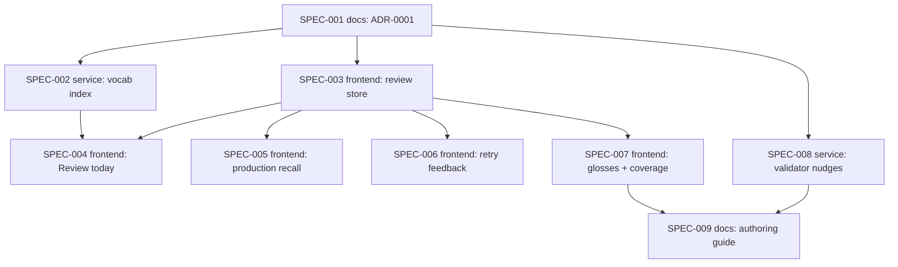

# Initiative: Evidence-based practice — spaced review, production recall, glosses, retry feedback

**Initiative ID:** INIT-001
**Status:** complete
**Completed:** 2026-10-08 (target was 2026-10-15)
**Slug:** INIT-001-evidence-based-practice
**Discipline Profile:** `software`
**Created:** 2026-10-08
**Owner:** Brian Nelson
**Ticket:** None (`branch_naming.ticket_system: none`; initiative sourced from `RSCH-003`)
**Branch:** `evidence-based-practice` (deliberately not a worktree — the operator chose to plan in place on `main` because uncommitted lesson work is open there; planning writes only under `sdd/initiatives/` and commits nothing)
**Target Completion:** 2026-10-15
**Source:** per `RSCH-003` (prior-art review: how adults best learn a new language — what works and what doesn't). See also `RSCH-001` (English→Hebrew).

---

## 1. Executive Summary

The player already repeats whole lessons in rounds a day apart and lets the learner mark words "Knew it / Missed it", but nothing schedules an individual word for review across days or across lessons, recall runs only from Hebrew to meaning, and wrong answers are revealed at once. This initiative adds the practices `RSCH-003` rates best supported — spaced cross-lesson review (High), active recall in both directions (Moderate), retry-before-reveal feedback (Moderate), and first-language glosses in stories (Moderate) — plus authoring rules that keep new lessons recycling words. Everything stays in the browser (localStorage), bilingual, with no accounts.

---

## 2. Domain Analysis

| Domain         | Affected | Key changes |
| -------------- | -------- | ----------- |
| Data           | No       | No database. Learner state stays in browser localStorage (owned by the frontend specs). |
| Service        | Yes      | Node generator for a cross-lesson vocabulary index (`worksheets/_review/vocab-index.js`), hooked into lesson publish; validator warnings for recycling, coverage, and glosses. |
| API            | No       | `upsert_lesson` gains one call to the index builder inside SPEC-002 (same pattern as the word-audio catalog rebuild); no new MCP tool or schema field beyond `reading.glosses`. |
| Event          | No       | — |
| Scheduled      | No       | — |
| Infrastructure | No       | Static files only; the existing container serves the new page and index. |
| Frontend       | Yes      | Review store + scheduler, "Review today" page and home-page queue, English→Hebrew recall in lessons, retry-before-reveal feedback, story glosses and coverage estimate. |
| Docs           | Yes      | ADR-0001 learner review model; authoring guide updates in the `hebrew-worksheet` skill. |

### Requirements (traced to `RSCH-003`)

| ID | Requirement | Priority | Evidence (RSCH-003) |
| --- | --- | --- | --- |
| REQ-001 | Each vocabulary word has its own review schedule across days, independent of which lesson taught it. Same-session repeats do not count as a review. | Must | Spacing beats massing — High |
| REQ-002 | Review intervals are simple (equal or gently expanding) and lengthen for long-term retention. | Must | Equal ≈ expanding; longer gaps help delayed tests — Moderate |
| REQ-003 | A "Review today" session mixes due words from all lessons (interleaved), and asks for recall before revealing the answer, with audio. | Must | Retrieval over rereading — Moderate; interleaving — Moderate |
| REQ-004 | Recall runs in both directions; English→Hebrew (production) is available at every level, not only `advanced`. | Must | Recall direction — Moderate; recall vs recognition — Low, leaning recall |
| REQ-005 | On a wrong answer in a checked activity, the learner is prompted to try again before the correct form is shown; misses feed the review schedule. | Should | Corrective feedback works; prompts ≥ recasts — Moderate / Low |
| REQ-006 | Story text supports tap-to-gloss with an English meaning; a tap counts as a "not yet known" signal. | Should | First-language glosses beat target-language glosses — Moderate |
| REQ-007 | Each lesson shows an estimated known-word coverage for its story, labelled as an estimate. | Could | 95–98% coverage threshold — Low (reading), Very Low (listening) |
| REQ-008 | Authoring tooling nudges new lessons to recycle known words, repeat each new word in context, and supply glosses. | Should | More encounters help — Moderate; deliberate study alongside input — Low |
| REQ-009 | Existing constraints hold: progress only in localStorage, no accounts, `window.WORKSHEET` loaded by script tag (no fetch), no edits to lesson `index.html`, no root/binyan speed drills, no forced vowel fading, bilingual UI. | Must | Operator constraints |

Out of scope (operator decision 2026-10-08): perception (minimal-pair) drills, study-time log and habit/streak features. `RSCH-003` lists them; they can be a later initiative.

---

## 3. Spec Breakdown

Each spec is single-domain. Frontend specs are sized by screens/components/states (`sdd-skill-config` §4 frontend band); other specs by 200–800 LOC / 2–6h.

| Spec     | Domain   | Title | Prompt | Autonomy | Gates | Blocked by | Effort |
| -------- | -------- | ----- | ------ | -------- | ----- | ---------- | ------ |
| SPEC-001 | docs     | ADR-0001 learner review model | implementation-planner | plan_only | — | None | 2.5h |
| SPEC-002 | service  | Cross-lesson vocabulary index generator | principal-backend-developer | auto_tests | — | SPEC-001 | 3.5h |
| SPEC-003 | frontend | Review store and scheduler | principal-frontend-developer | auto_tests | — | SPEC-001 | 4.5h |
| SPEC-004 | frontend | "Review today" page and home queue | principal-frontend-developer | auto_tests | — | SPEC-002, SPEC-003 | 6h |
| SPEC-005 | frontend | Production recall in lessons | principal-frontend-developer | auto_tests | — | SPEC-003 | 4h |
| SPEC-006 | frontend | Retry-before-reveal feedback | principal-frontend-developer | auto_tests | — | SPEC-003 | 3.5h |
| SPEC-007 | frontend | Story glosses and coverage estimate | principal-frontend-developer | auto_tests | — | SPEC-003 | 5h |
| SPEC-008 | service  | Validator nudges: recycling, coverage, glosses | principal-backend-developer | auto_tests | — | SPEC-001 | 3h |
| SPEC-009 | docs     | Authoring guide: evidence-based lesson rules | implementation-planner | plan_only | — | SPEC-007, SPEC-008 | 2h |

> Security review and architecture diagrams run automatically as `complete-initiative` phases (`Phase
> 3.5`/`Phase 3.6`) — they are not spec-table rows.

**Prompt resolution (disclosed gap):** this repository has no `.claude/agents/` tree, and `scripts/dev/expertise_state.py` (the expertise determination check) does not exist here. Each spec names the profile's prompt for its domain; at execution the prompt resolves to the documented degradation path (execute against the spec and this repo's own conventions, and say so). Nothing was manufactured; no persona generation was proposed, because the gap is the whole `.claude/agents/` tree — an `init` matter, not per-spec generation.

---

## 4. Dependency Graph

**Critical path:** SPEC-001 → SPEC-003 → SPEC-004 (13h)
**Parallelizable:** SPEC-002 with SPEC-003 and SPEC-008 after SPEC-001; SPEC-005, SPEC-006, and SPEC-007 with each other and with SPEC-004 after SPEC-003 (they touch different activity files; all add calls into the review store, so they must merge in sequence if run concurrently).

---

## 5. Timeline & Effort

| Metric             | Value |
| ------------------ | ----- |
| Total effort       | 34 hours |
| Critical path      | 13 hours |
| Realistic duration | 13 × 1.3 ≈ 17 hours |
| Calendar estimate  | about 3 days at ~6 productive hours/day (about 6 days if run one spec at a time) |

---

## 6. Controls & Gates

- **Default autonomy:** `auto_tests` (implement and run `npm test` plus the headless Chrome smoke check; no commit, push, PR, or merge — the operator commits only when asked). Docs specs are `plan_only`.
- **One-way actions expected:** none. No dependency adds, no migrations, no deploy. Deploying to the k8s site is a separate, operator-initiated step after the operator commits and pushes.
- **Approval owner(s):** Brian Nelson.
- **Reversibility:** `revertible` — work happens uncommitted on `main` in place; any spec can be reverted with `git restore`/`git checkout` of its files. The operator's uncommitted lesson work (`worksheets/anal-sex-vocab/`, audio catalog changes) must not be touched or reverted by any spec.

See `.claude/skills/sdd/assets/mechanics/gates-and-controls.md`.

---

## 7. Agent Behavior Overrides (optional)

Inherit defaults.

---

## 8. Threat Model (security)

- **Attack surface:** lesson content published through the authenticated MCP `upsert_lesson` tool and the local CLI; static pages served by the existing Node server; browser localStorage.
- **Trust boundaries:** lesson content (vocab, meanings, glosses) crosses from an authoring agent into files rendered by every page; the vocab index generator reads every lesson folder and writes one file under `LESSONS_DIR`.
- **Data classification:** no PII by design. Learner progress (word review state) stays in the browser and never leaves it. The ElevenLabs key is unaffected and must stay out of any generated file. The learner's name and any transcript must never appear in lesson files, glosses, or the vocab index.
- **STRIDE-lite notes:**
  - Tampering / XSS: gloss text, meanings, and words are rendered into HTML — every value goes through the existing `esc`/`U.escapeHtml`; the vocab index is emitted with `JSON.stringify` inside a `window.X = …;` assignment, never string-concatenated.
  - Tampering (path): the index generator must only read real lesson folders under `LESSONS_DIR` (skip `_`-prefixed and non-directories) and write only `LESSONS_DIR/_review/vocab-index.js`.
  - Information disclosure: the index contains only published lesson vocab already public on the site.
  - DoS: localStorage quota — the review store must cap record size and fail soft (keep working without saving) if a write throws.
- **Security-sensitive specs:** none classified `required`. SPEC-002 and SPEC-008 are `standard` (filesystem reads/writes under `LESSONS_DIR`); SPEC-004 and SPEC-007 are `standard` (render author-supplied text); the rest are `light`.

---

## 9. Risk Assessment

| Risk | Probability | Impact | Mitigation |
| ---- | ----------- | ------ | ---------- |
| The same word is spelled with different nikud or attached prefixes across lessons, so one word splits into two review records or two words merge. | M | M | ADR-0001 fixes the identity key (NFC-normalized pointed form, with a vowel-stripped fallback only when unique — the rule `speech.js` already uses for clips); prefixes are not stripped automatically. |
| Browser data is cleared, losing all review history. | L | H | Keep `navigator.storage.persist()`; ADR-0001 records an export/import backup as a follow-up, not in this initiative. |
| Self-grading inflates "Knew it", so words leave review too early. | M | M | Production (typed) recall where available; a miss in any activity pulls the word back; intervals stay modest (cap at 30 days in v1). |
| Review queue grows faster than the learner can clear it. | M | M | Daily cap on due items shown, new-word cap per day, oldest-overdue first. |

---

## 10. Success Criteria

- [x] All specs complete; `npm test` passes, including new tests for the scheduler, the store, and the index generator. (114/114 after the Phase 3.5 remediation.)
- [~] Headless Chrome smoke check passes for the review page and the changed activities. Met with a deviation: `test/chrome-audio-smoke.js` was not extended. Separate smoke files were added instead (`chrome-review-smoke.js`, `chrome-production-recall-smoke.js`, `chrome-story-gloss-smoke.js`, `retry-before-reveal-smoke.test.js`), and all pass.
- [x] Every Must requirement (REQ-001–004, REQ-009) is met and traced to a passing acceptance criterion, per the AC eval reports (9/9 PASS).
- [~] No unresolved Critical/High security findings. Met through a risk acceptance: SEC-OPS-1 (exposed ElevenLabs API key) is open until the operator rotates the key. Approver: Brian Nelson. Expires 2026-10-15. See `INIT-001-security-review-findings.md`.
- [x] Completion report generated; initiative status `complete`.

Coverage note: this repository runs `node --test` with no coverage tool wired up, so a percentage bar would be unmeasurable. The bar instead is that every exported pure function added by a spec has at least one `node:test` case covering its normal path and one edge case.

---

## 11. Plan quality (reflection loop, `create-initiative` Phase 5.5)

| Dimension | Score (0–10) | Note |
| --- | --- | --- |
| Completeness | 8 | All five chosen feature groups map to specs; perception and habit are explicitly out. |
| Accuracy | 8 | Grounded in current player code (`core.js` rounds and `wordMarks`, `words.js` recall mode, `type-it` advanced-only, no gloss support). |
| Clarity | 8 | Each spec has scope in/out and testable acceptance criteria. |
| Technical feasibility | 8 | Pure-JS, no new dependencies; reuses the script-tag catalog pattern already used for word audio. |
| Guardrails compliance | 9 | Operator constraints restated as REQ-009 and as acceptance criteria where touched. |

Confidence = 41 / 50 = 0.82 (threshold 0.70, every dimension ≥ 6). One iteration.

---

## 12. Next Steps

1. Approve this initiative and the spec breakdown.
2. Execute SPEC-001 (ADR-0001) and resolve its assumption ledger with the operator.
3. Execute specs in dependency order; SPEC-002 and SPEC-003 can run in parallel after SPEC-001.
4. Run `complete-initiative` once every spec is complete.
