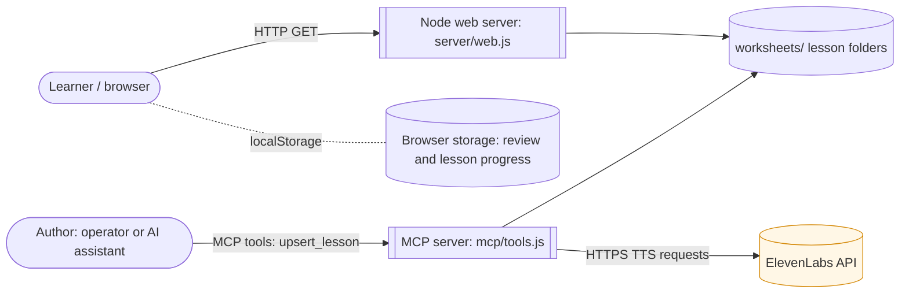
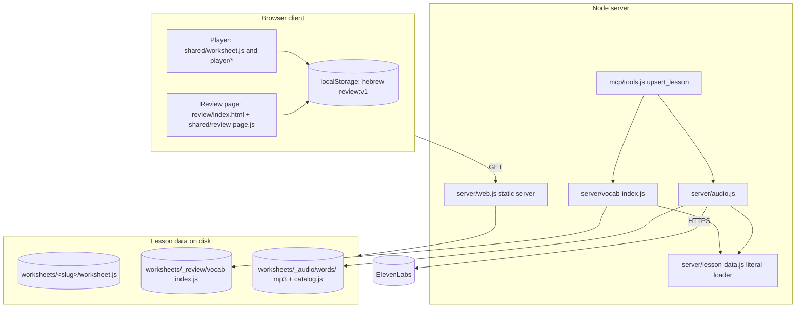
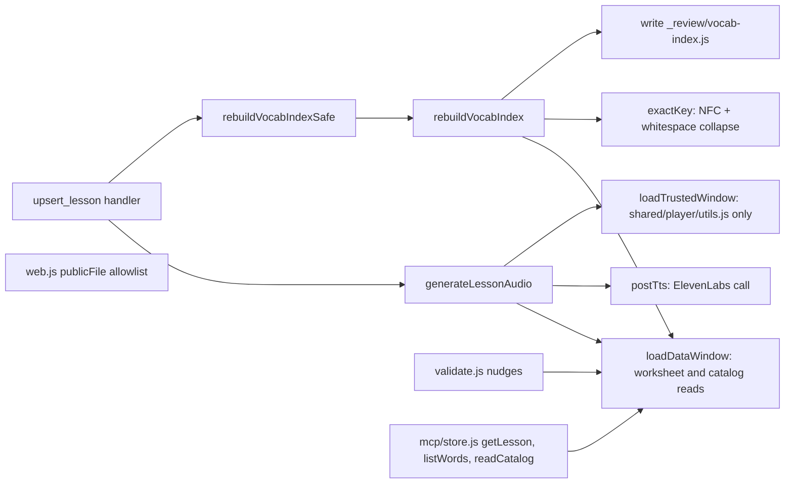
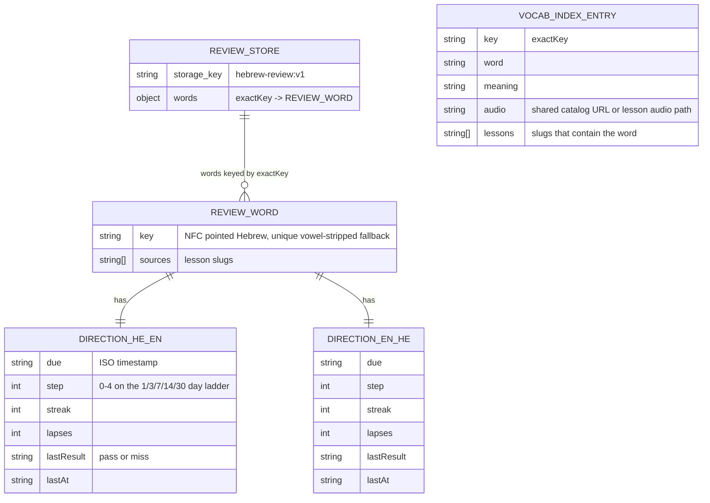
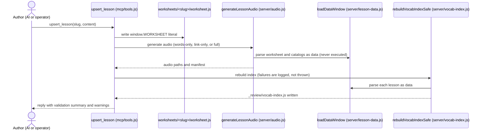
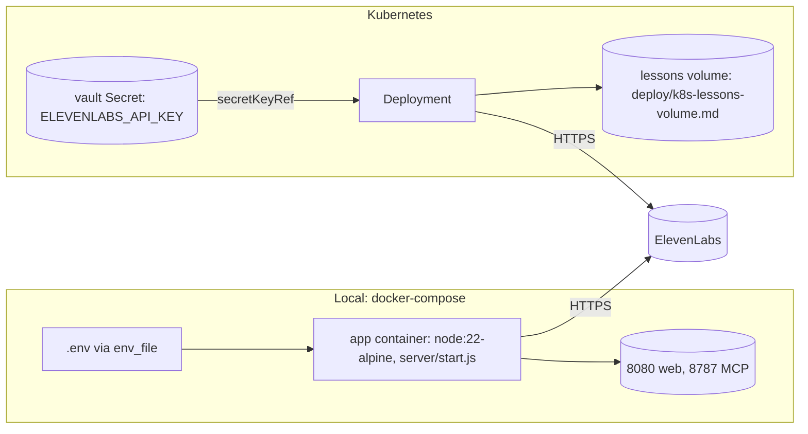
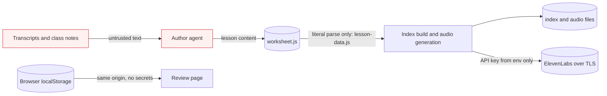

# Architecture & Design — Evidence-Based Practice (INIT-001)

**Initiative:** INIT-001-evidence-based-practice · **Reflects specs:** SPEC-001…SPEC-009 · **Date:** 2026-10-08
**Provenance tag:** `INIT-001/DESIGN-DIAGRAMS`
**Canvas:** in-doc Mermaid only (`design_diagrams.canvas.enabled: false`)
**Omitted:** `agent_topology`. This is not an agentic initiative. The MCP server is a tool surface, not an agent graph.

This document describes the system as built. It reflects the code as it stands after the HIGH-1 remediation (`server/lesson-data.js`); see `INIT-001-security-review-findings.md`.

---

## 1. System Context (C4 L1)  <!-- diagrams: system_context -->

The learner uses a static, browser-only practice site. The author (an AI assistant over MCP, or the operator) publishes lessons into the same repo. The server is a local Node process that serves static files and generates audio.



**Trust boundaries:** the ElevenLabs boundary is the only outbound network call, and it uses TLS with the key in a header. Lesson text crosses from author input into server-side evaluation, which is why the loader is data-only (see §7).

**Sources:** SPEC-001 (decision), SPEC-002 (index), SPEC-004 (review page), `server/web.js`, `mcp/tools.js`, `server/audio.js`.

---

## 2. Container (C4 L2)  <!-- diagrams: container -->

Four deployable parts: the static web server, the MCP tool server, the lesson data (a folder tree), and the browser client that runs the player and review page.



**Sources:** SPEC-002 (vocab index), SPEC-003 (review store and loader order in `shared/worksheet.js`), SPEC-004 (review page and `/review/` allowlist), SPEC-005/006/007 (activity changes), SPEC-008 (validator nudges in `mcp/tools.js`).

---

## 3. Component (C4 L3 — key container: Node server)  <!-- diagrams: component -->



`trusted` is the only `vm` call left. Its input is a fixed repo path, never lesson text.

**Sources:** SPEC-002 (`server/vocab-index.js`), SPEC-008 (`mcp/tools.js` `rebuildVocabIndexSafe` placement and validator nudges), HIGH-1 remediation (`server/lesson-data.js`).

---

## 4. Data Model (ERD)  <!-- diagrams: data_model -->

Two stores: the learner's browser store (review records) and the built vocabulary index. The index is derived, so it is rebuilt rather than migrated.



**Notes:** per-lesson `wordMarks` in `hebrew-worksheet:<slug>` are migrated once into `hebrew-review:v1` (SPEC-003). `not_yet` (gloss tap) does not advance or lapse the record. Storage writes fail soft on quota.

**Sources:** `docs/decisions/ADR-0001-learner-review-model.md`, SPEC-002, SPEC-003.

---

## 5. Key Sequences  <!-- diagrams: sequence -->

### 5a. Learner grades a review item

```mermaid
sequenceDiagram
  actor L as Learner
  participant R as review-page.js
  participant S as review.js store
  participant LS as localStorage
  L->>R: Show answer
  R-->>L: meaning or Hebrew, audio button
  L->>R: Knew it (pass) or Missed it (miss)
  R->>S: record(word, direction, signal, lesson)
  S->>S: nextState: advance one step on a new-day pass; reset on miss
  S->>LS: save hebrew-review:v1 (fail-soft)
  R-->>L: next item or Done for now
```

### 5b. Author publishes a lesson



**Sources:** SPEC-002 (index), SPEC-008 (`rebuildVocabIndexSafe` ordering after upsert), HIGH-1 remediation.

---

## 6. Deployment / Infrastructure  <!-- diagrams: deployment -->



**Configuration facts from the repo:** `docker-compose.yml` publishes ports 8080 and 8787 on `127.0.0.1` only, sets `HOST: 0.0.0.0` inside the container, and sets `MCP_ALLOW_NO_AUTH: "1"` (see MED-1 in the security review). It does not set `ELEVENLABS_API_KEY`, because an empty value would override `env_file`. `.env` is excluded from git and from the image build context. The key is never baked into the image.

**Sources:** the Compose and vault setup from the earlier ElevenLabs work (commit `ebf82d7`), `docker-compose.yml`, `Dockerfile`, `.gitignore`, `.dockerignore`, `mcp/http.js`.

---

## 7. Data Flow & Trust Boundaries  <!-- diagrams: data_flow -->

Ties to the initiative's security review (`INIT-001-security-review-findings.md`).



**Boundary notes:**
- Untrusted text enters at the top left. Before HIGH-1 remediation, `worksheet.js` was executed in `vm` at the index step. It is now parsed as data only, and that boundary is enforced by tests.
- The API key crosses only into the ElevenLabs request header. It stays in `process.env` and is never logged. Its exposure in tool output is tracked as SEC-OPS-1 and is an operator action.
- Learner progress stays in the browser. The server holds no learner data.

---

## Traceability

| Diagram | Reflects | Source specs / files |
| ------- | -------- | -------------------- |
| System Context | Scope and trust boundaries | INIT-001/SPEC-001, SPEC-002, SPEC-004; `server/web.js`, `mcp/tools.js`, `server/audio.js` |
| Container | Deployable units and storage | INIT-001/SPEC-002, SPEC-003, SPEC-004, SPEC-008; `shared/worksheet.js`, `review/index.html` |
| Component (server) | Server modules and loader boundary | INIT-001/SPEC-002, SPEC-008; `server/lesson-data.js` (remediation) |
| Data Model | Review record and vocab index shape | INIT-001/SPEC-001, SPEC-002, SPEC-003; `docs/decisions/ADR-0001-learner-review-model.md` |
| Sequences 5a, 5b | Learner grading; authoring and rebuild | INIT-001/SPEC-003, SPEC-004, SPEC-008; `shared/player/review.js`, `mcp/tools.js` |
| Deployment | Compose and k8s secret path | INIT-001/SPEC-001; `docker-compose.yml`, `Dockerfile` |
| Data flow | Trust boundaries and key handling | INIT-001/SECURITY-REVIEW (HIGH-1, SEC-OPS-1) |
