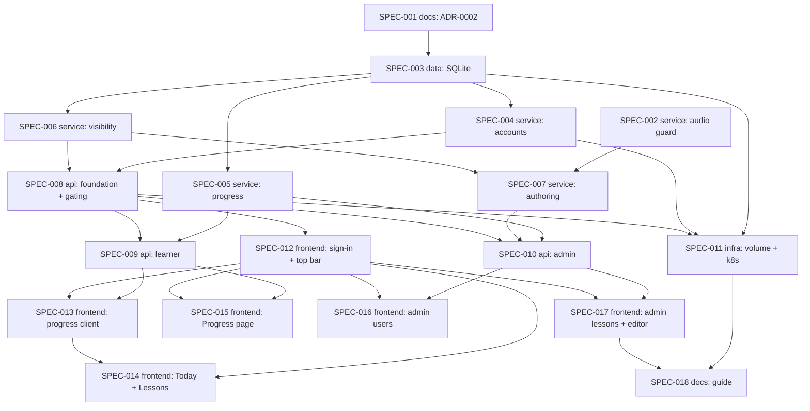

# Initiative: Multi-user accounts, server-side progress, and a rethought site

**Initiative ID:** INIT-002
**Status:** complete
**Completion Date:** 2026-10-08
**Slug:** INIT-002-multi-user-progress
**Discipline Profile:** `software`
**Created:** 2026-10-08
**Owner:** Brian Nelson
**Ticket:** None (`branch_naming.ticket_system: none`; initiative sourced from the operator's request and `RSCH-003`)
**Branch:** `multi-user-progress` (deliberately not a worktree — the operator chose to plan in place on `main`. The INIT-001 code and 37 of the 65 recordings are uncommitted, so a worktree from `HEAD` would contain neither. Every audio file was backed up and checksum-verified first; see §6.)
**Target Completion:** 2026-10-22
**Source:** Operator request (2026-10-08): "make it multi user and track the users progress … tied into our research … a local user database for now … later OAuth … two groups, users and admins", plus "don't lose any of our audio already recorded". Research: per `RSCH-003` (language-learning science). See also `RSCH-001`.

---

## 1. Executive Summary

Today the site is a set of static pages. Each learner's progress lives only in their own browser. There are no accounts, the review page is reachable only from a home-page card, and every page has its own header.

This initiative does five things:
- **Accounts.** It adds a local user database with two roles, users and admins.
- **Sign-in.** Every page, lesson, and recording requires sign-in.
- **Server-side progress.** Each learner's review schedule and lesson rounds move to the server. Progress then follows the account across devices, and the spacing rules from ADR-0001 run in one place.
- **New layout.** The site gets one shared top bar: Today, Lessons, Review, Progress, plus Admin for admins.
- **Admin console.** Admins manage users, see each learner's progress, choose which lessons each user can see, and edit lessons in the browser.

The Progress page shows the two measures the operator chose: words by memory stage, and recall accuracy by direction (Hebrew→English vs English→Hebrew).

No recorded audio may be lost. The plan:
- adds an archive-before-overwrite guard;
- adds a checksum inventory that every lesson-touching spec must pass;
- leaves every audio path and URL unchanged.

OAuth sign-in is out of scope, but the user model is shaped so it can be added later without a schema rewrite.

---

## 2. Domain Analysis

| Domain         | Affected | Key changes |
| -------------- | -------- | ----------- |
| Data           | Yes      | SQLite database (Node's built-in `node:sqlite`) in a new `DATA_DIR` outside every served folder. Tables: users, sessions, review items, practice events, lesson progress, lesson visibility and grants, audit log. Includes schema migrations and a backup command. |
| Service        | Yes      | Audio-preservation guard and checksum inventory. Accounts: password hashing, sessions, throttling, roles, and a user CLI. Server-side progress and metrics, reusing the ADR-0001 scheduler. Lesson visibility and per-user filtering of the shared data scripts. Lesson-authoring service for the browser editor, plus MCP tools so the AI can list users and assign lessons (REQ-016). |
| API            | Yes      | JSON API under `/api/` on the existing web server: sign-in, learner progress, and admin endpoints. Sign-in gating for every static path except the login page, CSRF and Origin checks, security headers, and per-user filtered data scripts. |
| Event          | No       | Practice events are rows in the database, not a message bus. |
| Scheduled      | No       | The database backup is an on-demand command; a k8s CronJob is documented as optional. |
| Infrastructure | Yes      | `DATA_DIR` volume in compose and k8s (a second PVC, so the lessons volume is never moved). Non-root container (`USER node`, INIT-001 LOW-1). `COOKIE_SECURE`/`PUBLIC_ORIGIN` settings, single replica, first-admin bootstrap. |
| Frontend       | Yes      | Sign-in page and shared top bar; server-backed progress client. New Today, Lessons, and Progress pages. Admin pages for users, learner progress, lesson visibility, and the lesson editor. |
| Docs           | Yes      | ADR-0002 (supersedes ADR-0001's localStorage-only and no-accounts constraint); operator/admin guide; `hebrew-worksheet` skill updates. |

### Bounded contexts

- **Identity & access** (supporting): users, roles, sessions, sign-in. A generic capability built small and local now. The `auth_provider` and `provider_subject` columns leave room for OAuth/OIDC later.
- **Learning progress** (core): per-user review schedule (ADR-0001 model, unchanged), lesson rounds, practice events, metrics.
- **Lesson catalog & authoring** (core): lessons on disk under `LESSONS_DIR`, visibility per user, MCP and browser editing through one store path.
- **Audio library** (supporting): recorded clips and their manifests. This initiative only protects it (inventory, archive-on-overwrite); no paths change.

### Requirements

| ID | Requirement | Priority | Source / evidence |
| --- | --- | --- | --- |
| REQ-001 | A local user database holds accounts with exactly two roles, `user` and `admin`. Admins create accounts; there is no public sign-up. The first admin is created from the command line. | Must | Operator |
| REQ-002 | Sign-in is required for every page, lesson file, data script, and recording. Only the sign-in page and its own assets are public. | Must | Operator (adult lesson content on an internet-facing site) |
| REQ-003 | Credentials and sessions are handled safely: scrypt password hashes, an HttpOnly session cookie revocable on the server, login throttling, CSRF defense on every state-changing request, and admin checks enforced on the server. | Must | Security |
| REQ-004 | Each account has its own review schedule and lesson-round progress on the server, available on any device. Every account starts fresh: existing browser progress is neither imported nor deleted. | Must | Operator |
| REQ-005 | The server is authoritative for scheduling. The browser sends review signals, and the server applies the ADR-0001 ladder using the same `shared/player/review.js` functions. Each signal is also kept in an append-only practice-event log. | Must | `RSCH-003`: spacing across days — High |
| REQ-006 | The site has one shared top bar (Today, Lessons, Review, Progress, Admin for admins only, account menu). Today shows what to do now; Lessons is the library. Labels mix Hebrew with English. | Must | Operator |
| REQ-007 | The Progress page shows words by memory stage (new / learning / long-term) for each direction, and recall accuracy by direction over the last 30 days. It has no streaks or points. | Must | `RSCH-003`: spacing — High; recall direction — Moderate; gamification unproven — Low ("don't") |
| REQ-008 | Admins can create users, disable them, reset passwords, and change roles. The last active admin cannot be demoted or disabled. Every admin action is written to an audit log. | Must | Operator |
| REQ-009 | Admins have a full view of any learner's activity: memory stages, direction accuracy, trouble words, and the complete answer history (every recorded answer with its time, word, direction, result, lesson, and activity). Learners are told this on the sign-in page and in the account menu. | Must | Operator ("admin has full view") |
| REQ-010 | Each lesson has a visibility: hidden (admins only), everyone, or selected users. The server enforces it on the catalog, lesson files, the vocab index, the word-audio catalog, review, and progress endpoints. The three existing lessons, including `anal-sex-vocab`, are seeded as `everyone` on first run, so nothing disappears at upgrade. | Must | Operator |
| REQ-016 | The operator's AI can author lessons and assign them to users through the MCP: it can list users (usernames only), create or update a lesson with an optional visibility (`everyone`, or a list of usernames), and change a lesson's visibility later. Admins can do the same in the browser. A lesson created with no visibility given is `hidden` until assigned, and the tool reply says so. The MCP never reads learner progress. | Must | Operator ("my AI can add lessons … and assign them to users") |
| REQ-011 | Admins can edit lessons in the browser. Metadata, vocabulary, and the activity path have forms; other sections use a validated JSON editor. Publishing goes through the same validator and store path as the MCP. Generating audio is an explicit choice, shown with a clip-count preview. | Should | Operator |
| REQ-012 | No recorded clip is ever deleted, moved, or overwritten without an archived copy. A checksum inventory is taken before and after every spec that touches lessons or audio. Audio file paths and URLs do not change. | Must | Operator |
| REQ-013 | The database lives outside every served folder, on persistent storage (compose volume, k8s PVC). The container runs as non-root. A backup command exists. One replica is documented as a hard limit. | Must | Security; operations |
| REQ-014 | Carried constraints still hold: `window.WORKSHEET` and the other learner data globals load by script tag (no fetch for lesson or vocab data); no edits to existing lesson `index.html` files; no root/binyan speed drills; no forced vowel fading; bilingual UI; no learner names, transcripts, or secrets in lesson files; the ElevenLabs key stays in server env only. | Must | Operator constraints (ADR-0001 REQ-009, minus constraint 1, which ADR-0002 supersedes) |
| REQ-015 | The identity model can take an OAuth/OIDC provider later without a schema rewrite. | Could | Operator ("later we can tie it into OAuth") |

**Out of scope** (operator decisions 2026-10-08):
- OAuth/OIDC sign-in and self-service password reset by email.
- Importing existing browser progress (accounts start fresh).
- Learner-facing practice-time totals, practice-days calendar, per-lesson coverage, and trouble words. Trouble words and the full answer history are shown to admins only.
- A third "instructor" role. There are two roles, `user` and `admin`; the AI acts through the MCP, not as an account.
- An audio library browser.
- OAuth changes to the MCP. The MCP does gain one requirement here: because it can now assign lessons, it must run with `MCP_AUTH_TOKEN` set and without `MCP_ALLOW_NO_AUTH` (INIT-001 MED-1, closed by SPEC-011).
- More than one server replica.

---

## 3. Spec Breakdown

Each spec covers one domain. Frontend specs are sized by screens, components, and states (`sdd-skill-config` §4 frontend band). Other specs are sized at 200–800 LOC and 2–6h.

| Spec     | Domain         | Title | Prompt | Autonomy | Gates | Blocked by | Effort | Status |
| -------- | -------------- | ----- | ------ | -------- | ----- | ---------- | ------ | ------ |
| SPEC-001 | docs           | ADR-0002: accounts, server-side progress, site map | implementation-planner | plan_only | — | None | 3.5h | complete |
| SPEC-002 | service        | Audio preservation guard and checksum inventory | principal-backend-developer | auto_tests | — | None | 3h | complete |
| SPEC-003 | data           | SQLite database, schema, migrations, backup | principal-backend-developer | auto_tests | — | SPEC-001 | 5h | complete |
| SPEC-004 | service        | Accounts, passwords, sessions, roles, user CLI | principal-backend-developer | auto_tests | — | SPEC-003 | 5.5h | complete |
| SPEC-005 | service        | Server-side progress and metrics | principal-backend-developer | auto_tests | — | SPEC-003 | 5h | complete |
| SPEC-006 | service        | Lesson visibility and per-user content filtering | principal-backend-developer | auto_tests | — | SPEC-003 | 4h | complete |
| SPEC-007 | service        | Lesson authoring service and MCP lesson assignment | principal-backend-developer | auto_tests | — | SPEC-002, SPEC-006 | 5h | complete |
| SPEC-008 | api            | API foundation, sign-in endpoints, content gating | principal-backend-developer | auto_tests | — | SPEC-004, SPEC-006 | 6h | complete |
| SPEC-009 | api            | Learner progress and metrics endpoints | principal-backend-developer | auto_tests | — | SPEC-005, SPEC-008 | 3.5h | complete |
| SPEC-010 | api            | Admin endpoints: users, progress, visibility, lessons | principal-backend-developer | auto_tests | — | SPEC-005, SPEC-007, SPEC-008 | 5h | complete |
| SPEC-011 | infrastructure | Database volume, non-root container, k8s layout, MCP auth required | principal-devops-engineer | auto_tests | — | SPEC-003, SPEC-004, SPEC-008 | 4h | complete |
| SPEC-012 | frontend       | Sign-in page and shared top bar | principal-frontend-developer | auto_tests | — | SPEC-008 | 5h | complete |
| SPEC-013 | frontend       | Server-backed progress client | principal-frontend-developer | auto_tests | — | SPEC-009, SPEC-012 | 5h | complete |
| SPEC-014 | frontend       | Today and Lessons pages | principal-frontend-developer | auto_tests | — | SPEC-012, SPEC-013 | 5h | complete |
| SPEC-015 | frontend       | Progress page: memory stages and direction accuracy | principal-frontend-developer | auto_tests | — | SPEC-009, SPEC-012 | 3h | complete |
| SPEC-016 | frontend       | Admin: users and learner activity | principal-frontend-developer | auto_tests | — | SPEC-010, SPEC-012 | 6h | complete |
| SPEC-017 | frontend       | Admin: lessons, visibility, and lesson editor | principal-frontend-developer | auto_tests | — | SPEC-010, SPEC-012 | 6h | complete |
| SPEC-018 | docs           | Operator and admin guide, authoring-skill updates | implementation-planner | plan_only | — | SPEC-011, SPEC-017 | 2h | complete |

> Security review and architecture diagrams run automatically as `complete-initiative` phases (`Phase
> 3.5`/`Phase 3.6`) — they are not spec-table rows.

**Prompt resolution (disclosed gap):** this repository has no `.claude/agents/` tree, and `scripts/dev/expertise_state.py` (the expertise-determination check) does not exist here. The check was therefore run by inspection for all 18 specs, with the same result each time: no installed persona, no persona template, nothing staged.

Each spec names the profile's prompt for its domain. At execution that prompt resolves to the documented degradation path: execute against the spec and this repo's own conventions, and disclose it. Nothing was manufactured, and no persona generation was proposed, because the gap is the entire `.claude/agents/` tree, which is an `init` matter rather than per-spec generation.

**ADR number (disclosed gap):** `scripts/dev/next_adr_number.py` is absent. ADR-0002 was claimed by scanning `docs/decisions/`, where only `ADR-0001` exists, and the number is written directly into SPEC-001.

**Wave option:** the browser lesson editor (SPEC-007, the lesson routes in SPEC-010, and SPEC-017) is the largest optional part. It sits at the end of the graph, so it can be split into a follow-up initiative without reshaping the rest.

---

## 4. Dependency Graph

**Critical path:** SPEC-001 → SPEC-003 → SPEC-004 → SPEC-008 → SPEC-012 → SPEC-013 → SPEC-014 (35h)

**Parallelizable:**

| Wave | Specs | Runs after |
| --- | --- | --- |
| 1 | SPEC-001, SPEC-002 | — |
| 2 | SPEC-003 | SPEC-001 |
| 3 | SPEC-004, SPEC-005, SPEC-006 | SPEC-003 |
| 4 | SPEC-007, SPEC-008 | Their wave 1–3 blockers |
| 5 | SPEC-009, SPEC-010, SPEC-011, SPEC-012 | SPEC-008 |
| 6 | SPEC-013, SPEC-015, SPEC-016, SPEC-017 | Their API specs and SPEC-012 |
| 7 | SPEC-014, SPEC-018 | Waves 5–6 |

Specs in the same wave touch different files. The exception is `server/web.js`: SPEC-009 and SPEC-010 both register routes on the router that SPEC-008 creates, so they must merge one after the other.

---

## 5. Timeline & Effort

| Metric             | Value |
| ------------------ | ----- |
| Total effort       | 81.5 hours |
| Critical path      | 35 hours |
| Realistic duration | 35 × 1.3 ≈ 46 hours |
| Calendar estimate  | About 8 days at ~6 productive hours/day with parallel waves; about 14 days run one spec at a time |

---

## 6. Controls & Gates

- **Default autonomy:** `auto_tests`. Specs implement, then run `npm test` and the headless Chrome smoke checks. They do not commit, push, open a PR, or merge; the operator commits only when asked, and `gh pr create` is never run. Docs specs are `plan_only`.
- **One-way actions expected:**
  - **Before the first deploy:** none. `node:sqlite` is built into Node 22, so no dependency is added. The first schema is created in a new, empty database file, which is revertible by deleting the file.
  - **After the first deploy:** any later schema change against a populated database is a `db_migration` gate.
  - **Dependency fallback:** if ADR-0002 picks `better-sqlite3` instead of `node:sqlite`, SPEC-003 gains a `dependency_add` gate.
  - **Deploying to k8s** is a separate, operator-initiated `deploy`, after the operator commits and pushes.
- **Approval owner(s):** Brian Nelson.
- **Reversibility:** `revertible`. Work happens uncommitted on `main`, in place. Any spec can be reverted with `git restore` of its files, and deleting `data/` resets the database. Specs must not touch or revert the operator's uncommitted work: INIT-001 files, `worksheets/anal-sex-vocab/`, and untracked audio.
- **Audio-preservation gate (REQ-012), for every spec that touches `worksheets/`, `server/audio.js`, `mcp/store.js`, or the lesson editor:**
  1. Run `npm run audio:inventory` before starting.
  2. Run `npm run audio:verify` after finishing.
  3. A verify failure blocks completion.

  Until SPEC-002 lands, the baseline is the backup taken during planning (below).
- **Audio backup taken during planning:** `C:\Users\BrianNelson\Backups\Hebrew-audio-2026-10-08-1249\`. It holds all 80 files under `worksheets/` (all 65 recordings, manifests, catalogs, and lesson data) plus `shared/word-audio-catalog.js`. Each copy was verified against its source by SHA-256, with zero mismatches, and the hashes are kept in `SHA256SUMS.txt` in the backup folder.

See `.claude/skills/sdd/assets/mechanics/gates-and-controls.md`.

---

## 7. Agent Behavior Overrides (optional)

Inherit defaults.

---

## 8. Threat Model (security)

**Attack surface:**
- The login endpoint.
- The session cookie.
- Every JSON endpoint under `/api/`, with the admin endpoints the highest risk.
- The lesson editor, which writes lesson files from admin input.
- The static gate on every existing path.
- The per-user filtered data scripts.
- The database file and its backups.
- The `next` redirect after sign-in.
- The admin audio-generation action, which spends ElevenLabs credit.

**Trust boundaries:**
- Browser to server: any request may be unauthenticated or forged cross-site.
- User role to admin role.
- Admin-supplied lesson content to files that every learner's browser runs.
- Server to the ElevenLabs API: the key lives in env only.
- Web process to the filesystem: `LESSONS_DIR` is served; `DATA_DIR` must never be.

**Data classification:**

| Data | Classification | Handling |
| --- | --- | --- |
| Password hashes | Secret-equivalent | Database only; never logged; never returned by any endpoint. |
| Session tokens | Secret | The browser holds the token; the database stores only its SHA-256. |
| Usernames and display names | PII (low) | Escaped wherever rendered. |
| Learning history | Personal data | Low sensitivity in general, but what someone studies can be sensitive. Admins have a full view, including the complete answer history (REQ-009, operator decision). Learners are told so on the sign-in page and in the account menu. The MCP/AI never reads it. |
| Usernames via MCP | PII (low) | `list_users` returns usernames and display names of active accounts only: no hashes, no sessions, no activity. |
| ElevenLabs API key | Secret | Env only. Never in the image, a file, a response, or a log (SEC-OPS-1 rotation is still owed, accepted until 2026-10-15). |

**STRIDE-lite:**
- **Spoofing.**
  - Brute force and credential stuffing: per-username and per-IP throttling with backoff.
  - User enumeration: one generic error message, plus a dummy hash for unknown users so timing matches.
  - Session fixation: rotate the session at login.
- **Tampering.**
  - CSRF: state-changing methods are allowed only on `/api/`, must send `Content-Type: application/json`, must pass an Origin check against `PUBLIC_ORIGIN` or Host, and the cookie is `SameSite=Lax`.
  - SQL injection: prepared statements only.
  - Lesson-file injection: the editor saves through `mcp/store.upsertLesson`, which uses `assertSlug` and writes with `JSON.stringify`. The literal-only `server/lesson-data.js` parser reads files back and never executes them.
  - Path tricks on the static gate: decode once, normalize, check containment, reject encoded dot-segments; gating runs on the resolved path.
- **Repudiation.** An audit log records every admin action: actor, action, target, time.
- **Information disclosure.**
  - The database lives outside every served root; the server refuses to start if `DATA_DIR` resolves inside one.
  - Restricted lessons are filtered out of `catalog.js`, the vocab index, and the word-audio catalog for users who can't see them. Their files return 404, not 403.
  - Responses that differ per user and every API response use `Cache-Control: no-store`.
  - **Accepted residual:** word mp3 files, which are hash-named, require sign-in but are not filtered per lesson.
- **Denial of service.**
  - Body limits: 64 KB for API calls, 1 MB for lesson saves.
  - Signal batches are capped at 200 items.
  - scrypt is memory-hard, so login is throttled before hashing.
  - Audio generation is admin-only and runs a dry-run count first.
- **Elevation of privilege.**
  - Every admin route checks the role on the server.
  - The last active admin is protected from demotion or disabling.
  - A role change or disable revokes the user's sessions.
  - Learner endpoints act only on the signed-in user (no user id in the URL).

**Security-sensitive specs:**

| `security_review` | Specs |
| --- | --- |
| `required` | SPEC-001, SPEC-003, SPEC-004, SPEC-006, SPEC-007, SPEC-008, SPEC-010, SPEC-011 |
| `standard` | SPEC-002, SPEC-005, SPEC-009, SPEC-012, SPEC-016, SPEC-017 |
| `light` | SPEC-013, SPEC-014, SPEC-015, SPEC-018 |

---

## 9. Risk Assessment

| Risk | Probability | Impact | Mitigation |
| ---- | ----------- | ------ | ---------- |
| Recorded audio is lost during the restructure, a lesson edit, or a regeneration. | L | H | Planning backup with checksums (§6). Archive-before-overwrite in `server/audio.js` (SPEC-002). Inventory and verify gate on every lesson-touching spec. No audio paths change. Before deploying, run the inventory on the k8s lessons volume too, since the live site may hold recordings that aren't in the repo (SPEC-011, SPEC-018). |
| A restricted (adult) lesson leaks through a shared generated file (catalog, vocab index, word-audio catalog), or a lesson path bypasses the gate. | M | H | The server filters these files per user (SPEC-006) and gates paths on the resolved file path (SPEC-008). Tests check each file and path variant as a user who can't see the lesson. |
| `node:sqlite` is still marked experimental in Node 22: the API may shift, and it logs a warning at startup. | M | M | All database access goes through one wrapper module (SPEC-003). The image stays pinned to `node:22`. `better-sqlite3` behind the same interface is the documented fallback (`dependency_add` gate). |
| Required sign-in breaks existing flows: direct links, smoke tests, MCP authoring previews, `file://` use, and the offline PWA. | M | M | Sign-in redirects back to the original page via a validated `next`. Smoke tests sign in with a test account created by the CLI. ADR-0002 states that `file://` and offline use are no longer supported. |
| Scope: 18 specs and about 81.5 hours. | M | M | Parallel waves (§4). The lesson editor sits last and can be split into a follow-up initiative. |
| The AI (via MCP) assigns a lesson wrongly, or forgets to assign it, so a learner sees the wrong lessons or none. | M | L | A lesson created with no visibility is `hidden` and the tool reply says so. Every MCP visibility change is audited with the actor `mcp`. Admins can see and fix visibility in the browser. |
| The MCP can now change who sees what, so an unauthenticated MCP is a bigger hole than before. | M | H | The visibility tools refuse unless `MCP_AUTH_TOKEN` is configured. SPEC-011 removes `MCP_ALLOW_NO_AUTH` from compose. |
| Review signals are lost when offline or when a tab closes. | M | L | A pending queue per user in localStorage, retried with idempotent signal ids. A "not saved yet" indicator in the top bar. |

---

## 10. Success Criteria

- [x] All 18 specs complete, with unit and HTTP-level tests for the database, accounts, sessions, gating, visibility filtering, progress, and admin routes. Close-out `npm test`: 273 passed. `test/retry-before-reveal-smoke.test.js` still expects a signed-out lesson page to return 200 and is the remaining red suite (see the completion report).
- [x] Headless Chrome smoke checks passed while signed in during spec verification: Today, Lessons, Review, Progress, and the Admin pages. A signed-out request to each gated path is redirected (HTML) or refused (data).
- [x] Every Must requirement (REQ-001 to REQ-010, REQ-012 to REQ-014, REQ-016) traces to a passing acceptance criterion in that spec's eval report.
- [x] `npm run audio:verify` against the planning inventory showed all 65 recordings present during SPEC-017.
- [ ] No unresolved Critical or High security findings (`complete-initiative` Phase 3.5). Phase 3.5 was not run. Per-spec reviews found none in the new code. Residuals are listed in the completion report. This box stays open on purpose.
- [x] Completion report generated; initiative status `complete`.

**Coverage note:** this repository runs `node --test` with no coverage tool wired up, so a percentage bar would be unmeasurable. The bar instead:
- Every exported function added by a service, data, or API spec has at least one `node:test` case for its normal path and one for an edge or failure case.
- Every authorization rule has a test proving the refusal.

---

## 11. Plan quality (reflection loop, `create-initiative` Phase 5.5)

| Dimension | Score (0–10) | Note |
| --- | --- | --- |
| Completeness | 8 | Every operator choice maps to a requirement and a spec. Out-of-scope items are listed. Audio, migration (fresh start), and OAuth readiness are each addressed. |
| Accuracy | 8 | Grounded in the current code: the GET/HEAD-only allowlist in `web.js`, in-place lesson-clip overwrites in `audio.js`, MCP OAuth that has no user store, three published lessons, and 37 untracked recordings. |
| Clarity | 8 | Single-domain specs with scope in/out, testable acceptance criteria, and a Verification Strategy for each. |
| Technical feasibility | 7 | No new dependency. `node:sqlite` was confirmed present in the running container (Node 22.23.3) but is experimental, which is mitigated by one wrapper. The scope is large but parallelizable. |
| Guardrails compliance | 9 | REQ-014 restates the carried constraints. Audio gate on every lesson-touching spec. No commits. Security criteria on every `required` spec. |

Confidence = 40 / 50 = 0.80 (threshold 0.70, every dimension ≥ 6). One iteration.

Refinements made during critique:
- **Database location:** moved the database from under `LESSONS_DIR` (the served tree, where a first sketch put it) to a separate `DATA_DIR`.
- **k8s volume:** chose a second PVC so the lessons-and-audio volume is never remounted.
- **Shared data scripts:** added per-user filtering of the shared data scripts after finding that the word-audio catalog does not carry lesson ids.

---

## 12. Next Steps

Closed 2026-10-08. The completion report and the pull-request artifact are in this folder. Nothing was committed.

1. Put `MCP_AUTH_TOKEN` in the gitignored `.env` before the next `docker compose up`.
2. Rotate the ElevenLabs key by 2026-10-15 (SEC-OPS-1).
3. Create the first admin from `docs/operations/accounts-and-admin.md`.
4. Update `test/retry-before-reveal-smoke.test.js` so it signs in, then re-run `npm test`.
5. Commit, push, or open a pull request only when asked. The working tree still holds uncommitted INIT-001 work and the recordings.
