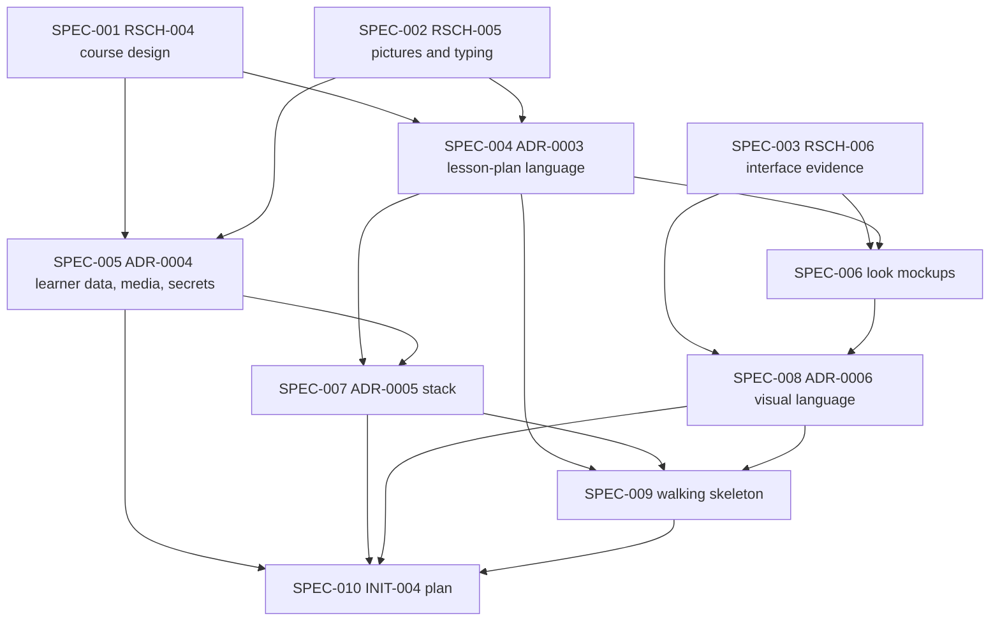

# Initiative: Lesson system foundations — research, stack, lesson-plan language, and a new look

**Initiative ID:** INIT-003
**Status:** complete — Mode E closed 2026-10-11. All ten specs complete. Completion report: `INIT-003-lesson-system-foundations-completion-report.md`. INIT-004 was approved and built after this foundations work.
**Slug:** INIT-003-lesson-system-foundations
**Discipline Profile:** `software`
**Created:** 2026-10-08
**Owner:** Brian Nelson
**Ticket:** None (`branch_naming.ticket_system: none`; initiative sourced from the operator's request and `RSCH-001`–`RSCH-003`)
**Branch:** `lesson-system-foundations` (deliberately not a worktree — the working tree was clean after the operator-requested commit `2f1f0b0` was pushed to `main`, so a plain branch loses nothing, and the Docker bind mount and `node_modules` stay in one place)
**Target Completion:** 2026-10-22
**Source:** Operator request (2026-10-08): "are we using the right code base … should we be using a different css … phoenix or something else", "I want each lesson to be something my AI agent can make … upload images … modify parts of it", "a lesson builder … multi lessons that build on each other, leveraging our research", "this web page is super lame". Research: per `RSCH-001`, `RSCH-002`, `RSCH-003`; the gaps those leave are closed by `RSCH-004`–`RSCH-006` inside this initiative.

---

## 1. Executive Summary

The operator wants the site rebuilt around a different idea of a lesson. Today a lesson is one `window.WORKSHEET` object that the AI replaces whole. It has no images, no way to change one part, and no link to any other lesson. The operator wants lessons that an AI can build and edit part by part, that carry uploaded or generated pictures, that build on one another, and that are drafted from what each learner already knows. The site should also look good, in ways that research supports.

Our research does not yet cover the three things this depends on: how to sequence a beginner Hebrew course, whether pictures and typing practice help, and which interface choices help learning. So this initiative does not start building. It does five things first:

- **Research (RSCH-004 to RSCH-006):** course design and lesson types; pictures, typing, and spelling; learner-interface design.
- **Decisions (ADR-0003 to ADR-0006):** the lesson-plan language, the rules for AI access to learner data and for media and secrets, the stack (including a full rewrite and Phoenix, judged fairly), and the visual language.
- **Look:** three visual mockups, from which the operator picks.
- **Proof:** a small walking skeleton that renders one real unit, with a picture, on the chosen stack and look.
- **Build plan:** the detailed build plan, INIT-004, written from those decisions.

Nothing in this initiative changes the live site. The accounts database, the recorded audio, and the existing lessons are not touched.

**Why two initiatives (operator decision 2026-10-08):** the right specs for the build depend on answers the research and the stack decision produce. Writing them now would mean writing them twice. §12 gives a provisional outline of INIT-004 so the shape is visible, and SPEC-010 replaces it with the real plan.

---

## 2. Domain Analysis

| Domain         | Affected | Key changes |
| -------------- | -------- | ----------- |
| Data           | No       | No schema work here. ADR-0003 and ADR-0005 decide the shape that INIT-004 will build. |
| Service        | No       | No code here. ADR-0004 decides AI access to learner data, media handling, and secrets. |
| API            | No       | Nothing shipped. ADR-0003 states which operations the API and the MCP must both support (capability parity). |
| Event          | No       | — |
| Scheduled      | No       | — |
| Infrastructure | No       | Nothing shipped. ADR-0005 states the runtime consequences of the stack choice. |
| Frontend       | Yes      | Three look mockups (SPEC-006) and a walking-skeleton spike (SPEC-009), both kept outside served folders and outside the Docker image. |
| Docs           | Yes      | Three research reports (`RSCH-004`–`RSCH-006`), four ADRs (ADR-0003–ADR-0006), and the INIT-004 plan (SPEC-010). |

### Bounded contexts

- **Course and lesson design** (core): the plan, unit, lesson, and block model; which lesson types exist; the rules that check a lesson against research.
- **Authoring** (core): one set of operations, used by the AI through the MCP and by the human in the builder, with parity between them.
- **Media** (supporting): uploaded and generated images, their safety, storage, and alt text.
- **Personalization** (core, sensitive): turning a learner's known words into a plan for that learner, and what the AI may see to do it.
- **Learner interface** (core): the look, the type, and the layout, tied to evidence.
- **Identity and progress** (supporting, exists): INIT-002's accounts and server-side progress. Kept; not redesigned.

### Requirements

| ID | Requirement | Priority | Source / evidence |
| --- | --- | --- | --- |
| REQ-001 | The stack decision is made on written criteria. The options include keeping the current stack, adding a no-build component layer, a different frontend toolchain, and a full rewrite (Phoenix LiveView among them). Each option states what it costs to keep users, progress, audio, and lessons. | Must | Operator ("should we be using phoenix or something else … from the ground up if you have to") |
| REQ-002 | One declarative, versioned, validated lesson-plan language describes plans, units, lessons, and typed blocks. Every part has a stable id, so a part can be read, replaced, inserted, moved, or removed without rewriting the whole lesson. | Must | Operator ("modify parts of it"; "a language to allow an instructor to build a lesson plan") |
| REQ-003 | Authoring is AI-first. Every operation the builder offers is also available through the MCP, and the reverse. The ADR states this as a parity table. | Must | Operator ("all lessons will be AI first via the MCP … but should also be able to … via the builder") |
| REQ-004 | Lessons can carry uploaded images and AI-generated images. The decisions cover validation, storage, who may see an image, alt text, cost limits, and where the generation key lives. | Must | Operator ("upload images"; chose "upload and generate") |
| REQ-005 | Lessons build on each other. A plan states, for each lesson, its new words and which earlier lessons it builds on, and the builder checks that earlier words are recycled. | Must | Operator ("multi lessons that build on each other") |
| REQ-006 | Plans can be personal: the next lesson for a learner is drafted from what that learner already knows. The decision states exactly what the AI may read, how the learner is told, and how access is limited and logged. This changes INIT-002's rule that the MCP never reads learner progress, and the ADR says so. | Must | Operator (chose "personal") |
| REQ-007 | The set of lesson types is chosen from evidence, not from a wish list. Each type states its purpose, what research supports it and at what grade, and where it sits in a unit. Types the research does not support are labelled as product choices. | Must | Operator ("whatever is actually useful to helping learn a new language"); `RSCH-003` bands |
| REQ-008 | The look is chosen from mockups. Every interface rule is traced to evidence, or labelled as a product choice. No points, streaks, or other gamification (unproven in `RSCH-003`). | Must | Operator ("whatever is backed by science"); `RSCH-003` |
| REQ-009 | The three gaps in current research are closed or labelled. Each new report has a "Not answered" list and grades every claim. | Must | `RSCH-003` method; operator ("research first") |
| REQ-010 | Nothing is lost. Recorded audio, existing lessons, accounts, and progress have a stated path into whatever is built. INIT-002's audio-preservation rules stay in force. | Must | Operator (INIT-002 REQ-012); carried |
| REQ-011 | Each carried constraint is either kept or superseded by a named ADR. The constraints are in §8 of INIT-002 and ADR-0001/ADR-0002: script-tag lesson data, no root/binyan drills, no forced vowel fading, bilingual UI, no learner names or transcripts in lesson files, key in env only, MCP never reads progress. | Must | Carried constraints |
| REQ-012 | A walking skeleton proves the chosen stack, look, and lesson-plan format on one real unit, with an image, before the build plan is written. | Should | Risk reduction |
| REQ-013 | INIT-004, the detailed build plan, is written from the decisions, with specs, dependencies, security classification, and a migration and rollout plan, and the operator reviews it before anything is built. | Must | Operator (two-initiative decision) |

**Out of scope** (operator decisions 2026-10-08):
- Building the production lesson builder, the new player, the media pipeline, or the personalization service (INIT-004).
- Migrating any data or changing the live site.
- A third "instructor" role. Admins act as instructors; the AI acts through the MCP.
- AI that drafts lesson text inside the server. The server calls an image-generation service only. The AI agent drafts text through the MCP.
- OAuth, email password reset, and more than one server replica (carried from INIT-002).

---

## 3. Spec Breakdown

Each spec covers one domain, sized at 2–6h. The three research specs run through the `sdd-research` skill, which has its own access gate and evidence tiers; the SPEC files say what each report must answer.

| Spec     | Domain   | Title | Prompt | Autonomy | Gates | Blocked by | Effort | Status |
| -------- | -------- | ----- | ------ | -------- | ----- | ---------- | ------ | ------ |
| SPEC-001 | docs     | RSCH-004: course design and lesson types for adult beginners | implementation-planner | plan_only | — | None | 4h | complete |
| SPEC-002 | docs     | RSCH-005: pictures, typing, and spelling in beginner vocabulary learning | implementation-planner | plan_only | — | None | 4h | complete |
| SPEC-003 | docs     | RSCH-006: learner-interface design evidence | implementation-planner | plan_only | — | None | 3h | complete |
| SPEC-004 | docs     | ADR-0003: course and lesson-plan language | implementation-planner | plan_only | — | SPEC-001, SPEC-002 | 5h | complete |
| SPEC-005 | docs     | ADR-0004: learner-data access for personal plans, media, and secrets | implementation-planner | plan_only | — | SPEC-001, SPEC-002 | 4h | complete |
| SPEC-006 | frontend | Three look mockups for Today and a lesson step | principal-frontend-developer | auto_branch | — | SPEC-003, SPEC-004 | 5h | complete |
| SPEC-007 | docs     | ADR-0005: stack and architecture decision | implementation-planner | plan_only | — | SPEC-004, SPEC-005 | 5h | complete |
| SPEC-008 | docs     | ADR-0006: visual language and interface rules | implementation-planner | plan_only | — | SPEC-003, SPEC-006 | 3h | complete |
| SPEC-009 | frontend | Walking skeleton: one real unit on the chosen stack and look | principal-frontend-developer | auto_tests | dependency_add (only if ADR-0005 adds one) | SPEC-004, SPEC-007, SPEC-008 | 6h | complete |
| SPEC-010 | docs     | INIT-004 build plan, migration plan, and review | implementation-planner | plan_only | — | SPEC-005, SPEC-007, SPEC-008, SPEC-009 | 4h | complete |

> Security review and architecture diagrams run automatically as `complete-initiative` phases (`Phase 3.5`/`Phase 3.6`) — they are not spec-table rows. Little code ships here, so Phase 3.5 reviews the SPEC-009 spike and checks ADR-0004 against INIT-004's code later.

**Prompt resolution (disclosed gap):** this repository has no `.claude/agents/` tree and no `scripts/dev/expertise_state.py` or `next_adr_number.py`, as in INIT-002. Each spec names the prompt its domain would use; at execution that resolves to the documented degradation path (work to the spec and this repo's conventions, and say so). The expertise check was run by inspection for all ten specs, with the same result each time: nothing installed, no template, nothing staged. Nothing was manufactured, because the gap is the whole `.claude/agents/` tree, which is an `init` matter.

**ADR numbers (disclosed gap):** claimed by scanning `docs/decisions/`, where only ADR-0001 and ADR-0002 exist: ADR-0003 (SPEC-004), ADR-0004 (SPEC-005), ADR-0005 (SPEC-007), ADR-0006 (SPEC-008). The numbers are written into those specs.

**Research ID claims:** `RSCH-004`, `RSCH-005`, and `RSCH-006` are the next free ids in `sdd/research/README.md`. The research skill may renumber if another session takes one first; the specs cite the report by subject as well as id.

**Operator gates inside the specs** (so none of them is a surprise): SPEC-005 asks for the decision on what the AI may read about a learner; SPEC-006 asks the operator to pick a look; SPEC-007 asks the operator to confirm the stack; SPEC-010 asks the operator to approve INIT-004 before any of it is built.

---

## 4. Dependency Graph

**Critical path:** SPEC-001 → SPEC-004 → SPEC-006 → SPEC-008 → SPEC-009 → SPEC-010 (27h)
**Parallelizable:** SPEC-001, SPEC-002, and SPEC-003 start together. After they finish, SPEC-004 and SPEC-005 run together. SPEC-006 and SPEC-007 then run together.

---

## 5. Timeline & Effort

| Metric             | Value |
| ------------------ | ----- |
| Total effort       | 43h |
| Critical path      | 27h |
| Realistic duration | critical path × 1.3 = 35h |
| Calendar estimate  | about 6 working days at ~6 productive hours/day, plus the time the operator takes at the four gates |

---

## 6. Controls & Gates

- **Default autonomy:** `plan_only` for research and ADRs; `auto_branch` for the mockups; `auto_tests` for the spike.
- **One-way actions expected:** none. Everything stays on the `lesson-system-foundations` branch. The only possible gate action is `dependency_add` in SPEC-009, and only if ADR-0005 chooses a library or framework.
- **Approval owner(s):** Brian Nelson, for ADR-0004 (learner data), the look pick, ADR-0005 (stack), and the INIT-004 plan.
- **Disambiguation gate:** every spec has an assumptions ledger. The rows marked ambiguous below are listed in each spec and must be resolved before that spec moves to `ready`.

See `.claude/skills/sdd/assets/mechanics/gates-and-controls.md`.

---

## 7. Agent Behavior Overrides (optional)

Inherits the defaults. One override for this initiative:

- reporting: every research claim carries its grade (High / Moderate / Low / Very Low) and its source, in the report itself, as in `RSCH-003`.

---

## 8. Threat Model (security)

Little code ships in this initiative, but the ADRs fix the security design of INIT-004, so the threats are modeled now.

- **Attack surface (designed here, built in INIT-004):** image upload endpoint; AI image-generation calls; MCP tools that write lesson parts and (new) read a learner's known words; the lesson-plan format, which holds text that the player renders for every learner.
- **Trust boundaries:** an uploaded file (untrusted bytes) enters the media store; text and image prompts leave the server for an image-generation provider; a learner's known words leave the server for the operator's AI provider through the MCP; plan content written by the AI or an admin is rendered in every learner's browser.
- **Data classification:**
  - Secrets: the ElevenLabs key (exists) and the new image-generation key. Env only, never in images, logs, responses, or lesson files.
  - Learner data: known words and their memory stage. This is the new, sensitive item. It reveals what a named person has studied, and it would go to a third-party AI provider. Answers, timestamps, and names are not needed for planning and should not be sent.
  - Media: uploaded photos may carry location data and faces.
- **STRIDE-lite notes:**
  - *Spoofing:* an upload or MCP call with no valid credential. Covered by the existing session and `MCP_AUTH_TOKEN` rules; ADR-0004 restates them for the new routes.
  - *Tampering:* a malicious file disguised as an image (SVG scripts, polyglot files, oversized pixel bombs); a lesson part that injects script into the player. ADR-0004 and ADR-0003 require content-type checks by bytes, no SVG, re-encoding, and escaping in the renderer (the spike tests this).
  - *Repudiation:* who changed which lesson part, or read which learner. An audit row for every write and every learner-data read (extends INIT-002's audit log).
  - *Information disclosure:* the learner-data snapshot leaving the system; EXIF location in photos; a media URL guessed by a learner who may not see that lesson. Minimum-data snapshot, a per-learner on/off switch, learner disclosure, stripped metadata, and the same visibility rules for media as for lessons.
  - *Denial of service:* large uploads, many generation calls (and their cost). Size and dimension limits, per-hour caps, and a spend cap with a dry-run cost preview, like the audio flow.
  - *Elevation:* a learner reaching an admin upload or generation route. Server-side admin checks on every route (INIT-002 rule).
- **Security-sensitive specs:** SPEC-005 `required` (learner data, secrets, upload threat model). SPEC-004 and SPEC-007 `standard` (untrusted content format; runtime and auth consequences). SPEC-009 `standard` (renders untrusted content). The rest `light`.

Per-spec security review depth and findings are governed by `.claude/skills/sdd/assets/modes/security-review.md`. Unresolved Critical/High findings block completion.

---

## 9. Risk Assessment

| Risk | Probability | Impact | Mitigation |
| ---- | ----------- | ------ | ---------- |
| The research finds little for Hebrew-specific course order, pictures, or typing (the three known gaps) | H | M | Every report must say what is not answered. Decisions that rest on a gap are labelled "product choice, no evidence" in the ADR and in the builder's rules, so none is passed off as science. |
| The stack discussion runs long | M | M | ADR-0005 uses a written criteria table and a decision deadline. The operator confirms at a gate. SPEC-009's spike tests the choice cheaply before the big plan is written. |
| A rewrite drops behavior that 44 test files and 10 Chrome smokes now protect, or loses audio, accounts, or progress | M | H | REQ-010 and REQ-011. ADR-0005 must name a migration path for the database, the 65 recorded clips, and the existing lessons, and list the tests that must be ported. |
| Personal plans send a named learner's study history to a third-party AI provider | M | H | SPEC-005 is `required` security. Minimum-data snapshot, a per-learner switch, learner disclosure, and an audit row on every read. The operator makes the call at SPEC-005's gate. |
| AI-generated pictures mislead (wrong object, odd culture, text baked into the image) | M | M | RSCH-005 asks about this directly. ADR-0004 requires a human approval step before a generated image publishes, required alt text, and a stored prompt for each image. |
| The lesson-plan language is too rigid for the AI, or too loose to validate | M | H | SPEC-004 requires a worked set of sample plans, including all three existing lessons expressed in the new language, and SPEC-009 renders one. |
| INIT-004 is planned from stale facts | L | M | SPEC-010 re-checks the repository state against `origin/main` before it writes any claim about current behavior. |

---

## 10. Success Criteria

- [x] All ten specs complete, with their gates cleared and each ADR accepted by the operator.
- [x] `RSCH-004`, `RSCH-005`, and `RSCH-006` are in `sdd/research/README.md` with graded findings and "Not answered" lists.
- [x] ADR-0003 to ADR-0006 exist, and each carried constraint in REQ-011 is marked kept or superseded.
- [x] The three existing lessons are shown expressed in the new lesson-plan language (no data lost).
- [x] The spike renders one real unit, with an image, in the chosen look, and passes its own tests.
- [x] INIT-004 exists, with specs, dependencies, security classification, and a migration plan (operator approval of INIT-004 is a separate gate before that build starts).
- [x] `npm test` still passes on this branch (the initiative adds no production code, so it must not break any test).
- [x] No unresolved Critical/High security findings, or documented, approved risk acceptances. *(docs/spikes initiative; deeper code review deferred to INIT-004/006 — disclosed in completion report)*
- [x] Completion report generated; initiative status `complete`.

**Plan quality (reflection loop, Phase 5.5):** completeness 8, accuracy 8, clarity 8, technical feasibility 7, guardrails compliance 8. Total 39/50, confidence 0.78. Every dimension is at or above 6, so the plan proceeds. Lowest score is feasibility: the stack decision is open on purpose, and the plan cannot show its cost until SPEC-007 runs.

---

## 11. Next Steps

1. All ten specs are complete. Mode E closed 2026-10-11.
2. INIT-004 was approved and Mode E closed; INIT-006 Mode E closed.
3. Remaining planned work: INIT-005 (approved, not started), INIT-007 (planned).

---

## 12. Provisional outline of INIT-004 (not a plan)

SPEC-010 replaced this outline. The plan that is in force is `sdd/initiatives/INIT-004-lesson-system-build/`. The table below is the sketch that was written before the ADRs; it is not a second plan. Where it said "if", ADR-0005 answered Option A. The spike needed no ADR amendment.

| Area | Likely work | Depends on |
| ---- | ----------- | ---------- |
| Data | Plans, units, lessons, blocks, and their revisions; media assets table; per-learner AI-planning switch. Migration that imports the three existing lessons into the new model without changing a recorded clip. | ADR-0003, ADR-0004 |
| Service | Lesson-plan store with part-level operations (read, replace, insert, move, remove) and optimistic revisions. Validator that applies the research rules (new words per lesson, recycling of earlier words, story coverage near 95%, one pattern per lesson). Media pipeline: upload checks, re-encode, strip metadata, thumbnails. Image-generation client with dry-run cost preview and spend cap. Personal-plan service that builds a minimum known-words snapshot. | ADR-0003, ADR-0004 |
| API / MCP | Admin plan, lesson, block, and media endpoints; learner plan endpoints; matching MCP tools (capability parity), including `get_learner_snapshot` behind the new switch. | ADR-0003, ADR-0004 |
| Frontend | The new design system; new Today, plan, and lesson screens; renderers for each lesson type; the builder (outline editor, block editors, media library, live preview, validation panel). | ADR-0005, ADR-0006 |
| Infrastructure | A media volume and its backup; the image-generation key as a secret; the runtime changes ADR-0005 implies. | ADR-0004, ADR-0005 |
| Docs | Authoring guide for the AI (updated `hebrew-worksheet` skill or its replacement), operator guide, ADR updates. | all |

Because the product is AI-first, the first INIT-004 slice should be the lesson-plan store with part-level operations and the matching MCP tools. The builder and the new look sit on top of that.
