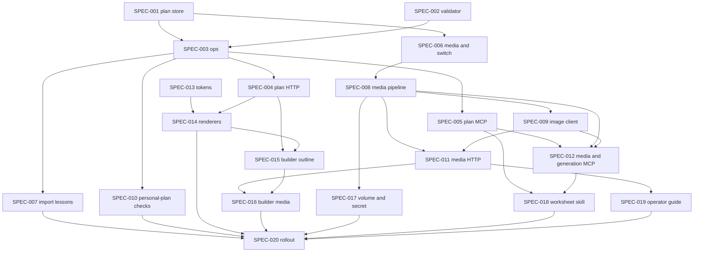

# Initiative: Lesson system build

**Initiative ID:** INIT-004
**Status:** complete — Mode E closed 2026-10-10. All twenty specs complete (SPEC-020 last, 2026-10-09). Completion report: `INIT-004-lesson-system-build-completion-report.md`. Approved by the operator 2026-10-09 ("OK finish init-004"). Local DB: migrations 002–003 applied and four sample plans imported 2026-10-10. Still operator-only: SPEC-017 cluster `secret_change`/`deploy`, and SPEC-020 learner-link cutover (default none — no link flipped).
**Slug:** INIT-004-lesson-system-build
**Discipline Profile:** `software`
**Created:** 2026-10-08
**Owner:** Brian Nelson
**Ticket:** None (`branch_naming.ticket_system: none`; sourced from INIT-003/SPEC-010 and ADR-0003 through ADR-0006)
**Branch:** `lesson-system-build` (approved 2026-10-09; created from the `lesson-system-foundations` checkout that already holds ADR-0003–0006 and the SPA work — in-place escape hatch, no separate worktree).
**Target Completion:** not a promise. §5 is a planning estimate that starts only after that approval.
**Source:** INIT-003/SPEC-010. Decisions: ADR-0003, ADR-0004, ADR-0005, ADR-0006. Spike: `spikes/skeleton/RESULTS.md` (adopt as the base; no ADR amendment). Research: `RSCH-004`, `RSCH-005`, `RSCH-006`, already applied inside those ADRs.

---

## 0. Source tree used for current-behavior claims

`git fetch origin` on 2026-10-08. `origin/main` and local `main` are the same commit:

`2f1f0b0ad87ad940ed8593af6d4a6e5c05554f58`

Local `main` is not behind the remote tip. Claims about the live product cite `origin/main:path:line`. ADR-0003 through ADR-0006 and the spike live on `lesson-system-foundations` and are not on that commit; they are cited by their own paths.

Checked on that commit:

| Fact | Citation |
|------|----------|
| 65 `.mp3` files in the tree | `git ls-tree -r --name-only origin/main` counted 65 paths ending in `.mp3`, matching the inventory in `origin/main:sdd/initiatives/INIT-002-multi-user-progress/INIT-002-multi-user-progress-completion-report.md:15` |
| Three published lessons | `origin/main` directories `worksheets/my-morning`, `worksheets/anal-sex-vocab`, `worksheets/shai-date-indirect-speech` (`worksheets/_template` is not a lesson) |
| Accounts, sessions, progress, audit | `origin/main:server/db/migrations/001-initial.js:12` (`users`), `:32` (`sessions`), `:42` (`review_items`), `:60` (`practice_events`), `:75` (`lesson_progress`), `:86` (`lesson_visibility`), `:100` (`audit_log`) |
| MCP tools today | `origin/main:mcp/tools.js:148` `list_lessons`, `:160` `get_lesson`, `:175` `list_words`, `:190` `list_activity_types`, `:202` `list_users`, `:221` `upsert_lesson`, `:318` `set_lesson_visibility`, `:342` `generate_lesson_audio` |
| Audio gates | `origin/main:package.json` scripts `audio:inventory` and `audio:verify` (INIT-002 REQ-012: inventory before and after, archive before overwrite) |

---

## 1. Executive Summary

INIT-004 builds the lesson system the ADRs already decided, in the Node process that already serves the site. A plan is a versioned JSON document. Authors change one part at a time. The same functions serve the MCP and the builder. Learners see a published snapshot, drawn with the a-calm-type tokens. Pictures are uploaded or generated under ADR-0004's rules. A personal plan can be assigned to one learner. What the AI may read about that learner is INIT-006's learner profile (ADR-0009 §1). INIT-004 no longer builds a learner snapshot (amended 2026-10-09 by INIT-006/SPEC-001).

The walking skeleton in `spikes/skeleton/` is the base. Its operations, validator, escaping, and tokens move into `server/plans/` and `shared/ui/`. The four hardcoded picture ids in the spike validator do not move. No ADR is amended. The production site does not import the spike folder.

This is one initiative. The store, the operations, the MCP, the learner screens, and the cutover share one SQLite file, one process, and one revision rule. Splitting them would freeze that contract between initiatives and run two cutovers. The estimate is 84h (88h before INIT-006/SPEC-001 moved the learner snapshot out). That is large, and it still fits one delivery because every spec stays inside 6h and the operator can stop at a slice boundary.

Nothing here starts until the operator approves this document. Tests use a fake speech client and a fake image client. The real ElevenLabs and OpenAI services are not called from tests. Keys are not printed, committed, or written into this plan.

**First slice:** plan store, part-level operations, and the matching MCP tools (SPEC-001, SPEC-002, SPEC-003, SPEC-004, SPEC-005), plus the import of the three lessons and the café unit (SPEC-007) so the tools have documents to edit. The builder UI is later. The AI can author through the MCP as soon as that slice is done.

---

## 2. Domain Analysis

| Domain         | Affected | Key changes |
| -------------- | -------- | ----------- |
| Data           | Yes      | Plan working copy, revision, status, published snapshot. Media-asset rows. The `users.ai_planning` column, default off (read and flipped by INIT-006). Import of the three legacy plans and the café unit. Accounts and progress tables stay. |
| Service        | Yes      | `server/plans/ops.js` is the only mutation logic. Validator (N1–N12 and the further rules). Media ingest. OpenAI image client. Personal-plan assignee checks. |
| API            | Yes      | Plan routes and plan MCP tools (the ADR-0003 parity table). Media, generation, and approval routes. MCP tools `upload_media`, `plan_image`, `generate_image`. |
| Event          | No       | Audit rows use the existing `audit_log`. No new bus. |
| Scheduled      | No       | Caps are counted on the request. No cron job. |
| Infrastructure | Yes      | `DATA_DIR/media` on the existing data volume, backup of that tree, `OPENAI_API_KEY` as a secret, rollout checklist. `replicas` stays 1. |
| Frontend       | Yes      | Tokens in `shared/worksheet.css`. `shared/ui/` renderers for Today, the plan, and the six block types. Builder screens on the same operations. |
| Docs           | Yes      | Rewrite of `.cursor/skills/hebrew-worksheet/` for the plan language. Operator-guide sentences for media and backup. |

### Bounded contexts

- **Plan document** (core): plans, units, lessons, blocks, revision, draft versus published snapshot.
- **Authoring** (core): one operation implementation, two adapters (HTTP session and MCP token).
- **Research rules** (core): the validator cites ADR-0003 Decision 6 by id.
- **Media** (supporting): bytes outside every served root, human approval, generation.
- **Personalization** (core, sensitive): moved to INIT-006 (the ADR-0009 §1 profile and the admin switch). INIT-004 keeps the assignee checks. The plan shape does not change.
- **Learner interface** (core): a-calm-type, six block renderers, Today.
- **Identity and progress** (supporting, exists): INIT-002 accounts, sessions, review rows, lesson progress. Kept.
- **Rollout** (supporting): parallel legacy worksheets, one-screen cutover, audio inventory at every step.

### Requirements

| ID | Requirement | Priority | Source |
| --- | --- | --- | --- |
| REQ-001 | Store each plan as one JSON document with an integer revision, `status` of `draft` or `published`, a working copy, and a published snapshot. Personal and shared plans use the same shape. | Must | ADR-0003 §1, §3, §7; ADR-0005 §5 "Where state lives" |
| REQ-002 | The six part operations and publish are each one exported function in `server/plans/ops.js` (publish in `server/plans/publish.js`). A stale `expectedRevision` returns `revision_conflict` and leaves the document unchanged. HTTP uses 409. | Must | ADR-0003 §4; ADR-0005 §5 operations table and "Conflict transport" |
| REQ-003 | The validator applies JSON Schema draft-07 and the ADR-0003 Decision 6 registry (N1–N12 and the further rules). It does not hardcode the spike's four picture ids. | Must | ADR-0003 §6; `spikes/skeleton/RESULTS.md` "ADR amendments" |
| REQ-004 | Every operation in the ADR-0003 / ADR-0005 parity table exists on the HTTP adapter and the MCP adapter, calling the same function. `upsert_lesson` stays the legacy worksheet write and is not a plan operation. | Must | ADR-0003 §4; ADR-0005 §5; operator AI-first (INIT-003 REQ-003) |
| REQ-005 | Import `my-morning`, `anal-sex-vocab`, and `shai-date-indirect-speech` from the sample plans, plus `beginner-unit-1` as draft. Audio paths are copied character for character. Worksheet `index.html` files are not edited. | Must | ADR-0003 §8 and §10 |
| REQ-006 | Image upload sniffs bytes, re-encodes to one PNG, strips metadata, stores under `DATA_DIR/media` with a random name, and archives before delete. Fetch follows the ADR-0004 matrix. | Must | ADR-0004 §5, §6, §8, §9, §10 |
| REQ-007 | Image generation calls OpenAI `gpt-image-1` only, from this server, with dry-run, `confirm: true`, the hourly cap, and the daily spend cap. `OPENAI_API_KEY` stays in the environment. | Must | ADR-0004 §7 |
| REQ-008 | **Superseded 2026-10-09 by INIT-006** (ADR-0009 §1, Accepted 2026-10-09). The learner snapshot (ADR-0004 §1), its MCP tool, the switch route, and the disclosure sentence are INIT-006's. INIT-004 keeps two parts: `users.ai_planning` exists and defaults off (SPEC-006), and the MCP cannot approve media (SPEC-011, SPEC-012). A personal plan can be assigned only to an active account (SPEC-010). | Must | ADR-0004 §3, §4; ADR-0009 §1 |
| REQ-009 | Today, the plan overview, and the six block types render from a published snapshot through `shared/ui/` functions and the ADR-0006 tokens. Text is escaped. An image with no alt is not rendered. | Must | ADR-0005 §6; ADR-0006 Decisions 1–4; spike RESULTS |
| REQ-010 | The builder edits parts through the same HTTP operations. It shows validation warnings and the media library. It does not contain a second copy of the operations. | Must | ADR-0003 §4; ADR-0005 §5 "One implementation" |
| REQ-011 | The media trees are on the data volume and in the backup set. `OPENAI_API_KEY` is a cluster secret, not an image layer. `replicas` stays 1. `strategy` stays `Recreate`. | Must | ADR-0004 §9; ADR-0005 §8 audio and data invariants |
| REQ-012 | `.cursor/skills/hebrew-worksheet/` teaches plan ids, part patches, image requests, and the validator ids. `docs/operations/accounts-and-admin.md` documents media upload, approval, generation caps, and backup. The AI-planning sentence ADR-0004 §11 left for this initiative moved to INIT-006 SPEC-019 on 2026-10-09. | Must | ADR-0004 §9, §11; operator (INIT-003 SPEC-010 item 6) |
| REQ-013 | Rollout keeps the 65 clips, the three lessons, accounts, and progress. Each step has a rollback. No step deletes a recording without an archive. Legacy pages stay up until that screen's snapshot is what learners open. | Must | ADR-0005 §8; INIT-002 REQ-012; operator |
| REQ-014 | Each carried constraint is restated as kept, changed, or superseded, in agreement with ADR-0003 §9 as ADR-0004 and ADR-0005 have already updated the MCP-progress row. | Must | ADR-0003 §9; ADR-0005 §9 |
| REQ-015 | Production modules are ported from `spikes/skeleton/`. The spike is not deleted in the first slice. The site does not serve `spikes/`. | Must | `spikes/skeleton/RESULTS.md`; ADR-0005 SPEC-009 row |

**Out of scope**

- A new plan-create operation. ADR-0003's parity table does not name one. **Open.** The first slice loads the four sample documents so the AI can edit them. Adding create or delete of a plan id is a later change that must land on both adapters in the same change (ADR-0003 §4, the bulk-import rule). This plan does not invent the tool name.
- A separate thumbnail file. INIT-003 §12 said "thumbnails". ADR-0004 §5 stores one PNG whose longest side is 2048 pixels. That decision replaces the outline.
- A decoder package. ADR-0005 Option A adds no direct dependency and does not name a PNG/JPEG/WebP decoder. **Open** until the operator approves one at SPEC-008's `dependency_add` gate. This plan does not pick a library.
- Phoenix, Preact, Vite, React, a second replica, OAuth, email password reset, an instructor role, and AI that drafts lesson text inside the server. ADR-0005 chose Option A. The server calls the image provider only.
- Editing existing lesson `index.html` files. ADR-0003 §9 keeps that constraint.
- Content-Security-Policy. ADR-0005 left it as ADR-0002's follow-up.

### Feature-analysis notes

Discipline profile `software` is bound because it is the only profile this repo's initiatives use, and this checkout has no `sdd/skill` config §7.1 file of its own. The eight domain rows above are that profile's rows. Prompt files under `.claude/agents/` are not in this repo. Each spec names the prompt its domain would use and discloses the degradation path. Nothing was manufactured.

INIT-003 §12 is the outline this plan replaces. Where it said "if", ADR-0005 has answered: Option A, modules beside the legacy player, one process.

---

## 3. Spec Breakdown

Each spec is one domain, 2–6h. Security review and architecture diagrams stay `complete-initiative` phases. They are not rows.

The first slice is the block the AI needs before a builder exists: SPEC-001, SPEC-002, SPEC-003, SPEC-004, SPEC-005, and SPEC-007.

| Spec | Domain | Title | Prompt | Autonomy | Gates | Blocked by | Effort |
| ---- | ------ | ----- | ------ | -------- | ----- | ---------- | ------ |
| SPEC-001 | data | Plan store: working copy, revision, snapshot | database-architect | auto_tests | db_migration | None | 4h |
| SPEC-002 | service | Plan validator (schema and N1–N12) | principal-backend-developer | auto_tests | — | None | 5h |
| SPEC-003 | service | Plan operations, store, and publish | principal-backend-developer | auto_tests | — | SPEC-001, SPEC-002 | 5h |
| SPEC-004 | api | Plan HTTP routes (admin and learner) | principal-backend-developer | auto_tests | — | SPEC-003 | 5h |
| SPEC-005 | api | Plan MCP tools (parity table) | principal-backend-developer | auto_tests | — | SPEC-003 | 4h |
| SPEC-006 | data | Media assets and the AI-planning switch | database-architect | auto_tests | db_migration | SPEC-001 | 4h |
| SPEC-007 | data | Import the three lessons and the café unit | database-architect | auto_tests | — | SPEC-003 | 4h |
| SPEC-008 | service | Media pipeline | principal-backend-developer | auto_tests | dependency_add | SPEC-006 | 5h |
| SPEC-009 | service | OpenAI image client | principal-backend-developer | auto_tests | — | SPEC-008 | 4h |
| SPEC-010 | service | Personal-plan assignee checks | principal-backend-developer | auto_tests | — | SPEC-003 | 2h |
| SPEC-011 | api | Media, generation, and approval routes | principal-backend-developer | auto_tests | — | SPEC-008, SPEC-009 | 4h |
| SPEC-012 | api | Media and image-generation MCP tools | principal-backend-developer | auto_tests | — | SPEC-005, SPEC-008, SPEC-009 | 4h |
| SPEC-013 | frontend | Design tokens in the shared stylesheet | principal-frontend-developer | auto_tests | — | None | 3h |
| SPEC-014 | frontend | Today, plan, and six block renderers | principal-frontend-developer | auto_tests | — | SPEC-004, SPEC-013 | 6h |
| SPEC-015 | frontend | Builder outline and block editors | principal-frontend-developer | auto_tests | — | SPEC-004, SPEC-014 | 5h |
| SPEC-016 | frontend | Builder media library, preview, validation | principal-frontend-developer | auto_tests | — | SPEC-011, SPEC-015 | 5h |
| SPEC-017 | infrastructure | Media volume, backup, and generation secret | principal-devops-engineer | auto_tests | secret_change, deploy | SPEC-008 | 4h |
| SPEC-018 | docs | Hebrew-worksheet skill for the plan language | implementation-planner | plan_only | — | SPEC-005, SPEC-012 | 4h |
| SPEC-019 | docs | Operator guide: media and backup | implementation-planner | plan_only | — | SPEC-011 | 3h |
| SPEC-020 | infrastructure | Migration and rollout | principal-devops-engineer | auto_tests | deploy | SPEC-007, SPEC-010, SPEC-014, SPEC-016, SPEC-017, SPEC-018, SPEC-019 | 4h |

**Amended 2026-10-09 (INIT-006/SPEC-001): no learner-snapshot tool here.** This initiative used to plan a `get_learner_snapshot` MCP tool and service under ADR-0004 §1 (SPEC-010, SPEC-011's switch route, SPEC-012). They are superseded by INIT-006's learner profile (ADR-0009 §1, Accepted 2026-10-09). The effort fell from 88h to 84h: SPEC-010 from 4h to 2h, SPEC-011 from 5h to 4h, SPEC-012 from 5h to 4h.

**Why there is no leading docs spec.** `spikes/skeleton/RESULTS.md` records no ADR amendment. SPEC-009's completion summary says the same. The skill rewrite waits until the tool names exist (SPEC-018).

**Prompt resolution (disclosed gap):** this repository has no `.claude/agents/` tree. The expertise check was inspection, once per spec: nothing installed, no template, nothing staged. Nothing was manufactured. At execution each prompt degrades to the spec plus this repo's conventions.

**Model:** `sonnet` on every spec except SPEC-002, SPEC-008, and SPEC-020, which pin `opus` (the rule registry, the upload threat model, and the cutover). SPEC-010 was `opus` for the snapshot contract and is `sonnet` now that the contract is INIT-006's.

---

## 4. Dependency Graph

**Critical path:** SPEC-002 → SPEC-003 → SPEC-004 → SPEC-014 → SPEC-015 → SPEC-016 → SPEC-020 (35h)

SPEC-001 (4h) runs beside SPEC-002 (5h). SPEC-003 waits for both, so the longer of those two is the path.

**First slice path:** SPEC-002 → SPEC-003 → SPEC-005 (14h), with SPEC-004 (15h to finish the HTTP twin) and SPEC-007 beside them. The AI can call the plan tools when SPEC-005 and SPEC-007 are done. The builder (SPEC-015) is not on that path.

**Parallelizable:** SPEC-001, SPEC-002, and SPEC-013 start together. After SPEC-003, SPEC-004, SPEC-005, and SPEC-007 share no files except the ops module they only call. After SPEC-006, SPEC-008 can start. SPEC-010 can run beside SPEC-004, SPEC-005, and SPEC-007 once SPEC-003 is done. It calls `ops.js` and does not edit it.

The graph has no cycles. Every edge above is a `blocked_by` on the later spec.

---

## 5. Timeline & Effort

| Metric | Value |
| ------ | ----- |
| Total effort | 84h (was 88h; see §3 amendment) |
| Critical path | 35h |
| First slice | 15h to SPEC-004 (HTTP) and SPEC-007; MCP tools at 14h |
| Realistic duration | critical path × 1.3 = 46h |
| Calendar estimate | about 8 working days at ~6 productive hours/day, after approval, plus the operator gates |

**Operator gates**

| Gate | Spec | Who |
|------|------|-----|
| Approve this initiative before any spec runs | this document | Brian Nelson |
| `db_migration` | SPEC-001, SPEC-006 | Brian Nelson |
| `dependency_add` (decoder; library not chosen here) | SPEC-008 | Brian Nelson |
| `secret_change` and `deploy` (`OPENAI_API_KEY`, media path, backup) | SPEC-017 | Brian Nelson |
| `deploy` (which learner screen switches to the snapshot) | SPEC-020 | Brian Nelson |

**Plan quality (reflection loop):** completeness 8, accuracy 8, clarity 8, technical feasibility 7, guardrails compliance 8. Total 39/50, confidence 0.78. Every dimension is at or above 6. Feasibility is the low score because the decoder is still an operator gate and the hand-built HTML stays the C11 risk ADR-0005 already accepted after the spike.

---

## 6. Controls & Gates

- **Default autonomy:** `auto_tests` for code; `plan_only` for the two docs specs.
- **One-way actions:** `db_migration` (SPEC-001, SPEC-006), `dependency_add` (SPEC-008), `secret_change` and `deploy` (SPEC-017), `deploy` (SPEC-020).
- **Approval owner:** Brian Nelson.
- **Standing rules:** no commit or push unless the operator asks. No key in a file, log, or response. No learner name or transcript in a lesson file. Tests never call ElevenLabs or OpenAI.
- **Audio on every spec that can see `worksheets/` or `LESSONS_DIR`:** `npm run audio:inventory` before, `npm run audio:verify` after. A clip is not deleted. An overwrite, if one is ever required, archives and verifies first. This initiative's steps do not overwrite clips.

---

## 7. Agent Behavior Overrides (optional)

Inherits the defaults. One override:

- secrets: never print `ELEVENLABS_API_KEY` or `OPENAI_API_KEY`, never write them into a spec, test, fixture, or image, and never log a generation prompt on a line that is printed.

---

## 8. Threat Model (security)

Carried from ADR-0004 and ADR-0003's Security section. This initiative builds that model. It does not reopen it.

- **Attack surface:** `POST /api/media`; image-generation calls; MCP tools that write plan parts; plan text rendered for every learner who may open the lesson. The learner-data surface (the profile tool and the AI-planning switch) moved to INIT-006 on 2026-10-09.
- **Trust boundaries:** upload bytes enter `DATA_DIR/media`; prompts leave the server for OpenAI; plan text written by an admin or the MCP is rendered in the learner's browser. No learner data reaches the MCP client from this initiative.
- **Data classification:**
  - Secrets: `ELEVENLABS_API_KEY` (exists) and `OPENAI_API_KEY` (new). Environment only.
  - Learner data: none leaves the server from this initiative. The profile contract is ADR-0009 §1 (INIT-006).
  - Media: uploaded photos may carry location data and faces. Those are stripped at ingest. Approval is a person.
- **STRIDE-lite:** the ADR-0004 matrix is the authorization contract. Spoofing is the existing session and `MCP_AUTH_TOKEN`. Tampering is sniff, re-encode, no SVG, and escaped plan text. Repudiation is one `audit_log` row per ADR-0004 §10 action. Disclosure is the 404 for plans the caller must not know about, and no public media URL. Denial of service is the size, upload, and generation rate caps. Elevation is server-side admin checks; `mcp` receives 403 on approval.
- **Security-sensitive specs (`security_review: required`):** SPEC-004 (personal-plan visibility), SPEC-006 (switch column), SPEC-008 (upload), SPEC-009 (generation key and provider call), SPEC-010 (assignee checks), SPEC-011 (those routes), SPEC-012 (upload and generation tools), SPEC-017 (the key in the cluster).

---

## 9. Risk Assessment

| Risk | Probability | Impact | Mitigation |
| ---- | ----------- | ------ | ---------- |
| Hand-written HTML misses an escape, `dir`, or alt | M | H | The spike already refused a hostile string and a missing alt. SPEC-014 ports those tests. ADR-0005 says amend to Option B only if that failure returns. |
| A migration step touches a recording | L | H | SPEC-007 and SPEC-020 run inventory and verify. No step's rollback deletes an `.mp3`. Paths stay the strings already in the worksheets. |
| A personal plan is assigned to a disabled or missing account | L | M | SPEC-010 refuses it and leaves the revision unchanged. The learner-profile risk moved to INIT-006 (its SPEC-007 never-returned test). |
| The decoder gate stalls pictures | M | M | Plan authoring does not wait on it. SPEC-005 ships before SPEC-008. |
| Two writers publish a blend | L | H | One revision. Mismatch rejects the write. No merge. |
| Legacy lessons fail N1 if treated as new | H | M | `migration.legacy: true` warns and does not block, as ADR-0003 §8 states for the two lessons over 8 new words. |
| `GET /api/plans/:id/published` reads the lesson visibility inside the plan, not `lesson_visibility`, so a lesson restricted in the Lessons tab is readable by every signed-in learner once its plan is published (added 2026-10-09 by INIT-004/SPEC-020) | M | H | The SPEC-020 preflight compares the two before and after rollout step 2, and the checklist blocks step 2 on a mismatch. Follow-up for the SPEC-004 route: also require `lesson_visibility` for a lesson that is a worksheet slug. Until then, Brian records in the rollout run log that he accepts this, or step 2 waits. |

---

## 10. Success Criteria

- [ ] All twenty specs complete, with the gates in §5 cleared.
- [ ] The MCP and the HTTP tests call the same ops functions and cover every row of the parity table in §12.
- [ ] `npm test` passes. `npm run audio:verify` matches the inventory taken at the start of the rollout spec. The count of recordings is still 65, at the same paths.
- [ ] The three legacy plans and the café unit load. Worksheet `index.html` files are unchanged. Accounts, sessions, review rows, and lesson progress are still in `hebrew.sqlite`.
- [ ] No MCP tool in this initiative reads learner progress. A personal plan can be assigned only to an active account.
- [ ] Today and one lesson of each block type render with the ADR-0006 tokens in light and dark.
- [ ] No unresolved Critical or High security finding, or a documented acceptance by the operator.
- [ ] Completion report generated; initiative status `complete`.

---

## 11. Next Steps

1. The operator reviews this initiative, the first-slice list, and the security classifications.
2. After written approval, create branch `lesson-system-build` and start SPEC-001, SPEC-002, and SPEC-013 together.
3. Finish the first slice (through SPEC-005 and SPEC-007) before the builder specs.
4. Stop at each gate in §5.
5. Run `complete-initiative` when every spec is complete.

---

## 12. Capability parity

ADR-0005 §5 is the table INIT-004 implements. SPEC-004 and SPEC-005 both list these rows. SPEC-012 lists the ADR-0004 tools and does not drop these.

| Operation | Function | MCP tool | HTTP |
|-----------|----------|----------|------|
| Read a part | `readPart` | `read_part` | `GET /api/plans/:id/parts` |
| Replace a part | `replacePart` | `replace_part` | `PUT /api/plans/:id/parts` |
| Insert a block | `insertBlock` | `insert_block` | `POST /api/plans/:id/blocks` |
| Move a block | `moveBlock` | `move_block` | `POST /api/plans/:id/blocks/move` |
| Remove a block | `removeBlock` | `remove_block` | `DELETE /api/plans/:id/parts` |
| Set a field | `setField` | `set_field` | `PATCH /api/plans/:id/fields` |
| Publish | `publishPlan` | `publish_plan` | `POST /api/plans/:id/publish` |

Publish is not a seventh edit operation. Learner read is `GET /api/plans/:id/published` (snapshot only). It is not in the edit table.

ADR-0004 media tools, SPEC-011 and SPEC-012. The learner-profile tool and the AI-planning switch route are INIT-006's (its §12):

| Action | HTTP | MCP |
|--------|------|-----|
| Upload | `POST /api/media` | `upload_media` |
| Fetch | `GET /api/media/:id` | no separate tool; fetch is the HTTP row |
| Approve | `POST /api/admin/media/:id/approval` | 403. No success tool. |
| Dry-run | `GET /api/admin/images/image-plan` | `plan_image` |
| Generate | `POST /api/admin/images` | `generate_image` |

The eight tools already registered in `origin/main:mcp/tools.js` stay registered. `upsert_lesson` still writes worksheets. It does not write a plan.

**Open:** a tool that creates a new plan id is not in this table.

---

## 13. Carried constraints

ADR-0003 §9 is the list. ADR-0005 §9 restates it for Option A and applies ADR-0004 to the MCP-progress row. This table agrees with both. "In force" is what INIT-004 builds.

| Source | Constraint | ADR-0003 | In force for this build |
|--------|------------|----------|-------------------------|
| ADR-0001 #1, superseded by ADR-0002 | Progress only in the account database | Kept. Plans do not store progress. | Kept |
| ADR-0001 #2; INIT-002 REQ-014 | Lesson data by script tag, not `fetch` | Superseded for the plan at API cutover. Kept for `window.WORKSHEET` until those files are removed. | Same. SPEC-014 fetches only `GET /api/plans/:id/published`. Legacy worksheets stay script tags until SPEC-020 retires that screen. |
| ADR-0001 #3 | No edits to existing lesson `index.html` | Kept | Kept. SPEC-007 does not touch them. |
| ADR-0001 #4 | No root or binyan speed drills | Kept | Kept |
| ADR-0001 #5 | No forced vowel fading; points on by default | Kept | Kept. Missing points are a warn, not a publish block. |
| ADR-0001 #6 | Bilingual UI labels | Kept for chrome | Kept |
| ADR-0001 #7 | No account names, transcripts, or secrets in lesson files | Kept | Kept |
| ADR-0001 | `exactKey` identity | Kept | Kept. Review and checkpoint word keys are that key. |
| ADR-0002 | Server owns the review schedule | Kept | Kept |
| ADR-0002 | `fetch` only for `/api/` | Changed in scope: plan GET is one `/api/` call | Kept with that scope |
| ADR-0002 | New lessons `hidden`; draft was `hidden` | Changed. Draft is `status`. New lesson visibility stays `hidden`. | Kept as changed |
| ADR-0002 | Visibility `hidden` / `everyone` / `selected`; grants in the account database | Kept | Kept |
| ADR-0002; REQ-012 | Audio paths unchanged; archive before overwrite; inventory and verify | Kept | Kept. SPEC-007 and SPEC-020. |
| ADR-0002 | ElevenLabs key only in server env | Kept | Kept. Same rule for `OPENAI_API_KEY`. |
| ADR-0002, as ADR-0004 and ADR-0009 amend | MCP and learner progress | Kept until ADR-0004 | Kept. Nothing INIT-004 builds lets the MCP read learner progress. The rule is replaced by INIT-006 (ADR-0009 §9, Accepted 2026-10-09) when INIT-006 ships: the MCP reads only the §1 profile, only when that learner's switch is on, and never answer history, typed text, timestamps, passwords, sessions, or admin views. |
| ADR-0002 | One replica; `DATA_DIR` outside served roots | Kept | Kept |
| ADR-0004 | Media sniff, re-encode, random name, gated fetch, human approval, generation key in the environment | Not in the ADR-0003 table (later record) | Kept. SPEC-008, SPEC-009, SPEC-011, SPEC-017. |

---

## 14. Migration and rollout

This section is the plan. SPEC-020 is the spec that runs it, after the modules exist. ADR-0005 §8 is the step order. The site stays the current process and the current image. There is no second site.

What moves, and what does not:

| Thing | What happens | Citation |
|-------|----------------|----------|
| 65 recordings | Unchanged paths and bytes. Inventory before and after every step that can see the lessons tree. No delete. No overwrite in these steps. | `origin/main` count of 65 `.mp3` files; INIT-002 REQ-012 |
| Three lessons | Imported from `docs/decisions/ADR-0003-assets/samples/*.plan.json` into the plan tables. `my-morning`, `anal-sex-vocab`, `shai-date-indirect-speech` are `published`, visibility `everyone`, `migration.legacy: true`. The worksheet files remain the live player until step 6 for that lesson. | ADR-0003 §8, §10 |
| Café unit | `beginner-unit-1.plan.json` imports as `draft`, lessons `hidden`. No clip paths are invented. | ADR-0003 §10 |
| Accounts, sessions, review rows, lesson progress, grants, audit | Same `hebrew.sqlite`. New tables are additive. Down migrations drop only the new tables. | `origin/main:server/db/migrations/001-initial.js` |
| MCP | The eight current tools stay. Plan tools are added in SPEC-005. Media and image-generation tools are added in SPEC-012. | `origin/main:mcp/tools.js:148`–`:342` |

| Step | Spec | What changes | What stays up | Rollback |
|------|------|----------------|---------------|----------|
| 1 | SPEC-001, SPEC-003, SPEC-004, SPEC-005 | Plan tables, ops, validator, plan routes, plan MCP tools. Routes use the existing session, CSRF, and token checks. | Legacy pages, worksheets, the eight MCP tools, sign-in. | Unmount the plan routes and unregister the plan tools. Drop the new tables with the down migration. No snapshot has been served. |
| 2 | SPEC-007 | Insert the four sample documents. Run `audio:inventory` before and `audio:verify` after. | The worksheet player. | Delete the inserted plan rows. Worksheets and recordings were not modified. |
| 3 | SPEC-013 | Token block appended to `shared/worksheet.css`. Existing selectors keep their names. | Every page. | Revert the stylesheet. |
| 4 | SPEC-006, SPEC-008, SPEC-011, SPEC-017 | Media tables, pipeline, routes, volume path, backup copy of `DATA_DIR/media` and `DATA_DIR/media/_archive`. | The static allowlist. Media is not added to it. | Stop the routes. Down migration drops the media tables. Archived files stay archived. |
| 5 | SPEC-015, SPEC-016 | Admin builder for plans. The old editor remains for worksheets. | Learner site. | Hide the builder route. Worksheets still save through `upsert_lesson`. |
| 6 | SPEC-014, then SPEC-020's cutover gate | One learner screen fetches `GET /api/plans/:id/published`. Other lessons stay on script tags. The operator names which lesson. | Sign-in, the other lessons, review, progress. | Point that lesson's link back at the worksheet. |
| 7 | SPEC-020 | Retire a worksheet only after its snapshot is what learners open and that screen's Chrome script is green. | The other worksheets. | Restore the worksheet link. The files were not deleted in earlier steps. |

Invariants on every step, from ADR-0005 §8:

- No `.mp3` is deleted, moved, or overwritten. A future overwrite still archives and verifies first.
- Paths and URLs of existing clips do not change.
- `hebrew.sqlite` is not replaced. Plan and media tables are additive, each with a down path.
- `DATA_DIR` stays outside every served root.
- `replicas` stays 1. `strategy` stays `Recreate`.
- `MCP_AUTH_TOKEN` stays required.
- No step serves a page, a lesson file, a plan, a clip, or a media byte without the sign-in check, except the login page and its assets.

**Tests.** ADR-0005 §7: under Option A, nothing in the current `npm test` set is dropped. New plan tests are new files. A Chrome script changes only in the same change as a `data-*` hook or class it queries. While a screen is still the legacy player, its script is unchanged. Port-or-drop applies only to the rejected stack options D and E, which this initiative does not build.

| Disposition | Files |
|-------------|--------|
| Kept, still run | The `test/*.test.js` suite `origin/main:package.json` runs with `node --test test/*.test.js`, and the `test/chrome-*-smoke.js` scripts ADR-0005 §7 names |
| Added beside them | Plan store, ops, validator, route, MCP, media, snapshot, and renderer tests. They use a temporary database, the sample JSON, a fake image generator, and no network. |
| Updated in the same change as the screen | Only a smoke script whose queried hook changes when that screen switches |
| Retired | None in this initiative. Legacy authoring tests stay while `upsert_lesson` stays. |

**Who approves cutover.** Brian Nelson, at SPEC-020's `deploy` gate, for each lesson that leaves its worksheet. Approval is written. The default is that no learner link changes.

**Parallel running.** From step 1 through step 6, both languages are live: worksheets for learners, plans for the AI and the builder. That is the point of the first slice.

---

## 15. Spike decision

Recorded in `sdd/initiatives/INIT-003-lesson-system-foundations/INIT-003-lesson-system-foundations-spike-decision.md`.

Adopt `spikes/skeleton/` as the base. Port `ops.js`, `validate.js` (without the four-id catalog), and the render/escape behavior into the module paths ADR-0005 §5 names. Do not amend ADR-0003, ADR-0005, or ADR-0006. Do not delete the spike until SPEC-003 and SPEC-014 tests replace it. The served site and the Docker image continue to exclude `spikes/`.
