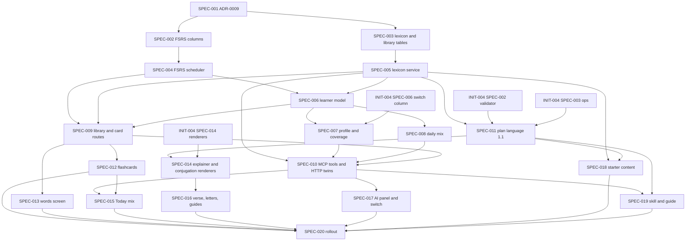

# Initiative: Language program — learner model, word library, flashcards, grammar, and lesson recipes

**Initiative ID:** INIT-006
**Status:** complete — Mode E closed 2026-10-10. All twenty specs complete (SPEC-020 last). Completion report: `INIT-006-language-program-completion-report.md`. Still operator-only: apply migrations 004–005 on real DATA_DIR, SPEC-020 `SRS_SCHEDULER=fsrs` flip (written OK), and SPEC-018 forms checklist ticks.
**Slug:** INIT-006-language-program
**Discipline Profile:** `software`
**Created:** 2026-10-09
**Owner:** Brian Nelson
**Ticket:** None (`branch_naming.ticket_system: none`; sourced from the operator request of 2026-10-09 and the scope answers recorded in §2)
**Branch:** `lesson-system-build` (continuing on the INIT-004 checkout; in-place, no new worktree). No commit unless the operator asks.
**Target Completion:** not a promise. §5 is a planning estimate that starts only after that approval.
**Source:** operator request 2026-10-09 (word library, built-in spaced flashcards, an MCP-visible learner profile, grammar and tense tracking, verb conjugation lessons, lessons that recycle known words, and lesson types modelled on the teacher's worksheets). Research: `RSCH-001`, `RSCH-003`, `RSCH-004`, `RSCH-005`, `RSCH-006`. Decisions it builds on: ADR-0001 through ADR-0007. Depends on INIT-004's plan core (§4).

---

## 0. Source tree used for current-behavior claims

`git rev-parse HEAD` on 2026-10-09: `2f1f0b0ad87ad940ed8593af6d4a6e5c05554f58` on branch `lesson-system-foundations`. That is the same commit as `origin/main`. The single-page shell (ADR-0007) and the environment bootstrap admin are uncommitted working-tree changes on that branch. Claims below cite working-tree paths.

| Fact | Citation |
|------|----------|
| One migration; review rows store a ladder `step`, `streak`, `lapses`, `last_result`, `last_at`, `sources` per word and direction | `server/db/migrations/001-initial.js:42`–`:58` |
| Practice events store word, direction, result, slug, activity. No grammar attribute. | `server/db/migrations/001-initial.js:60`–`:73` |
| The scheduler is a five-rung ladder `[1, 3, 7, 14, 30]` days; `pass` climbs one rung once per local day; `miss` resets to rung 0 and adds a lapse | `shared/player/review.js:8`, `:74`–`:114` |
| Stage strings: `new` (never passed), `learning` (step 0–2), `longTerm` (step ≥ 3) | `server/progress.js:229`–`:234` |
| Word identity is `exactKey` (NFC, whitespace collapsed, trimmed, pointed; no prefix stripping) | `server/vocab-index.js:15`; ADR-0001 A1 |
| Vocabulary exists only inside lesson files and is merged into `_review/vocab-index.js`. There is no lexicon, no part of speech, root, binyan, or tense on any word. | `server/vocab-index.js:78`–`:118` |
| MCP tools today: `list_lessons`, `get_lesson`, `list_words`, `list_activity_types`, `list_users`, `upsert_lesson`, `set_lesson_visibility`, `generate_lesson_audio`. None reads learner progress. | `mcp/tools.js:148`–`:342` |
| SPA routes: `today`, `lessons`, `review`, `progress`, `admin` | `shared/app-routes.js:48`–`:115` |
| Carried constraint "No root/binyan speed drills" | `docs/decisions/ADR-0001-learner-review-model.md:64`, `:308` |
| Minimum snapshot chosen; richer snapshot (accuracy, trouble words) rejected | `docs/decisions/ADR-0004-learner-data-media-and-secrets.md:72`–`:73` |
| N1 caps new words at 8 (block); N7 caps introductions at a quarter of a unit (warn) | `docs/decisions/ADR-0003-course-and-lesson-plan-language.md:260`, `:266` |

**Teacher material checked.** The attachment `drive-download-20261009T151709Z-1-001.zip` holds six PDFs: four "The letters …" sheets (Alef to Hey with vowels, "write the letter with the correct vowel", "which word contains the letter", picture matching), one vowels sheet (the ten vowels, Shva, Dagesh), and one copy. It does not hold the 80 conversation, review, Bible, and verb sheets. The four-type analysis in §2 is the operator's own summary of those sheets, used as written. No teacher text is copied into this plan or into any lesson file (ADR-0001 #7).

---

## 1. Executive Summary

Today the site is a shelf of fixed worksheets plus a review queue. INIT-006 turns it into a language program the operator's AI can see and build for. A **lexicon** holds each word once, with gloss, part of speech, root, binyan, and, for verb forms, tense, person, gender, and number. A **personal word library** is every word the learner has met or added. **Flashcards** replace the ladder with an FSRS-style scheduler (Again, Hard, Good, Easy). A **learner model** derives word strength, weak and very weak words, accuracy per grammar concept (tense, binyan, person, weak-root class), and a journey stage. A **learner profile** exposes those aggregates to the MCP, behind the existing per-learner AI-planning switch, so the AI can draft the next lesson from what the learner actually knows and gets wrong. A **daily mix** on Today stacks due cards, weak words, one grammar drill, and one reading built from known words.

The plan language (ADR-0003) gains five blocks — `explainer`, `conjugation-table`, `personal-question`, `verse-reading`, `letter-intro` — and a `recipe` field naming the teacher's lesson types. That covers walkthrough pages like "Decoding Hebrew Verbs", verb workshops with present and past tables, verse-by-verse readings, topic conversations, review worksheets, and letters and vowels.

One new ADR, ADR-0009, records the decisions. It supersedes ADR-0004 §1 (the minimum snapshot) with an aggregate profile, changes ADR-0001 constraint 4 (untimed conjugation practice with feedback is allowed, timed root and binyan speed drills stay out), and extends ADR-0003 to schema `1.1.0`.

**First slice (operator choice):** the word library and flashcards, on the existing review data. SPEC-001 through SPEC-006, SPEC-009, SPEC-012, SPEC-013. That slice does not wait on INIT-004. The AI profile, the new blocks, and the daily mix follow, and those depend on INIT-004's plan core and its AI-planning switch column.

Tests never call ElevenLabs or OpenAI. Keys are not printed, committed, or written into this plan. No new npm dependency and no build step (ADR-0005 Option A).

---

## 2. Domain Analysis

### Operator scope answers (2026-10-09)

| Question | Answer |
|----------|--------|
| What the AI may see through the MCP | A rich profile of **aggregates**: per-word strength, lapses, and weak flag; per-grammar-concept accuracy; journey stage. **No** raw answer history and **no** typed text. Still behind the per-learner AI-planning switch. |
| Relation to INIT-004 | A new initiative that depends on INIT-004's plan store, validator, operations, and MCP core. INIT-006 replaces INIT-004's minimum snapshot (SPEC-010's snapshot half and SPEC-012's `get_learner_snapshot`) with the richer profile. |
| First usable slice | Word library and Anki-style flashcards on the existing review data, then the AI profile. |
| Flashcard scheduling | Upgrade to an FSRS-style scheduler with four grades and per-card stability and difficulty, migrating from the ladder. |

### Teacher lesson types (operator summary, used as the recipe list)

| Recipe | Shape in the teacher's sheets | Share |
|--------|-------------------------------|-------|
| `topic-conversation` | Warm-up or review; about 15 words in three groups of five, pointed, with English; sentence frames; personal questions; a speaking task (role-play, picture, "this or that") | About half |
| `review-worksheet` | Exercises 1–7: match to a word bank, pick the right sentence, two readings to compare, short writing. Hebrew instructions with English under them. | Recurring |
| `verse-reading` | Verse by verse: 3–6 new words, the pointed verse, simple Hebrew questions, one personal question | Genesis Dec 2025–Mar 2026, Isaiah fall 2026 |
| `verb-workshop` | Rule in English; 3–4 verbs with root letters; present and past tables; one sentence and two questions per verb | Recurring; one sheet reused three times |
| `letters-and-vowels` | Letter, its sounds with each vowel, recognition in words, picture matching (the attached zip; picture matching is not in 1.1.0, ADR-0009 §7 "Pictures") | Early 2025 |
| `guide` | Standalone explainer such as "Decoding Hebrew Verbs": shoresh, binyan, infinitive, present and past, the traffic-light method | Operator request |

Observed trends the operator reported: less English over time, sound spellings dropped, vowel points being dropped from readings by October 2026, class opens with small talk, and the learner reads new words aloud while the teacher corrects vowels.

| Domain         | Affected | Key changes |
| -------------- | -------- | ----------- |
| Data           | Yes      | FSRS columns on `review_items` and a `grade` on `practice_events` (additive). Lexicon entries and forms with grammar tags and a `verified` flag. Grammar-concept registry. Personal library rows. Concept-mastery rows. Starter content as draft plans. |
| Service        | Yes      | Pure FSRS scheduler shared by browser and server. Lexicon service and validator. Learner model (word strength, weak flags, concept mastery, journey stage). Learner-profile contract and text-coverage check. Daily-mix composer. Plan language `1.1.0` blocks and recipe rules. |
| API            | Yes      | Learner routes: library, cards by deck, graded signals, own profile, daily mix. Admin and MCP lexicon writes. MCP: `get_learner_profile`, `check_text_coverage`, `list_grammar_concepts`, `list_lexicon`, `get_lexicon_entry`, `upsert_lexicon_entries`, `add_library_words`. The AI-planning switch route. |
| Event          | No       | Audit rows use the existing `audit_log`. No bus. |
| Scheduled      | No       | Strength and due-ness are computed at read time. No cron. |
| Infrastructure | Yes      | Migration rollout with a pre-migration backup, a scheduler fallback variable, k8s doc lines. `replicas` stays 1. |
| Frontend       | Yes      | Review becomes flashcards. New Words screen. Block renderers for the five new blocks. Today daily mix. Guides shelf. "What your AI sees" panel and the admin switch. |
| Docs           | Yes      | ADR-0009. Amendments to INIT-004 specs. Skill rewrite for recipes and the profile loop. Operator guide. |

### Bounded contexts

- **Lexicon** (core, content): words, forms, grammar tags, verification. Content, not learner data.
- **Scheduling** (core): FSRS state per word and direction; grades; due-ness.
- **Learner model** (core, sensitive): strength, weak flags, concept mastery, journey. Derived from the learner's own rows.
- **Learner profile** (core, sensitive): the ADR-0009 §1 projection of the learner model that may leave the server.
- **Plan language** (core, shared with INIT-004): new blocks and recipes on INIT-004's store and operations.
- **Learner interface** (core): flashcards, words, Today mix, guides, new block renderers.
- **Identity and progress** (supporting, exists): accounts, sessions, review rows, lesson progress. Kept.

### Requirements

| ID | Requirement | Priority | Source |
| -- | ----------- | -------- | ------ |
| REQ-001 | ADR-0009 records the profile contract, the scheduler choice, the grammar-concept registry, stage and weak thresholds, the five blocks, the recipe rules, and each carried constraint marked kept, changed, or superseded. It is accepted before any code spec runs. | Must | Operator scope answers; ADR-0004 §1; ADR-0001 #4 |
| REQ-002 | Review rows gain FSRS state (stability, difficulty, reps, state, last grade) by an additive migration. Existing rows are backfilled so every learner's `new` / `learning` / `longTerm` counts are unchanged by the migration. | Must | Operator (FSRS); `server/progress.js:229` |
| REQ-003 | One pure scheduler module serves the browser and the server. Grades are Again, Hard, Good, Easy. A lesson `pass` maps to Good, `miss` to Again, `not_yet` to no review. A second `pass` on the same local day does not advance a card. A fallback variable restores the ladder without a down migration. | Must | Operator; `shared/player/review.js:98`; RSCH-003 §1.1 (spacing High) |
| REQ-004 | A lexicon holds lemmas and forms keyed by `exactKey`, with gloss, part of speech, root, binyan, weak-root class, tense, person, gender, number, accepted unpointed spellings, and `verified`. Text is validated, size-limited, and contains no HTML. | Must | Operator (tense and verb type); ADR-0003 R11 |
| REQ-005 | A personal library lists every word the learner has a review row for or has added, with status (`new`, `learning`, `longTerm`), weak flag, tags from the lexicon, and source lessons. The learner can add a word and suspend a card. | Must | Operator ("my word library") |
| REQ-006 | The learner model computes per-word strength and the `weak` / `very_weak` flag, per-concept mastery from graded events attributed through lexicon tags, and a journey stage, using thresholds named once in ADR-0009. | Must | Operator ("where they are good, where they suck") |
| REQ-007 | `get_learner_profile` returns only the ADR-0009 §1 fields, only when that learner's switch is on, at 60 reads per clock hour, with one audit row per read. The never-returned list includes answer history rows, typed text, wrong answers given, per-event timestamps, display name, numeric ids, role, hashes, and session data. | Must | Operator ("aggregates, no raw history"); ADR-0004 §3, §4, §10 |
| REQ-008 | The learner sees the same profile object at `GET /api/me/profile` ("What your AI sees"), whatever the switch says, and the disclosure sentence states what leaves the server when the switch is on. | Must | ADR-0004 §3 disclosure; ADR-0002 transparency |
| REQ-009 | `check_text_coverage` reports the share of running words a learner treats as known and lists the unknown tokens, so the AI can hold readings near RSCH-004 rule 1. It is switch-gated and audited like the profile. | Should | RSCH-004 §3 rules 1–2 (Low); ADR-0003 N3 |
| REQ-010 | Plan schema `1.1.0` adds `explainer`, `conjugation-table`, `personal-question`, `verse-reading`, `letter-intro`, and a lesson `recipe`. New registry rules are labeled block, warn, or inform, and cite research or "product choice". `1.0.0` plans still validate. | Must | Operator; ADR-0003 §2, §6 |
| REQ-011 | A conjugation table references lexicon forms by id. A drill scores typed answers against the form's accepted unpointed spellings after ADR-0001 vowel stripping. Only `verified` forms are scored. Practice is untimed and gives feedback. | Must | RSCH-003 §1.3 (focused grammar with feedback, Moderate); ADR-0001 #4 as changed |
| REQ-012 | The daily mix composes due cards, weak words, one concept drill from the weakest concept the learner has seen, and one reading at or above 95% known words. It never introduces an unseen spine word outside the existing new-card cap. | Should | RSCH-004 §3 rule 14; RSCH-003 §1.1 (interleaving Moderate) |
| REQ-013 | MCP and HTTP call the same functions for every lexicon and library write (ADR-0005 §5 "one implementation"). The MCP cannot flip the switch. | Must | ADR-0005 §5; ADR-0004 §4 |
| REQ-014 | Starter content: a "Decoding Hebrew Verbs" guide and one verb workshop for לַחְשֹׁב, לְהַרְגִּישׁ, לִשְׁאֹל, לַעֲנוֹת, as draft plans with lexicon forms marked unverified until the operator checks them. No teacher text is copied. | Should | Operator example; ADR-0001 #7 |
| REQ-015 | The hebrew-worksheet skill teaches the profile loop (profile, choose recipe, write, check coverage, save draft), the recipes, tagging rules, and rotation. The operator guide states what the switch sends. | Must | INIT-004 REQ-012 pattern |
| REQ-016 | Rollout backs up `hebrew.sqlite` before each migration, keeps the 65 recordings and the three lessons, and can fall back to the ladder scheduler by variable. | Must | ADR-0005 §8; INIT-002 REQ-012 |

### Out of scope

- FSRS parameter optimization from the learner's own history. Default parameters only; optimization needs far more reviews than one learner has.
- Speech scoring and pronunciation grading (RSCH-003 supports it at Moderate; it needs an audio model this stack does not have).
- Points, badges, and streak rewards. RSCH-006 found them unproven. The journey stage is a label, not a reward.
- A morphological analyzer that conjugates verbs automatically. Forms are authored (by the AI or the operator) and verified by a person.
- Admin lexicon editing screen. Lexicon writes are MCP and HTTP in this initiative; the builder is INIT-004's.
- Future tense and imperative tables. The registry names them; recipes and starter content use present and past, as the teacher's sheets do.

### Feature-analysis notes

Discipline profile `software`, as INIT-004. Prompt files under `.claude/agents/` are not in this repo; each spec names the prompt its domain would use and discloses the degradation path. Nothing was manufactured.

**Research fit, stated plainly.** Spaced recall on later days is High (RSCH-003 §1.1). Both recall directions, Moderate. Interleaving, Moderate. Focused grammar work with feedback, Moderate; explicit versus implicit unresolved, Low. Coverage near 95% for meaning-focused reading, Low (RSCH-004 rule 1). No study found that a lesson ordered by known words beats a frequency-and-theme spine (RSCH-004 §1.6), so the daily mix and the AI may recycle known words and schedule reviews but do not reorder unseen spine lessons (rule 14). FSRS versus the ladder is a product choice: RSCH-003 found equal and expanding gaps equivalent and longer gaps better for retention; it did not compare FSRS. The pointed-then-unpointed sequence is untested (RSCH-001), so vowel fading stays a learner toggle.

---

## 3. Spec Breakdown

Each spec is one domain, 2–6h. Security review and architecture diagrams stay `complete-initiative` phases.

| Spec | Domain | Title | Prompt | Autonomy | Gates | Blocked by | Effort |
| ---- | ------ | ----- | ------ | -------- | ----- | ---------- | ------ |
| SPEC-001 | docs | ADR-0009 learner model and language program; INIT-004 amendments | implementation-planner | plan_only | operator ADR acceptance | None | 5h |
| SPEC-002 | data | FSRS columns on review rows and graded events | database-architect | auto_tests | db_migration | SPEC-001 | 4h |
| SPEC-003 | data | Lexicon, concept registry, personal library, concept mastery | database-architect | auto_tests | db_migration | SPEC-001 | 5h |
| SPEC-004 | service | FSRS scheduler and signal mapping | principal-backend-developer | auto_tests | — | SPEC-002 | 5h |
| SPEC-005 | service | Lexicon service, validator, and seed from the vocab index | principal-backend-developer | auto_tests | — | SPEC-003 | 5h |
| SPEC-006 | service | Learner model: strength, weak words, concept mastery, journey | principal-backend-developer | auto_tests | — | SPEC-004, SPEC-005 | 5h |
| SPEC-007 | service | Learner profile contract and text coverage | principal-backend-developer | auto_tests | — | SPEC-006, INIT-004/SPEC-006 | 5h |
| SPEC-008 | service | Daily-mix composer | principal-backend-developer | auto_tests | — | SPEC-006 | 4h |
| SPEC-009 | api | Learner library and flashcard routes | principal-backend-developer | auto_tests | — | SPEC-004, SPEC-005, SPEC-006 | 5h |
| SPEC-010 | api | Profile, coverage, lexicon, library MCP tools, HTTP twins, switch route | principal-backend-developer | auto_tests | — | SPEC-005, SPEC-007, SPEC-008, SPEC-009 | 5h |
| SPEC-011 | service | Plan language 1.1: five blocks, recipes, rules | principal-backend-developer | auto_tests | — | SPEC-005, INIT-004/SPEC-002, INIT-004/SPEC-003 | 5h |
| SPEC-012 | frontend | Flashcards on the Review screen | principal-frontend-developer | auto_tests | — | SPEC-009 | 5h |
| SPEC-013 | frontend | Words screen (personal library) | principal-frontend-developer | auto_tests | — | SPEC-009 | 5h |
| SPEC-014 | frontend | Explainer, conjugation-table, personal-question renderers | principal-frontend-developer | auto_tests | — | SPEC-011, INIT-004/SPEC-014 | 6h |
| SPEC-015 | frontend | Today daily mix | principal-frontend-developer | auto_tests | — | SPEC-010, SPEC-012 | 4h |
| SPEC-016 | frontend | Verse-reading and letter-intro renderers; Guides shelf | principal-frontend-developer | auto_tests | — | SPEC-014 | 5h |
| SPEC-017 | frontend | "What your AI sees" panel and admin AI-planning switch | principal-frontend-developer | auto_tests | — | SPEC-010 | 4h |
| SPEC-018 | data | Starter content: verbs guide and verb workshop (drafts) | implementation-planner | auto_tests | operator content check | SPEC-005, SPEC-011 | 4h |
| SPEC-019 | docs | Skill rewrite for recipes and profile loop; operator guide | implementation-planner | plan_only | — | SPEC-010, SPEC-011 | 4h |
| SPEC-020 | infrastructure | Migration and rollout | principal-devops-engineer | auto_tests | deploy | SPEC-012, SPEC-013, SPEC-015, SPEC-016, SPEC-017, SPEC-018, SPEC-019 | 3h |

**First slice:** SPEC-001, SPEC-002, SPEC-003, SPEC-004, SPEC-005, SPEC-006, SPEC-009, SPEC-012, SPEC-013 (44h). After it, the learner has a word library, four-grade flashcards on FSRS, and tags on words. Nothing in it waits on INIT-004.

**Why the ADR leads.** The profile contract supersedes an accepted ADR-0004 decision, and conjugation practice changes an ADR-0001 constraint. Code that ships either before the record is accepted would contradict an accepted decision.

**Why the profile is service + api, not one spec.** SPEC-007 is the contract and its never-returned test, the riskiest part. SPEC-010 is two adapters calling it. Same split as INIT-004 SPEC-010 / SPEC-012.

**Prompt resolution (disclosed gap):** this repository has no `.claude/agents/` tree. Nothing was manufactured. At execution each prompt degrades to the spec plus this repo's conventions (`AGENTS.md`, the ADRs, the surrounding code).

**Model:** `sonnet` on every spec except SPEC-001, SPEC-004, SPEC-007, and SPEC-011, which pin `opus` (the superseding ADR, the scheduler math, the profile contract, and the rule registry).

---

## 4. Dependency Graph

**Critical path (inside INIT-006):** SPEC-001 → SPEC-003 → SPEC-005 → SPEC-006 → SPEC-007 → SPEC-010 → SPEC-015 → SPEC-020 (5 + 5 + 5 + 5 + 5 + 5 + 4 + 3 = 37h). SPEC-002 → SPEC-004 (9h) runs beside SPEC-003 → SPEC-005 (10h).

**External edges.** SPEC-007 needs INIT-004 SPEC-006 (`users.ai_planning`, which needs INIT-004 SPEC-001). SPEC-011 needs INIT-004 SPEC-002 and SPEC-003. SPEC-014 needs INIT-004 SPEC-014 (which needs INIT-004 SPEC-004 and SPEC-013). SPEC-018 writes drafts through INIT-004's operations via SPEC-011. If INIT-004 has not reached those specs, INIT-006 stops after its first slice; it does not build a second plan store.

**First slice path:** SPEC-001 → SPEC-003 → SPEC-005 → SPEC-006 → SPEC-009 → SPEC-012 (30h).

**Parallelizable:** SPEC-002 with SPEC-003. SPEC-004 with SPEC-005. After SPEC-006: SPEC-007, SPEC-008, SPEC-009. After SPEC-009: SPEC-012 and SPEC-013. SPEC-011 any time its INIT-004 edges are met. SPEC-016, SPEC-017, SPEC-018, SPEC-019 share no files.

The graph has no cycles. Every edge is a `blocked_by` on the later spec.

---

## 5. Timeline & Effort

| Metric | Value |
| ------ | ----- |
| Total effort | 93h |
| Critical path (internal) | 37h |
| First slice | 44h of effort; 30h on its path |
| Realistic duration | critical path × 1.3 = 48h |
| Calendar estimate | about 8 working days at ~6 productive hours/day, after approval, plus operator gates and the INIT-004 edges in §4 |

**Operator gates**

| Gate | Spec | Who |
|------|------|-----|
| Approve this initiative before any spec runs | this document | Brian Nelson |
| Accept ADR-0009 (supersedes ADR-0004 §1 in part; changes ADR-0001 #4) | SPEC-001 | Brian Nelson — **done 2026-10-09** |
| `db_migration` | SPEC-002, SPEC-003 | Brian Nelson |
| Content check of Hebrew forms before any starter plan is published | SPEC-018 | Brian Nelson (or the teacher) |
| `deploy` (scheduler switch to FSRS; migrations in production) | SPEC-020 | Brian Nelson |

**Plan quality (reflection loop):** completeness 8, accuracy 8, clarity 8, technical feasibility 7, guardrails compliance 8. Total 39/50, confidence 0.78. Feasibility is the low score because the second slice waits on INIT-004 edges, and authored Hebrew forms need a human check that no test can replace.

---

## 6. Controls & Gates

- **Default autonomy:** `auto_tests` for code; `plan_only` for SPEC-001 and SPEC-019.
- **One-way actions:** `db_migration` (SPEC-002, SPEC-003), `deploy` (SPEC-020).
- **Approval owner:** Brian Nelson.
- **Standing rules:** no commit or push unless the operator asks. No key in a file, log, or response (`ELEVENLABS_API_KEY`, `OPENAI_API_KEY`, `MCP_AUTH_TOKEN`, `ADMIN_PASSWORD`). No learner name, typed answer, or transcript in a lesson file, lexicon entry, or plan. Tests never call ElevenLabs or OpenAI. No new npm dependency. No build step. Login stays a separate page. Admin is enforced server-side. Worksheet `index.html` files are not edited.
- **Audio on every spec that can see `worksheets/` or `LESSONS_DIR`:** `npm run audio:inventory` before, `npm run audio:verify` after. No clip is deleted or overwritten.
- **Test hooks:** a Chrome smoke changes only in the same change as the `data-*` hook it queries (ADR-0005 §7).

---

## 7. Agent Behavior Overrides (optional)

Inherits the defaults. Two overrides:

- secrets: never print or write any key named in §6, in a spec, test, fixture, log line, or profile sample.
- learner data: examples and fixtures use `example-learner`. A profile sample in a doc is synthetic.

---

## 8. Threat Model (security)

- **Attack surface:** `get_learner_profile`; `check_text_coverage`; `add_library_words` (an MCP write into learner data); lexicon writes rendered for every learner; plan text in five new blocks; typed conjugation answers; `PATCH /api/admin/users/:id/ai-planning`; the learner's own profile route.
- **Trust boundaries:** profile aggregates leave the server toward the MCP client's model provider when the switch is on. Lexicon and plan text written by the MCP or an admin is rendered in learners' browsers. Learner-typed answers enter the server only as a pass or miss, never as text.
- **Data classification:**
  - Secrets: unchanged set; environment only.
  - Learner data leaving the server (switch on): username, word identity keys, stage strings, strength buckets, lapse counts, weak flags, concept accuracy rounded to 0.05, attempt counts, journey stage, completed lesson slugs, recipe counts, vowels-off share. Answer rows, typed text, wrong answers, timestamps, and names other than the username stay.
  - Content: lexicon and plans. Untrusted text, no HTML.
- **STRIDE-lite:** Spoofing is the existing session and `MCP_AUTH_TOKEN`. Tampering is the validator (enums, sizes, NFC, no markup), escaped rendering, and revisions on plans. Repudiation is one `audit_log` row per profile read, coverage check, library write by `mcp`, lexicon write, and switch change. Disclosure is the switch (default off), the never-returned walk test, rounded aggregates, and no per-event data. Denial of service is the 60-per-hour read cap shared by profile and coverage, a 50-word daily cap on `add_library_words`, and lexicon batch limits. Elevation is server-side admin checks; `mcp` receives 403 on the switch.
- **Security-sensitive specs (`security_review: required`):** SPEC-003 (library and mastery rows), SPEC-005 (lexicon text rendered to learners), SPEC-007 (profile), SPEC-009 (learner write routes), SPEC-010 (MCP reads and writes, switch route), SPEC-011 (plan text), SPEC-017 (switch UI and disclosure).

---

## 9. Risk Assessment

| Risk | Probability | Impact | Mitigation |
| ---- | ----------- | ------ | ---------- |
| The profile leaks a never-returned field | M | H | SPEC-007 walks the JSON tree against a constant copied once from ADR-0009 §1. Switch defaults off. Learner sees the same object. |
| FSRS migration changes what a learner sees as due or known | M | M | Backfill maps ladder step to stability so stage counts are unchanged (SPEC-002 ac). `SRS_SCHEDULER=ladder` restores the old transition without a down migration. Pre-migration backup (SPEC-020). |
| Wrong Hebrew forms are drilled as correct | H | H | The operator's own table has pointing errors (for example אַתָּה past of לַחְשֹׁב written חַשָׁבתַ for חָשַׁבְתָּ; לְהַרְגִּישׁ past 1sg written הֶרְגַשְׁתִי for הִרְגַּשְׁתִּי). Forms carry `verified`; only verified forms are scored; unverified forms show "not yet checked". SPEC-018 has a human gate. |
| Typed answers fail on spelling variants (full versus defective spelling) | H | M | Score against stripped `accept[]` spellings, not one string; "I was right" override counts as pass and is logged with `activity: conjugation-override` (ADR-0009 §7, "Drill scoring"). |
| Second slice stalls on INIT-004 | M | M | First slice is independent. §4 names every external edge. |
| Concept accuracy misattributes errors (a miss on a form counts against binyan, tense, and person at once) | M | L | ADR-0009 states attribution is to every tag on the form; the profile labels it "accuracy on items tagged X", not "skill in X". |
| Deck grows without bound from conjugation forms | M | M | Forms do not create review cards. Concept mastery tracks forms; only words in the library are cards. |

---

## 10. Success Criteria

- [x] All twenty specs complete, with the gates in §5 cleared. *(deploy / live migrate remain operator steps — see completion report)*
- [x] `npm test` passes. `npm run audio:verify` matches the inventory taken at the start of SPEC-020. 65 recordings at the same paths. *(2026-10-10: 846 pass; inventory `20261010T225230.json`)*
- [x] After migration, every learner's `new` / `learning` / `longTerm` counts equal the pre-migration counts. *(fixture-proven in SPEC-020; live compare is the runbook step)*
- [x] The learner can open Words, see every reviewed word with status and tags, add a word, and review it as a flashcard with four grades in both directions.
- [x] With the switch off, `get_learner_profile` returns `planning_off` and no §1 field. With it on, the profile has no never-returned field, and `GET /api/me/profile` returns the same object.
- [x] A verb-workshop draft with a present and a past table renders, drills only verified forms, and attributes results to tense, binyan, and person concepts.
- [x] The daily mix contains no unseen spine word beyond the new-card cap.
- [x] No unresolved Critical or High security finding, or a documented acceptance by the operator. *(per-spec; initiative-wide Phase 3.5 disclosed as not re-dispatched)*
- [x] Completion report generated; initiative status `complete`.

---

## 11. Next Steps

1. The operator reviews this initiative, the first slice, and ADR-0009's intended changes in SPEC-001.
2. After written approval, create branch `language-program` and run SPEC-001.
3. After ADR-0009 is accepted, run SPEC-002 and SPEC-003 together (each behind its `db_migration` gate).
4. Finish the first slice before any spec with an INIT-004 edge.
5. Run `complete-initiative` when every spec is complete.

---

## 12. Capability parity

ADR-0005 §5: one function, two adapters. SPEC-009 and SPEC-010 list these rows.

| Operation | Function | MCP tool | HTTP |
|-----------|----------|----------|------|
| Read own library | `library.list` | — (learner-only) | `GET /api/me/library` |
| Add words to a library | `library.add` | `add_library_words` (switch-gated, audited, 50/day) | `POST /api/me/library` |
| Suspend / resume a card | `library.setSuspended` | — | `PATCH /api/me/library/:key` |
| Cards by deck | `cards.deck` | — | `GET /api/me/cards?deck=` |
| Grade a card | `progress.applySignals` (existing, with `grade`) | — | `POST /api/progress/signals` (existing) |
| Read a learner profile | `profile.build` | `get_learner_profile` (switch-gated) | `GET /api/me/profile` (own only) |
| Coverage of a text | `coverage.check` | `check_text_coverage` (switch-gated) | `POST /api/me/coverage` (own only) |
| Daily mix | `mix.compose` | — | `GET /api/me/mix` |
| List grammar concepts | `concepts.list` | `list_grammar_concepts` | `GET /api/grammar/concepts` |
| List / read lexicon | `lexicon.list` / `lexicon.get` | `list_lexicon` / `get_lexicon_entry` | `GET /api/lexicon` / `GET /api/lexicon/:key` |
| Write lexicon entries | `lexicon.upsert` | `upsert_lexicon_entries` | `PUT /api/admin/lexicon` |
| Mark forms verified | `lexicon.setVerified` | 403. No success tool. | `PATCH /api/admin/lexicon/:key/verified` |
| AI-planning switch | `accounts.setAiPlanning` | 403. No success tool. | `PATCH /api/admin/users/:id/ai-planning` |

The eight existing tools stay registered. INIT-004's plan tools write the new block types; INIT-006 adds no second plan writer. Verification is a person's act, as media approval is in ADR-0004, so the MCP cannot mark a form verified.

---

## 13. Carried constraints

| Source | Constraint | In force for this build |
|--------|------------|-------------------------|
| ADR-0001 A1 | `exactKey` identity, no prefix stripping | Kept. Lexicon keys, library keys, and profile `word_id` are that key. Coverage matching uses no prefix stripping (ADR-0009 §1); a prefixed token is unknown until a lexicon `form` entry records it. |
| ADR-0001 #3 | No edits to lesson `index.html` | Kept |
| ADR-0001 #4 | No root/binyan speed drills | **Changed** by ADR-0009: untimed conjugation practice with feedback is allowed (RSCH-003 §1.3, Moderate). Timed root or binyan speed drills stay out (RSCH-001: no method trial). |
| ADR-0001 #5 | No forced vowel fading | Kept. The profile reports the share of readings done with vowels off. A recipe never turns points off for the learner. |
| ADR-0001 #6 | Bilingual UI labels | Kept on new screens |
| ADR-0001 #7 | No names, transcripts, secrets in lesson files | Kept, extended to lexicon entries |
| ADR-0002 | Server owns the review schedule | Kept. FSRS runs on the server; the browser module is the same code for preview only. |
| ADR-0002 | Admin full answer history stays admin-only | Kept |
| ADR-0003 | Plan shape, operations, revisions, publish | Kept. Schema `1.1.0` is additive; `1.0.0` plans validate. |
| ADR-0003 N1 | ≤ 8 new words, block | **Changed** for recipe `topic-conversation` only: ADR-0009 §7 (N18): warn from 9 words or a group over 5, block above 15. The operator confirms the numbers when accepting the ADR. Other recipes keep N1. |
| ADR-0004 §1 | Minimum snapshot | **Superseded** by ADR-0009 §1 (aggregate profile). |
| ADR-0004 §3, §4, §10 | Switch default off, token, rate, audit | The switch default (off) and the token are kept. The disclosure sentence, the rate limit and matrix row, and the audit rows are **replaced** by ADR-0009 §1 for the profile, coverage, library, and lexicon tools. |
| ADR-0005 | Option A, no build step, no new dependency, one process | Kept |
| ADR-0006 | Tokens and interface rules | Kept on new screens |
| ADR-0007 | Route table, view contract, ready signal | Kept. New routes `words` and `guides` follow it. |
| RSCH-006 | No points or streak rewards | Kept |

---

## 14. Migration and rollout

| Step | Spec | What changes | Rollback |
|------|------|--------------|----------|
| 0 | SPEC-020 | Copy `DATA_DIR/hebrew.sqlite` (and `-wal`, `-shm` after a checkpoint) to a dated backup. `audio:inventory`. | — |
| 1 | SPEC-002 | Add FSRS columns, backfill from ladder step. `SRS_SCHEDULER` defaults to `ladder` until step 5. | Down migration drops the columns. Ladder data was never rewritten. |
| 2 | SPEC-003 | Add lexicon, concept, library, mastery tables. Seed lexicon from the vocab index (glosses only, unverified). | Down migration drops the new tables. |
| 3 | SPEC-009, SPEC-012, SPEC-013 | Library and card routes; flashcards; Words screen. | Hide the `words` route; Review keeps working on the ladder. |
| 4 | SPEC-010, SPEC-015, SPEC-017 | MCP tools, Today mix, AI panel, switch. Switch stays off for every learner. | Unregister the tools; remove the panel. |
| 5 | SPEC-020 | Set `SRS_SCHEDULER=fsrs`. Verify stage counts unchanged. | Set it back to `ladder`. |
| 6 | SPEC-011, SPEC-014, SPEC-016, SPEC-018 | Schema `1.1.0`, renderers, starter drafts. Drafts stay `hidden` until the content gate. | Drafts are deleted; no learner saw them. |

Invariants: no `.mp3` deleted, moved, or overwritten; `hebrew.sqlite` not replaced; `replicas` 1, `strategy` `Recreate`; `MCP_AUTH_TOKEN` required; every new route behind the sign-in check.

**Tests.** Nothing in the current suite is dropped. New tests are new files. Smoke scripts change only with their hooks.

---

## 15. Lessons question answered (operator, 2026-10-09)

Wiping the database did not remove lessons. Lessons are files under `worksheets/` (or `LESSONS_DIR`), not database rows. The database holds accounts, sessions, review state, lesson progress, visibility, and audit rows. Visibility for the three lessons is seeded again on startup. INIT-004 moves plans into the database; at that point SPEC-020's backup step covers them.
