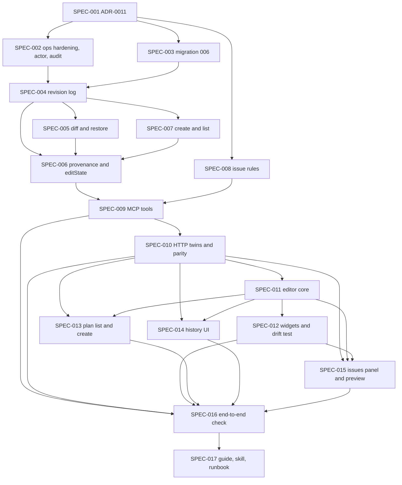

# Initiative: AI-first plan builder — operations, history and restore, advisory edit state, issues, and a schema-driven admin editor

**Initiative ID:** INIT-008
**Status:** complete 2026-10-12 (Mode E). All 17 specs complete; full suite 1460 pass; 20 Chrome smokes pass; migration 006 applied to the local database after a backup. Open items are listed in INIT-008-completion-report.md (no independent security review; Hebrew pointing table and UI copy not reviewed by a Hebrew reader; legacy worksheet question).
**Slug:** INIT-008-ai-first-plan-builder
**Discipline Profile:** `software`
**Created:** 2026-10-12
**Owner:** Brian Nelson
**Ticket:** None (`branch_naming.ticket_system: none`; sourced from the operator request and follow-up of 2026-10-12, quoted in the Source line)
**Branch:** `ai-first-plan-builder` (not yet created — this session wrote planning documents only, on the working tree that already holds uncommitted INIT-005 to INIT-007 work; in-place, no worktree). No commit unless the operator asks.
**Target Completion:** not a promise. §5 is a planning estimate that starts only after approval.
**Source:** operator request 2026-10-12: "I wanted all the plans to be built via MCP, but we should allow the admin to modify things that AI may make mistakes. Let's research how to design the worksheet builder in a way that somebody can build the worksheets or modify ones already built. Also making sure this is still very MCP build plan first approach." Follow-up, same day: "it's ai first. No hitl if possible. if an issue is found the human or ai can fix it." Research: `RSCH-009` (technical analysis; its recommendation is revised by operator decisions D1–D6, appended to that report and recorded in §2). `RSCH-006` and `RSCH-008` for the admin screens' look and icon rules, and `RSCH-004` and `RSCH-005` for the plan rules the new checks sit beside. Decisions it builds on: ADR-0003 (plan language, operations, revisions, publish), ADR-0004 (media approval, audit), ADR-0005 §5 (one implementation, two adapters), ADR-0008 and ADR-0010 (look and tokens for the admin editor), ADR-0009 (`1.1.0` blocks, lexicon, `verified`). Depends on INIT-004's plan core and INIT-006's `1.1.0` plan language, both complete.

---

## 0. Source tree used for current-behavior claims

`git rev-parse HEAD` on 2026-10-12: `ff216a2b7d4dce07fb789e916247f417d336030c` on branch `main`. `origin/main` resolved to the same commit locally; `git fetch` was **not** run, because this session wrote documents only and the operator asked for no network step. The working tree holds uncommitted INIT-005, INIT-006, INIT-007, and brand work; every claim below cites a working-tree path as read on 2026-10-12.

| Fact | Citation |
|------|----------|
| Six part operations, one `apply()`, one revision integer on the plan; any edit bumps it and sets `status` to `draft`; stale `expectedRevision` returns `revision_conflict` and writes nothing | `server/plans/ops.js` `apply`, `finish`, `mutate` |
| `replace_part` writes `value` over the node at the path without comparing `value.id` to the node's id; `mutate` only checks the plan-level id | `server/plans/ops.js:209`–`:224`, `:394`–`:396` |
| `set_field` on the plan document blocks only `id`, `revision`, `status`; `audience` and `assigneeId` are writable. `replace_part` with an empty path takes `audience` and `assigneeId` from the value | `server/plans/ops.js:187`–`:189`, `:220`–`:223` |
| `personal.assign` does the active-account check, then calls `ops.replacePart` with an empty path; nothing calls it except tests | `server/plans/personal.js:49`–`:80` |
| Write-time refusals are the `WRITE_BLOCK_RULES` set (`schema`, `html`, `audio-path`, `image-placement`, `N8`–`N11`); pedagogical blocks stay on the draft and `publishPlan` refuses them | `server/plans/ops.js:24`–`:33`, `:339`–`:341`; `server/plans/publish.js:90`–`:99` |
| `publishPlan` runs inside `db.transaction`: working copy, status `published`, revision + 1, and the snapshot | `server/plans/publish.js:105`–`:114` |
| The plan store keeps `working_copy` and `snapshot` on one row of `plans`; there is no revision history and no list function | `server/plans/store.js:36`–`:50`, `:187`–`:192` |
| Plan HTTP routes are admin-only and call the six functions plus `publishPlan`; a conflict is 409 | `server/api/plan-routes.js:23`–`:30`, `:99`–`:108`, `:309`–`:417` |
| MCP plan tools: `read_part`, `replace_part`, `insert_block`, `move_block`, `remove_block`, `set_field`, `publish_plan`, with `upload_media`, `plan_image`, `generate_image`. There is no tool that creates a plan, lists plans, or reads history | `mcp/tools.js:1035`–`:1201` |
| `set_lexicon_verified` and `set_ai_planning` are registered and always return `forbidden` | `mcp/tools.js:708`–`:732` |
| The audit repo is `append({ actor, action, target, at, detail })`; plan edits and publishes write no audit row; media and library actions use the fixed actor `mcp` | `server/db/repos/audit.js`; `rg audit server/plans` finds none; `mcp/tools.js` `auditMedia`, `auditLibraryAdd` |
| Validator findings carry `{ rule, severity, path, message }`; `path` is an RFC 6901 pointer with array indexes, not an id path. Registry rows exist for `pointed-word` (warn), `meaning` (block), `romanized-answer` (block), and N1–N19 | `server/plans/validate.js:253`–`:263`, rule table `:25`–`:194` |
| The validator is a pure function of one document and an optional `lexicon`; it has no snapshot input | `server/plans/validate.js:291` |
| The admin builder holds hand-written lists `BLOCK_TYPES`, `BLOCK_FIELDS`, `ITEM_FIELDS`, `FIELD_OK` and has no form for the `1.1.0` blocks or the lesson `recipe` | `shared/admin/plan-builder.js:20`–`:50` |
| Migrations 001–005 exist; the next free number is 006 | `server/db/migrations/` |
| ADR-0010 is the highest ADR; ADR-0011 is next | `docs/decisions/` |
| No `sdd/initiatives/README.md` exists. The only index in `sdd/` is the Research Index | `sdd/research/README.md` |

---

## 1. Executive Summary

Today a person can fix a lesson plan only in a builder that knows six block types and a short whitelist of fields. The AI can edit a plan through seven MCP tools, but cannot create one, cannot list them, cannot see who changed what, and cannot undo anything. Two code defects let a write change a part's id or hand a personal plan to any account name. Nothing records who made a plan edit.

INIT-008 makes the plan builder **AI first** and keeps a person able to fix anything. The operator's direction replaces `RSCH-009`'s pin-and-refuse design with a lighter one:

1. **One operations layer, MCP primary.** Every admin action is an MCP tool call and every MCP tool has an admin route. New tools: `create_plan`, `list_plans`, `list_plan_revisions`, `get_plan_revision`, `diff_plan`, `restore_plan_revision`, `list_plan_issues`, `assign_plan`.
2. **No human in the authoring flow.** The AI builds and may publish. There is no approval step and no proposal queue.
3. **No blocking pins or locks.** Either actor can change any field at any time. Protection against clobbering is the existing revision check, an actor and tool on every write, a revision log with field-level diff and a one-step restore for both actors, and an advisory `editState` inside `read_part` that tells an AI a person fixed a field and what the earlier value was.
4. **Issues are first-class.** Five new Hebrew and consistency checks (`pointing-form`, `field-language`, `lexicon-form`, `pointing-consistency`, `audio-stale`) report as warnings with stable codes and never block publish. A tool and an admin panel list them so the AI or a person can fix them.
5. **A schema-driven admin editor.** The form is generated from the plan JSON Schema, with per-block hints, a generic JSON fallback, and a drift test so a new block type can never be silently uneditable. It covers every block type including the five `1.1.0` constructs, creates a plan from scratch, and previews the learner's view.

One new ADR, ADR-0011, records the decisions, including the no-pin choice, its reasoning, and the evidence grades from `RSCH-009`. One small migration, `006`, adds a revision log and a provenance side table. **The `db_migration` gate was waived by the operator on 2026-10-12** (a local-only project with no other users, and no sign-offs of any kind). A backup first is still good practice.

Standing constraints hold: no new dependency, no build step, `node:sqlite`, tests never call ElevenLabs or OpenAI, admin checks stay on the server, no secret appears in any file, `worksheets/*/index.html` is never edited, and `SRS_SCHEDULER` is not flipped.

---

## 2. Domain Analysis

### Operator decisions (2026-10-12)

These are the operator's direction, recorded verbatim in effect. They supersede `RSCH-009`'s recommendation where they differ; the report's appended section lists exactly what each one replaces.

| Id | Decision |
|----|----------|
| D1 | **AI first, no human-in-the-loop gating in the authoring flow.** The AI builds and may publish plans through the MCP with no human approval step. No proposal queue (`RSCH-009` architecture B and its SPEC-012 are dropped entirely). |
| D2 | **No blocking pins or locks.** There is no `field_pinned` refusal. Either actor, AI or admin, can fix any issue at any time. Protection against clobbering: (a) optimistic revision checks, which already exist; (b) every write records actor (`ai` or `human`) and the tool or source in a revision log; (c) full history with a diff and a **one-step restore**, usable by both actors (an admin button and an MCP tool); (d) an **informational** `editState` / `lastHumanEdit` note inside `read_part` results, so an AI re-editing a human-fixed field sees that a person changed it and what the previous AI value was. Advisory. Never a refusal. |
| D3 | **Issues are first-class.** New validator and Hebrew checks (`pointing-form`, `field-language`, `lexicon-form`, `pointing-consistency`, `audio-stale`) report as **warnings** with stable codes and never block publish (D1). An MCP tool and an admin issues panel expose them so the AI can find and self-fix and so can a person. Existing hard validation errors (schema and structure) are unchanged. |
| D4 | **Every admin UI action is expressible as an MCP tool call and the reverse.** One operations layer. MCP is primary and the UI is a client of the same operations. Added: `create_plan` (plans start in MCP), `list_plans`, `list_revisions`, `get_revision` and diff, `restore_revision`, issues tools. **Limitation kept and stated:** the MCP uses one shared bearer token (`MCP_AUTH_TOKEN`), so the actor is derived from the channel — the MCP is `ai`, an admin session is `human` — and two different AI clients cannot be told apart. |
| D5 | **Admin editor: schema-driven.** Built from the plan JSON Schema with per-block hints and a generic JSON fallback; a drift test so new block types cannot be silently missing (the `1.1.0` gap); a live preview as the learner. An admin can create a plan from scratch or modify any plan, covering all block types including the five `1.1.0` constructs, the lesson `recipe`, `newWords`, `buildsOn`, `recycles`, and `visibility`. |
| D6 | **Fold in the two code defects** as an early small spec, with no migration: `replace_part` accepting a part whose `id` differs from its path; `audience` and `assigneeId` settable through `set_field` and `replace_part`, past the `personal.assign` account check. Route both through the same check. Expose `assign` as an MCP tool and a route. |

### What D1 does and does not remove (stated plainly)

- **Removed:** any approval step between the AI and a published plan; any proposal queue; any pin or lock that refuses a write.
- **Kept, and not a gate this initiative adds:** hard validation (`schema`, `html`, `audio-path`, `image-placement`, `N8`–`N11` on write; the publish blocks such as `meaning`, N1, N5, `romanized-answer`, N13, N19). A plan the validator blocks does not publish. This is the existing validator, not human review.
- **Kept, unchanged, carried constraints (not authoring gates):** a person approves picture bytes and alt text (ADR-0004); only a person marks a lexicon form `verified` (ADR-0009); only an admin turns the AI-planning switch on. A publish that references a pending picture on an `everyone` or `selected` lesson is refused (`pending_media`). The operator's "no HITL if possible" is read as the authoring loop; these three acts guard learner data and image bytes and are not changed here. The operator may overrule that reading at approval (§17).
- **Waived by the operator (2026-10-12):** the `db_migration` gate on SPEC-003. The project is local only and has no other users. Migration 006 still gets a database backup first (`scripts/backup-db.js`), because it is cheap, but nobody signs it off.
- **Consequence the operator accepts under D1:** a new lesson defaults to `visibility: hidden` (ADR-0003 §7), but `visibility` is an ordinary field the AI may set through `set_field`. The AI can therefore publish a plan and expose it to learners with no person involved. The protection is the audit row, the revision log, and one-step restore, not a gate. Recorded in ADR-0011 as an accepted residual risk.

### Domains

| Domain | Affected | Key changes |
| ------ | -------- | ----------- |
| Data | Yes | One migration, `006`: `plan_revisions` (log with gzipped full document per revision) and `plan_field_marks` (last writer and last human edit per id path and field). No change to `plans`, to the plan schema, or to `audit_log`. No `pinned` or `locked` column anywhere. |
| Service | Yes | `ctx` (actor, tool, request id) on every write. Two defect fixes. Audit rows on plan writes. Revision log in the write path. Diff, restore, `createPlan`, `listPlans`. Provenance marks and the advisory `editState`. Five new validator rules as warnings and an issues list. |
| API | Yes | Eight new MCP tools and their HTTP twins. An admin-only schema route. A parity test. No preview route: the editor previews with the shared render components and reads the saved working copy through the existing admin read (§16 Q4). |
| Event | No | Audit rows use the existing `audit_log`. No bus. |
| Scheduled | No | No pruning job. No cron. |
| Infrastructure | No | `replicas` stays 1. Migration `006` is applied by the operator after `scripts/backup-db.js` (§14). No new variable. |
| Frontend | Yes | Schema-driven form renderer with a widget registry and JSON fallback. Hints and widgets for every block type. Plan list and create flow. History, diff, restore panel. Issues panel. Live preview as the learner. |
| Docs | Yes | ADR-0011. Operator guide section. `hebrew-worksheet` skill update. |

### Bounded contexts

- **Plan operations** (core, exists): the six operations, publish, personal assignment. Extended with `ctx`, create, list, restore.
- **Plan history** (core, new): the revision log and the field-level diff. Content, not learner data.
- **Plan provenance** (supporting, new): who last wrote each field and the last human edit. Advisory only.
- **Plan issues** (core, new): the validator's findings, normalized with stable codes, id paths, and fix hints.
- **Admin editor** (core, exists, rebuilt): a client of the operations. Holds no edit logic.
- **MCP adapter** (core, exists): thin adapters over the same functions.
- **Lexicon** (core, exists, INIT-006): the authority for Hebrew forms through `verified`. Read by the `lexicon-form` rule.

### Requirements

| ID | Requirement | Priority | Source |
| -- | ----------- | -------- | ------ |
| REQ-001 | ADR-0011 records D1–D6: the operations layer, actor and provenance, the revision log, the advisory `editState`, the no-pin decision with its reasoning and the `RSCH-009` evidence grades, the issues model, retention, and each carried constraint marked kept, changed, or superseded. It is accepted before any code spec runs. | Must | Operator D1–D6; `RSCH-009` D8 |
| REQ-002 | `replace_part` refuses a value whose `id` differs from the id in its path. `set_field` and `replace_part` cannot change `audience` or `assigneeId`; those change only through the `personal.assign` account check. `assign` is reachable from MCP and HTTP. | Must | Operator D6; `RSCH-009` §3 |
| REQ-003 | Every plan write carries an actor (`ai`, `human`, or `system`), a name, a tool or source, and a request id, derived from the channel. Every plan mutation, publish, restore, create, and assign writes one `audit_log` row in the same transaction as the write. | Must | Operator D2(b), D4; ADR-0004 §10 pattern |
| REQ-004 | A revision log keeps one row per successful write, including create, publish, and restore, holding the actor, operation, path, field, a short summary, and the full document, written in the same transaction as the working copy. Plans that predate the log get a baseline row on their first write. | Must | Operator D2(b); `RSCH-009` D3 item 3 |
| REQ-005 | Both actors can list revisions, read one, diff two (or the working copy against the published snapshot), and restore a whole revision, one part, or one field as a **new** revision, in one call. History is never edited. | Must | Operator D2(c), D4 |
| REQ-006 | `read_part` returns an advisory `editState` and `lastHumanEdit`: the fields under that part whose last writer is a person, with the revision, the time, and the value before the person's edit. It never refuses and never changes a write's outcome. No pin, lock, or "refused because a person edited this" error exists anywhere. | Must | Operator D2(d), D2 |
| REQ-007 | `create_plan` makes a new draft at revision 1. `list_plans` lists id, title, audience, status, revision, updated time, whether a snapshot exists, and the count of human-edited fields. `assign_plan` wraps the assign check. | Must | Operator D4; `RSCH-009` §1.5 |
| REQ-008 | Five new rules — `pointing-form`, `field-language`, `lexicon-form`, `pointing-consistency`, `audio-stale` — are warnings with stable codes, never block a write or a publish, and are returned with an id path, a field, a message, and a fix hint where one is known. `list_plan_issues` returns every finding the validator produces for a plan, hard errors included, with stable codes. | Must | Operator D3; `RSCH-009` §1.4 |
| REQ-009 | One operations layer. Every admin action has an MCP tool and every MCP tool has an admin route. A parity test fails when a row of §12 loses one side, when an adapter edits JSON itself, or when an adapter bypasses the operations layer. | Must | Operator D4; ADR-0005 §5 |
| REQ-010 | The admin editor is generated from the plan JSON Schema, with per-block hints and a generic JSON fallback. A drift test fails when a schema block type, block field, or lesson field has neither a widget nor an explicit exemption. | Must | Operator D5; `RSCH-009` §1.3 |
| REQ-011 | An admin can create a plan from scratch and change any plan, for every block type including `explainer`, `conjugation-table`, `personal-question`, `verse-reading`, and `letter-intro`, and for lesson `recipe`, `newWords`, `buildsOn`, `recycles`, and `visibility`. Plan audience and assignee change only through the assign control. | Must | Operator D5 |
| REQ-012 | The admin sees history, a field-level diff, and a one-step restore, and sees which fields a person last wrote. | Must | Operator D2(c) |
| REQ-013 | The admin sees an issues panel, with a one-click "use the lexicon form" where the `lexicon-form` finding carries one, and a live preview as the learner of unsaved edits. | Must | Operator D3, D5 |
| REQ-014 | An MCP-only script builds a plan, publishes it, a simulated human fix lands through the admin route, the AI's re-read shows `editState`, the AI re-edit succeeds, and a restore brings the human value back. | Must | Operator D1, D2, D4 |
| REQ-015 | The `hebrew-worksheet` skill teaches the new tools and the AI-first loop; the operator guide documents history, restore, issues, the actor limitation, and the migration runbook. | Must | `INIT-004` REQ-012, `INIT-006` REQ-015 pattern |
| REQ-016 | Exactly one small migration, `006`, adds the revision log and the provenance table, with a tested `down()`. The `db_migration` gate was waived by the operator on 2026-10-12 (local-only project, no sign-offs); a backup first is still good practice. | Must | Operator waiver 2026-10-12; ADR-0005 §8 |
| REQ-017 | Standing constraints: no new dependency, no build step, `node:sqlite`, tests never call ElevenLabs or OpenAI, admin enforced on the server, no secret in any file, `worksheets/*/index.html` untouched, `SRS_SCHEDULER` untouched, existing tools keep names and shapes (only additive keys). | Must | `INIT-006` §6; ADR-0005 |
| REQ-018 | A human text fix leaves the old audio clip attached. The `audio-stale` warning names the field and the clip, and the fix path uses the existing media tools. No new media feature is added. | Should | `RSCH-009` §1.4 |
| REQ-019 | No approval step exists in the authoring flow: `publish_plan` stays callable by the AI with the token. Hard validation and `pending_media` still refuse. | Must | Operator D1 |

### Out of scope

- A **proposal queue** (`RSCH-009` architecture B). Dropped by D1.
- **Blocking pins and locks** of any kind. Dropped by D2.
- A **worksheet-to-plan converter** and per-lesson cutover. A later candidate initiative or spec; see §16 question 2.
- **Stopping AI creation of new legacy worksheets** once `create_plan` ships. A recommendation, not a decision; see §16 question 3.
- **WYSIWYG-first editing** on the learner render (`RSCH-009` architecture C). Rejected on evidence and cost.
- MCP **resources and prompts** (`plan://…/history`, `review_human_edits`). Edit state comes back inside tool results, because the MCP spec leaves resources to the host. Not in the core scope.
- **New media features.** Audio and images keep their existing tools.
- **Server-side LLM checks.** The server never calls a text model (ADR-0003 aud-4). Every AI act reaches the server through the MCP.
- **Per-client AI identity.** The shared bearer token cannot tell clients apart. Not solved here.
- **Revision pruning.** Not built; see §16 question 1.

### Feature-analysis notes

Discipline profile `software`, as INIT-004 and INIT-006. Prompt files under `.claude/agents/` are not in this repository. Each spec names the prompt its domain would use and the degradation path; nothing was manufactured and no consent request was made.

**Research fit, stated plainly** (grades from `RSCH-009`). People miss AI errors, and evidence shown beside the AI's answer beats asking "is it right?" (Moderate; healthcare and annotation studies, none on lesson authoring). The `expectedRevision` check is the right guard against stale writers (High; HTTP conditional-request standard). Revision snapshots, not event sourcing (engineering judgement, practitioner sources). Provenance in side tables, not in the plan document (High; the schema rejects unknown properties and learners receive the snapshot). Field-level locks have vendor and open-source practice and no controlled study (Low) — and the operator chose against them (D2); ADR-0011 records that as a product choice. Schema-driven forms with a registry and a generic fallback are practice (Low evidence of effect) and the `1.1.0` gap in this repository is the local evidence that hand-written lists drift (High, read in code). Live preview has weak evidence (Low). New Hebrew checks are mechanizable only for form, language, and consistency; correctness in context stays with the lexicon `verified` flag and a person (Moderate that experts miss sparse pointing errors).

---

## 3. Spec Breakdown

Each spec is one domain and 3–6h; the sizes are planning estimates. Security review and architecture diagrams stay `complete-initiative` phases. Each spec names the prompt its domain would use; none exists in this repository (disclosed degradation, §6). Migration number `006` and ADR number `ADR-0011` were checked against `server/db/migrations/` and `docs/decisions/` on 2026-10-12 and are written in as literal values; this repository has no number-claim script, so SPEC-001 and SPEC-003 re-check the directory before writing.

| Spec | Domain | Title | Prompt | Autonomy | Gates | Blocked by | Effort |
| ---- | ------ | ----- | ------ | -------- | ----- | ---------- | ------ |
| SPEC-001 | docs | ADR-0011 AI-first plan builder: operations, actor, revisions, advisory edit state, no pins, issues | implementation-planner | plan_only | operator ADR acceptance | None | 4h |
| SPEC-002 | service | Operations hardening: id-mismatch and assignee defects, actor context on every write, audit rows | principal-backend-developer | auto_tests | — | SPEC-001 | 6h |
| SPEC-003 | data | Migration 006: `plan_revisions` and `plan_field_marks` | database-architect | auto_tests | none (waived) | SPEC-001 | 3h |
| SPEC-004 | service | Revision log in the write path; list and get revisions | principal-backend-developer | auto_tests | — | SPEC-002, SPEC-003 | 5h |
| SPEC-005 | service | Field-level diff and one-step restore | principal-backend-developer | auto_tests | — | SPEC-004 | 4h |
| SPEC-006 | service | Provenance marks and advisory `editState` in `read_part` | principal-backend-developer | auto_tests | — | SPEC-004, SPEC-005, SPEC-007 | 5h |
| SPEC-007 | service | `createPlan` and `listPlans` | principal-backend-developer | auto_tests | — | SPEC-004 | 4h |
| SPEC-008 | service | Issue rules as warnings with stable codes; issue list | principal-backend-developer | auto_tests | — | SPEC-001 | 6h |
| SPEC-009 | api | MCP tools: create, list, history, get, diff, restore, issues, assign | principal-backend-developer | auto_tests | — | SPEC-006, SPEC-008 | 5h |
| SPEC-010 | api | HTTP twins, schema route, parity test | principal-backend-developer | auto_tests | — | SPEC-009 | 5h |
| SPEC-011 | frontend | Schema-driven editor core: renderer, widget registry, generic JSON fallback | principal-frontend-developer | auto_tests | — | SPEC-010 | 6h |
| SPEC-012 | frontend | Block hints and widgets for every block type; drift test | principal-frontend-developer | auto_tests | — | SPEC-011 | 6h |
| SPEC-013 | frontend | Plan list, create-plan flow, assign control | principal-frontend-developer | auto_tests | — | SPEC-010, SPEC-011 | 5h |
| SPEC-014 | frontend | History, diff, restore panel and edit-state display | principal-frontend-developer | auto_tests | — | SPEC-010, SPEC-011 | 5h |
| SPEC-015 | frontend | Issues panel and live preview as the learner | principal-frontend-developer | auto_tests | — | SPEC-010, SPEC-011, SPEC-012 | 6h |
| SPEC-016 | testing | End-to-end AI-first check: MCP-only build and publish, simulated human fix, advisory edit state, restore; Chrome smoke | test-automator | auto_tests | — | SPEC-009, SPEC-010, SPEC-012, SPEC-013, SPEC-014, SPEC-015 | 5h |
| SPEC-017 | docs | Operator guide, `hebrew-worksheet` skill update, rollout runbook | implementation-planner | plan_only | — | SPEC-016 | 3h |

**Total: 83h across 17 specs.** The research proposal had 11 specs at 3–12h. Four of those (`RSCH-009` D7 SPEC-004, SPEC-006, SPEC-008, SPEC-010 at 8–12h) exceeded the 2–6h rule once the work was written out, so they are split here: revision log / diff and restore; MCP / HTTP; editor core / widgets and drift test / list, history, issues and preview.

**Why the ADR leads.** It records a design that departs from the research's own recommendation (no pins) and carries the picture, `verified`, and AI-planning acts beside an "AI first" direction. Code that ships before the record is accepted could contradict what the operator meant.

**Why the migration is its own spec.** It is the only `one_way` change and the only human gate. Everything before it in the order (SPEC-002, SPEC-008) needs no migration and is useful alone: audit rows, the two defect fixes, and the new Hebrew checks.

**Why diff and restore come before provenance.** Provenance marks are computed from the same field-level diff that powers history, so SPEC-006 reuses SPEC-005's function and does not carry a second differ.

**Why MCP lands before HTTP.** D4 makes MCP primary. SPEC-009 writes the tool adapters first; SPEC-010 adds the admin twins and the parity test that fails when either side is missing.

**Model:** `sonnet` on every spec except SPEC-001, SPEC-002, and SPEC-006, which pin `opus` (the decision record, the authorization fix, and the provenance semantics).

**Prompt resolution (disclosed gap):** this repository has no `.claude/agents/` tree. Nothing was manufactured. At execution each prompt degrades to the spec plus this repository's conventions (`AGENTS.md` if present, the ADRs, the surrounding code).

---

## 4. Dependency Graph

**Critical path:** SPEC-001 → SPEC-002 → SPEC-004 → SPEC-005 → SPEC-006 → SPEC-009 → SPEC-010 → SPEC-011 → SPEC-012 → SPEC-015 → SPEC-016 → SPEC-017 (4 + 6 + 5 + 4 + 5 + 5 + 5 + 6 + 6 + 6 + 5 + 3 = 60h).

**Parallelizable:** SPEC-002 with SPEC-003 and SPEC-008 (SPEC-008 touches `validate.js` and a new rules module; SPEC-002 touches `ops.js` and adapters). After SPEC-004: SPEC-005 and SPEC-007 (SPEC-006 waits for both: it reuses SPEC-005's diff and extends SPEC-007's list). After SPEC-010: SPEC-011, then SPEC-012, SPEC-013, and SPEC-014 share no files and may run together.

**Useful alone, in order.** SPEC-001, SPEC-002, and SPEC-008 need no migration and give audit rows, the two defect fixes, and the Hebrew checks. SPEC-003 to SPEC-007 give history, restore, and edit state. SPEC-009 and SPEC-010 give the full MCP and admin surface. SPEC-011 to SPEC-015 give the editor.

**External edges.** None are open. INIT-004's plan core and INIT-006's `1.1.0` language and lexicon are complete and are inputs, not dependencies. If INIT-005's SPA admin shell moves routes before SPEC-011 starts, SPEC-011 adopts the route table as it then stands (ADR-0007).

The graph has no cycles. Every edge is a `blocked_by` on the later spec.

---

## 5. Timeline & Effort

| Metric | Value |
| ------ | ----- |
| Total effort | 83h |
| Critical path | 60h |
| Realistic duration | critical path × 1.3 = 78h |
| Calendar estimate | about 13 working days at ~6 productive hours/day, after approval, plus the two operator gates below |

**Operator gates**

| Gate | Spec | Who |
|------|------|-----|
| Approve this initiative before any spec runs | this document (§17) | Brian Nelson |
| Accept ADR-0011 | SPEC-001 | Brian Nelson |
| `db_migration` (waived by the operator 2026-10-12) | SPEC-003 | none |
| Apply migration 006 to the real `DATA_DIR` after `scripts/backup-db.js` | after SPEC-003, per §14 and the SPEC-017 runbook | Brian Nelson (outside any spec, as INIT-006's live migrate was) |

**Plan quality (reflection loop):** completeness 8, accuracy 8, clarity 8, technical feasibility 7, guardrails compliance 9. Total 40/50, confidence 0.80. Feasibility is the low score for two reasons: the editor's real effort rests on `RSCH-009`'s Low-evidence estimate, and the Hebrew `pointing-form` rule needs a Unicode combination table that a person who reads Hebrew should confirm.

---

## 6. Controls & Gates

- **Default autonomy:** `auto_tests` for code; `plan_only` for SPEC-001 and SPEC-017.
- **One-way actions:** none require sign-off. Migration 006 is additive; take a backup first.
- **Approval owner:** Brian Nelson.
- **The migration gate is waived.** The operator said there is no rule requiring database sign-offs on this local-only project (2026-10-12). SPEC-003 therefore runs without one. A backup before the migration remains good practice.
- **Standing rules:** no commit or push unless the operator asks. No key in a file, log, or response (`ELEVENLABS_API_KEY`, `OPENAI_API_KEY`, `MCP_AUTH_TOKEN`, `ADMIN_PASSWORD`). No learner name, typed answer, or transcript in a plan, a revision, a mark, or an audit row. Tests never call ElevenLabs or OpenAI. No new npm dependency. No build step. Login stays a separate page. Admin is enforced server-side on every new route. `worksheets/*/index.html` is not edited. `SRS_SCHEDULER` is not changed. `node:sqlite` only.
- **Audio on every spec that can see `worksheets/` or `LESSONS_DIR`:** `npm run audio:inventory` before, `npm run audio:verify` after. No clip is deleted or overwritten. (This initiative generates no audio.)
- **Test hooks:** new hooks use new `data-plan-*` names. A Chrome smoke changes only in the same change as the hook it queries (ADR-0005 §7). The legacy lesson editor's `data-lesson-save` hook stays.
- **Prompt resolution:** no `.claude/agents/` tree; each prompt degrades to the spec plus repository conventions. Disclosed, as in INIT-004 and INIT-006.
- **Branch and worktree:** `create-initiative` Phase 0 would create and enter a worktree. It was not run: the operator asked for documents only, and the working tree holds uncommitted work from three other initiatives that a worktree would not carry. Recorded here, not hidden.

---

## 7. Agent Behavior Overrides (optional)

Inherits the defaults. Three overrides:

- secrets: never print or write any key named in §6, in a spec, test, fixture, log line, audit row, or revision.
- learner data: examples and fixtures use `example-learner` and a synthetic admin name `example-admin`. No real username in a fixture or doc.
- AI-first honesty: no spec adds a refusal that depends on who edited a field last. A test in SPEC-006 and SPEC-016 searches for it.

---

## 8. Threat Model (security)

- **Attack surface:** eight new MCP tools (three of them writes: `create_plan`, `restore_plan_revision`, `assign_plan`); their HTTP twins; an admin-only schema route; plan text and revision documents rendered in the admin editor and preview; the revision and marks tables; restore of an old revision into the live working copy.
- **Trust boundaries:** the MCP bearer token (one shared identity) versus an admin session (a named person). Plan text, revision text, and field values are untrusted content written by an AI or a person and rendered in an admin's browser, and, after publish, in a learner's. The server never calls a text model.
- **Data classification:**
  - Secrets: unchanged set; environment only; none stored in a plan, revision, or mark.
  - Plan content: untrusted text, no HTML (schema `html` rule), size-limited (N9–N11). A revision row holds a full copy, so it holds nothing a plan may not hold.
  - Provenance: actor kind, a name (`mcp`, `system`, or an admin username), a tool name, a request id, a hash, and the previous value of a field a person changed. An admin username is an account name; it is shown to admins and **not returned to the MCP**: `editState` reports `human`, never the name.
  - `personal` plans: `assigneeId` is an account username (existing). The new list and history tools run over the token and an admin session only, and return it only where `read_part` already does.
- **STRIDE-lite:**
  - Spoofing: the token and the admin session, both existing. The actor is derived from the channel, never from a request field, so a client cannot claim to be `human`. **Limitation:** one shared bearer token, so every MCP caller is `mcp`; two AI clients are indistinguishable, and `tool` and an optional `client` name are best-effort labels, not identities.
  - Tampering: the validator on every write, `expectedRevision`, the id-mismatch fix, and the assign check closing the `audience`/`assigneeId` bypass. Restore goes through the same `mutate` path and the same validation as any write. A restore never changes `audience` or `assigneeId`.
  - Repudiation: one `audit_log` row per plan mutation, publish, restore, create, and assign, written in the same transaction as the write, plus the revision log. The AI is not "forbidden" from anything new; every act is attributable to a channel and a tool.
  - Information disclosure: revision and diff reads are admin or token only; the learner route `GET /api/plans/:id/published` still answers 404 for a draft, and no preview route is added. The diff returns plan text only. The audit `detail` carries the path, field, revision, tool, and request id and **not** the field value.
  - Denial of service: revision documents are gzip-compressed and bounded by N9 (512 KiB before compression); list endpoints are capped (200 rows) with a cursor; diff output is capped and says when it truncated. No pruning job exists, so the table only grows; SPEC-003 and SPEC-004 record the measured growth for the retention question.
  - Elevation of privilege: every new route sits behind `requireSession(requireAdmin(…))`, and a test iterates the write-route list so a new write cannot skip it. `restore` cannot be used to set `audience` or `assigneeId`. The MCP still cannot mark a lexicon form `verified`, approve a picture, or turn the AI-planning switch on.
- **AI-specific risk accepted under D1/D2:** an AI that ignores `editState` can overwrite a person's fix, and can publish and expose a lesson (`visibility` is a plain field). The mitigations are the advisory note (in `read_part` and in an `overwrote` list on the write result), the full history, the one-step restore, and the audit rows. There is no gate.
- **Security-sensitive specs (`security_review: required`):** SPEC-002 (authorization fix, actor derivation), SPEC-009 (MCP writes including restore and assign), SPEC-010 (admin routes, schema route). `standard` on SPEC-003 to SPEC-008, SPEC-011 to SPEC-016 (admin UI renders untrusted text).

---

## 9. Risk Assessment

| Risk | Probability | Impact | Mitigation |
| ---- | ----------- | ------ | ---------- |
| An AI overwrites a person's fix because it never reads `editState` | M | M | `editState` also comes back as an `overwrote` list on the AI's own write result. Restore is one call. The skill says to read `editState` before editing a part (SPEC-017). Not a gate, by D2. |
| The AI publishes and exposes a bad lesson with no person involved | M | M | Hard validation and `pending_media` still refuse. A new lesson is `hidden` by default. History plus one-step restore plus audit rows undo and trace it. Accepted residual risk in ADR-0011. |
| The revision table grows without a prune | M | L | Gzip; N9 caps a document at 512 KiB; measured sizes recorded in SPEC-004; pruning is §16 question 1. |
| The `pointing-form` rule flags valid Hebrew | M | L | It is a warning and never blocks. SPEC-008 writes the allowed-combination table from the Unicode ranges the validator already uses and tests both directions; a person who reads Hebrew confirms the table (ledger row aud-2). |
| `audio-stale` is noisy or missing: nothing links a plan field to its clip except the path pattern | M | L | SPEC-008 defines an explicit field-to-clip table and a drift check against the schema's audio fields. It compares to the published snapshot, so it cannot tell a clip that was already stale at publish. Stated in the finding text. |
| The shared bearer identity makes the actor coarse | H | L | Stated plainly (D4). Admin edits are `human` with a username; every MCP call is `ai`. `tool` and `client` are recorded as labels. |
| Editor drift returns the next time a block type is added | M | H | SPEC-012's drift test fails the build when the schema gains a block type, block field, or lesson field with no widget and no exemption. The test is run against a mutated schema in the test itself, so it cannot pass by being blind. |
| The schema-driven renderer is larger than estimated | M | M | The `RSCH-009` estimate for the editor was Low-evidence. SPEC-011 ships a renderer plus a generic JSON fallback first; SPEC-012 adds hints. An uncovered node is editable as JSON on day one. |
| A restore of an old revision no longer validates (the schema moved) | L | M | Restore runs the same validation as any write and returns the validation error with the reasons; it never writes an invalid document. |
| Hand-edited JSON in the generic fallback breaks a plan | M | M | The fallback sends the same operation as any widget and the server validates; a 409 or validation error keeps the typed text (INIT-004 SPEC-015 behavior). |
| Existing tests deep-equal an MCP or HTTP result and break on an added key | M | L | Additive keys only; any test that deep-equals a result is updated in the same change as the key that broke it (ADR-0005 §7). |
| The migration is applied without a backup | L | H | The runbook (SPEC-017) puts `scripts/backup-db.js` first; `down()` is tested; the sign-off gate was waived by the operator on 2026-10-12, the backup stays. |

---

## 10. Success Criteria

- [ ] All seventeen specs complete, with the gates in §5 cleared.
- [ ] `npm test` passes, with the new test files. `npm run audio:verify` matches the inventory taken at the start (no clip touched).
- [ ] An MCP-only script creates a plan with `create_plan`, builds it with the six operations, reads its issues, fixes one, and publishes it with no human step.
- [ ] A person's fix through the admin route is visible to a later `read_part` as `editState`; an AI re-edit of that field succeeds (no refusal) and returns an `overwrote` note; `restore_plan_revision` returns the person's value as a new revision.
- [ ] No plan module, plan route, plan tool name or description, error code, or column contains `field_pinned`, `keepPinned`, `pinned_by`, `pinned_at`, or a key or column named `pinned` or `locked` (a test searches those places; unrelated uses of the word elsewhere, such as the "pinned model" in the image tool text, are out of its scope).
- [ ] `replace_part` with a mismatched id and `set_field` or `replace_part` that changes `audience` or `assigneeId` are refused; `assign_plan` and the assign route work and keep the account check.
- [ ] The five new rules appear as warnings with stable codes, never as blocks, and `list_plan_issues` returns them with id paths.
- [ ] The admin editor creates a plan from scratch and edits every block type, including the five `1.1.0` constructs, with the drift test passing against the real schema and failing against a mutated one.
- [ ] Every row of §12 has both an MCP tool and an admin route (or a stated reason), and the parity test passes.
- [ ] `hebrew-worksheet` skill and the operator guide updated; no secret, real username, or teacher text in either.
- [ ] No unresolved Critical or High security finding, or a documented acceptance by the operator.
- [ ] Completion report generated; initiative status `complete`.

---

## 11. Next Steps

1. The operator reads this initiative, ADR-0011's intended content in SPEC-001, and answers the five open questions in §16 (all have a stated default).
2. After written approval, create branch `ai-first-plan-builder` and run SPEC-001.
3. After ADR-0011 is accepted, run SPEC-002, SPEC-003, and SPEC-008 together (the `db_migration` gate on SPEC-003 was waived by the operator on 2026-10-12: local-only project, no sign-offs; a backup first is still good practice).
4. Follow the order in §4. Apply migration 006 to the real `DATA_DIR` only after a dated backup (§14).
5. Run `complete-initiative` when every spec is complete.

---

## 12. Capability parity

ADR-0005 §5: one function, adapters only. SPEC-009 writes the MCP column; SPEC-010 writes the HTTP column and the parity test that iterates this table. Function and module names are proposals that SPEC-002 to SPEC-008 fix.

| Operation | Function | MCP tool | HTTP route (admin session) | Admin UI |
|-----------|----------|----------|----------------------------|----------|
| Read a part, with `editState` | `ops.readPart` | `read_part` (existing; gains `editState`) | `GET /api/plans/:id/parts` (existing; same keys) | Form loads the part; edit-state badges (SPEC-014) |
| Replace a part | `ops.replacePart` | `replace_part` (existing) | `PUT /api/plans/:id/parts` (existing) | JSON fallback and structural edits |
| Insert / move / remove a block | `ops.insertBlock` / `moveBlock` / `removeBlock` | existing | existing | Outline |
| Set a field | `ops.setField` | `set_field` (existing) | `PATCH /api/plans/:id/fields` (existing) | Widgets and fallback |
| Publish | `publish.publishPlan` | `publish_plan` (existing; **no approval step**) | `POST /api/plans/:id/publish` (existing) | Publish button |
| List plans | `plans.listPlans` | `list_plans` | `GET /api/plans` | Plan list |
| Create a plan | `plans.createPlan` | `create_plan` | `POST /api/plans` | New plan flow |
| Assign a plan | `personal.assign` via `ops.assignPlan` | `assign_plan` | `POST /api/plans/:id/assign` | Assign control |
| List revisions | `revisions.list` | `list_plan_revisions` | `GET /api/plans/:id/revisions` | History panel |
| Read one revision | `revisions.get` | `get_plan_revision` | `GET /api/plans/:id/revisions/:revision` | History panel |
| Diff | `diff.between` | `diff_plan` | `GET /api/plans/:id/diff?from=&to=` | Diff view |
| Restore (whole, part, or field) | `revisions.restore` | `restore_plan_revision` | `POST /api/plans/:id/restore` | "Restore this value" |
| List issues | `issues.list` | `list_plan_issues` | `GET /api/plans/:id/issues` | Issues panel |
| Schema for the editor | `validate.schemaText` | — (UI plumbing; the AI reads the repository schema, and `read_part` plus `list_plan_issues` carry what it needs) | `GET /api/plan-schema` | Editor renderer |
| Preview as the learner (saved working copy; unsaved form state is client-side only) | `ops.readPart` (path empty) | `read_part` with an empty path (same data) | `GET /api/plans/:id/parts` (existing; no new route) | Preview pane, rendered with `shared/ui/` |
| Mark a lexicon form verified; approve a picture; turn the AI-planning switch on | existing | **403 / no success tool** (unchanged) | existing admin routes | existing screens |

The existing plan and media tools keep their names. INIT-008 adds no second plan writer and no second revision counter. Rows marked "UI plumbing" are read helpers for the editor, not user actions; D4 is read as "every user action", and the exception is stated here rather than hidden.

---

## 13. Carried constraints

| Source | Constraint | In force for this build |
|--------|------------|-------------------------|
| ADR-0001 #3 | No edits to lesson `index.html` | Kept |
| ADR-0001 #6 | Bilingual UI labels | Kept on every new admin screen |
| ADR-0001 #7 | No names, transcripts, secrets in lesson files | Kept, extended to revisions, marks, and audit rows |
| ADR-0002 | Server owns the review schedule; `SRS_SCHEDULER` | Untouched |
| ADR-0003 §4 | Six operations; one revision integer; no automatic merge | **Kept.** New writes (create, restore) are additional functions on the same revision rule. No merge. |
| ADR-0003 §6 | Rule registry; block, warn, inform; each labeled | **Extended.** Five named warn rows, labeled "product choice" or "adapted" with evidence from `RSCH-009`; none blocks. |
| ADR-0003 §7 | Draft and publish; a new lesson is `hidden` | Kept. Publish has no approval step (D1), and the validator's blocks still refuse. |
| ADR-0003 aud-4 | The server never calls a text model | Kept |
| ADR-0004 §4, §8 | Admin approves picture bytes and alt text; a pending picture blocks publish of an `everyone` or `selected` lesson | Kept, unchanged. Stated in §2 as not an authoring gate this initiative adds or removes. |
| ADR-0004 §10 | One `audit_log` row per action; actors `admin:<username>` and `mcp` | **Extended** with `plan.*` actions and the actor `system` for scripts; same table, same format. |
| ADR-0005 §5 | One implementation; adapters authenticate, call, map | Kept. SPEC-010's parity test enforces it for the new rows. |
| ADR-0005 §7 | Test hooks; Chrome smokes change with their hook | Kept |
| ADR-0005 §8 | Migrations are additive; backup first | Kept. One additive migration with `down()`. |
| ADR-0006, ADR-0008, ADR-0010 | Tokens, accessibility floors (24 px AA, 44 px primary), reduced motion, hook contract | Kept on every new admin screen; no new raw hex; the restyle gate tests still pass. |
| ADR-0007 | Route table and view contract | Kept; admin views follow it |
| ADR-0009 §6 | `verified` is set only by a person | Kept. The `lexicon-form` rule reads it; nothing here writes it. |
| ADR-0009 §7 | Rules N13–N19; `1.1.0` | Kept. The new rules are named, not numbered, as ADR-0003 names its rules outside N1–N12. |
| RSCH-006 / RSCH-007 | No points, streaks, or jokes in screen text | Kept on every new admin string |
| INIT-004 SPEC-015 ac-1 | The builder contains no local JSON patch of the plan | Kept. The editor sends the operations. |
| Project | no new dependency; no build step; `node:sqlite`; admin server-side; tests never call ElevenLabs or OpenAI; no secrets in docs | Kept |

---

## 14. Migration and rollout

| Step | Spec | What changes | Rollback |
|------|------|--------------|----------|
| 0 | SPEC-017 runbook (`docs/operations/plan-builder-rollout.md`, on the pattern of `language-program-rollout.md`) | Copy `DATA_DIR/hebrew.sqlite` (and `-wal`, `-shm` after a checkpoint) with `scripts/backup-db.js`. `npm run audio:inventory`. `node scripts/rollout-preflight.js counts --out <file>`. | — |
| 1 | SPEC-002 | `ctx` on every write; audit rows; the two defect fixes. No schema change. | Revert the commit. |
| 2 | SPEC-008 | Five warn rules and the issue list. No schema change. | Revert; warnings disappear, nothing was stored. |
| 3 | SPEC-003 (code); operator applies it at the next `npm start` of the new image, per the SPEC-017 runbook | Migration `006`: `plan_revisions`, `plan_field_marks`. Additive; `plans` is not touched. | `down(db)` drops the two tables; the dated backup from step 0. |
| 4 | SPEC-004 to SPEC-007 | Revision log in the write path; diff, restore; marks and `editState`; create and list. Plans that predate the log get a baseline row on their first write. | Revert the commit; the two tables stay unused. |
| 5 | SPEC-009, SPEC-010 | MCP tools and HTTP twins. | Unregister the tools; remove the route mounts. |
| 6 | SPEC-011 to SPEC-015 | New editor beside the existing builder; the old builder is replaced screen by screen in the same change as its smoke (ADR-0005 §8). | Hide the new view; the previous builder markup returns by revert. |

Invariants: no `.mp3` deleted, moved, or overwritten; `hebrew.sqlite` not replaced; `plans` rows and snapshots untouched by the migration; `replicas` 1, `strategy` `Recreate`; `MCP_AUTH_TOKEN` required; every new route behind the sign-in check and the admin check; learners keep reading the last published snapshot throughout.

**Tests.** Nothing in the current suite is dropped. New tests are new files. Existing smoke scripts change only with their hooks. Tests use fakes for any audio or image service and never call ElevenLabs or OpenAI.

---

## 15. Relationship to other initiatives

| Initiative | Relationship |
|------------|--------------|
| INIT-004 (lesson system build, complete) | INIT-008 builds directly on its plan store, validator, six operations, publish, personal assignment, MCP tools, and admin builder (SPEC-001 to SPEC-005, SPEC-010, SPEC-012, SPEC-015, SPEC-016). INIT-004 SPEC-013 to SPEC-016 are the builder this replaces screen by screen: SPEC-015's outline and field editing and SPEC-016's media and validation panel become views inside the schema-driven editor, keeping the media panel's behavior and hooks. INIT-004 SPEC-015 ac-1 (no local JSON patch) is kept. INIT-004's legacy lesson editor (`data-lesson-save`) is not touched. |
| INIT-005 (learner experience and identity, complete) | The SPA shell, router, and admin routes (ADR-0007), the design tokens and the look (ADR-0008), the icon set, and the a11y and screenshot gate (`test/restyle-gate.test.js`, `test/chrome-restyle-a11y-smoke.js`) are inputs. New admin screens use the tokens and icons, meet the same floors, and extend the same Chrome helpers (`test/helpers/chrome-cdp.js`, `test/helpers/signed-in-server.js`). |
| INIT-006 (language program, complete) | The `1.1.0` blocks (`explainer`, `conjugation-table`, `personal-question`, `verse-reading`, `letter-intro`), the lesson `recipe`, the lexicon and its `verified` flag, and rules N13–N19 are what the editor must cover and what the `lexicon-form` rule reads. INIT-006 SPEC-019's skill sections stay; SPEC-017 amends the one hard rule that says never to publish unless asked. |
| INIT-007 (core learning experience, complete) | The learner player render and `shared/ui/plan-render.js` are reused by the live preview. Nothing in the player changes. |
| Later candidates | A worksheet-to-plan converter and per-lesson cutover (`RSCH-009` SPEC-013); a proposal queue if the operator ever wants one; an AI identity per client. Not in this initiative. |

---

## 16. Assumptions and open questions

These are the only questions left open after the operator's decisions D1–D6. Each has a stated default that the specs are written to, so none blocks approval. Answering one changes only the spec named.

| Id | Question | Default the specs use | Spec touched if changed |
|----|----------|----------------------|-------------------------|
| 1 | **Revision retention.** Keep every revision forever, or cap by count or age? Real plan sizes were not measured. | **Keep every revision.** No prune function, no job. A revision is a gzipped copy of a document that N9 caps at 512 KiB. SPEC-004 records measured growth from fixtures and, if the operator supplies one, a backup copy of the database (never the live file). A prune function is a follow-up. | SPEC-003, SPEC-004 |
| 2 | **Legacy worksheets.** How many worksheets exist on the production lessons volume beyond the three imported ones? Which copy does a learner open for the three that exist twice? Should a converter be built? | **Open; not decided.** Nothing here depends on the answer. The converter is a later candidate. The legacy `upsert_lesson` path is untouched. The three duplicated slugs are not resolved here; `RSCH-009` §3 records that this was not determined. | None |
| 3 | **Stop AI creation of new legacy worksheets once `create_plan` ships?** | **A recommendation, not a decision.** SPEC-017 updates the skill to prefer `create_plan` and to say `upsert_lesson` is for a worksheet that has not moved. It does not remove `upsert_lesson` and does not make it refuse. | SPEC-017 |
| 4 | **Is an admin-only preview of unpublished work, rendered as the learner would see it, acceptable?** | **Yes, inside the editor, with no new route.** The pane renders the unsaved form state with the same `shared/ui/` components the learner view uses, and reads the saved working copy through the existing admin `GET /api/plans/:id/parts`. The learner route `GET /api/plans/:id/published` keeps answering 404 for drafts, and a test proves it (SPEC-010, SPEC-015). A **real-player** preview — opening a draft in the learner shell — is not built; it would need a new route that must not leak drafts, and is a follow-up if the operator wants it. If the operator says no to any admin preview of unpublished work, SPEC-015 drops the pane and keeps the issues panel. | SPEC-015 |
| 5 | **Should "New plan" offer the recipe scaffolds?** (`topic-conversation`, `review-worksheet`, `verse-reading`, `verb-workshop`, `letters-and-vowels`, `guide`) | **Yes, as a starting shape only:** it sets the lesson `recipe` and, where the schema accepts it, creates empty block shells. It generates no Hebrew. `create_plan` takes `recipe` as an optional argument either way. If the operator says no, SPEC-013 drops the picker; the tool keeps the argument. | SPEC-007, SPEC-013 |

**Assumptions carried (not questions).**

| Id | Assumption | Basis |
|----|------------|-------|
| A1 | The actor comes from the channel: the MCP is `ai`, an admin session is `human`, scripts are `system`. The shared bearer limitation is accepted. | Operator D4 |
| A2 | `editState` does not return an admin's username to the MCP, only `human`. | Data minimization; ADR-0004 §1 precedent. Reversible in SPEC-006. |
| A3 | The AI's write result carries an `overwrote` list when it changes a field a person last wrote. This is advisory, never a refusal, and goes slightly past D2(d)'s wording ("inside read_part"). | An AI that skips `read_part` still sees it. The operator may remove it at approval; SPEC-006 is written so it is one function. |
| A4 | Restore never changes `audience` or `assigneeId`, even on a whole-document restore. | Closes the same bypass D6 closes. |
| A5 | `new` plans and anything created by scripts before migration 006 have no history. The first post-migration write adds a baseline row. | Honest and cheap; restore to "before the first edit" works. |
| A6 | The five new rules never block, in any severity setting. | Operator D3 |
| A7 | The regenerate-audio path for a plan clip uses whatever existing media tool can regenerate it. `RSCH-009` found that no code under `server/` generates audio for a plan field. SPEC-008 checks `server/audio.js` and `generate_lesson_audio` and states the real path in the `audio-stale` fix text; if none exists for plan fields, the finding says so and names removing the stale `audioPath` as the fix. No new media feature is built. | `RSCH-009` §1.4; operator audio note |

---

## 17. Approval checklist

**Status: approved 2026-10-12.**

- [ ] I have read §2 and agree D1–D6 are recorded as I meant them.
- [x] Operator approved 2026-10-12 ("Let's build this editor"). "No HITL" applies to authoring; the `db_migration` gate is waived. Picture approval, lexicon `verified` and the AI-planning switch stay as they are (existing features).
- [ ] I accept that the AI can publish and set `visibility` with no person involved, with history, restore, and audit as the only protection (ADR-0011 records it).
- [ ] I have answered or accepted the defaults for the five questions in §16.
- [ ] I accept the 17-spec, 83h breakdown in §3, including the split of the research's four oversized specs.
- [ ] I accept that ADR-0011 is written by SPEC-001 and accepted by me before any code spec runs.
- [ ] I will apply migration 006 to the real `DATA_DIR` myself, after `scripts/backup-db.js` (§14).
- [ ] Approved to create branch `ai-first-plan-builder` and run SPEC-001.

Approved by: ________  Date: ________
