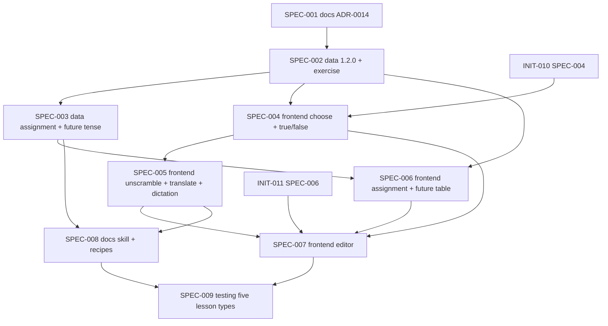

# Initiative: A plan can hold every kind of lesson the teacher actually teaches

**Initiative ID:** INIT-012
**Status:** complete (2026-10-15; SPEC-001 through SPEC-009 `complete`, Phase 3.5 Security Review PASS, Phase 3.6 Architecture Diagrams generated).
**Slug:** INIT-012-lesson-type-coverage
**Discipline Profile:** `software`
**Created:** 2026-10-15
**Owner:** Brian Nelson
**Ticket:** None (`branch_naming.ticket_system: none`)
**Branch:** `lesson-type-coverage` (not created). The tree holds a lot of uncommitted work, including INIT-009 to INIT-011, and a worktree would not see it. Planning stayed in this checkout. No commit unless the operator asks.
**Target Completion:** not a promise. The spec table is an estimate that starts when the operator says to execute.
**Source:** operator, 2026-10-15. The operator's own analysis "Brian's Hebrew lessons with Aaron (Preply): categories and structure", checked against the Drive folder `1eKpZisxfS6DwdNf5jcOgEJY6JRqeu71_` (read-only, 7 of about 85 class docs plus every folder listing). Research: `RSCH-003`, `RSCH-004`, `RSCH-005`. Builds on ADR-0003, ADR-0009 §7, ADR-0013, INIT-010, and INIT-011. Does not redo INIT-010 SPEC-004 (Match and Type it) or INIT-011.

---

## 0. What is already true

| Fact | Where |
|------|--------|
| The lesson recipes already name four of the teacher's five lesson types: `topic-conversation`, `review-worksheet`, `verse-reading`, `verb-workshop`. `letters-and-vowels` and `guide` are the other two | `lesson-plan.schema.json` `recipe`, `.cursor/skills/hebrew-worksheet/recipes.md` |
| The recipe cards already cover the topic lesson's role-play and this-or-that choice (as `short-dialogue`) and the verse lesson's pointed text | `recipes.md` |
| The plan player draws six block types itself and five more through a registry: `explainer`, `conjugation-table`, `personal-question`, `verse-reading`, `letter-intro` | `shared/ui/plan-render.js` `renderBlock`, `REGISTRY` |
| The plan player cannot play `match` or `type-it`. INIT-010 SPEC-004 is `ready`, not done | INIT-010 |
| "Choose the correct sentence" has no block. INIT-011 left it open as O1, with the default "out of INIT-011, until a later ADR-0003 change" | INIT-011 §2b |
| The older worksheet player already has `fill`, `build-sentence`, `listen-pick`, `speed-quiz`, `match`, and `type-it`. Those are worksheet activities, not plan blocks | `shared/activities/catalog.js` |
| `conjugation-table` takes `tense` of `present` or `past` only. `cellCode` and the lexicon cells stop at present and past. The lexicon `TENSE` set already names `future` and `imperative`, but `CELLS` holds no cells for them | `lesson-plan.schema.json`, `server/lexicon/validate.js` |
| A personal question stores no answer. Nothing a learner writes is sent to the server | `personalQuestionBlock` |
| One-word audio clips can be made and reused. Sentence audio goes through the lesson audio path | `server/word-audio.js`, `server/audio.js` |
| Block order inside a lesson is guidance, not a rule | `recipes.md` |
| A new block or field needs a named schema version. 1.1.0 did this for five blocks with a `v110BlockType` guard and an automatic raise. `type-it` is in the schema with no such guard | ADR-0003 §3, ADR-0009 Decision 7, `lesson-plan.schema.json`, `server/plans/ops.js` |
| A person, not a tool, sets a lexicon form `verified`. `set_lexicon_verified` is forbidden to the AI | `RSCH-009`, `mcp/tools.js` |

## 0b. What the teacher's lessons need that the plan cannot hold today

Each row is a thing the teacher does in class. The right column says what holds it.

| What the teacher does | Seen in | Holds it today? |
|-----------------------|---------|------------------|
| Pick the right sentence or form from choices | `Copy of 08: המלצות` Ex. 3, `02` Ex. 2 | No (INIT-011 O1) |
| True or false after a reading | Short story lessons | No |
| Put the words in order | Review sheets, sentence frames | No (worksheet `build-sentence` only) |
| Say or type a whole Hebrew sentence or number from an English cue | Numbers in the Noah doc, translate rows | No. `type-it` is one word |
| Type what you hear | Listening gap in the teacher's list | No. `listening` only asks questions |
| Write 6–8 sentences using given words | End of most topic lessons | No. `personal-question` is one open answer |
| Homework | 8 class docs | No |
| Future tense table | Verb workshop gap | No |
| Match two columns | `03` Ex. 2 | No (INIT-010 SPEC-004) |
| Word bank, fill-in, reading, verse, present and past tables, role-play | Most lessons | Yes |

---

## 1. Executive summary

Four of the teacher's five lesson types already have a recipe. What they lack is the exercise formats the teacher uses inside them. This initiative adds those formats, once, so every lesson type is buildable by hand on `/editor/` and by the AI over MCP.

It adds two blocks and one tense:

- **Exercise** (`exercise`). One block with a `kind`: choose, true or false, unscramble, translate, dictation. It holds the checks the review sheets and short stories need.
- **Assignment** (`assignment`). A written task with a minimum number of sentences and words to use, plus optional homework lines. Never scored. Nothing is sent to the server.
- **Future tense** in `conjugation-table`, with the same cell codes as past. Imperative stays out.

Match and Type it stay INIT-010's. This initiative sits behind them and does not repeat them.

Content stays original. The teacher's class docs show the structure and the topics. None of their text is copied, and their pointing is not trusted, because the live docs hold learner errors and some pointing that looks swapped (`אַכָל`, `לַמָד`). Every pointed form comes from the app's own dictionary.

---

## 2. Operator decisions (2026-10-15)

| Id | Decision |
|----|----------|
| D1 | The lesson types to cover are the teacher's five: topic conversation, review worksheet, Bible verse, verb workshop, short story with true or false. |
| D2 | Do not add a recipe value for the short story. It is a `review-worksheet` that holds a story and a true-or-false exercise. |
| D3 | One `exercise` block with `kind`, not one block per format. One schema definition, one player module, one editor form. |
| D4 | One `assignment` block covers both the writing task and homework. |
| D5 | Future tense reuses the past cell codes. Imperative is out. |
| D6 | Exercise answers sit in the plan and are checked in the browser. They are not sent to the server and they are not secret. The learner can read them in the published plan, as with the cloze answers today. This is a worksheet, not an exam. |
| D7 | Warnings do not block publish (INIT-010 D4 stands). The new rules warn, except where the item cannot be played at all. |
| D8 | Content is original. Class docs inform structure and topics only. Pointed forms come from the dictionary, not from the class docs. |
| D9 | Number, date, and time drills use `translate` items the author writes. A generated drill is later work. |
| D10 | The new constructs take `schemaVersion` 1.2.0 (O3). A part operation that adds one raises the plan in the same revision. A plan never goes back down. |
| D11 | Two exercise families for now: `exercise` (this initiative) and `match` and `type-it` (INIT-010). They share one compare helper (O1). |
| D12 | No `transform` kind (O2). Person-form practice stays in the `conjugation-table` drill. |
| D13 | A person verifies every future form, after a Hebrew-literate checker has read the list (O4). No tool sets `verified`. |

## 2b. Questions, answered from the research (2026-10-15)

| Id | Question | Answer | Why |
|----|----------|--------|-----|
| O1 | Fold INIT-010's `match` and `type-it` into `exercise`? | No. Keep two families, share one compare helper. Revisit when both have shipped | The research does not ask for one family. It asks for both recall and recognition formats, because the evidence on which is better conflicts (`RSCH-003` §1.1: a testing-effect meta-analysis favors recall, a later one that includes classroom studies favors multiple choice; both Moderate or lower). Folding is only a tidiness choice, and INIT-010 SPEC-004 is already written to a different shape |
| O2 | Add a `transform` kind (I to we to they)? | No | `RSCH-001`: no published comparison shows a morphology drill speeds acquisition (Low, an absence). ADR-0009 already ruled out timed root and binyan drills. A free-typed transform needs a Hebrew answer the AI wrote, and `RSCH-009` finds AI pointing needs a person to check it (Moderate, three sources). The `conjugation-table` drill already does untimed form recall against verified forms, with feedback, which `RSCH-003` §1.3 supports (Moderate) |
| O3 | Additive inside 1.1.0, or 1.2.0? | **1.2.0.** This reverses the earlier default | ADR-0003 §3: a minor version adds things only by publishing a schema that names that version. ADR-0009 Decision 7 did that for the five 1.1.0 blocks, with a version guard and an automatic raise. The repo already has the machinery (`V110`, `usesV110`). Skipping it would let a 1.1.0 plan hold a block its own rules say it cannot |
| O4 | Who marks future forms `verified`? | A person, never a tool: the operator sets the flag, after a Hebrew-literate checker (the teacher) has read the list | `RSCH-009`: AI pointing needs verification (Moderate); only a person sets `verified`; experts miss sparse errors, so show the form beside the lexicon form and check a list, not one form at a time. `set_lexicon_verified` is already forbidden to the AI. The operator is a learner and the research says a Hebrew expert should check. Until a form is verified, N14 warns and the drill does not score it, so the future drill stays display-only until then |

No decision is left open.

---

## 3. Requirements

| Id | Requirement | Priority |
|----|-------------|----------|
| REQ-001 | A lesson can hold an `exercise` block of kind choose, true-false, unscramble, translate, or dictation. The schema, validator, and player all accept it | must |
| REQ-002 | Choose: one answer among two to five choices, with a one-line reason shown after the answer | must |
| REQ-003 | True or false: a statement and the answer, with a reason shown after | must |
| REQ-004 | Unscramble: the learner arranges the words. Alternate correct orders are allowed | must |
| REQ-005 | Translate: an English cue and a typed Hebrew answer. Vowel points do not change the score. Several spellings can be accepted | must |
| REQ-006 | Dictation: the learner hears a clip and types it. Same scoring as translate | should |
| REQ-007 | A wrong answer gets one more try before the right answer shows. This matches Type it | must |
| REQ-008 | An `assignment` block holds a prompt, a minimum sentence count, optional words to use, and optional homework lines. It stores no answer | must |
| REQ-009 | `conjugation-table` accepts `tense: future`. N13 and N14 check future forms the way they check past forms. The player draws the table and the drill | must |
| REQ-010 | The plan builder at `/editor/` can add and edit every new activity with no JSON, no id, and no path | must |
| REQ-011 | MCP builds the same blocks through the existing operations. No second write path | must |
| REQ-012 | The hebrew-worksheet skill and the recipe cards say how to build each of the five lesson types with the new blocks | must |
| REQ-013 | Each of the five lesson types has one original sample lesson that validates and plays in a real browser | must |
| REQ-014 | Authored text is escaped on every new surface. A choice or an answer that contains ` Security review and architecture diagrams run as `complete-initiative` phases 3.5 and 3.6. They are not spec rows.

**Outside dependencies:**

- **INIT-010 SPEC-004** (Match and Type it in the plan player). SPEC-004 here reuses its retry-before-reveal rule and its vowel-point-insensitive compare. If it is not done when SPEC-004 starts, SPEC-004 lifts that compare into a shared helper and INIT-010 SPEC-004 then uses it. It does not copy it.
- **INIT-011 SPEC-006** (signed-in browser pass). SPEC-007 here edits the same lesson screen. The pass records that the base screen works before new activities go on it.

**Expertise check:** `scripts/dev/expertise_state.py` is not in this repo, so it was not run. The prompts are the ones INIT-010 and INIT-011 already used: `docs-agent`, `frontend-agent`, `data-agent`. The testing spec uses `frontend-agent`, as INIT-011 SPEC-006 did. Nothing new was generated.

---

## 6. Dependency graph

**Critical path:** SPEC-001 → SPEC-002 → SPEC-004 → SPEC-005 → SPEC-007 → SPEC-009 (31h). A second chain, SPEC-001 → SPEC-002 → SPEC-003 → SPEC-006 → SPEC-007 → SPEC-009, is also 31h.
**Parallelizable:** SPEC-003 can run beside SPEC-004 and SPEC-005. SPEC-006 can run beside SPEC-005. They edit different files. SPEC-004 and SPEC-005 both edit the exercise player module, so they run in order. SPEC-002 and SPEC-003 both edit `lesson-plan.schema.json`, so they run in order.

---

## 7. Timeline and effort

| Metric | Value |
|--------|-------|
| Total effort | 45h |
| Critical path | 31h |
| Realistic duration | 31h × 1.3 ≈ 40h |
| Calendar estimate | about 7 days at 6 productive hours a day |

This starts when the operator says to execute, and after INIT-010 SPEC-004 lands.

---

## 8. What this does not do

- It does not redo Match or Type it (INIT-010 SPEC-004).
- It does not add a `transform` kind, imperative tense, a generated number drill, or a recipe value (see D12, D5, D9, D2).
- It does not import Google Docs or copy any teacher text. The AI reads the doc over MCP and writes original lines.
- It does not write the missing lesson topics (health, hobbies, phone, calendar, news). Those are content for the AI and the teacher to build once the formats exist. They are a follow-up initiative.
- It does not change the review scheduler, `SRS_SCHEDULER`, or the three published worksheets.
- It does not record or collect a learner's written answers.
- It does not restyle Today, Lessons, or Sign in.

---

## 9. Controls and gates

- **Default autonomy:** `auto_tests`. SPEC-001 and SPEC-008 are `plan_only` because they are documents.
- **One-way actions expected:** none. No migration, no dependency, no deploy. The schema change is a minor version (1.2.0); no stored plan changes version until someone adds a 1.2.0 construct to it. A server restart is needed to load validator changes (`hebrew-hebrew-1` bind-mounts `.:/app`; front-end files are live).
- **Approval owner:** Brian Nelson, for the ADR and for the schema version change (D10).

---

## 10. Threat model

- **Attack surface:** admin-only plan writes (the same admin and bearer-token checks as today) and learner reads of a published plan. No new route, no new secret, no new account.
- **Trust boundaries:** authored text crosses from the plan JSON into learner HTML. A learner's typed answer stays in the browser.
- **Data classification:** content only. No personal data. Answers in a plan are visible to a learner who can read the plan. The initiative accepts that (D6).
- **STRIDE-lite:**
  - *Tampering / XSS:* a choice, statement, or `audioPath` carrying markup. The existing markup and audio-path checks apply to the new fields, and every new renderer escapes (REQ-014).
  - *Information disclosure:* answers are readable by design.
  - *Denial of service:* item caps and the plan-size rule (N9, N10, N11) bound a block.
- **Security-sensitive specs:** none is `required`. SPEC-002, SPEC-003, SPEC-004, SPEC-005, SPEC-006, and SPEC-007 are `standard`, because they take authored text into HTML.

---

## 11. Risks

| Risk | Probability | Impact | Mitigation |
|------|-------------|--------|------------|
| Future forms are wrong. The AI writes them, and the teacher's own docs show swapped pointing | M | H | Forms written over MCP enter unverified. N14 warns and does not score them. Only a person marks a form verified, after a Hebrew-literate checker reads the list (D13). SPEC-009 writes that list. No spec marks any |
| Match and Type it are not done, so Exercise looks like a second system | M | M | D11: two families for now, one shared compare helper. SPEC-001 writes down why |
| `type-it` has no version guard, so INIT-010 may ship `match` and `type-it` outside 1.2.0 | M | L | SPEC-001 names the gap for INIT-010. This initiative does not fix another initiative's block |
| Unscramble breaks on Hebrew word order that has more than one correct answer | M | M | `alt` orders, up to three. A wrong order the author did not list gets the retry, then the answer. The author can add one |
| Typed Hebrew fails on plene versus defective spelling and on vowel points | H | M | Reuse the `accept[]` rule from the lexicon (no points, up to eight spellings). Compare with points stripped |
| An exercise-heavy lesson turns a topic lesson into a quiz and breaks the research warnings | L | M | N-rules warn on too many exercises in a `topic-conversation` lesson. SPEC-001 sets the number and says it is a product choice |
| SPEC-004 and INIT-010 SPEC-004 collide on the plan player | M | M | Both edit `shared/ui/plan-render.js` only for registry entries. The exercise code lives in a new file, `shared/ui/blocks/exercise.js` |
| The editor form for item lists is large | M | M | SPEC-007 builds one list-of-items widget and reuses it for all five kinds |

### Reflection loop (plan quality gate)

| Dimension | Score |
|-----------|-------|
| Completeness | 8 |
| Accuracy | 8 |
| Clarity | 8 |
| Technical feasibility | 7 |
| Guardrails compliance | 8 |

Confidence = 39 / 50 = 0.78. Every dimension is 6 or higher. One iteration. The lowest score is feasibility, because INIT-010 SPEC-004 is not done and the future forms depend on a human check. Both are named as dependencies and risks above.

---

## 12. Success criteria

- [x] Each of the five lesson types has one original sample lesson that validates with no blocking issue, builds over MCP, and plays in real Chrome as a learner.
- [x] A teacher with no AI builds one `review-worksheet` lesson with a choose, an unscramble, and a translate exercise on `/editor/`.
- [x] A future-tense table and drill play, and an unverified future form warns and is not scored.
- [x] An exercise in a 1.1.0 document fails, and adding one to a 1.1.0 plan raises it to 1.2.0 in the same revision.
- [x] A list of the future forms the samples use is written for a person to check. None is marked verified by a test or a tool.
- [x] Every new surface escapes authored text. A test feeds each field ``.
- [x] The full node suite has no new failure. The failures that exist today stay as they are.
- [x] The hebrew-worksheet skill says how to build each of the five types.
- [x] No unresolved Critical or High security finding.
- [x] Completion report written; initiative status `complete`.

---

## 13. Next steps

1. The operator approves the spec breakdown. O1–O4 are answered in §2b.
2. INIT-010 SPEC-004 lands first, or SPEC-004 here lifts the shared compare helper.
3. Execute SPEC-001, then the rest in the order in §6.
4. Run `complete-initiative` once every spec is complete.
