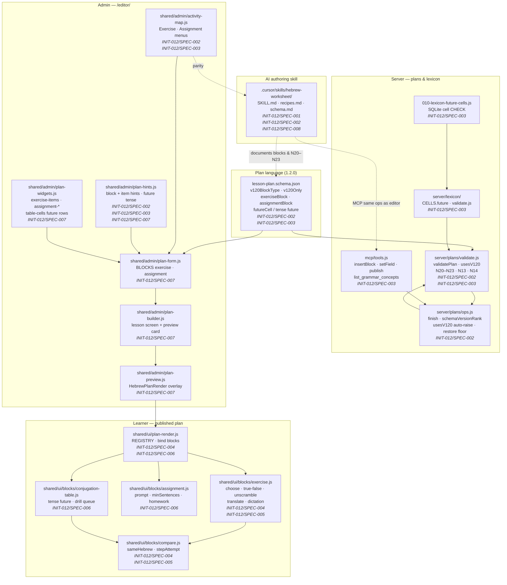
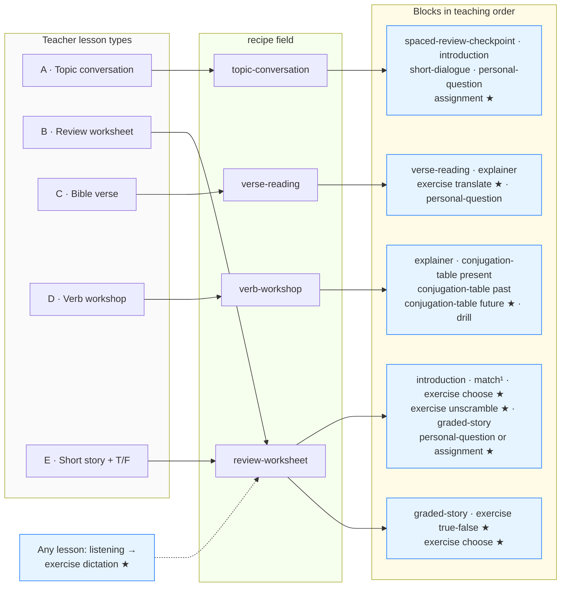

# Architecture & Design — Lesson-Type Coverage (INIT-012)

**Initiative:** INIT-012-lesson-type-coverage · **Reflects specs:** SPEC-001…SPEC-009 · **Date:** 2026-10-15  
**Provenance tag:** `INIT-012/DESIGN-DIAGRAMS`  
**Canvas:** in-doc Mermaid only  
**Grounding:** [ADR-0014](../../../docs/decisions/ADR-0014-lesson-type-coverage.md), implemented plan language `schemaVersion` `1.2.0`, blocks `exercise` and `assignment`, and `conjugation-table` `tense: future`.

This document visualizes how the 1.2.0 constructs, validator rules, lexicon cells, admin editor, learner player, MCP write path, and hebrew-worksheet skill connect after INIT-012 shipped SPEC-001 through SPEC-009.

---

## 1. Component / Module Architecture  <!-- diagrams: component -->

Internal modules for lesson-type coverage: schema guards, server validation and ops, lexicon future cells, admin authoring UI, learner block renderers, and AI authoring skill docs. Arrows show primary dependencies (read, validate against, or render).



**Notes:** `validatePlan` loads `lesson-plan.schema.json` and, when a plan references lexicon `formKey` values, consults the lexicon service (N13 requires a stored future form; N14 warns when it is not `verified`). The editor and MCP share `server/plans/ops.js`; neither path adds a second write model (REQ-011).

---

## 2. Data Flow — Authoring vs Learner Playback  <!-- diagrams: sequence -->

Two trust boundaries: (1) admin/MCP writes plan JSON through validated ops; (2) the learner browser holds answers locally and never posts exercise or assignment text to the server (ADR-0014 §9, D6).

```mermaid
sequenceDiagram
  autonumber
  box Authoring (admin session or MCP bearer)
    participant Author as Author<br/>(teacher or AI)
    participant Editor as /editor/<br/>plan-builder · plan-form · plan-widgets
    participant Preview as plan-preview.js<br/>(HebrewPlanRender)
    participant MCP as mcp/tools.js<br/>insertBlock · setField
    participant Ops as server/plans/ops.js<br/>finish · usesV120
    participant Val as validatePlan<br/>N13 · N14 · N20–N23
    participant Lex as server/lexicon<br/>CELLS.future
    participant Schema as lesson-plan.schema.json<br/>1.2.0 guards
  end

  box Learner (published plan, browser only)
    participant Browser as Learner browser
    participant Render as plan-render.js
    participant Ex as blocks/exercise.js
    participant Cmp as blocks/compare.js
    participant Asg as blocks/assignment.js
    participant Fut as blocks/conjugation-table.js<br/>tense future
  end

  Note over Author,Schema: (a) Authoring — MCP and /editor/ share one ops path (INIT-012/SPEC-007, SPEC-003)

  Author->>Editor: Add exercise · assignment · future table
  Author->>MCP: insertBlock / setField (same revision rules)
  Editor->>Ops: HTTP part op + expectedRevision
  MCP->>Ops: planOps.insertBlock / setField
  Ops->>Ops: usesV120 → schemaVersion 1.2.0<br/>(same revision, never downgrade)
  Ops->>Val: validate merged plan
  Val->>Schema: JSON Schema + v120BlockType / v120Only
  Val->>Lex: N13 formKey · N14 unverified future
  Val-->>Ops: blocks N20–N22 · warnings N23 · N14
  Ops-->>Author: saved draft + findings panel

  Editor->>Preview: unsaved field overlay
  Preview->>Render: render only (controls not bound)

  Note over Browser,Fut: (b) Learner playback — answers stay in DOM / memory (INIT-012/SPEC-004–006)

  Browser->>Render: Load published plan JSON (read-only)
  Render->>Ex: bind exercise block by kind
  alt choose or true-false
    Ex->>Cmp: stepAttempt + compare choices / boolean
  else unscramble
    Ex->>Cmp: order match + alt[] permutations
  else translate or dictation
    Ex->>Cmp: sameHebrew + accept[] (points stripped)
    Note right of Ex: dictation plays audioPath locally;<br/>no answer upload
  end
  Cmp-->>Browser: retry once, then reveal (in-page only)

  Render->>Asg: bind assignment
  Asg-->>Browser: local textarea · sentence count · homework checklist<br/>(no HTTP with learner text)

  Render->>Fut: bind conjugation-table future
  Fut->>Cmp: drill scores verified cells only (N14)
  Fut-->>Browser: table + drill feedback in-page only

  Note over Browser,Val: Zero network transmission of learner exercise or assignment answers<br/>(contrast: authoring writes go through Ops → Val only)
```

**Validator touchpoints on write:** N13/N14 apply to `conjugation-table` rows with `tense: future` (SPEC-003). N20–N23 apply to `exercise` items and topic-lesson exercise density (SPEC-002). Warnings including N23 and N14 do not block publish (ADR-0013, D7).

---

## 3. Lesson Types A–E → Recipes & 1.2.0 Blocks  <!-- diagrams: lesson_type_map -->

Teaching order is guidance for authors and the hebrew-worksheet skill; the validator enforces shape via rules, not block order (ADR-0014 §1). `★` marks constructs introduced at 1.2.0 in this initiative.



¹ `match` is INIT-010 SPEC-004 (recognition family); INIT-012 adds the `exercise` family (D11). Type C was buildable before translate; number drills use new `exercise` `kind: translate` (SPEC-001 table). Type E reuses `review-worksheet` per D2 (no separate recipe). Sample lessons for all five types are validated and browser-played in SPEC-009.

**Skill & docs:** `.cursor/skills/hebrew-worksheet/recipes.md` and `SKILL.md` mirror this map (SPEC-008). ADR-0014 records the normative table (SPEC-001).

---

## Traceability

| Diagram | Reflects | Source specs / files |
| ------- | -------- | -------------------- |
| Component / module | Schema 1.2.0, validator, ops auto-raise, lexicon future cells, editor widgets, player blocks, skill | INIT-012/SPEC-001–003, SPEC-007, SPEC-004–006, SPEC-008; `docs/decisions/ADR-0003-assets/lesson-plan.schema.json`, `server/plans/validate.js`, `server/plans/ops.js`, `server/lexicon/`, `server/db/migrations/010-lexicon-future-cells.js`, `mcp/tools.js`, `shared/admin/*`, `shared/ui/plan-render.js`, `shared/ui/blocks/*`, `.cursor/skills/hebrew-worksheet/` |
| Authoring vs learner sequence | MCP/editor shared ops, `usesV120`, `validatePlan`, N13/N14/N20–N23, local scoring | INIT-012/SPEC-002, SPEC-003, SPEC-007, SPEC-004–006; ADR-0014 §6–§9 |
| Lesson type map | Types A–E, recipes, 1.2.0 blocks | INIT-012/SPEC-001, SPEC-008, SPEC-009; initiative §4, ADR-0014 §1 |
