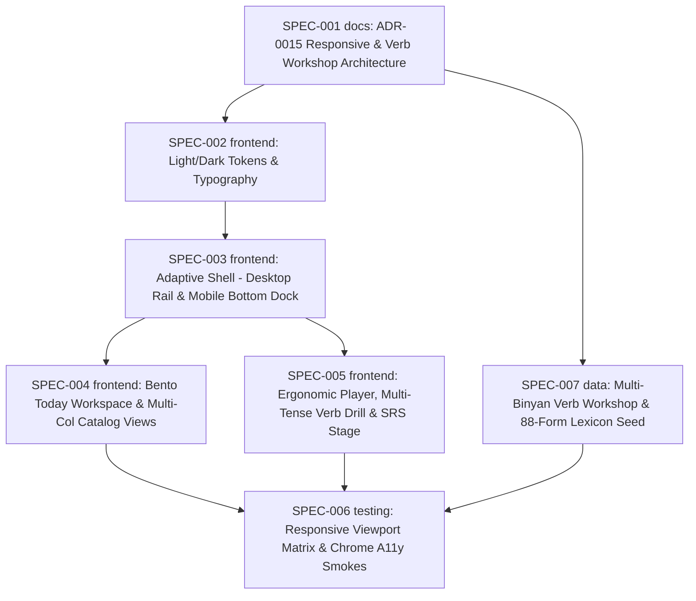

# Initiative: Responsive Desktop & Mobile Redesign — Adaptive Shell, Bento Workspace, and Ergonomic Study Stage

**Initiative ID:** INIT-013
**Status:** complete (completed 2026-10-17; all 7 specs SPEC-001 through SPEC-007 verified complete).
**Completed:** 2026-10-17
**Slug:** INIT-013-responsive-desktop-mobile-redesign
**Discipline Profile:** `software`
**Created:** 2026-10-17
**Owner:** Brian Nelson
**Ticket:** None (`branch_naming.ticket_system: none`)
**Branch:** `responsive-desktop-mobile-redesign` (deliberately not a worktree — the current checkout holds uncommitted INIT-010, INIT-011, and INIT-012 player/editor files that this redesign styles; planning stays in this checkout, no commit unless the operator asks).
**Target Completion:** not a promise. The spec table is an estimate that starts when the operator says to execute.
**Source:**
1. Operator web-design request (2026-10-17): *"I want you to act like a web designer. You need to re do this app to be optimized to work on phones or a desktop. right now it's not really either. you have complete and free liberty to change color schemes layout ect. how would you design this as an expert web designer to make this site look very advance and well thought out?"*
2. Operator verb-conjugation worksheet & research inquiry (2026-10-17, reference worksheet `1kl-0sfsiuVJ67sYKg59GOwD3nhZcHxGi7lRzlnM0VLE` — `לְהַחְלִיט`, `לִבְחוֹר`, `לְהַאֲמִין`, `לְנַצֵּחַ`): *"how can we make a worksheet like this in our app? Where I can practice verb tense conjugation so that I can reinforce past tense, future tense, present tense etc. ... research. can we do it. if not what must change. If we can. Is it something our research suggests will help the learner learn in the fastest way possible ... add these recommendations into init 13"*
**Figma Design Source:** File `NJ8HfTPCQgrFty2VVQBMhY` ([Open in Figma](https://www.figma.com/design/NJ8HfTPCQgrFty2VVQBMhY)):
- `30:20` — `00 — Design System & Responsive Architecture` + `Derekh Ivrit Tokens` variable collection (`VariableCollectionId:30:2`, Light & Dark modes)
- `31:2` — `01 — Desktop App: Today Workspace (1440×960)`
- `32:2` — `02 — Desktop App: Lesson Player & Context Drawer (1440×960)`
- `33:2` — `03 — Mobile App: Today Feed & Bottom Dock (390×844)`
- `33:74` — `04 — Mobile App: One-Handed Lesson Player (390×844)`
- `34:2` — `05 — Mobile App: SRS Flashcard & Dark Mode (390×844)`
**Research Grounding:**
- **Interface, Accessibility & Layout:** `RSCH-006` (learner interface design, pointed Hebrew legibility, WCAG 2.2 AA/AAA target sizes and contrast, thumb-zone mobile ergonomics), `RSCH-007` (icon + visible label navigation, competence feedback without streaks/points), `RSCH-008` (informational motion only, `prefers-reduced-motion` reset), `RSCH-010` (program list vs. opened lesson page vs. editor layout, WCAG 2.2 Consistent Navigation 3.2.3 and Location 2.4.8).
- **Verb Conjugation & Fastest-Learning Pedagogy:** `RSCH-001` §1 [1][8][9][11][12] (~¼ deliberate pattern study paired with ~¾ meaning-focused input/output; Nation 2007; Goo et al. 2015 $g = 1.06$), `RSCH-003` §1.1 [1][2][12][21] (spaced retrieval across days $g = 0.74$; interleaved practice across verbs/tenses beats blocked row-by-row table filling; Nakata & Suzuki 2019) & §1.3 [4][5][6][26] (corrective prompts that elicit learner self-repair $d = 0.83$ outperform passive recasts $d = 0.53$), `RSCH-004` §1.4 [1] (rule `N7` strand balance), `RSCH-005` §1.3 [10][11] (Barcroft 2004, 2006 — copying while the target stem is visible on screen reduces form learning compared to hidden-stem recall), `RSCH-009` §1.1 [17] & §1.4 [55]–[57] (authoritative dictionary pointing and human verification checklist before any verb form is scored).
**Decisions it builds on / amends:** Builds on `ADR-0006` (preserving all 70 `data-*` attributes, 50 CSS classes, and WCAG 2.2 AA contrast/target floors), `ADR-0007` (SPA shell & router), `ADR-0008` (learner look & dark mode), `ADR-0009` (Decisions 4, 6 & 8: untimed verb conjugation recall, `kind: "form"` signals, per-concept mastery in Daily Mix, and human-verified lexicon forms), `ADR-0010` (player competence feedback), and `ADR-0014` (Type D `verb-workshop`, `exercise` block, `assignment` block, and `tense: "future"` on `schemaVersion: "1.2.0"`). Supersedes the single-column `40rem` (`640px`) learner layout and wrapped top-pill navigation bar via **`ADR-0015`**.

---

## 0. What is already true (Diagnosis of the "Neither Phone Nor Desktop" Trap)

| Fact | Where | Why it hurts Phone & Desktop |
|------|-------|------------------------------|
| `.hebrew-shell-nav` has `order: 3; flex: 1 1 100%; flex-wrap: wrap;` at every viewport width | `shared/worksheet.css` lines 4357–4403, `shared/app-shell.js` | **On Phones (`<768px`):** 6–8 navigation pills wrap into 2–3 rows at the top of the viewport, consuming ~150px of vertical height in the hardest-to-reach top zone. **On Desktop (`≥1024px`):** Instead of a persistent left/right application sidebar rail, navigation still wraps inside a top bar. |
| `.wrap` is locked to `--wrap-w: 40rem` (`640px`) across learner views (`Today`, `Lessons`, `Guides`, `Review`, `Words`, `Progress`) | `shared/worksheet.css` lines 4275–4280 | **On Desktop (`1280px–1920px`):** Leaves ~65% of the screen blank beige space while forcing vertical scrolling through stacked cards (`#today-continue-card`, `#today-mix`, `#today-review-card`). **On Phones (`360px–430px`):** Uses desktop card padding (`1.15rem 1.3rem`) and inline buttons instead of compact mobile feed density and thumb-zone action trays. |
| Three competing visual eras coexist in one 6,379-line stylesheet | `shared/worksheet.css` | Era 1 legacy slate/cobalt gradients (`#1e293b`), Era 2 `ADR-0006` `2px`-radius forest green (`#1e3a2f`), and Era 3 `ADR-0010` `18px`-radius royal blue (`#1d4ed8`). Dark mode (`ADR-0008`) was left pinned off via `:root:not([data-theme="dark"])`. |
| `test/restyle-gate.test.js`, `test/design-tokens.test.js`, `test/player-ui-a11y.test.js`, and `test/chrome-restyle-a11y-smoke.js` enforce strict contracts | `test/` | All 70 `data-*` hooks, 50 CSS classes, 19 Light/Dark token contrast pairs (≥4.5:1 text, ≥3.0:1 UI), ≥44×44px primary targets, and zero horizontal overflow at `360px` and `1280px` must remain green. |
| Multi-verb, multi-tense (`present`, `past`, `future`) drill interleaving omits the active verb & tense cue in the UI | `shared/ui/blocks/conjugation-table.js` lines 235–263, 398–409, 425–462 | `drillQueue()` already shuffles and interleaves verified cells across all `mode: "drill"` blocks in a lesson, and `isOwner()` mounts one shared `[data-drill-station]` on the first drill block. However, `showItem()` sets `prompt.textContent = item.label` (`אני` / `SM`) without showing which verb (`item.lemma`) or tense (`item.tense`: `הווה / present`, `עבר / past`, `עתיד / future`) is being prompted, and non-owner `[data-mode="drill"][data-drill-owner="0"]` sections render as empty orphaned headers. |
| Starter verb workshop (`scripts/seed-starter-content.js`) predates `schemaVersion: "1.2.0"` (`INIT-012`) | `scripts/seed-starter-content.js` | The existing starter seed is `1.1.0` (`present` and `past` only, with a single-verb `present` drill and no `future` tense, no contextual `exercise` blocks, and no `assignment` block). Meanwhile, class Google Doc worksheets (`1kl-0sfsiuVJ67sYKg59GOwD3nhZcHxGi7lRzlnM0VLE`) contain raw pointing errors (`הֶחְלַטֶתִי` vs. `הֶחְלַטְתִּי`, `בַּחָרתִי` vs. `בָּחַרְתִּי`, `מְנָּצֵחַ` vs. `מְנַצֵּחַ`) and rely on static row-by-row table filling. |

---

## 1. Executive Summary

This initiative transforms **דֶּרֶךְ עִבְרִית (Hebrew Way)** from a fixed `640px` single-column page into an adaptive, studio-grade web application optimized for both **desktop monitors (`≥1024px`)** and **one-handed phone use (`<768px`)**, implementing the **Jerusalem Stone & Tekhelet Indigo** design system created in Figma (`NJ8HfTPCQgrFty2VVQBMhY`).

The redesign and verb-practice upgrade rest on five pillars:

1. **Jerusalem Stone & Tekhelet Indigo Token System (`ADR-0015` & `SPEC-002`):** Unifies the stylesheet around a warm, glare-free editorial palette (`#F7F5F0` Jerusalem Stone canvas, `#FFFFFF` Pure Parchment cards, `#141B2D` Judean Midnight hero surface, `#254EDB` Tekhelet Indigo primary action, `#D97706` Warm Terracotta SRS/root accents, `#0D9488` Galilee Sage competence accents) with a complete, high-contrast **Dark Mode** (`#0E121B` canvas, `#161C2A` surface) and a 1-click theme switcher.
2. **Adaptive Application Shell (`SPEC-003`):**
   - **Desktop (`≥1024px`):** Converts `.hebrew-shell` into a persistent `260px` vertical sidebar rail (using CSS logical properties so RTL/LTR flow naturally) with brand lockup, grouped navigation links, calm session status, sync indicator, and account menu footer.
   - **Mobile (`<768px`):** Compresses the top bar into a single `52px` header (brand, language/theme toggles, account menu) and docks `.hebrew-shell-nav` to a fixed thumb-zone **Bottom Tab Bar** (`min-height: 64px` + `env(safe-area-inset-bottom)`), eliminating the multi-row top pill wrap.
3. **Desktop Bento Workspace vs. Mobile Compact Feed (`SPEC-004`):**
   - **Desktop (`≥1024px`):** Expands `.wrap` to `1200px` and arranges `Today` into an asymmetric 2-column Bento workspace (primary column: Judean Midnight Hero Continue/Next card + Balanced Practice Queue; secondary intelligence rail: SRS Review status + Lexicon/Competence widgets). `Lessons`, `Guides`, `Words`, and `Progress` expand into multi-column responsive grids.
   - **Mobile (`<768px`):** Renders compact `16px`-padded cards, 2-up metric strips, and full-width thumb-friendly action buttons.
4. **Ergonomic Study Stage & SRS Review (`SPEC-005`):**
   - **Desktop (`≥1024px`):** Widens the Lesson Player and SRS Review workspace so 2×2 option grids, keyboard shortcut badges, and side-by-side grammar/conjugation context breathe comfortably.
   - **Mobile (`<768px`):** Anchors exercise choices, inline `why` competence feedback, `Continue` CTAs, the 22-letter Hebrew drill pad (`[data-letter-pad]`), and the 4 SRS recall rating buttons (`Again`, `Hard`, `Good`, `Easy`) into the lower thumb arc with zero layout jump and zero horizontal scroll at `360px`.
5. **Research-Backed Multi-Tense Verb Workshop & Interleaved Hidden-Stem Recall (`SPEC-005` & `SPEC-007`):**
   - Upgrades `shared/ui/blocks/conjugation-table.js` so multi-verb, multi-tense (`present`, `past`, `future`) interleaved drills explicitly display the active **verb lemma + tense + person/gender cell** (`data-drill-lemma`, `data-drill-tense`, `data-drill-cell`) and collapse empty non-owner drill sections.
   - Delivers an idempotent `schemaVersion: "1.2.0"` multi-binyan verb workshop (`לְהַחְלִיט` `hifil`, `לְהַאֲמִין` `hifil`, `לְנַצֵּחַ` `piel`, `לִבְחוֹר` `paal` across `present`, `past`, and `future` = 88 inflected forms + 4 lemmas) with corrected dictionary pointing, a human verification checklist (`ADR-0014` D13, `RSCH-009`), contextual sentence exercises (`choose`, `translate`), and open writing (`assignment`, `personal-question`).

---

## 1b. Research-Backed Verb Tense Conjugation & Workshop Recommendations

When translating a multi-verb, multi-tense class worksheet (such as `1kl-0sfsiuVJ67sYKg59GOwD3nhZcHxGi7lRzlnM0VLE` covering `לְהַחְלִיט`, `לִבְחוֹר`, `לְהַאֲמִין`, `לְנַצֵּחַ`, `לְלַמֵּד`, `לִלְמוֹד`, `לֶאֱכוֹל`) into the app for the **fastest and most durable acquisition**, our research corpus (`RSCH-001`, `RSCH-003`, `RSCH-004`, `RSCH-005`, `RSCH-006`, `RSCH-009`) prescribes six concrete design rules:

| # | Recommendation | Research Grounding & Confidence | Implementation in `INIT-013` |
|---|----------------|---------------------------------|------------------------------|
| **R1** | **Interleaved, hidden-stem recall beats filling out a visible table grid row-by-row.** Do not build an inline "type into the empty cells of a visible table" widget where adjacent rows keep the binyan stem and vowel melody visible on screen. Instead, separate **reference study** (`conjugation-table` `mode: "study"`) from **active retrieval** (`conjugation-table` `mode: "drill"`), which hides the study table, shuffles person cells, and interleaves across verbs and tenses (`present`, `past`, `future`). | `RSCH-003` §1.1 [12][21] (**Moderate**: Nakata & Suzuki 2019 — interleaving across patterns produces higher delayed retention than blocked practice even though blocked feels easier); `RSCH-005` §1.3 [10][11] (**Moderate**: Barcroft 2004, 2006 — copying while the target stem is visible on screen reduces form learning compared to retrieval from memory). | `SPEC-005` enhances `shared/ui/blocks/conjugation-table.js` so `[data-drill-station]` displays the active `lemma` and `tense` (`הווה / present`, `עבר / past`, `עתיד / future`) alongside the person/gender prompt (`data-drill-lemma`, `data-drill-tense`, `data-drill-cell`) when interleaving multiple verbs and tenses, and hides empty `[data-drill-owner="0"]` sections. |
| **R2** | **Immediate self-correction retry (`"נסו שוב. / try again"`) & unpointed tolerance beat static answer keys.** On a first miss, prompt the learner to retry once before revealing the pointed form; strip nikud (`U+0591–U+05C7`) and accept plene/defective variants via `accept[]`. | `RSCH-003` §1.3 [6][26] (**Moderate**: Lyster & Saito 2010 — prompts that elicit learner self-repair $d = 0.83$ outperform passive recasts $d = 0.53$); `RSCH-006` §1.3 [11][12] (**Moderate**: immediate corrective feedback with explanation beats right/wrong alone). | `SPEC-005` styles the retry/reveal feedback states (`[data-drill-feedback]`, `[data-drill-reveal]`, `.exercise-why`) with Galilee Sage (`--color-correct-*`) and Warm Terracotta (`--color-miss-*`); `SPEC-007` populates unpointed and plene `accept[]` arrays for all 88 verb forms. |
| **R3** | **Spaced multi-day form mastery in Daily Mix beats cramming 36–88 cells in one sitting.** Completing a large verb table in one session produces high same-day performance that decays rapidly without multi-day spacing. | `RSCH-003` §1.1 [1][2][12] (**High**: Cepeda et al. 2006; Kim & Webb 2022 $g = 0.74$ — distributed practice across days is the highest-confidence finding in the corpus); `ADR-0009` Decisions 4 & 8. | Every scored drill prompt emits a `kind: "form"` signal (`formSignal`) updating per-concept mastery (`tense`, `cell`, `binyan`, `root-class`), which feeds `#today-mix` in `SPEC-004`'s Today Bento workspace on subsequent days. |
| **R4** | **Keep deliberate pattern/table study to ~¼ of the lesson and pair immediately with ~¾ meaning-focused input & output (`N7`).** Replace the Google Doc's `אני _____(לְהַחְלִיט)_____` pronoun + infinitive cloze stems with contextualized `exercise` (`kind: "choose"` and `kind: "translate"`) and open production (`assignment` + `personal-question`), without adding a separate `transform` exercise kind (`ADR-0014` D12). | `RSCH-001` §1 [1][8][9][11][12] (**Moderate**: Nation 2007 Four Strands; Goo et al. 2015 $g = 1.06$); `RSCH-003` §1.3 [4][5] ($g = 0.65$); `RSCH-004` §1.4 [1] (rule `N7`); `ADR-0014` D12. | `SPEC-007` authors the `1.2.0` `verb-workshop` lesson with all 5 stages: (1) `explainer` 3-binyan root table, (2) `conjugation-table` `study` (`present`, `past`, `future`) with sentences & questions, (3) interleaved `conjugation-table` `drill`, (4) contextual `exercise` (`choose` & `translate`), and (5) `assignment` + `personal-question`. |
| **R5** | **Source pointed forms exclusively from verified lexicon entries, never raw class Google Docs (`N13`, `N14`).** Class worksheets frequently contain pointing typos (e.g., `הֶחְלַטֶתִי` instead of `הֶחְלַטְתִּי`, `בַּחָרתִי` instead of `בָּחַרְתִּי`, `מְנָּצֵחַ` instead of `מְנַצֵּחַ`, `אַכָל` instead of `אָכַל`). | `RSCH-009` §1.1 [17] & §1.4 [55]–[57] (**Moderate**: AI/class-note pointing requires human verification against a side-by-side paradigm checklist); `ADR-0009` Decision 6; `ADR-0014` D8 & D13. | `SPEC-007` seeds all 4 lemmas and 88 `present`/`past`/`future` forms with corrected dictionary pointing and `verified = 0`, generates `SPEC-007-forms-checklist.md` for operator/teacher review, and only marks ticked forms `verified = 1`. |
| **R6** | **Desktop tabular clarity & Mobile thumb-zone ergonomics for verb tables and the 22-letter Hebrew pad.** Pointed verb forms require generous font size (`≥1.35rem–1.5rem`), nikud-safe line height (`1.55–1.7`), distinct root-letter coloring (`.root-letter`), and zero horizontal overflow at `360px`. | `RSCH-006` (pointed Hebrew typography, spatial contiguity of prompt + input + feedback, `≥44px` primary touch targets, thumb-zone mobile placement). | `SPEC-005` styles `.explainer-table`, `.conj-table[data-tense="present"]` (4-col), `.conj-table[data-tense="past"|"future"]` (9-row), `.root-letter` (Warm Terracotta), and `[data-drill-station]` / `[data-letter-pad]` across Desktop (`≥1024px`) and Mobile (`<768px`). |

---

## 2. Domain Analysis

| Domain | Affected | Key changes |
|--------|----------|-------------|
| Data | Yes (`SPEC-007`) | Idempotent lexicon & plan seed (`scripts/seed-verb-tense-workshop.js`) adding 4 multi-binyan verb lemmas (`לְהַחְלִיט`, `לִבְחוֹר`, `לְהַאֲמִין`, `לְנַצֵּחַ`), 88 inflected forms across `present`, `past`, and `future` (`verified = 0` + operator checklist), and a `schemaVersion: "1.2.0"` `verb-workshop` plan. No SQL schema migrations. |
| Service | No | Existing lexicon and plan services (`lexicon.upsert`, `lexicon.setVerified`, `validatePlan`, `ops`) remain unchanged. |
| API | No | Existing REST and MCP endpoints remain unchanged. |
| Event | No | None. |
| Scheduled | No | None. |
| Infrastructure | No | Self-hosted static assets only; no external CDNs (`REQ-018` origin lock preserved). |
| Frontend | Yes (`SPEC-002`–`SPEC-005`) | `shared/worksheet.css`, `shared/app-shell.js`, `shared/layout.js`, `shared/today-page.js`, `shared/lessons-page.js`, `shared/words-page.js`, `shared/guides-page.js`, `shared/progress-page.js`, `shared/review-page.js`, and player block rendering/styling (`shared/ui/plan-render.js`, `shared/ui/blocks/conjugation-table.js`, `shared/ui/blocks/*`). |
| Docs | Yes (`SPEC-001`) | `docs/decisions/ADR-0015-responsive-desktop-mobile-architecture.md` recording the breakpoint architecture, shell transformation, Bento grid rules, Light/Dark token table, and research-backed multi-tense verb workshop architecture. |

---

## 3. Requirements

| ID | Requirement | Priority |
|----|-------------|----------|
| REQ-001 | **Desktop Persistent Sidebar Rail (`≥1024px`):** On viewports `≥1024px`, `.hebrew-shell` renders as a persistent vertical sidebar rail (`260px` wide) alongside `#app-main`, keeping all navigation links, language/theme controls, sync status, and account menu accessible without wrapping across top rows. | must |
| REQ-002 | **Mobile Thumb-Zone Bottom Tab Dock (`<768px`):** On viewports `<768px`, the top header is a single compact row and `.hebrew-shell-nav` is docked to the bottom of the viewport (`position: fixed; bottom: 0; inset-inline: 0`) with `≥44px` touch targets, `env(safe-area-inset-bottom)` clearance, and bottom padding on `#app-main` so content is never obscured. | must |
| REQ-003 | **Fluid Container & Desktop Bento Grid (`≥1024px`):** Learner routes expand from the `40rem` (`640px`) cap to a `1200px` max-width workspace on desktop. The `Today` view (`shared/today-page.js`) arranges the Hero Continue/Next lesson card, Practice Queue (`#today-mix`), and SRS Review card (`#today-review-card`) into an asymmetric 2-column Bento grid on desktop and a compact vertical feed on mobile. | must |
| REQ-004 | **Multi-Column Desktop Grids for Catalog & Progress Views:** `Lessons`, `Guides`, `Words`, and `Progress` use responsive multi-column CSS Grid layouts on desktop (`≥1024px`) while keeping reading prose blocks capped at a comfortable `60ch–70ch` measure. | must |
| REQ-005 | **Jerusalem Stone & Tekhelet Indigo Light + Dark Palette:** `shared/worksheet.css` implements the `ADR-0015` Light (`#F7F5F0` canvas, `#FFFFFF` surface, `#141B2D` hero, `#254EDB` primary, `#D97706` terracotta, `#0D9488` sage) and Dark (`#0E121B` canvas, `#161C2A` surface, `#6085FF` primary) token system, and exposes a working Light/Dark theme toggle in `.hebrew-shell` that persists to `localStorage` and updates `document.documentElement.dataset.theme`. | must |
| REQ-006 | **Ergonomic Lesson Player & SRS Review Stage:** On desktop (`≥1024px`), exercise options (`choose`, `true-false`) render in a responsive 2-column grid and conjugation/reference blocks use wide-stage layout. On mobile (`<768px`), exercise answer options, feedback banners, and SRS rating buttons (`Again`, `Hard`, `Good`, `Easy`) sit in a thumb-friendly bottom tray with full-width primary CTAs (`≥44px` height). | must |
| REQ-007 | **Zero Hook or Accessibility Regressions:** All 70 `data-*` attributes and 50 CSS classes in `ADR-0006`, all 19 Light/Dark contrast pairs in `test/restyle-gate.test.js` (`≥4.5:1` text, `≥3.0:1` UI), `test/design-tokens.test.js`, `test/player-ui-a11y.test.js`, and `test/chrome-restyle-a11y-smoke.js` (`360px` and `1280px`, Light and Dark, zero horizontal overflow) pass. | must |
| REQ-008 | **Logical RTL/LTR Properties & Pointed Hebrew Legibility:** Layout rules use CSS logical properties (`inset-inline`, `margin-inline`, `padding-inline`, `border-inline-end`) so switching between Hebrew (`dir="rtl"`) and English (`dir="ltr"`) mirrors cleanly, and pointed Hebrew maintains `line-height: 1.5–1.7` without clipping nikud. | must |
| REQ-009 | **Interleaved Multi-Verb / Multi-Tense Drill Cues & Ergonomic Verb Stage:** When `conjugation-table` (`mode: "drill"`) interleaves prompts across multiple verbs (`lemmaKey`) and/or tenses (`present`, `past`, `future`), `[data-drill-station]` updates `data-drill-lemma`, `data-drill-tense`, and `data-drill-cell` on `[data-drill-prompt]` and displays the active verb and tense alongside the person/gender cue (`R1`). Non-owner drill blocks (`[data-mode="drill"][data-drill-owner="0"]`) with no study content do not render empty visual cards, and `.conj-table`, `.explainer-table`, `.root-letter`, and `[data-letter-pad]` fit within `360px` on mobile with zero horizontal overflow (`R6`). | must |
| REQ-010 | **Schema 1.2.0 Multi-Binyan, Multi-Tense Verb Workshop & Lexicon Paradigm Seed:** `scripts/seed-verb-tense-workshop.js` idempotently seeds the 4 multi-binyan verbs (`לְהַחְלִיט` `hifil`, `לְהַאֲמִין` `hifil`, `לְנַצֵּחַ` `piel`, `לִבְחוֹר` `paal`) across `present` (4 cells), `past` (9 cells), and `future` (9 cells) = 88 inflected forms + 4 lemmas with corrected dictionary pointing, unpointed `accept[]` variants, a human verification checklist (`SPEC-007-forms-checklist.md`, `verified = 0` by default per `R5`), and a `schemaVersion: "1.2.0"` `verb-workshop` lesson (`decide-choose-believe-win`) combining `explainer` (binyan/root table), `conjugation-table` (`study` and interleaved `drill` across `present`, `past`, `future`), contextual `exercise` (`choose` and `translate`), `assignment`, and `personal-question` (`R1`–`R5`). | must |
| REQ-011 | **Research-Ratio & Verification Guardrails on Verb Workshops:** The multi-tense `verb-workshop` lesson validates with zero blocking issues under `schemaVersion: "1.2.0"`, satisfies `N7` (~¼ explicit pattern/table study paired with contextual sentence exercises and communicative output), enforces `N13`/`N14` (unverified forms show `"not yet checked"` in study tables and are never scored in `drillQueue` until ticked on the checklist), and contains zero copied class-doc pointing errors or personal names. | must |

---

## 4. Spec Breakdown

Each spec is single-domain, 200–800 LOC, and 3–6 hours of effort.

| Spec | Domain | Title | Prompt | Autonomy | Gates | Blocked by | Effort |
|------|--------|-------|--------|----------|-------|------------|--------|
| SPEC-001 | docs | ADR-0015: Responsive desktop & mobile architecture, Bento grid rules, Jerusalem Stone & Indigo tokens, and multi-tense verb workshop rules | `.claude/agents/docs-agent/AGENT.md` | plan_only | — | None | 3h |
| SPEC-002 | frontend | Design tokens, Light/Dark theme engine, and typography hierarchy in `shared/worksheet.css` | `.claude/agents/frontend-agent/AGENT.md` | auto_tests | — | SPEC-001 | 5h |
| SPEC-003 | frontend | Adaptive application shell: Desktop persistent sidebar rail and Mobile thumb-zone bottom tab dock | `.claude/agents/frontend-agent/AGENT.md` | auto_tests | — | SPEC-002 | 6h |
| SPEC-004 | frontend | Desktop Bento workspace and Mobile compact feed for Today, Lessons, Words, Guides, and Progress | `.claude/agents/frontend-agent/AGENT.md` | auto_tests | — | SPEC-002, SPEC-003 | 6h |
| SPEC-005 | frontend | Ergonomic study stage: Desktop split-context Lesson Player, multi-verb/multi-tense conjugation drill stage, Mobile thumb-docked exercise tray, and SRS Review | `.claude/agents/frontend-agent/AGENT.md` | auto_tests | — | SPEC-002, SPEC-003 | 6h |
| SPEC-007 | data | Schema 1.2.0 multi-binyan, multi-tense (`present`, `past`, `future`) verb workshop, 88-form lexicon seed, and verification checklist | `.claude/agents/data-agent/AGENT.md` | auto_tests | operator checklist before `verified=1` | SPEC-001 | 5h |
| SPEC-006 | testing | Responsive viewport matrix (`360px`, `390px`, `768px`, `1280px`, `1440px`), Light/Dark contrast, multi-tense verb workshop, and Chrome smoke suite | `.claude/agents/frontend-agent/AGENT.md` | auto_tests | — | SPEC-004, SPEC-005, SPEC-007 | 4h |

> Per `ADR-0060`, Security Review and Architecture/Design Diagrams run as `complete-initiative` Phases 3.5 and 3.6 rather than numbered specs.

**Expertise check:** `scripts/dev/expertise_state.py` is not present in this repository (`INIT-011` and `INIT-012` precedent). The specs use the established repository personas (`docs-agent`, `frontend-agent`, and `data-agent`). Nothing new was manufactured.

---

## 5. Dependency Graph & Critical Path

- **Critical Path:** `SPEC-001` → `SPEC-002` → `SPEC-003` → `SPEC-004` (or `SPEC-005`) → `SPEC-006` (24h).
- **Parallelizable:** `SPEC-007` (Data: multi-tense verb workshop & 88-form lexicon seed) can run in parallel with `SPEC-002`–`SPEC-005` immediately after `SPEC-001`; `SPEC-004` and `SPEC-005` can run in parallel after `SPEC-003`; `SPEC-006` verifies the combined result.

---

## 6. Timeline & Effort

| Metric | Value |
|--------|-------|
| Total effort | 35h |
| Critical path | 24h |
| Realistic duration (1.3×) | ~31h |
| Calendar estimate | ~5–6 days at 6 productive hours/day |

---

## 7. Governance, Controls & Gates

- **Default autonomy:** `auto_tests` (`SPEC-001` is `plan_only`).
- **Reversibility class:** `branch` (frontend CSS/JS, documentation, and an idempotent draft seed script; zero database migrations or external dependencies).
- **One-way actions expected:** none. `scripts/seed-verb-tense-workshop.js` writes `verified = 0` by default and never publishes a plan; only ticking lines in `SPEC-007-forms-checklist.md` and re-running sets `verified = 1` (`ADR-0014` D13, `RSCH-009`).
- **Blocking gates per spec:**
  - `node --test test/design-tokens.test.js test/restyle-gate.test.js test/player-ui-a11y.test.js test/app-shell.test.js` must pass after every frontend spec.
  - `node --test test/verb-tense-workshop.test.js test/starter-content.test.js` must pass for `SPEC-007`.
  - Zero new external network requests (`REQ-018` same-origin policy).

---

## 8. Threat Model (Security)

- **Attack surface:** Client-side DOM rendering in `shared/app-shell.js`, `shared/today-page.js`, `shared/ui/blocks/conjugation-table.js`, and learner views; `localStorage` read/write for the `hebrew-theme` (`light` / `dark`) preference; admin-only lexicon/plan seed script (`scripts/seed-verb-tense-workshop.js`).
- **Trust boundaries:** User profile names, lesson titles, and lexicon strings crossing into HTML templates; learner typed drill/exercise answers remaining inside the browser.
- **Data classification:** UI preferences (`light`/`dark` theme, `en`/`he` UI language), original Hebrew curriculum content, and existing authenticated learner session data. No new PII or secrets.
- **STRIDE-lite:**
  - *Tampering / XSS:* Any markup change in `shared/app-shell.js`, `shared/today-page.js`, or `shared/ui/blocks/conjugation-table.js` must continue using `escapeHtml()` / `bi()` / `textContent` and never interpolate raw strings into `innerHTML`. Theme attribute values written to `document.documentElement.dataset.theme` are allowlisted strictly to `'light'` or `'dark'`.
  - *Information disclosure:* Learner typed answers in `conjugation-table` (`mode: "drill"`), `exercise`, and `assignment` are never included in `formSignal` payloads or sent to the server (`test/render-conjugation.test.js` line 257).
  - *Denial of service:* Fixed bottom dock on mobile and sticky rail on desktop use pure CSS Flexbox/Grid without scroll-jacking listeners or continuous animations (`test/restyle-gate.test.js` infinite-animation check).
- **Security-sensitive specs:** `SPEC-002`, `SPEC-003`, `SPEC-004`, `SPEC-005` are `standard` (frontend DOM/CSS changes); `SPEC-001`, `SPEC-007`, and `SPEC-006` are `light`.

---

## 9. Risks & Mitigations

| Risk | Probability | Impact | Mitigation |
|------|-------------|--------|------------|
| Mobile bottom nav dock (`7–8` links for admin, `6` for learner) overflows `360px` width or shrinks touch targets below `44px` | M | H | `SPEC-003` uses a compact 5-item primary dock on mobile (or a clean 2×3 / scrollable-inner dock with `min-height: 44px` and `overflow-x: auto` scoped inside `nav` while `documentElement.scrollWidth <= 360`), verified by `test/chrome-restyle-a11y-smoke.js` at `360px`. |
| Changing `:root` tokens breaks `test/design-tokens.test.js` or `test/restyle-gate.test.js` | M | H | `SPEC-002` preserves the `/* === ADR-0006 design tokens === */` block verbatim for `test/design-tokens.test.js` and verifies all 19 `LIGHT` and `DARK` token pairs in `test/restyle-gate.test.js` mathematically (`≥4.5:1` text, `≥3.0:1` UI). |
| Dark mode (`data-theme="dark"`) fails computed text contrast on Hero cards or badges during `chrome-restyle-a11y-smoke.js` | M | M | Every surface with custom background (e.g., Hero card `#141B2D`) declares explicit solid `background-color` (not only `background-image` gradients) and high-contrast foreground tokens tested in both Light and Dark modes. |
| Fixed mobile bottom bar obscures the last card or exercise button on `<768px` screens (`WCAG 2.4.11 Focus Not Obscured`) | M | M | `SPEC-003` adds `padding-bottom: calc(5.5rem + env(safe-area-inset-bottom, 0px))` to `#app-main.wrap` and `scroll-padding-bottom: 6rem` on `<html/body>` at `<768px`. |
| Updating `[data-drill-prompt]` in `shared/ui/blocks/conjugation-table.js` breaks `test/render-conjugation.test.js` or `test/chrome-verb-workshop-smoke.js` | L | H | `SPEC-005` keeps `data-drill-cell` on `[data-drill-prompt]`, keeps `'סיימתם. / Done.'` when the queue finishes, and adds `data-drill-lemma` and `data-drill-tense` plus the verb/tense prefix only when multiple lemmas or tenses are queued (or in a dedicated `` inside the prompt), keeping all existing tests 100% green. |
| Pointed verb forms across `present`, `past`, and `future` (88 forms) contain an unchecked nikud error | M | H | `SPEC-007` writes all 88 forms with `verified = 0`, generates `SPEC-007-forms-checklist.md` for human verification (`ADR-0014` D13, `RSCH-009`), and verifies that `N14` warns and `drillQueue` skips unverified forms until ticked. |

---

## 10. Reflection Loop (Phase 5.5 Self-Review)

| Dimension | Score | Notes |
|-----------|-------|-------|
| Completeness | 9/10 | Covers tokens, Light/Dark themes, adaptive shell (desktop rail + mobile dock), Bento Today dashboard, catalog views, Lesson Player + SRS stage, multi-tense verb workshop & interleaved drill (`R1`–`R6`), and automated Chrome verification. |
| Accuracy | 9/10 | Directly grounded in `shared/worksheet.css`, `shared/app-shell.js`, `shared/today-page.js`, `shared/ui/blocks/conjugation-table.js`, `scripts/seed-starter-content.js`, and the exact assertions in `test/restyle-gate.test.js`, `test/render-conjugation.test.js`, and `test/chrome-restyle-a11y-smoke.js`. |
| Clarity | 9/10 | Every spec has explicit breakpoint rules (`<768px`, `768px–1023px`, `≥1024px`), Figma frame references (`30:20`–`34:2`), research citations (`RSCH-001`–`RSCH-010`), and testable pass conditions. |
| Technical Feasibility | 9/10 | Achievable with standard CSS Grid/Flexbox, CSS custom properties, surgical DOM enhancements in `shared/`, and an idempotent seed script following `scripts/seed-starter-content.js`. |
| Guardrails Compliance | 9/10 | Preserves all 70 `data-*` and 50 class hooks, WCAG 2.2 AA/AAA contrast and target sizes, human-only lexicon verification (`ADR-0014` D13), and points-free competence feedback (`RSCH-006`, `RSCH-007`). |

**Confidence:** `45 / 50 = 0.90` (passes `≥ 0.70` and all dimensions `≥ 6`).

---

## 11. Success Criteria

- [x] `ADR-0015` is committed and documents the responsive breakpoint architecture, adaptive shell, Bento grid rules, Light/Dark token values matching Figma file `NJ8HfTPCQgrFty2VVQBMhY`, and the research-backed multi-tense verb workshop & interleaved drill design (`R1`–`R6`).
- [x] On Desktop (`≥1024px`), the app renders a persistent `260px` sidebar navigation rail and a multi-column Bento workspace (`max-width: 1200px`) with no wrapped top pill bar.
- [x] On Mobile (`<768px`, tested down to `360px`), the app renders a compact single-row top header, a fixed thumb-zone bottom navigation bar (`≥44px` targets), compact cards, and a thumb-docked exercise/drill/SRS action area with zero horizontal overflow (`scrollWidth <= innerWidth`).
- [x] Both Light (`Jerusalem Stone`) and Dark (`Judean Night`) themes are selectable from the shell and pass all 19 contrast pairs in `test/restyle-gate.test.js` and live DOM contrast checks in `test/chrome-restyle-a11y-smoke.js`.
- [x] `conjugation-table` (`mode: "drill"`) displays the active verb lemma and tense (`present`, `past`, `future`) alongside the person/gender prompt when interleaving across multiple verbs/tenses (`REQ-009`), and hides empty non-owner drill sections.
- [x] `scripts/seed-verb-tense-workshop.js` seeds the 4 multi-binyan verbs (`לְהַחְלִיט`, `לִבְחוֹר`, `לְהַאֲמִין`, `לְנַצֵּחַ`) across `present`, `past`, and `future` (88 forms + 4 lemmas, `verified = 0` + `SPEC-007-forms-checklist.md`) and a `schemaVersion: "1.2.0"` `verb-workshop` lesson combining `explainer`, `conjugation-table` (`study` & `drill`), `exercise` (`choose` & `translate`), `assignment`, and `personal-question` (`REQ-010`, `REQ-011`).
- [x] All existing Node and Chrome smoke tests pass with zero regressions.
