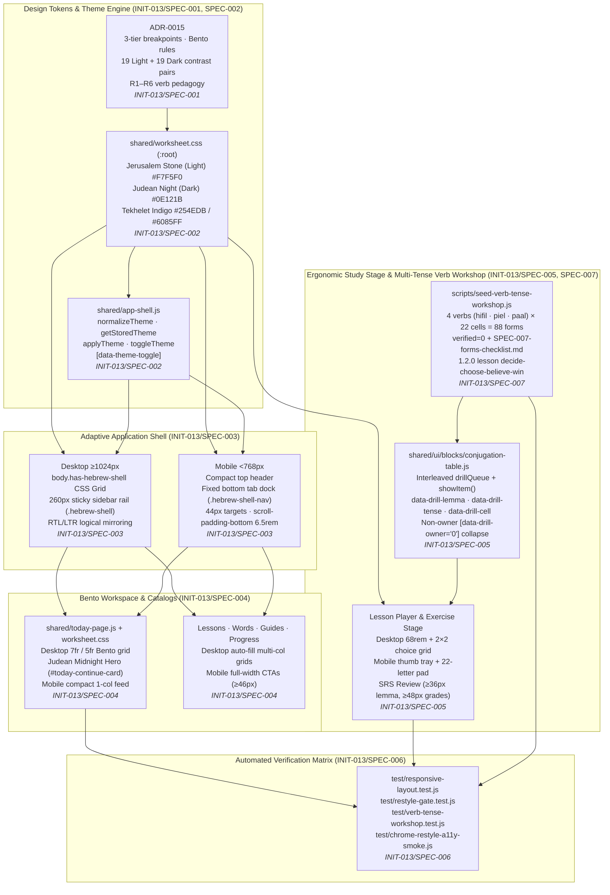

# Architecture & Design — Responsive Desktop & Mobile Redesign (`INIT-013`)

**Initiative:** `INIT-013-responsive-desktop-mobile-redesign` · **Reflects specs:** `SPEC-001`…`SPEC-007` · **Date:** `2026-10-17`  
**Provenance tag:** `INIT-013/DESIGN-DIAGRAMS`  
**Canvas:** in-doc Mermaid only  
**Grounding:** [ADR-0015](../../../docs/decisions/ADR-0015-responsive-desktop-mobile-architecture.md), Figma file `NJ8HfTPCQgrFty2VVQBMhY` (`30:20`, `31:2`, `32:2`, `33:2`, `33:74`, `34:2`), `shared/worksheet.css`, `shared/app-shell.js`, `shared/ui/blocks/conjugation-table.js`, and `scripts/seed-verb-tense-workshop.js`.

This document visualizes the 3-tier responsive layout architecture (`<768px`, `768px–1023px`, `≥1024px`), the Light (`Jerusalem Stone`) / Dark (`Judean Night`) token & theme engine, the Bento workspace and study stage, and the research-backed (`R1`–`R6`) multi-tense verb conjugation workshop & interleaved drill pipeline after `INIT-013` shipped `SPEC-001` through `SPEC-007`.

---

## 1. Component & Responsive Shell Architecture  <!-- diagrams: component -->

How `ADR-0015` design tokens, the theme/direction engine in `shared/app-shell.js`, the adaptive shell/Bento rules in `shared/worksheet.css`, the study stage & interleaved verb drill in `shared/ui/blocks/`, and the `schemaVersion: "1.2.0"` verb workshop seed (`scripts/seed-verb-tense-workshop.js`) connect across Desktop and Mobile viewports.



---

## 2. Data & Interaction Flow — Multi-Tense Verb Seed, Human Verification, and Interleaved Drill  <!-- diagrams: sequence -->

How `scripts/seed-verb-tense-workshop.js` (`SPEC-007`) seeds the 88 pointed verb forms (`present`, `past`, `future`) behind the human verification boundary (`ADR-0014` D13, `RSCH-009`), and how `shared/ui/blocks/conjugation-table.js` (`SPEC-005`) interleaves verified forms into a single active-recall station (`R1`–`R3`) that feeds `formSignal` mastery into the `Today` Bento workspace (`SPEC-004`).

```mermaid
sequenceDiagram
  autonumber
  participant Op as Operator / Teacher
  participant Seed as scripts/seed-verb-tense-workshop.js<br/>(INIT-013/SPEC-007)
  participant Check as SPEC-007-forms-checklist.md<br/>(88 forms, default [ ])
  participant DB as SQLite Lexicon & Plans<br/>(server/lexicon · server/plans)
  participant Player as Learner Browser<br/>conjugation-table.js (INIT-013/SPEC-005)
  participant Mastery as /api/learner/attempt<br/>#today-mix Bento (INIT-013/SPEC-004)

  Op->>Seed: Run seed({ checklistPath })
  Seed->>Check: Read ticked [x] vs unticked [ ] boxes
  Seed->>DB: checkForeignSources() (abort if source != 'admin')
  Seed->>DB: lexicon.upsert(4 lemmas + 88 present/past/future forms, verified=0)
  alt Form ticked [x] by human in checklist
    Seed->>DB: lexicon.setVerified(lemmaKey, formKey, true)
  else Unticked [ ] (default)
    Note over Seed,DB: Remains verified=0 (N14 warning; skipped in drillQueue)
  end
  Seed->>DB: Create/replace 1.2.0 plan verb-tense-workshop (decide-choose-believe-win)

  Op->>Player: Open /shared/plan/?id=verb-tense-workshop (390×844 or 1440×960)
  Player->>Player: Render study tables + collapse [data-drill-owner="0"] sections
  Player->>Player: drillQueue() shuffles verified cells across verbs & tenses
  loop Each interleaved prompt (R1, R2)
    Player->>Player: showItem() sets data-drill-lemma, data-drill-tense, data-drill-cell<br/>Displays "lemma · tense · person/gender"
    Player->>Player: Learner types answer (unpointed/plene accepted; 1 retry before reveal)
    Player->>Mastery: formSignal({ lemmaKey, cell, correct }) (boolean only, no typed text)
  end
  Player->>Player: Queue empty → "סיימתם. / Done." (clears data-drill-* attrs)
```
