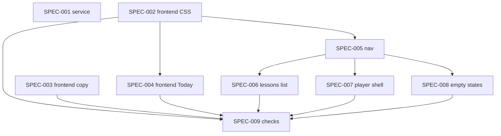

# Initiative: Design and Usability — Hierarchy, Wayfinding, Copy, and Safe Lesson Visibility

**Initiative ID:** INIT-014
**Status:** planned
**Slug:** INIT-014-design-and-usability
**Discipline Profile:** `software`
**Created:** 2026-10-17
**Owner:** Brian Nelson
**Ticket:** None (`branch_naming.ticket_system: none`)
**Branch:** `design-and-usability` (not yet created — ASMT-002 is uncommitted in this checkout, so a worktree from HEAD would not contain the source assessment. Planning stays here. No commit unless the operator asks.)
**Target Completion:** not a promise. The spec table is an estimate that starts when the operator says to execute.
**Source:** [ASMT-002](../../assessments/ASMT-002-hebrew-web-app/ASMT-002-hebrew-web-app-assessment-report.md) (design and usability, eval PASS). Standards cited there: RSCH-006, RSCH-007, RSCH-008, RSCH-010, WCAG 2.2 AA, Nielsen heuristics. This initiative does not absorb ASMT-001's learning-loop work. ASMT-001's front-door spec is covered here by SPEC-004, SPEC-005, and SPEC-006.

---

## 1. Executive Summary

The app already meets most of the accessibility checks ASMT-002 measured (no sideways scroll from 320 to 1440px, one contrast failure, visible keyboard focus on a sampled pass). It is harder to use once a lesson is under way: the desktop Today grid steps down, a returning learner sees "Nothing due" first, the phone bar has seven destinations with truncated labels, the lesson in progress sorts to the bottom, the lesson player drops the desktop side rail, and some learner-facing sentences are untrue or written for developers. A fresh database also publishes every lesson folder on disk, including a stray "test" lesson and a lesson whose own text says it is hidden unless assigned.

This initiative fixes those in place. Nine specs, two domains (service, frontend). No new framework and no visual redesign.

**Requirements** (from ASMT-002; each spec's acceptance criteria trace to these):

| ID | Requirement | Priority |
| --- | --- | --- |
| REQ-001 | On a fresh database, only the named teaching lessons are visible to everyone. A database that was already seeded is not rewritten. | P1 |
| REQ-002 | The stray `test` lesson folder is removed from the repo. | P1 |
| REQ-003 | On desktop, the Continue card is not pushed below an empty gap beside Review. | P1 |
| REQ-004 | Today leads with one primary action. Review appears only when something is due. | P1 |
| REQ-005 | A learner sees five destinations, each with an icon and a full label at 320px. Guides and Verbs stay reachable, and their old URLs still open. | P1 |
| REQ-006 | The lessons list puts the lesson in progress first, marks it, names the next lesson, and can be searched. | P2 |
| REQ-007 | Learner-facing sentences are true, and they do not name internal stores. The Hebrew and English pair pattern stays. | P1 |
| REQ-008 | Empty Review, Words, Guides, and Progress tell the truth and offer a way forward. "What your AI sees" starts collapsed. | P2 |
| REQ-009 | The lesson player keeps the desktop rail. On a phone, a step's heading sits in the top portion of the screen, and the step has a page heading. | P2 |
| REQ-010 | Match column headings meet 4.5:1 contrast. The due-date colon sits inside each language. Two short Progress controls are at least 24px tall. | P1 |
| REQ-011 | Automated checks cover the Today row placement, the Match contrast, and the short Progress controls, so these do not regress. | P2 |

**Planning notes**

- **Discipline.** `active_discipline_profiles` lists `software` and `network`. The operator chose `software` for this initiative.
- **Personas.** Checked at decomposition. This repo has no `.claude/agents/` tree, and `scripts/dev/expertise_state.py` is not in the repo. Nothing was manufactured. Each spec still names the persona from `sdd-skill-config` §7.1 (`principal-backend-developer` for service, `principal-frontend-developer` for frontend). Execution degrades, with that gap disclosed, until those personas are installed.
- **Harness.** Cursor. Exploration was done in this session from ASMT-002's already-verified evidence, not by a fresh explore subagent.
- **Coverage bar.** This repo runs `node --test`. It does not measure line coverage. Spec pass conditions are named tests passing, not a coverage percent.

---

## 2. Domain Analysis

| Domain         | Affected | Key changes |
| -------------- | -------- | ----------- |
| Data           | No       | Visibility rows already exist. SPEC-001 does not add a table and does not rewrite rows on a seeded database. |
| Service        | Yes      | `server/visibility.js` seed: allowlist for `everyone`, everything else stays hidden. |
| API            | No       | No new route. Existing visibility reads stay as they are. |
| Event          | No       | — |
| Scheduled      | No       | — |
| Infrastructure | No       | — |
| Frontend       | Yes      | Today, nav, lessons list, player shell, copy, empty states, and the regression checks. |
| Docs           | No       | No new ADR. The player keeps the rail ADR-0015 already specifies. |

---

## 3. Spec Breakdown

Each spec is single-domain. Detailed definitions live in `specs/`.

| Spec     | Domain   | Title                                      | Prompt                                              | Autonomy   | Gates | Blocked by | Effort |
| -------- | -------- | ------------------------------------------ | --------------------------------------------------- | ---------- | ----- | ---------- | ------ |
| SPEC-001 | service  | Safe lesson visibility on a fresh database | principal-backend-developer                         | auto_tests | —     | None       | 3h     |
| SPEC-002 | frontend | Today grid placement and three small fixes | principal-frontend-developer                        | auto_tests | —     | None       | 3h     |
| SPEC-003 | frontend | Learner copy that is true                  | principal-frontend-developer                        | auto_tests | —     | None       | 3h     |
| SPEC-004 | frontend | Today shows one next action                | principal-frontend-developer                        | auto_tests | —     | SPEC-002   | 4h     |
| SPEC-005 | frontend | Five destinations, labels intact           | principal-frontend-developer                        | auto_tests | —     | SPEC-002   | 5h     |
| SPEC-006 | frontend | Lessons list keeps the learner's place     | principal-frontend-developer                        | auto_tests | —     | SPEC-005   | 4h     |
| SPEC-007 | frontend | One shell in the lesson player             | principal-frontend-developer                        | auto_tests | —     | SPEC-005   | 6h     |
| SPEC-008 | frontend | Empty states that tell the truth           | principal-frontend-developer                        | auto_tests | —     | SPEC-005   | 4h     |
| SPEC-009 | frontend | Usability regression checks                | principal-frontend-developer                        | auto_tests | —     | SPEC-002, SPEC-003, SPEC-004, SPEC-006, SPEC-007, SPEC-008 | 4h |

> Security review and architecture diagrams run as `complete-initiative` phases, not as spec rows. SPEC-001 is `security_review: required` because it changes who can see a lesson.

---

## 4. Dependency Graph

**Critical path:** SPEC-002 → SPEC-005 → SPEC-007 → SPEC-009 (18h)
**Parallelizable:** SPEC-001 and SPEC-003 share no files with that chain and can run beside it. SPEC-004 waits for SPEC-002 because both edit `shared/today-page.js`, then it can run beside SPEC-005. After SPEC-005, SPEC-006 and SPEC-008 can run beside SPEC-007.

SPEC-002, SPEC-005, and SPEC-007 all edit `shared/worksheet.css`, so they stay in sequence. SPEC-002 and SPEC-004 both edit `shared/today-page.js`. SPEC-005, SPEC-006, and SPEC-008 share the lessons and review pages, so SPEC-006 and SPEC-008 wait for SPEC-005.

---

## 5. Timeline & Effort

| Metric             | Value                                      |
| ------------------ | ------------------------------------------ |
| Total effort       | 36 hours                                   |
| Critical path      | 18 hours (SPEC-002 → SPEC-005 → SPEC-007 → SPEC-009) |
| Realistic duration | 18 × 1.3 = 23.4 hours                      |
| Calendar estimate  | 4 days at ~6 productive hours/day          |

The five-learner phone test and the screen-reader pass from ASMT-002 are named in SPEC-009 as human checks. They are not part of the 4-day coding estimate. They happen when a person is available.

---

## 6. Controls & Gates

- **Default autonomy:** `auto_tests`. Agents may edit, run tests, and stop. They do not commit, push, or open a PR unless the operator asks.
- **One-way actions expected:** none. No migration, no deploy, no secret change. SPEC-001 must not rewrite visibility on a database that already has the seed flag.
- **Approval owner:** Brian Nelson, before any commit or deploy.

---

## 7. Agent Behavior Overrides (optional)

None. Repo defaults apply.

---

## 8. Threat Model (security)

- **Attack surface:** lesson visibility on a fresh or rebuilt database. The seed in `server/visibility.js` runs once, when its meta flag is absent, and currently inserts `everyone` for every lesson folder that has a `worksheet.js`.
- **Trust boundaries:** a signed-in learner can open any lesson the seed marked `everyone`. Lesson files on disk are trusted content; the bug is treating every folder as public.
- **Data classification:** lesson text. One folder is a private vocabulary lesson. No new secrets and no new personal data.
- **STRIDE-lite notes:** information disclosure is the live risk (a learner sees a lesson that should be hidden). The change does not add an endpoint. Tampering risk is low if the allowlist is a fixed list in code, reviewed in the spec, not read from request input.
- **Security-sensitive specs:** SPEC-001 (`required`). The other specs render UI for an already signed-in learner and are `standard`.

---

## 9. Risk Assessment

| Risk | Probability | Impact | Mitigation |
| --- | --- | --- | --- |
| Hiding Guides and Verbs behind tabs makes them hard to find | M | L | Old URLs keep working. Tabs are labeled, not removed. |
| The seed change hides real lessons on a fresh install | L | M | Allowlist names `my-morning` and `shai-date-indirect-speech` as `everyone`. A test covers a fresh database. Already-seeded databases are untouched. |
| Several specs edit `shared/worksheet.css` and collide | M | M | They are ordered: SPEC-002, then SPEC-005, then SPEC-007. |
| Copy changes drift from the Hebrew half of a pair | M | L | Each changed `bi()` pair updates both languages in the same edit. |
| The rail inside the player feels tight at 1024px | M | L | SPEC-007 allows a collapsed rail from 1024 to 1279px and a full rail from 1280px. |

---

## 10. Success Criteria

- [ ] All nine specs complete, each with its named tests passing.
- [ ] A fresh database shows the two teaching lessons to a learner and does not show the private vocabulary lesson or a `test` lesson.
- [ ] At 1440px, the Continue card is not lower than the Review card. At 320px, no learner destination label is cut off.
- [ ] No unresolved Critical or High security finding on SPEC-001, or a written risk acceptance from the operator.
- [ ] Completion report written and initiative status set to `complete`.

---

## 11. Next Steps

1. Operator reviews this breakdown.
2. Execute in dependency order. SPEC-001 and SPEC-003 can start immediately. The critical path starts at SPEC-002. SPEC-004 starts once SPEC-002 has landed.
3. Run `complete-initiative` when every spec is complete.

---

## 12. Plan Quality

Self-review before writing (Generate → Critique → Refine → Validate):

| Dimension | Score |
| --- | ---: |
| Completeness | 8 |
| Accuracy | 8 |
| Clarity | 8 |
| Technical feasibility | 8 |
| Guardrails | 8 |
| **Confidence** | **0.80** |

One domain per spec, effort inside 2–6h, prompts and autonomy set, dependency graph acyclic. The open gap is personas not installed in this repo, disclosed above, not blocking.
