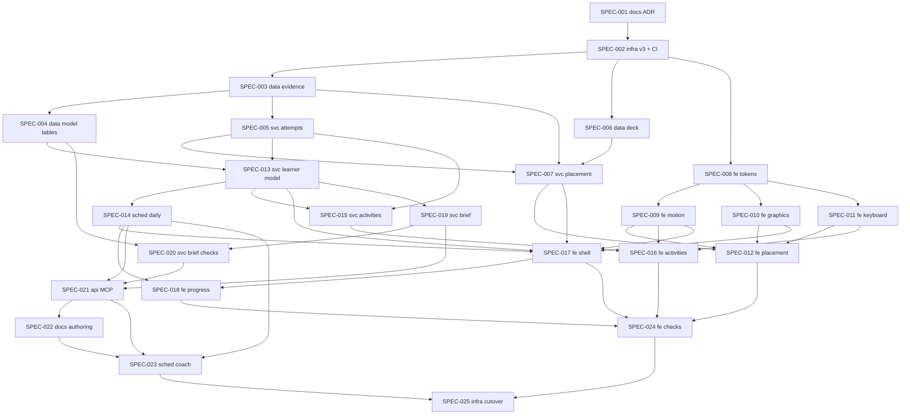

# Initiative: v3 — Real Placement, a Learner Model, Lessons Built From It, and the Lamplight Design

**Initiative ID:** INIT-015
**Status:** complete (build closed 2026-10-19; production cutover pending: SPEC-025 ac-2 and ac-4 need the operator)
**Slug:** INIT-015-v3-adaptive-learning
**Discipline Profile:** `software`
**Created:** 2026-10-19
**Owner:** Brian Nelson
**Ticket:** None (`branch_naming.ticket_system: none`)
**Branch:** `v3`, cut from `origin/v2` (528c75c) by SPEC-002 on 2026-10-19. Worktree: `C:/Users/BrianNelson/Projects/Hebrew-v3`. Planning artifacts stay in the main checkout on `main`, uncommitted, because `docs/north-star.md` and this plan are not committed. No commit unless the operator asks.
**Target Completion:** not a promise. The estimate starts when the operator says to execute.
**Source:** [`docs/north-star.md`](../../../docs/north-star.md) (sections 4–12, decisions recorded 2026-10-19). Evidence: RSCH-001, RSCH-003, RSCH-004, RSCH-005, RSCH-006, RSCH-008. Design: Figma file `NJ8HfTPCQgrFty2VVQBMhY`, page `139:2` ("Lamplight").

---

## 1. Executive Summary

v2 has a working Go server, FSRS reviews, a lesson player, units built over MCP, and a placement deck. The placement is a self-graded flashcard pass. It can't hear and read separately, and it shows transliteration on reading cards. Cards know a direction (`he_en`, `en_he`), not a skill. Nothing records what was picked or typed, so nothing can say which words are known, which are slipping, or why. Lessons are static. The colors disagree with each other and nothing moves.

v3 fixes that in six steps from the north star:

1. A real placement: letters, listening, reading, and optional typing, with adaptive bands, guessing correction, and a review of misses at the end.
2. Evidence: an `attempts` row for every checked answer and an `exposures` row for every word seen.
3. A learner model per word and skill (listen, read, recall, spell), with daily snapshots, regression events, and a diagnosis.
4. Checked activities: listen and pick, read and pick, word match, audio match, type it, and dictation, plus a Hebrew keyboard. The session mix picks the weakest skill for each word.
5. Lessons built for the learner: a `LessonBrief`, validator checks against the brief, auto-publish with no human step, and MCP tools so Muse, Grok, Claude, or Cursor can build lessons the same way.
6. Coaching: a weekly report, coach notes, boundary re-checks, and band-slip alerts.

Across all of it, the Lamplight design from Figma goes into code: tokens, components, motion with reduced-motion fallbacks, icons, and illustrations.

25 specs across seven domains. About 117 hours of work, with a 47-hour critical path.

**Operator decisions** (2026-10-19). For 1–4 the operator asked for "whatever science says will work best". For 5 the operator said "No HITL".

| ID | Decision | Choice | Evidence |
| --- | --- | --- | --- |
| D1 | Placement feedback | None during the test. A neutral "picked" state, then auto-advance. A review of misses at the end, with the right answer, audio, and pointed form. | Showing the correct response beats right/wrong-only feedback (0.32 against 0.05, RSCH-006 [11]). Immediate and delayed feedback gave the same result (RSCH-006 [13]). |
| D2 | Placement into FSRS | Only right answers become cards, rated Good. Wrong answers and "I don't know" mark the word `seen` and create no card. | Words are taught before they are tested. Spacing then does its work (RSCH-003, High). |
| D3 | Self-graded flashcards | They stay, with the plain labels "Forgot", "Hard", "Got it", and "Easy", in one neutral style. A checked activity is used wherever one exists. | Learners overrate what they know (RSCH-005 [4]). |
| D4 | Unpointed reading | Not in v3. It becomes a fifth skill once pointed reading is `solid` for band 1. | Pointing helps early decoding, and readers then move off it (RSCH-005 [16], Low for adults). No study tested when to switch (RSCH-001, RSCH-004). |
| D5 | Lesson approval | No human step. A learner-scoped unit that passes the validator, brief checks included, publishes to Today. | The operator's call. Mitigated by a stricter validator, an audit row for every auto-publish, "Report a problem" inside the lesson, and an unpublish tool. |
| D6 | What "v3" is | Assumed: a `v3` branch cut from `origin/v2` on the same stack (Go, templ, htmx, SQLite). v2 freezes. CI publishes only from `v3`. | Assumption. It keeps every v2 rule: never merges into `main`, never publishes `hebrew-lessons`, ARC `k8-build` runners only. |
| D8 | Conversations use two voices | Added 2026-10-19 at the operator's request. A conversation is a `dialogue` with two speakers, one female voice and one male voice. Narration and single words keep the default voice. | The operator's call. SPEC-026. It must land before SPEC-021 so the `generate_audio` contract is final. |
| D9 | Migration numbers 007 to 010 moved to 008 to 011 | Added 2026-10-19. `origin/v3` shipped `007_oauth_client_issued.sql` (PR #77, with #95, #97 and #99) while this line was built, and every push to `v3` is deployed, so a real database can already record version 7. The INIT-015 migrations that were 007 (learner model), 008 (confusion), 009 (daily job) and 010 (placement v3) are now **008, 009, 010 and 011**. 006 is unchanged. | Forced by the runner: two files with one version stop the app at start, and a version already recorded is skipped, so the learner tables would never be built. Completion summaries for SPEC-004, 005, 007, 013 and 014 use the old numbers because that is what they were when written. Read them as +1 for 007 to 010. The next free number is 012. |
| D7 | Production data at cutover | Assumed: v3 keeps the SQLite file that its host already uses and migrates it forward. If production still runs the old `hebrew-lessons` app, v1 learner history is not imported. The placement reseeds, and the v1 database is archived read-only. | Assumption. SPEC-025 checks which image each host runs before it does anything. |

**Requirements** (each spec's acceptance criteria trace to these):

| ID | Requirement | Priority |
| --- | --- | --- |
| REQ-001 | Placement has a letters check, a listening part, a reading part, and an optional typing part. Each skill moves through bands adaptively, six items at a time. | P0 |
| REQ-002 | No listening item is shown without audio. Reading items show pointed Hebrew and never a transliteration. | P0 |
| REQ-003 | No right/wrong feedback during placement. The end of the test has a review of misses that shows the right answers. | P0 |
| REQ-004 | Placement scores each skill with guessing correction, (right − wrong ÷ 3) ÷ asked, and estimates words known per skill. | P0 |
| REQ-005 | Only right placement answers become FSRS cards, rated Good. The others mark the word `seen`. | P0 |
| REQ-006 | Every checked answer writes one `attempts` row (word, skill, activity, source, response, correct, latency, hint used). Every word shown writes an `exposures` row. | P0 |
| REQ-007 | Cards carry a skill (listen, read, recall, spell). Existing `he_en` cards become `read` and `en_he` become `recall`, with no lost review history. | P0 |
| REQ-008 | For every word and skill, the app knows the state (unseen, seen, learning, struggling, known, solid, regressed) and a diagnosed cause. | P0 |
| REQ-009 | A daily snapshot and regression events are written once a day, even if the app was idle. | P1 |
| REQ-010 | Listen and pick, read and pick, word match, audio match, type it, and dictation all exist and are checked. Distractors come from the same band and part of speech. Confusions are logged. | P0 |
| REQ-011 | The session mix asks each word through its weakest skill and prefers a checked activity over a self-graded one. | P1 |
| REQ-012 | A Hebrew on-screen keyboard (standard Israeli layout, final letters, physical-key hints) is used for every typed answer. | P1 |
| REQ-013 | `LessonBrief` returns 5 to 8 new words, 3 to 5 struggle words with their failing skill, comfortable words, the skill focus, and the activities. | P0 |
| REQ-014 | The validator checks a unit against its brief: 95% known-word coverage in passages, new words introduced before tested and used at least 3 times, struggle words reused in their skill, glosses for out-of-brief words, and audio for all Hebrew. | P0 |
| REQ-015 | A learner unit that passes is published with no human step. Each auto-publish is logged. The learner can hide it with "Report a problem", and the AI can unpublish it. | P0 |
| REQ-016 | MCP adds `get_learner_model`, `get_progress`, `get_lesson_brief`, `add_coach_note`, `unpublish_unit`, `validate_unit` with `briefId`, and an `hebrew://authoring` resource. A learner token reads only that learner's data. | P0 |
| REQ-017 | A Progress screen shows each skill's states, estimated words known over time, retention against target, words gained and lost, and regressions. | P1 |
| REQ-018 | A weekly report names what was gained, what was lost, and why. A boundary re-check is offered every 4 to 6 weeks. A band slip shows on Today. | P2 |
| REQ-019 | Every screen uses the Lamplight tokens. Gold marks the one main action. Green and red appear only in answer feedback. No colored grade buttons. | P0 |
| REQ-020 | Motion: screen transitions, answer feedback, card flips, progress, and the audio orb animate in 150–400ms. With reduced motion set, all of it is replaced by an instant change or a fade. | P1 |
| REQ-021 | Icons are one SVG sprite. The brand mark, the placement and results heroes, and the empty states are illustrations drawn from the tokens. No emoji as icons. | P1 |
| REQ-022 | Every learning screen is captured in light and dark at phone and desktop widths, and the captures are checked for contrast, target size, and reduced motion. | P1 |
| REQ-023 | v3 is built and published only from the `v3` branch, to `ghcr.io/networkbuild3r/hebrew`, on ARC `k8-build`. It never publishes `hebrew-lessons`. | P0 |
| REQ-024 | Cutover to `hebrew.ibhacked.us` has a backup, a dry run on a copy, a smoke check, and a rollback image. | P0 |

**Planning notes**

- **Discipline.** `software`.
- **Personas.** This repo has no `.claude/agents/` tree, and `scripts/dev/expertise_state.py` and `scripts/dev/next_adr_number.py` are not in the repo. Nothing was manufactured. Each spec names the persona from `sdd-skill-config` §7.1. Execution degrades, with that gap disclosed, until those personas are installed. The ADR number was taken by hand: the highest is ADR-0017, so SPEC-001 writes ADR-0018.
- **Harness.** Cursor. Exploration in this session read `origin/v2` (tree, CI, migrations, `internal/placement`, `internal/session`, `internal/units`, `internal/mcp`) and the research reports.
- **Coverage bar.** v2 runs `go test ./...` and `templ generate`. Pass conditions are named tests passing, not a coverage percent.
- **Figma.** Page `139:2` holds the system (`148:101` "Design system · Lamplight", `141:2` "Components") and the screens. On 2026-10-19 the listening "answered" screens were changed to a neutral picked state (`144:25` light, `147:440` dark) that auto-advances after 0.8s. "Placement / 7 Review misses" was added (`158:129` light, `158:194` dark), and the Results "Review my 6 misses" button links to it.

---

## 2. Domain Analysis

| Domain | Affected | Key changes |
| --- | --- | --- |
| Data | Yes | `006_evidence.sql` (attempts, exposures, `cards.skill`). `008_learner_model.sql` (snapshots, regression events, briefs, coach notes, publish audit, unit reports, weekly reports), then `009` to `011` (see D9). Version 7 is `007_oauth_client_issued.sql` from `origin/v3`. Placement deck grows to 200 words with audio. |
| Service | Yes | Attempt recorder and grading rule. Placement v3. Learner model and diagnosis. Activity engine and skill-aware mix. `LessonBrief`. Brief checks and auto-publish safety. |
| API | Yes | Six MCP tools added or extended, one resource. Learner-scope authorization on each. |
| Event | No | — |
| Scheduled | Yes | Daily snapshot, regression, and band-slip job. Weekly report and the external coach automation. |
| Infrastructure | Yes | `v3` branch and CI. Cutover to production with a backup and a rollback. Host config lives in home_k3, outside this repo. |
| Frontend | Yes | Tokens and components, motion, icons and illustrations, Hebrew keyboard, placement screens, activity screens, app shell, Progress, visual checks. |
| Docs | Yes | ADR-0018. The shared authoring skill for every AI. |

---

## 3. Spec Breakdown

Each spec is single-domain. Detailed definitions live in `specs/`.

| Spec | Domain | Title | Prompt | Autonomy | Gates | Blocked by | Effort |
| --- | --- | --- | --- | --- | --- | --- | --- |
| SPEC-001 | docs | ADR-0018: the v3 line and the north-star decisions | implementation-planner | auto_tests | — | None | 2h |
| SPEC-002 | infrastructure | Cut `v3` and move CI to it | devops-engineer | auto_branch | merge | SPEC-001 | 3h |
| SPEC-003 | data | Evidence tables and card skills | database-architect | auto_tests | db_migration | SPEC-002 | 5h |
| SPEC-004 | data | Learner-model tables | database-architect | auto_tests | db_migration | SPEC-003 | 3h |
| SPEC-005 | service | One attempt recorder and the grading rule | principal-backend-developer | auto_tests | — | SPEC-003 | 5h |
| SPEC-006 | data | Placement deck: 200 verified words with audio | database-architect | auto_tests | — | SPEC-002 | 6h |
| SPEC-007 | service | Placement engine v3 | principal-backend-developer | auto_tests | — | SPEC-003, SPEC-005, SPEC-006 | 6h |
| SPEC-008 | frontend | Lamplight tokens and components | principal-frontend-developer | auto_tests | — | SPEC-002 | 6h |
| SPEC-009 | frontend | Motion system with reduced-motion fallbacks | principal-frontend-developer | auto_tests | — | SPEC-008 | 4h |
| SPEC-010 | frontend | Icons, brand mark, and illustrations | principal-frontend-developer | auto_tests | — | SPEC-008 | 4h |
| SPEC-011 | frontend | Hebrew on-screen keyboard | principal-frontend-developer | auto_tests | — | SPEC-008 | 4h |
| SPEC-012 | frontend | Placement screens | principal-frontend-developer | auto_tests | — | SPEC-007, SPEC-009, SPEC-010, SPEC-011 | 6h |
| SPEC-013 | service | Learner model: states and diagnosis | principal-backend-developer | auto_tests | — | SPEC-004, SPEC-005 | 6h |
| SPEC-014 | scheduled | Daily snapshot and regression job | principal-backend-developer | auto_tests | — | SPEC-013 | 4h |
| SPEC-015 | service | Activity engine and skill-aware session mix | principal-backend-developer | auto_tests | — | SPEC-005, SPEC-013 | 6h |
| SPEC-016 | frontend | Activity screens and the review card | principal-frontend-developer | auto_tests | — | SPEC-009, SPEC-011, SPEC-015 | 6h |
| SPEC-017 | frontend | App shell: Today, dock and rail, lesson frame | principal-frontend-developer | auto_tests | — | SPEC-007, SPEC-009, SPEC-010, SPEC-013, SPEC-014 | 6h |
| SPEC-018 | frontend | Progress per skill | principal-frontend-developer | auto_tests | — | SPEC-014, SPEC-017 | 5h |
| SPEC-019 | service | `LessonBrief` | principal-backend-developer | auto_tests | — | SPEC-013 | 5h |
| SPEC-020 | service | Brief checks and auto-publish safety | principal-backend-developer | auto_tests | — | SPEC-004, SPEC-019 | 6h |
| SPEC-021 | api | MCP tools for the learner model and briefs | principal-backend-developer | auto_tests | — | SPEC-014, SPEC-019, SPEC-020, SPEC-026 | 6h |
| SPEC-022 | docs | One authoring skill for every AI | implementation-planner | auto_tests | — | SPEC-021 | 2h |
| SPEC-023 | scheduled | Weekly report and the coach automation | principal-backend-developer | auto_tests | — | SPEC-014, SPEC-021, SPEC-022 | 4h |
| SPEC-024 | frontend | Visual and usability regression checks | principal-frontend-developer | auto_tests | — | SPEC-012, SPEC-016, SPEC-017, SPEC-018 | 4h |
| SPEC-025 | infrastructure | Cutover to production | devops-engineer | plan_only | deploy, db_migration, merge | SPEC-023, SPEC-024 | 3h |
| SPEC-026 | service | Two-voice dialogue (female and male) | principal-backend-developer | auto_tests | — | SPEC-020 | 6h |

> Security review and architecture diagrams run as `complete-initiative` phases, not as spec rows. `security_review: required` is set on SPEC-002 (CI and registry), SPEC-003 (a migration of learner data), SPEC-020 (content reaches the learner with no human step), SPEC-021 (new MCP reads of learner data), and SPEC-025 (production).

---

## 4. Dependency Graph

**Critical path:** SPEC-001 → 002 → 003 → 005 → 013 → 019 → 020 → 021 → 022 → 023 → 025 (47h).

**Parallel lanes once SPEC-002 lands:**

- Design lane: SPEC-008, then SPEC-009, SPEC-010, and SPEC-011 side by side. It needs no backend work until SPEC-012.
- Deck lane: SPEC-006 runs beside the migrations.
- After SPEC-013: SPEC-014, SPEC-015, and SPEC-019 can run side by side. SPEC-017 joins once SPEC-014 lands.

**Shared files that force order:**

- SPEC-003 and SPEC-004 each add a migration file. The numbers are fixed (006, then 007) so they don't collide.
- SPEC-008, SPEC-009, and SPEC-010 all edit `static/css/tokens.css`, so they run in that order.
- SPEC-012, SPEC-016, and SPEC-017 each add `views/*.templ` files and share `layout.templ`. SPEC-017 owns `layout.templ`. The other two only add files.
- SPEC-020 and SPEC-021 both touch `internal/units` and `internal/mcp/tool_publish_unit.go`. SPEC-021 waits for SPEC-020.

---

## 5. Timeline & Effort

| Metric | Value |
| --- | --- |
| Total effort | 117 hours |
| Critical path | 47 hours |
| Realistic duration | 47 × 1.3 ≈ 61 hours |
| Calendar estimate | About 10 working days at 6 productive hours a day, with the design lane in parallel |

The six phases from the north star map to specs:

| Phase | Specs |
| --- | --- |
| 0 · Placement that works | SPEC-006, SPEC-007, SPEC-012 |
| 1 · Evidence | SPEC-003, SPEC-005 |
| 2 · Learner model | SPEC-004, SPEC-013, SPEC-014, SPEC-018 |
| 3 · Activities | SPEC-011, SPEC-015, SPEC-016 |
| 4 · Built-for-me lessons | SPEC-019, SPEC-020, SPEC-021, SPEC-022 |
| 5 · Coaching | SPEC-023 (weekly report, coach automation). Re-check due dates are in SPEC-007, band-slip events in SPEC-014, both shown on Today by SPEC-017. Coach notes are in SPEC-021. |
| Design, across all | SPEC-008, SPEC-009, SPEC-010, SPEC-017, SPEC-024 |
| Line and release | SPEC-001, SPEC-002, SPEC-025 |

Phase 0 needs SPEC-003 and SPEC-005 first, because placement writes attempts. That is why evidence is built before the placement engine.

---

## 6. Controls & Gates

- **Default autonomy:** `auto_tests`. Agents edit, run `templ generate` and `go test ./...`, and stop. They do not commit, push, or open a PR unless the operator asks.
- **Merges:** Hebrew PR Reviewer approves and merges. Brian Nelson does not approve pull requests himself.
- **One-way actions expected:**
  - SPEC-003 rebuilds `cards` to rename `dir` to `skill`. It runs on a copy first, and the test proves review history is kept.
  - SPEC-025 deploys to production. It is `plan_only`. It writes the runbook and stops.
- **Gates:**
  - `db_migration`: SPEC-003, SPEC-004, and SPEC-025.
  - `merge`: SPEC-002, which creates the branch and changes CI.
  - `deploy`: SPEC-025.
- **Outside this repo:** host and Argo settings live in home_k3. SPEC-002 and SPEC-025 write the exact change for that repo and stop. Nothing in this initiative edits home_k3.
- **No human approval of lessons (D5).** This is not a gate. The validator is the gate. It is a product rule from the operator, and SPEC-020 carries its mitigations.

---

## 7. Agent Behavior Overrides

- Never publish `ghcr.io/networkbuild3r/hebrew-lessons`. Never use GitHub-hosted runners. Never add `pull_request_target`.
- Never merge `v3` into `main`.
- Hebrew text in tests and fixtures is checked against Pealim before it is used (the v2 rule in `internal/placement/NOTICE`).
- Frontend specs take their values from the Figma variables on page `139:2`, not from screenshots. A value with no variable stays a literal and is named in the completion summary.

---

## 8. Threat Model (security)

- **Attack surface:**
  - MCP over OAuth and the static admin token: six new or extended tools, and a new resource.
  - Auto-published learner units: AI-written text reaches the learner's Today with no human step.
  - CI and the registry on the new branch.
  - The production cutover.
- **Trust boundaries:**
  - A learner token reads and writes only `learner:<own id>` data. The admin token reads any learner.
  - Units come from an AI client and are untrusted until validated. Lesson text is rendered through templ escaping.
  - CI runs only on the self-hosted ARC runners. Forks are refused.
- **Data classification:** one learner's study history (words, answers, typed text, timings). It is personal but not sensitive. It is never sent to a third party except through the MCP client the learner connects.
- **STRIDE-lite notes:**
  - *Information disclosure:* `get_learner_model` and `get_progress` must check learner scope. That check gets the same table test style as `authz_test.go`.
  - *Tampering:* a unit could carry HTML or script. Templ escapes it. A validator rule rejects raw markup in text fields. The audio URLs a unit names must resolve to `audio_assets` rows.
  - *Elevation:* `unpublish_unit` may act only on learner-scoped units in the caller's scope. Shared units still go through admin-only `publish_unit`.
  - *Repudiation:* every auto-publish and unpublish writes an audit row (who, unit, revision, brief, validator result).
  - *Denial of service:* briefs and model reads are paged and capped. The daily job is idempotent per day.
  - *Supply chain:* SPEC-002 keeps action pins and the image-name guard from v2 CI.
- **Security-sensitive specs:** SPEC-002, SPEC-003, SPEC-020, SPEC-021, and SPEC-025 are `required`. The rest are `standard`.

---

## 9. Risk Assessment

| Risk | Probability | Impact | Mitigation |
| --- | --- | --- | --- |
| An AI lesson auto-publishes with a wrong Hebrew form | M | M | Validator checks every lexeme against the lexicon. Out-of-brief words need a gloss. "Report a problem" hides the lesson at once. Every auto-publish is audited. |
| Renaming `cards.dir` loses review history | L | H | SPEC-003 rebuilds the table in one transaction, runs on a copy of a real database, and counts rows before and after. |
| The placement deck can't reach 200 Pealim-verified words with audio | M | M | SPEC-006 ships with what is verified. The engine samples without repeats from whatever each band holds, and the build fails only on a listening item without audio. |
| Guessing correction is noisy at six items a band | M | L | It is a starting estimate. Daily practice corrects it, and a boundary re-check runs every 4 to 6 weeks. |
| Motion makes the app feel slow | L | M | Durations are capped at 400ms, screens never wait on an animation to accept input, and reduced motion removes it. |
| v2 and v3 both publish `sha-` tags and confuse the image updater | M | M | SPEC-002 stops v2 publishing in the same change that starts v3. |
| Production runs a different app than assumed (D7) | M | H | SPEC-025 checks the image on each host first and stops if D7 does not hold. |
| The design specs drift from Figma | M | L | SPEC-008 generates `tokens.css` from the Figma variables. SPEC-024 compares the captures with the Figma frames. |

---

## 10. Success Criteria

- [~] All 26 specs complete, each with its named tests passing. 25 are complete. SPEC-025 (`plan_only`) is in progress: its staging smoke (ac-2) and rehearsed rollback (ac-4) need the operator.
- [~] I can finish a placement, hear every listening word, see no right/wrong until the end, review my misses, and get separate listening and reading levels. Proved by tests and the browser suite; the 206 clips are not on the cluster yet and the letter clips have not been listened to.
- [x] Every answer I give can be traced to a word, skill, activity, time, and what I typed or picked.
- [x] An AI over MCP builds a lesson from my brief. It passes validation and appears on Today with no human step. Proved by tests; the live coach automation stays off until the operator picks a credential.
- [x] The app and the AI give the same answers to the six questions in north-star section 1 (`TestThisWeekAgreesWithGetProgress`).
- [x] Each screen has one gold action, and green and red appear only in feedback. Checked by `csslint_test.go` and, on every screen, by `TestShots` (SPEC-024).
- [x] With reduced motion set, nothing slides or scales (`TestMotionInBrowser`, and the reduced-motion pass of `TestShots`).
- [~] No unresolved Critical or High security finding, or a written risk acceptance from the operator. None found and four issues fixed, but the review was partial (see `INIT-015-security-review.md`); no risk acceptance was written.
- [x] Completion report written and initiative status set to `complete` (`INIT-015-v3-adaptive-learning-completion-report.md`).

---

## 11. Next Steps

1. Operator reviews this breakdown and the two assumptions, D6 and D7.
2. Execute in dependency order. SPEC-001 starts now. After SPEC-002, the design lane (SPEC-008) and the deck (SPEC-006) start beside the migrations.
3. Run `complete-initiative` when every spec is complete.

---

## 12. Plan Quality

Self-review before writing (Generate → Critique → Refine → Validate):

| Dimension | Score |
| --- | ---: |
| Completeness | 8 |
| Accuracy | 8 |
| Clarity | 8 |
| Technical feasibility | 7 |
| Guardrails | 8 |
| **Confidence** | **0.78** |

Each spec is one domain, effort is inside 2–6h, prompts and autonomy are set, and the dependency graph is acyclic. Feasibility is 7 because the deck size depends on Pealim verification and audio generation. The other open gaps are D6, D7, and the personas not installed in this repo, all disclosed above.

## Security review record (2026-10-19)

The `security-review` tool computes its diff against `origin/main` and reviews about 20 to 30 files per run, so the line was reviewed in partial passes (a to e) over throwaway worktrees. No pass reviewed everything.

| Finding | Where | Fix | Commit on `v3` |
| --- | --- | --- | --- |
| `validate_unit` without a brief, and `lookup`, were outside the 60-per-minute per-caller limit | `internal/mcp/tools.go` | Learner-role callers are counted on both; admin and the static token stay unlimited | `82cbf66` |
| `MCP_READONLY_TOKEN` could call `unpublish_unit` (a write) because it shares the learner tool list | `internal/mcp/policy.go` | `learnerWriteTools`; the `mcp-readonly` actor is denied them; docs corrected | `6037aa2` |
| Placement `Replace` capped at three swaps only in the template, so a client could skip words until a familiar one appeared | `internal/placement/service.go` | `Engine.Replace` refuses past `MaxReplaces` (3) per item; a web test keeps the screen constant equal | `6037aa2` |

Each fix has a test that fails without it.

Checked with no finding: CSRF default-deny and `Origin: null`, IDOR on runs, tokens, cards and briefs, D1 (no verdict before review), templ escaping and CSP, activity-token forgery, replay and cross-user use, evidence cross-writes, learner isolation in MCP, brief forgery and reuse, publish bypass, and `add_coach_note` authorization.

Not reviewed by any pass: `internal/mcpstore/*` and `internal/units/*` (including the `unit.no_markup` source), most web handlers, templates and JS (a route-by-route CSRF matrix, and `shell.js` `location.assign`), and `internal/auth` cookie flags. These are covered by tests, not by review.

Known and left alone: `get_context` and `get_learner_words` are not rate limited (own-data reads); the limiter is in-process, so it is not shared across replicas; a deleted unit frees its brief for reuse by the same learner; coverage matching by prefix is lenient.