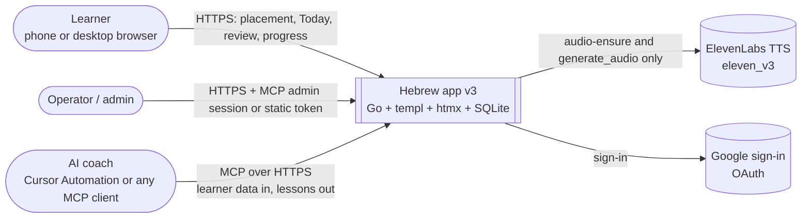
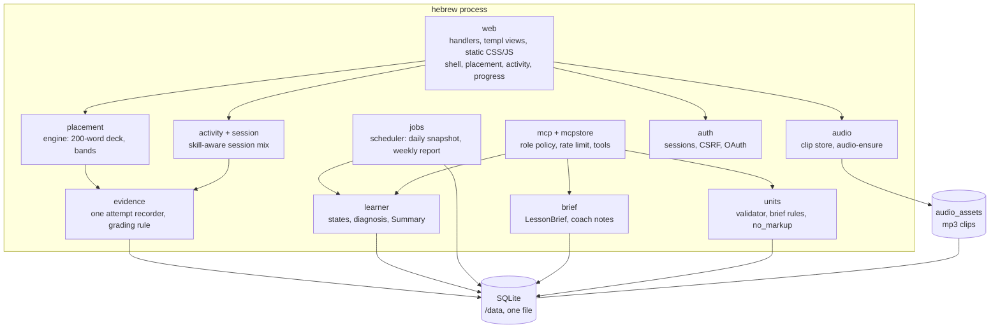
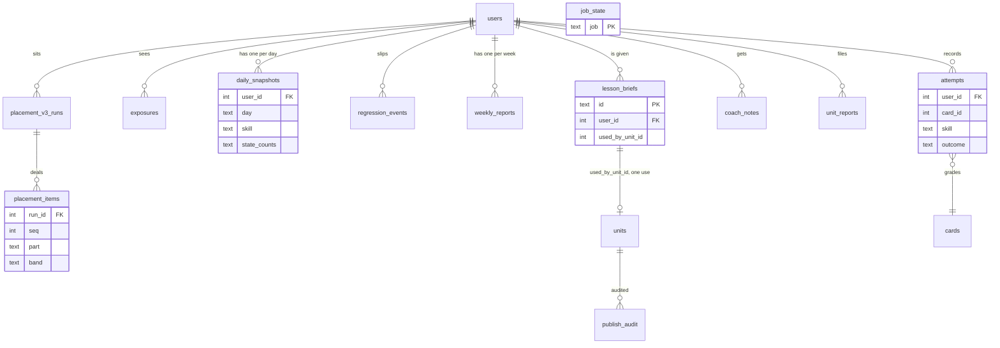
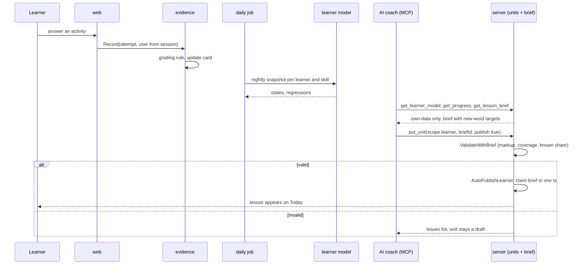
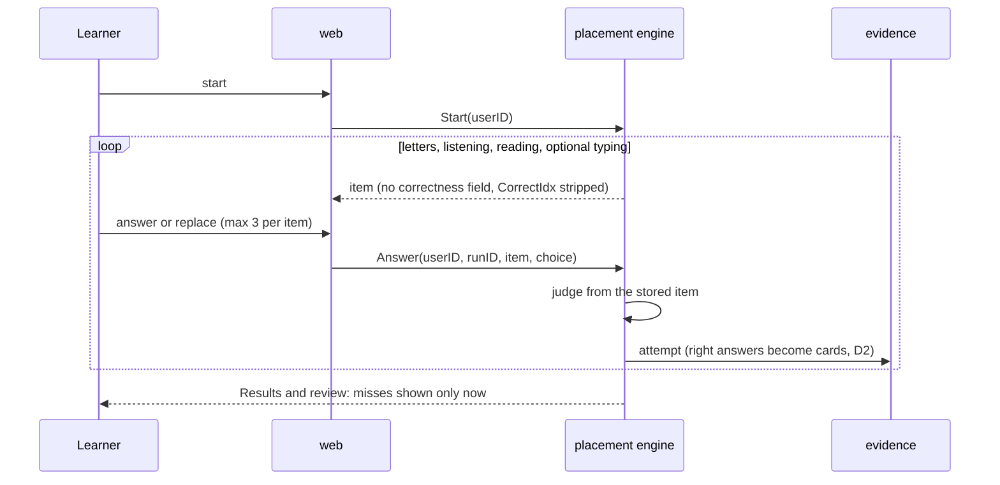
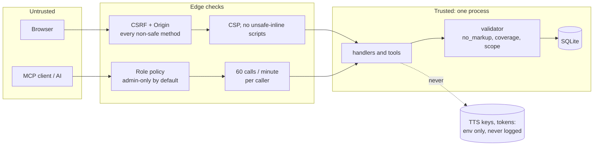
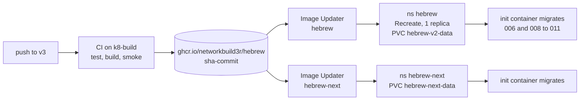

# INIT-015 Architecture: v3 Adaptive Learning (`INIT-015/DESIGN-DIAGRAMS`)

Diagrams are grounded in the specs and the code at `v3` `844f16d`. Each cites its source specs. Included: system context, container, data model, two sequences, data flow with trust boundaries, and deployment. Left out: component (C4 L3) and agent topology, because the app is one Go binary and the only agent is an external MCP client.

## 1. System context (C4 L1) · SPEC-001, SPEC-021, SPEC-022

The AI never holds a learner session. It reads the learner model and a `LessonBrief`, writes a unit with a `briefId`, and the server validates and publishes it (D5, no human step).

## 2. Container (C4 L2) · SPEC-005, SPEC-007, SPEC-013 to SPEC-015, SPEC-019 to SPEC-021, SPEC-023

One process, one SQLite file on one volume. Packages are the containers.

## 3. Data model (ERD) · SPEC-003, SPEC-004, SPEC-006, SPEC-014, SPEC-019, SPEC-020, SPEC-023 (migrations 006 and 008 to 011)

Migration 007 is the OAuth client change that shipped on `origin/v3` first (D9). Every learner table carries `user_id`; there is no cross-learner join in any query.

`job_state` holds the daily and weekly job locks. `cards_new` (006) rebuilt `cards` with a skill direction; `confusion_misses_new` (009) and `regression_events_new` (010) are table rebuilds.

## 4. Sequence: attempt to published lesson · SPEC-005, SPEC-013, SPEC-014, SPEC-019, SPEC-020, SPEC-021

## 5. Sequence: placement with no feedback (D1) · SPEC-007, SPEC-012

## 6. Data flow and trust boundaries · SPEC-002, SPEC-021, SPEC-023; threat model in the initiative doc section 8

Learner scope is forced server-side from the session or token. A learner naming another `learnerId` is refused before the handler runs. The read-only smoke token is a learner principal with writes removed.

## 7. Deployment · SPEC-002, SPEC-025

Both updaters track the same image, so staging is not a separate stage today (SPEC-025 documents the pause and a real staging dry run). Migrations run in the init container; a failing one shows as a stuck init container. The old image cannot read a migrated database, so rollback is the previous tag plus the backup file. Hosts: `hebrew.ibhacked.us`, `hebrew-next.ibhacked.us`, MCP at `hebrew-mcp.ibhacked.us`. CI never publishes `ghcr.io/networkbuild3r/hebrew-lessons`.
