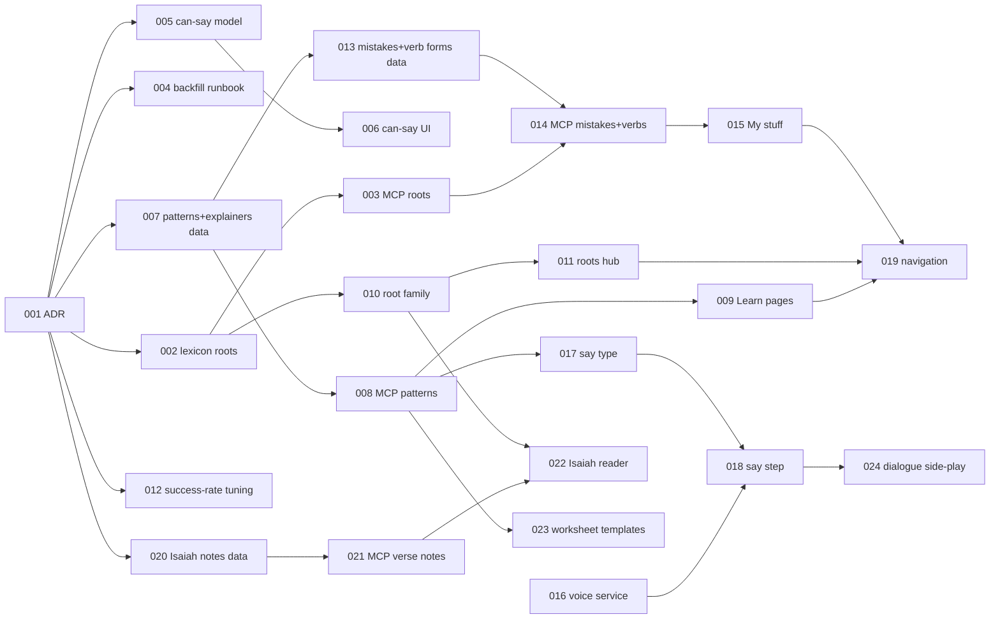

# Initiative: The Hybrid Model: research rules, lessons tuned to the learner, and a course around them

**Initiative ID:** INIT-016
**Status:** planned
**Slug:** INIT-016-hybrid-learning
**Discipline Profile:** `software`
**Created:** 2026-10-23
**Owner:** Brian Nelson
**Ticket:** None (`branch_naming.ticket_system: none`)
**Branch:** `main` (deliberately not a worktree: the operator made `main` the single line on 2026-10-23, and every push to `main` is published by CI and deployed by a tag bump in home_k3.)
**Target Completion:** not a promise. The estimate starts when the operator says to execute.
**Source:** [`docs/design/learner-without-a-tutor.md`](../../../docs/design/learner-without-a-tutor.md) (the hybrid model, revised 2026-10-23). Builds on [`docs/north-star.md`](../../../docs/north-star.md) and INIT-015 (learner model, lesson brief, MCP tools).

---

## 1. Executive Summary

The app already knows, per word and skill, what the learner knows, and its lesson brief already mixes struggle words, new words and comfortable words (INIT-015). What it lacks is the course around that engine and the rules not yet in code. This initiative builds the hybrid model from the design doc:

1. **Research rules in code**, the same for everyone. New this time: aim each lesson at a success rate (about 8 in 10 right), explain a pattern at the point of need, fix the mistakes that keep coming back, and show what the learner can now say.
2. **Lessons tuned to the one learner** from their record. The brief keeps choosing; it now also reads recent accuracy, personal mistakes and grammar patterns.
3. **Tutor input through MCP** when there is a tutor: words with roots and verb patterns, verb forms, grammar patterns with prerequisites, mistakes, speaking prompts. Any MCP client (Muse, Grok, a swarm) can load and tune. Without a tutor, the **default path** stands in: class order, reordered by prerequisites.

The course around it: explainer pages keyed to grammar patterns, a roots hub, My stuff (personal mistakes, verb tables, word bank), a say-it-aloud step, Isaiah verse by verse, worksheet-type templates, and dialogues where the learner plays one side.

24 specs across seven domains. About 100 hours of work, with a 28-hour critical path.

**Operator decisions** (2026-10-23, from the design doc):

| ID | Decision | Choice |
| --- | --- | --- |
| D1 | The model | Hybrid: research rules in code, lessons tuned per learner from their record, tutor input through MCP when there is a tutor. |
| D2 | Who picks, who writes | Code picks words and patterns (the brief). An author (person or MCP client) writes the lesson and cannot override the pick. A tutor adds to the record. Unchanged from the north star. |
| D3 | Class data | Arrives through MCP tools, never as repo files. Not loaded until the backfill is under way (it is four classes today). The backfill starts alongside builds 1 and 2. |
| D4 | Default path order | Class order is the starting point. A unit whose pattern comes before one of its prerequisites is flagged and moved. |
| D5 | Mistakes | Two lists. A general list ("learners often say X, it is Y") for the shared course, never anyone's actual answers. A personal list, private to one learner, for the tuned path and My stuff. |
| D6 | Explainers | Keyed to a grammar pattern, so a lesson links by data, not by hand. |
| D7 | Roots hub | A root page shows only when the root has at least two words or a verse. |
| D8 | Content | Our own material in the same structure and order as the class sheets, not the sheets. Tutor and learner names and transcripts stay out of the repo and the site. |
| D9 | Audio | A dependency, not assumed. The voice service is down to 3 credits and has no male voice. Say-it-aloud and two-speaker dialogues wait for it. |
| D10 | Isaiah | Drafted one verse at a time by an agent, checked by a person who reads Hebrew. Only checked notes are shown. |

**Requirements** (each spec's acceptance criteria trace to these):

| ID | Requirement | Priority |
| --- | --- | --- |
| REQ-001 | A lexeme can carry a consonantal root and a verb pattern (binyan), written and read through MCP. | P0 |
| REQ-002 | The learner sees what they can now say: the words and phrases whose recall skill is known or solid, and how many were added this week. | P0 |
| REQ-003 | Grammar patterns exist as data, each with the patterns it depends on. A unit names its pattern. | P0 |
| REQ-004 | The shared path is checked: no unit's pattern comes before a unit that teaches one of its prerequisites. Violations are reported with a proposed order. | P1 |
| REQ-005 | Each pattern can have one explainer page: plain English, pointed examples, no raw HTML. A lesson step links to it where the pattern first appears. | P0 |
| REQ-006 | Each root with at least two words or a verse has a page: its words, verb forms, the lessons that use them, and verses that contain them. Each word card links to its root. | P1 |
| REQ-007 | The brief reads the learner's recent success rate and shifts the mix: more comfortable material when accuracy is low, more new material when it is high, within the existing limits. | P0 |
| REQ-008 | A tutor or agent can record a learner's mistakes through MCP. They are private to that learner, feed the brief, and show in My stuff. | P1 |
| REQ-009 | An admin can maintain a general mistakes list, tied to patterns, shown on explainer pages. It never contains a learner's own answer. | P2 |
| REQ-010 | Verb forms by tense and person can be loaded through MCP, and My stuff shows a verb table for each verb the learner knows. | P1 |
| REQ-011 | A say-it-aloud step exists: an English cue, the learner says the Hebrew, the model plays, the learner self-checks. | P1 |
| REQ-012 | Navigation is organized around the sections (Path, Learn, Roots, Isaiah, My stuff) and shows only sections that have content. | P2 |
| REQ-013 | Isaiah reads verse by verse with four layers (gloss, roots, the manner of the Jews, bridge to modern Hebrew). Only notes a person has checked are shown. | P2 |
| REQ-014 | Worksheet types (topic conversation, review sheet, verb workshop, short story with true/false, foundations and reading) are templates an author fetches over MCP, and a unit records its type. | P2 |
| REQ-015 | In a dialogue the learner can play one side: their lines are cues, they say each line, then hear it. | P2 |
| REQ-016 | The class backfill is loaded through MCP by a documented procedure that keeps names and transcripts out. | P1 |
| REQ-017 | The voice service has credits and a second (male) voice before audio-heavy steps ship at scale. | P1 |

**Planning notes**

- **Discipline.** `software`.
- **Harness.** Cursor. Explored this session: `internal/lexicon` (no root or binyan field in `lexicon.Input`), `internal/mcp` tool list, `internal/brief` (mixes struggle, new and comfortable words; no success-rate input), `migrations/` (next free number 013), `internal/db/tanakh.go` (`VersesContaining` already searches verses by a plain word), `internal/units` activity types (`shadow` and `dialogue` exist, no `say`), `generate_audio` (speaker `b` is the male voice in code, not configured).
- **Personas.** This repo has no `.claude/agents/` tree, and the `scripts/dev/` tools (`prior_art.py`, `next_adr_number.py`, `expertise_state.py`) are not in the repo. Nothing was manufactured. Each spec names the persona from `sdd-skill-config` §7.1; execution degrades with the gap disclosed, as in INIT-015. The ADR number was taken by hand: the highest is ADR-0018, so SPEC-001 writes **ADR-0019**.
- **Prior art.** Not run: the prior-art tool is not in this repo. The in-repo prior art is INIT-015 itself; every spec builds on its packages rather than beside them.
- **Coverage bar.** `go test ./...`, `templ generate`, and the Playwright browser suites (`-tags browser`). Pass conditions are named tests and checks, not a coverage percent.
- **Migrations.** 013 (patterns and explainers), 014 (mistakes and verb forms), 015 (Isaiah notes), 016 (unit fields: worksheet type, if not folded into 013). Numbers are claimed in that order; a spec that lands out of order takes the next free number and updates this table.

---

## 2. Domain Analysis

| Domain | Affected | Key changes |
| --- | --- | --- |
| Data | Yes | Lexicon root and binyan through the write path. Migrations 013–015: grammar patterns and prerequisites, explainers, personal and common mistakes, verb forms, Isaiah verse notes. |
| Service | Yes | "Can say" read model. Root family read model. Success-rate tuning in the brief. Say-it-aloud activity type, validator rules, grading. |
| API | Yes | MCP: root and binyan on `upsert_lexemes` and `lookup`; patterns, explainers, mistakes, verb forms, verse notes, worksheet templates; `put_unit` takes `pattern` and `worksheet_type`; a path-order check. |
| Event | No | — |
| Scheduled | No | The existing daily job is enough; "added this week" is computed from snapshots. |
| Infrastructure | Yes | Voice service credits and a male voice (operator, outside the repo). |
| Frontend | Yes | Learn pages, roots hub, "You can now say", My stuff, say-it-aloud step, Isaiah reader, navigation, dialogue side-play. |
| Docs | Yes | ADR-0019. The backfill runbook. Authoring resource updates. |

---

## 3. Spec Breakdown

Each spec is single-domain. Detailed definitions live in `specs/`.

| Spec | Domain | Title | Prompt | Autonomy | Gates | Blocked by | Effort |
| --- | --- | --- | --- | --- | --- | --- | --- |
| SPEC-001 | docs | ADR-0019: the hybrid model | implementation-planner | auto_tests | — | None | 2h |
| SPEC-002 | data | Roots and verb patterns in the lexicon | database-architect | auto_tests | — | SPEC-001 | 3h |
| SPEC-003 | api | MCP: root and binyan on `upsert_lexemes` and `lookup` | principal-backend-developer | auto_tests | — | SPEC-002 | 2h |
| SPEC-004 | docs | Class backfill runbook through MCP | implementation-planner | plan_only | — | SPEC-001 | 2h |
| SPEC-005 | service | "Can say" read model | principal-backend-developer | auto_tests | — | SPEC-001 | 3h |
| SPEC-006 | frontend | "You can now say" on Progress and Today | principal-frontend-developer | auto_tests | deploy | SPEC-005 | 4h |
| SPEC-007 | data | Grammar patterns, prerequisites and explainers (migration 013) | database-architect | auto_tests | db_migration | SPEC-001 | 5h |
| SPEC-008 | api | MCP: patterns, explainers, unit pattern, path-order check | principal-backend-developer | auto_tests | — | SPEC-007 | 6h |
| SPEC-009 | frontend | Learn pages and the lesson link | principal-frontend-developer | auto_tests | deploy | SPEC-008 | 6h |
| SPEC-010 | service | Root family read model | principal-backend-developer | auto_tests | — | SPEC-002 | 4h |
| SPEC-011 | frontend | Roots hub and the word-card link | principal-frontend-developer | auto_tests | deploy | SPEC-010 | 5h |
| SPEC-012 | service | Success-rate tuning in the brief | principal-backend-developer | auto_tests | — | SPEC-001 | 5h |
| SPEC-013 | data | Mistakes and verb forms (migration 014) | database-architect | auto_tests | db_migration | SPEC-007 | 5h |
| SPEC-014 | api | MCP: mistakes and verb forms; brief and learner model read personal mistakes | principal-backend-developer | auto_tests | — | SPEC-003, SPEC-013 | 6h |
| SPEC-015 | frontend | My stuff: mistakes, verb tables, word bank | principal-frontend-developer | auto_tests | deploy | SPEC-014 | 6h |
| SPEC-016 | infrastructure | Voice service: credits and a male voice | devops-engineer | plan_only | external_service | None | 1h |
| SPEC-017 | service | Say-it-aloud activity type | principal-backend-developer | auto_tests | — | SPEC-008 | 4h |
| SPEC-018 | frontend | Say-it-aloud step in the player | principal-frontend-developer | auto_tests | deploy | SPEC-016, SPEC-017 | 5h |
| SPEC-019 | frontend | Navigation around the sections | principal-frontend-developer | auto_tests | deploy | SPEC-009, SPEC-011, SPEC-015 | 4h |
| SPEC-020 | data | Isaiah verse notes (migration 015) | database-architect | auto_tests | db_migration | SPEC-001 | 3h |
| SPEC-021 | api | MCP: verse notes, drafted and checked | principal-backend-developer | auto_tests | — | SPEC-020 | 3h |
| SPEC-022 | frontend | Isaiah reader | principal-frontend-developer | auto_tests | deploy | SPEC-010, SPEC-021 | 6h |
| SPEC-023 | api | Worksheet-type templates and the unit's type | principal-backend-developer | auto_tests | — | SPEC-008 | 4h |
| SPEC-024 | frontend | Dialogue: play one side | principal-frontend-developer | auto_tests | deploy | SPEC-018 | 6h |

> Security review and architecture diagrams run as `complete-initiative` phases, not as spec rows. `security_review: required` is set on SPEC-008 (authored explainer bodies reach every learner), SPEC-009 (renders that content), SPEC-014 (writes and reads private learner mistakes over MCP), SPEC-021 (agent-drafted content gated by a human check), and SPEC-024 is `standard`.

**Build list mapping** (design doc, "Build list"):

| Design build | Specs |
| --- | --- |
| 1. Roots and patterns in the lexicon; backfill starts | SPEC-001, 002, 003, 004 |
| 2. "You can now say" | SPEC-005, 006 |
| 3. Grammar patterns with prerequisites | SPEC-007, 008 |
| 4. Explainers | SPEC-007, 008, 009 |
| 5. Roots hub | SPEC-010, 011 |
| 6. Success-rate tuning | SPEC-012 |
| 7. Mistakes lists | SPEC-013, 014, 015 |
| 8. Verb tables | SPEC-013, 014, 015 |
| 9. Say-it-aloud | SPEC-016, 017, 018 |
| 10. Isaiah | SPEC-020, 021, 022 |
| 11. Dialogues with a side to play | SPEC-024 |
| (sections) Navigation, worksheet types | SPEC-019, 023 |

---

## 4. Dependency Graph

**Critical path (28h):** SPEC-001 → SPEC-007 → SPEC-013 → SPEC-014 → SPEC-015 → SPEC-019 (2+5+5+6+6+4). A second 28h chain runs SPEC-001 → SPEC-007 → SPEC-008 → SPEC-017 → SPEC-018 → SPEC-024, and SPEC-018 also waits on SPEC-016, which is outside our control.

**Parallel from the start:** SPEC-002/003 (roots), SPEC-005/006 (can say), SPEC-007 (patterns), SPEC-012 (tuning), SPEC-020 (Isaiah data), SPEC-016 (operator), SPEC-004 (runbook). Specs that add a migration land one at a time in number order.

**Waves:**

| Wave | Specs | What the learner gets |
| --- | --- | --- |
| A | 001, 002, 003, 004, 005, 006, 012 | "You can now say"; lessons that react to accuracy; roots writable; backfill starts |
| B | 007, 008, 009, 010, 011 | Explainers linked from lessons; roots hub |
| C | 013, 014, 015, 019 | My stuff (mistakes, verb tables); section navigation |
| D | 016, 017, 018, 023, 024 | Say-it-aloud; worksheet templates; play a side in a dialogue |
| E | 020, 021, 022 | Isaiah verse by verse |

---

## 5. Timeline & Effort

- **Total effort:** 100 hours.
- **Critical path:** 28 hours. Realistic: 28 × 1.3 ≈ 36 hours, about 6 working days at 6 productive hours a day, if specs off the critical path run alongside.
- **Outside our control:** SPEC-016 (voice service), the backfill (operator and the class-data agent), and Isaiah checking (a person who reads Hebrew). Waves D and E wait on them.

---

## 6. Controls & Gates

- **Autonomy:** `auto_tests` for code specs; `plan_only` for SPEC-004 (the operator runs the loads) and SPEC-016 (operator account work).
- **Gates:**
  - `db_migration` on SPEC-007, 013, 020: additive tables only, no rewrite of existing rows; the migration runner's own transaction and a backup of the production SQLite file before deploy.
  - `deploy` on frontend specs: push to `main` publishes; deploy is the tag bump in home_k3 and the `/version` check, as already practiced.
  - `external_service` on SPEC-016: buying credits and adding a voice are the operator's.
- **Blocking checks:** `go vet ./...`, `go test ./...`, `templ generate` with no diff, the motion and CSS lints, and the browser suites that touch the changed screens.
- **Rollback:** every spec is revertible by commit. Migrations are additive; rolling back the app leaves unused tables.

---

## 7. Agent Behavior Overrides

None beyond the repo's existing rules: plain English in learner copy, Hebrew in `bdi` with `lang` and `dir`, motion only through tokens, no learner or tutor names in code, content or fixtures.

---

## 8. Threat Model (security)

| Flow | Trust boundary | Risk | Control |
| --- | --- | --- | --- |
| Explainer bodies, verse notes, common mistakes written over MCP and shown to every learner | MCP admin token → shared pages | Stored markup injection; an agent writes HTML or script | Admin-only tools. Bodies are a restricted markdown subset parsed into an allow-listed node set; raw HTML is refused at write time and escaped at render. Length caps. |
| Personal mistakes written by a tutor's agent | MCP token → one learner's private data | One learner's mistakes read or written by another | Learner scope from the token, never from input, as in INIT-015's learner tools. Admin writes name the learner explicitly. No public page shows them. |
| Agent-drafted Isaiah notes | MCP → public reader | Wrong or harmful text shown as fact | Notes start `draft`. Only an admin marking `checked` publishes them. The reader shows checked notes only. |
| Class backfill | Operator's machine → MCP | Names or transcripts loaded into the shared course | The runbook strips names; validators refuse tokens from a configured deny list in shared content; personal answers go only to personal tables. |
| Say-it-aloud | Browser | Microphone use | Out of scope: no recording in this initiative. A later spec adds it with an explicit permission prompt. |

---

## 9. Risk Assessment

| Risk | Probability | Impact | Mitigation |
| --- | --- | --- | --- |
| The backfill stays at four classes, so roots, verbs and mistakes pages are thin | High | Medium | Pages hide until they have content (D7, REQ-012). Tools ship first so loading can start (Wave A). |
| Voice credits do not arrive | Medium | High for Wave D | SPEC-018 ships behind the dependency; the step falls back to a text model and a disabled play control with a plain note. |
| Success-rate tuning makes lessons swing | Medium | Medium | Hysteresis: a rolling window of the last 40 checked answers, two thresholds, a floor and ceiling on the new-word count. Table tests pin the rule. |
| Content quality from agents (explainers, Isaiah) | Medium | Medium | Human check gate for Isaiah; explainers reviewed in the PR or through an admin publish flag. |

---

## 10. Success Criteria

- A tutor's agent loads one class through MCP, and the next brief for that learner reflects its words, pattern and mistakes.
- The learner sees "You can now say" with a weekly number that goes up.
- When recent accuracy drops below the low threshold, the next brief has fewer new words and more comfortable ones, and the reverse above the high threshold.
- Every pattern in a published unit with an explainer links to it from the step where it first appears.
- The shared path passes the order check, or every violation is listed with a proposed move.
- A root page exists for every root with two or more words or a verse, and none otherwise.

---

## 11. Next Steps

1. Operator: review this plan and the decisions; start the backfill (SPEC-004) and the voice service (SPEC-016).
2. Execute Wave A, starting with SPEC-001, then SPEC-002/003 and SPEC-005/006 in parallel.

---

## 12. Plan Quality

| Dimension | Score | Note |
| --- | --- | --- |
| Completeness | 8 | Every design build maps to specs. Self-recording and an AI conversation partner are deliberately out. |
| Accuracy | 8 | Grounded in the code read this session; table and tool names checked. |
| Clarity | 8 | One domain per spec, acceptance criteria per spec. |
| Technical feasibility | 8 | Builds on INIT-015 packages; no new infrastructure except the voice account. |
| Guardrails compliance | 7 | Prior-art and persona tooling absent in this repo, disclosed. |

**Confidence:** 39 / 50 = 0.78. Every dimension ≥ 6.
