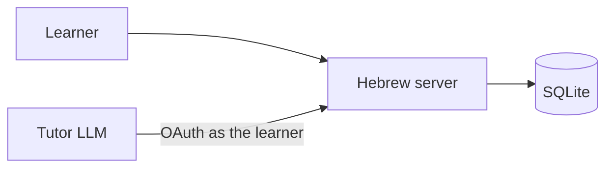
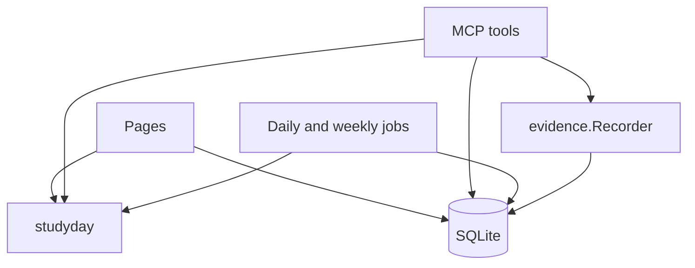
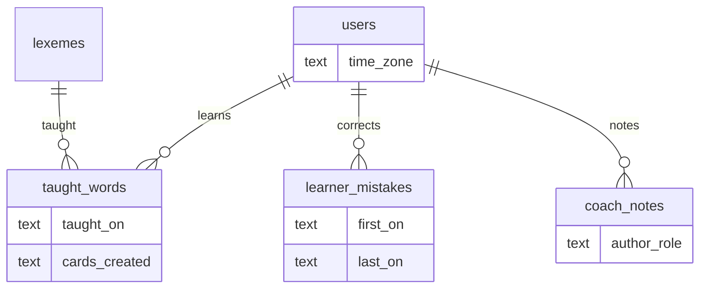
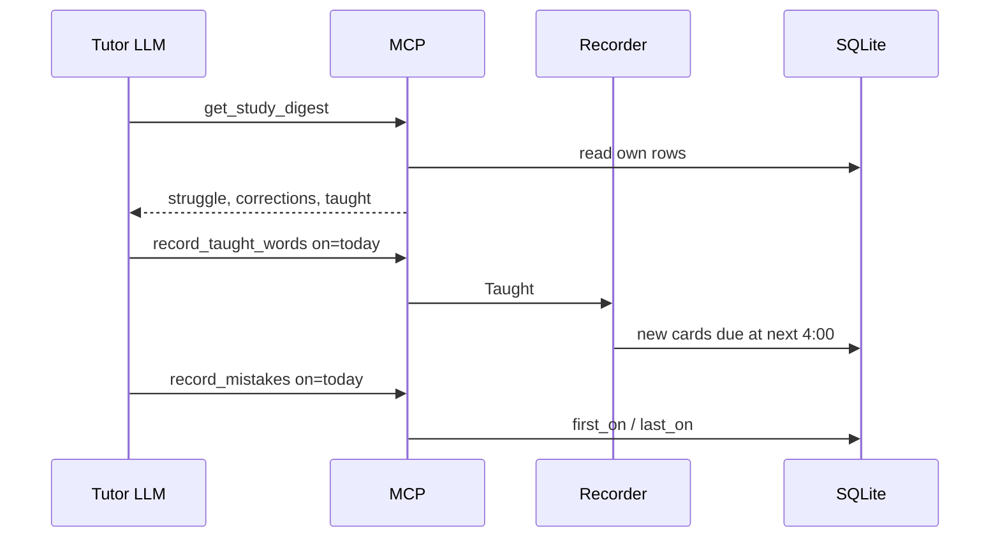

# INIT-026 architecture

Provenance: INIT-026/DESIGN-DIAGRAMS. Written from the specs and the code on branch `tutor-data-loop`. This app has no in-process agent fleet, so the agent diagram is the outside tutor calling MCP.

## System context

Grok, or any OAuth MCP client signed in as the learner, calls the Hebrew server. The human tutor never signs in. Recordings and transcripts stay with the caller.

Sources: INIT-026/SPEC-001, INIT-026/SPEC-007, INIT-026/SPEC-008, INIT-026/SPEC-009.

## Container

One Go process serves the pages and the MCP tools. Both use `internal/studyday` for the learner's day. The daily and weekly jobs run in the same binary.

Sources: INIT-026/SPEC-003, INIT-026/SPEC-004, INIT-026/SPEC-005, INIT-026/SPEC-006.

## Data

Migration 020 adds the zone, the taught-word rows, the correction days, and the note role.

Source: INIT-026/SPEC-002.

## Sequence: after a session

The recorder inserts new cards only. It does not grade an existing card. Sources: INIT-026/SPEC-005, INIT-026/SPEC-008, INIT-026/SPEC-009.

## Deployment

The live server is the `hebrew` Deployment in namespace `hebrew`. `TZ` is the app zone when a learner has none. This initiative does not change the Deployment. A learner's zone is a row, set with `set_time_zone`.

Source: INIT-026/SPEC-003, INIT-026/SPEC-007.
