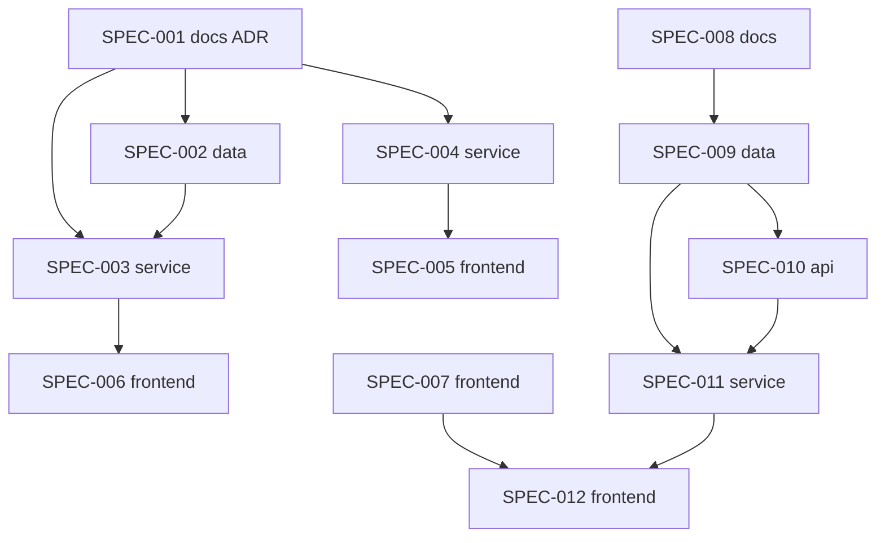

# INIT-036: "Known" means remembered on a later day, and the learner can hear the difference

**Initiative ID:** INIT-036 · **Status:** on_track · **Created:** 2026-11-08 · **Owner:** Brian Nelson
**Discipline Profile:** `software` · **Ticket:** none · **Branch:** `main` (deliberately not a worktree: the checkout carries about 46 line-ending-only modified files, and the repo's own initiatives such as INIT-032 work in place on `main`)
**Source:** [ASMT-003](../../assessments/ASMT-003-hebrew-web-app/ASMT-003-hebrew-web-app-assessment-report.md), phases 1 and 2 of its spec skeleton. Brian's answers to the handoff questions, 2026-11-08: self-reported speaking counts toward nothing until speech can be checked; the later-day rule and the headline follow the research.

## What we found

**"Known" can be reached on the day a word is taught.** Three same-day right answers, with recall chance at least 0.85 and the newest three right, make a skill known (`internal/learner/state.go:148-151`, `:167-192`). Nothing asks for a later day. The success count also takes self-reported speaking checks (`internal/evidence/recorder.go:286-326`, `internal/db/learner.go:319`). That state sets the comfortable-text tier (`internal/brief/build.go:534`) and the validator's coverage check (`internal/mcpstore/learner.go:51-71`). A looser set, `knownLexemes`, takes one right read answer (`internal/db/placement.go:614-632`), and also picks the suggested course start.

**Research.** RSCH-003 line 18 (High): spacing beats massing. RSCH-003 line 173 and ADR-0024 D3: a same-session repeat is practice, not the review. ASMT-003 falsifier 1 confirmed the mechanism in code. How often it happens in real data is unknown, and no application data was read.

**Hearing.** Only placement can play a clip at 0.75× (`internal/web/static/js/placement.js:62`). The project's own guidance A4 asks for it on every replay (`internal/units/rules.go:228`), and C1 and C2 ask for a minimal-pair drill that nothing builds (`:234-235`). RSCH-003 line 42 (Moderate): perception training with feedback works.

**Speaking.** The say step's "Got it" and "Not yet" are a self-grade. INIT-020 SPEC-002 line 31 fed them to the scheduler. With no way to check speech, a self-grade is not evidence, so Brian's call is to remove it until speech can be checked.

## What you get

- **A word is known only after it is remembered on a later day.** At least two different study days carry a checked right answer, in lesson or review.
- **Nothing self-reported counts.** The say step writes no attempt, review or card. Its Got it / Not yet buttons go away.
- **The numbers are honest, and they say so.** "Words you know" gets stricter. Words that pass the old rule but not yet the new one show as "learned today, check tomorrow", so progress is still visible.
- **The author and the course start use the same rule.** `knownLexemes` and the suggested start read the strict set.
- **Slow audio everywhere.** A 0.75× control on every replay, remembered in the browser.
- **A "hear the difference" drill.** Real-word minimal pairs in both voices, only for contrasts a native speaker or the tutor confirms. Guidance C1 and C2 are rewritten to match.

## Specs

| Spec | Domain | Title | Blocked by | Effort | Status |
| --- | --- | --- | --- | --- | --- |
| [SPEC-001](specs/SPEC-001-docs-known-means-remembered.md) | docs | ADR: known means remembered on a later day | — | 2h | complete |
| [SPEC-002](specs/SPEC-002-data-checked-success-per-day.md) | data | Checked successes and the days they fall on | SPEC-001 | 4h | complete |
| [SPEC-003](specs/SPEC-003-service-known-needs-a-later-day.md) | service | The known rule needs a later day, rule version 4 | SPEC-001, SPEC-002 | 5h | complete |
| [SPEC-004](specs/SPEC-004-service-say-counts-for-nothing.md) | service | The say step writes nothing | SPEC-001 | 3h | complete |
| [SPEC-005](specs/SPEC-005-frontend-say-step-without-grade.md) | frontend | The say step without a grade | SPEC-004 | 2h | complete |
| [SPEC-006](specs/SPEC-006-frontend-learned-today-check-tomorrow.md) | frontend | "Learned today, check tomorrow" on Progress and Today | SPEC-003 | 3h | complete |
| [SPEC-007](specs/SPEC-007-frontend-slow-audio-everywhere.md) | frontend | A 0.75× control on every clip | — | 3h | complete |
| [SPEC-008](specs/SPEC-008-docs-sound-contrast-inventory.md) | docs | The sound contrasts worth training, checked by a native speaker | — | 3h | blocked (draft written; needs a native speaker or the tutor) |
| [SPEC-009](specs/SPEC-009-data-sound-pairs.md) | data | The sound-pair bank | SPEC-008 | 3h | planned |
| [SPEC-010](specs/SPEC-010-api-sound-pairs-tool.md) | api | An MCP tool to add sound pairs and their clips | SPEC-009 | 4h | planned |
| [SPEC-011](specs/SPEC-011-service-hear-the-difference-drill.md) | service | The "hear the difference" drill in the review mix | SPEC-009, SPEC-010 | 6h | planned |
| [SPEC-012](specs/SPEC-012-frontend-hear-the-difference-screen.md) | frontend | The "hear the difference" screen | SPEC-007, SPEC-011 | 5h | planned |

**Total:** 43h. **Critical path:** SPEC-008 → SPEC-009 → SPEC-010 → SPEC-011 → SPEC-012 = 21h. Realistic: 21h × 1.3 ≈ 27h, about 5 calendar days at 6 productive hours a day.

**Parallelizable.** Three tracks share no files: the known-rule track (SPEC-001 to SPEC-006), the audio control (SPEC-007), and the sound-pair track (SPEC-008 onward). SPEC-004 and SPEC-005 stand apart from SPEC-002 and SPEC-003.

**Order.** The known-rule track ships first, because every later number reads it. SPEC-008 needs a native speaker or the tutor, so start it early and let the code specs run meanwhile.

## Decisions

- **Later day means a second study day.** A skill is known only when its checked right answers fall on at least two different study days in the learner's zone (`internal/studyday`). Lesson and review answers both count, because both are retrieval, and a day apart is the delay the research asks for. Rejected: review-only. A later lesson that brings a word back is also delayed retrieval, and lessons are where most words return.
- **Checked means not self-reported.** Rows that are `peeked` or from the say self-check never count as successes, as later-day answers, or toward the newest-three rule. Typed spelling's implied credit still counts, as ADR-0030 set.
- **Self-reported speaking counts toward nothing.** It writes no attempt, review or card, and its buttons go. This supersedes INIT-020 SPEC-002 line 31. It returns when something can check what was said.
- **Existing data is kept, not deleted.** Past say rows and peeked reviews stay in `review_log`. They stop counting toward known under rule version 4, and history is rebuilt as ADR-0030 did.
- **The headline gets stricter, and the gap is shown.** "Words you know" uses the new rule. A separate count, "learned today, check tomorrow", holds words that pass the old rule and wait for a second day. The research has no direct finding on how to display this, so the choice follows what the research does say: same-session repeats are not the review (RSCH-003 line 173), and streaks and points are unproven (line 91), so the page should be honest about the number rather than flatter it.
- **`knownLexemes` and the suggested start use the strict set.** One rule for the headline, the tier, the coverage check, the author's list and the course start.
- **Slow audio is stored in the browser.** One local setting, no server data. It applies to every clip the learner can replay.
- **Sound pairs are real words only, and only confirmed contrasts.** The bank holds pairs from the lexicon. A pair is served only after SPEC-008's list approves its contrast. Guidance C1 stops naming letter pairs that sound the same in modern speech.

## Threat model

- **No new trust boundary** in the known-rule, say and slow-audio specs. They change what existing learner data counts as, and add a local browser setting.
- **SPEC-010 adds an admin-only MCP write tool.** Same shape as `upsert_lexemes`: admin only, lexicon-checked, no raw markup. A learner token cannot call it.
- **Rule version 4 rebuilds derived history.** It reads `review_log` and rewrites `daily_snapshots` and `daily_totals`, which stay reproducible from the log. `review_log` is never edited.
- **No recording and no microphone** in this initiative. ADR-0022 D3 still holds.

## Risks

| Risk | Probability | Impact | Mitigation |
| --- | --- | --- | --- |
| The headline drops and discourages the learner | M | M | "Learned today, check tomorrow" beside it (SPEC-006); a short note when the rule changes |
| Synthetic voices blur the contrasts being trained | M | H | SPEC-008 requires a native speaker or the tutor to listen to the clips before a pair is served |
| The native-speaker check never happens | M | M | SPEC-008 is first on its track; SPEC-009 onward stay blocked until it is signed off |
| Rule version 4 rebuild changes historical charts | H | L | Stamp rows with the version, as ADR-0030 did; Progress already handles mixed versions |
| Voice credits run short for pair clips | M | M | Cap pairs per contrast in SPEC-010; confirm the balance before generating |
| A new drill kind crowds the review mix | L | M | Reuse the letter-drill cap and weave rules; keep it inside `DrillCap` |

## Depends on / unblocks

- Builds on ADR-0024, ADR-0027, ADR-0028 and ADR-0030, and on INIT-020 (superseding SPEC-002's feed to the scheduler).
- Shares no files with INIT-031 or INIT-032. INIT-032 SPEC-001 plans `ADR-0028-one-right-answer.md`, but ADR-0028 is taken, so INIT-032 will likely take ADR-0029. This initiative claims ADR-0031.
- Unblocks ASMT-003 phases 3 to 5: record and compare, a graded reading library, and closing the loop.
- **Ship SPEC-003 after INIT-037 SPEC-007.** SPEC-003 raises the Learning count that `PaceFor` reads (`internal/brief/build.go:573-575`), and on its own that makes more briefs consolidate (ASMT-004). SPEC-004 shares `authoring.md` and the author skill with INIT-037 SPEC-005, SPEC-006 and SPEC-008; land them in sequence.

## Done when

- A word answered right three times on its first day is not known until a checked right answer lands on a second day.
- No self-reported say check writes a row, and the say step shows no Got it / Not yet.
- Progress and Today show "learned today, check tomorrow" beside "Words you know", and the AI author's `knownLexemes` matches the strict set.
- Every replayable clip has a 0.75× control.
- At least one native-speaker-approved contrast has a pair bank, clips in both voices, and a working drill with feedback.

## Plan quality (Phase 5.5 self-review, not independent)

Completeness 8, accuracy 8, clarity 8, feasibility 7, guardrails 8: 39/50, confidence 0.78. Weakest point: SPEC-008 depends on a person outside the repo. The initiative is written so the code specs run without it.

## Disclosures

- **Kit tools missing.** `<KIT>/scripts/dev/` has no `run_py.sh`, `next_adr_number.py`, `expertise_state.py`, `prior_art.py` or `model_tier.py` on this machine. So: the ADR number was taken by hand (next after ADR-0030, no reservation made); the expertise check and prior-art search were not run, and every spec uses `primary_prompt: none` as this repo's other initiatives do; complexity ratings were set by hand, with a one-line reason in each spec, and `complexity-rating.md` was not consulted.
- **INIT number by hand.** No `INIT-033` to `INIT-035` folders exist, but git history uses INIT-033 and INIT-035. INIT-036 is the next number above everything git names.
- **Guard.** `guard_identities` is empty, so the git guard is inert.
