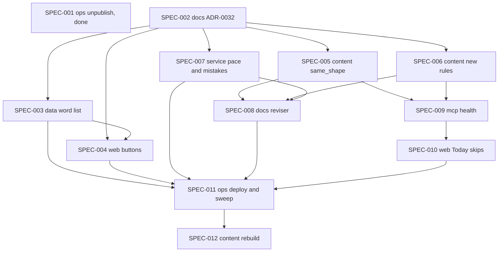

# INIT-037: A lesson asks only about words you were taught, and a bad lesson can't be copied forward

**Initiative ID:** INIT-037 · **Status:** complete · **Created:** 2026-11-08 · **Owner:** Brian Nelson
**Discipline Profile:** `software` · **Ticket:** none · **Branch:** `main` (deliberately not a worktree: the checkout carries many line-ending-only modified files, and this repo's initiatives, such as INIT-032 and INIT-036, work in place on `main`)
**Source:** [ASMT-004](../../assessments/ASMT-004-hebrew-web-app/ASMT-004-hebrew-web-app-assessment-report.md), its spec skeleton (SPEC-A to SPEC-H). Brian, 2026-11-08, on https://hebrew.ibhacked.us/lesson/12/1: "I didn't even have some of the option i just failed on … I want to make sure it cleans up all the old and the new." His answers to the handoff questions, the same day: take units 12 to 34 off Today now, and create this initiative.

## What we found

**Buttons for words the learner never had.**
- **Where the wrong answers come from.** A cloze's wrong answers come from the unit's word list first, same part of speech, then from earlier units (`internal/web/lesson.go:1339-1352`, `:1391-1441`).
- **What goes into that list.** The word list is every dictionary word on every line of the unit (`internal/db/put_unit.go:214-252`). That includes the wrong side of a tutor-mistake contrast, which is stored as "right — wrong" in one pattern `text` (`internal/units/doc.go:241-250`).
- **No learner check.** Neither pool checks what the learner was taught (`internal/db/lesson.go:209-251`).
- **What it did in lesson 12.** Learner 1 has no card for לְהָכִין or עוֹשֶׂה, and one listening card for לַעֲשׂוֹת, yet all three were in unit 12's pool.

**23 units built from one structure.** Units 12 to 34 all have:
- 0 new words;
- a lesson that repeats another;
- one-word clozes, 128 in total;
- the authoring note "Correct form first; incorrect form second." in the English.

Four faults in the generator explain it:
- **Pace.** The brief consolidates when more than 40 words are learning (`internal/brief/build.go:413-429`).
- **Reviser.** It revises every untouched unit from one snapshot (`.cursor/skills/hebrew-lesson-reviser/SKILL.md:20-26`).
- **Mistake rotation.** It cycles two sets (`internal/brief/progression.go:213-263`).
- **The copy check is inverted.** `unit.same_shape` warns on a varied unit, not a copy (`internal/units/shape_rules.go:235-248`).

A fifth fault means nothing catches them afterwards: a published unit only warns (`internal/units/validate_cloze.go:12-20`).

**Not fixed by INIT-036 or INIT-032.**
- **INIT-036** changes none of these functions. Its SPEC-003 also raises the Learning count `PaceFor` reads (`internal/brief/build.go:573-575`), so it should ship after SPEC-007 here.
- **INIT-032** ships the cloze rules and the English cue. Its SPEC-007 and SPEC-008 would list and rewrite the units through the same generator; this initiative takes them over.

## What you get

- **Every button is a word you were taught.** A wrong answer is a word you have a card for, a new word this unit introduces, or a word from a unit you finished. Never a wrong form, and never a word you have not met.
- **A bad lesson can't be copied forward.**
  - A unit that copies the previous one's shape warns, and a copied story blocks.
  - A graded word you were never taught blocks.
  - An authoring note in your English blocks.
- **Consolidation is review, not 23 units.** At most one review-style unit is queued ahead. A tutor-mistake pair is not reused within three units. The reviser rebuilds only the next one or two units.
- **Old units are checked against today's rules.**
  - `get_context` shows each published unit's block count.
  - Today skips an untouched unit that blocks.
  - A read-only sweep lists them.
- **Your path is rebuilt one unit at a time,** each from your state when you reach it.

## Specs

| Spec | Domain | Title | Blocked by | Effort | Status |
| --- | --- | --- | --- | --- | --- |
| [SPEC-001](specs/SPEC-001-ops-take-units-off-today.md) | ops | Take units 12 to 34 off Today | — | 1h | done 2026-11-08 |
| [SPEC-002](specs/SPEC-002-docs-taught-words-only.md) | docs | ADR-0032: a lesson asks only about words the learner was taught | — | 2h | complete |
| [SPEC-003](specs/SPEC-003-data-word-list-skips-wrong-side.md) | data | The word list leaves out the wrong side of a contrast | SPEC-002 | 3h | complete |
| [SPEC-004](specs/SPEC-004-web-buttons-from-taught-words.md) | web | Buttons come only from taught words | SPEC-002, SPEC-003 | 4h | complete |
| [SPEC-005](specs/SPEC-005-content-same-shape-fixed.md) | content | `unit.same_shape` warns on a copy, and a copied story blocks | SPEC-002 | 2h | complete |
| [SPEC-006](specs/SPEC-006-content-taught-target-and-clean-english.md) | content | A graded word must be taught, the English must be clean, and checkpoints are covered | SPEC-002 | 5h | complete |
| [SPEC-007](specs/SPEC-007-service-pace-and-mistakes.md) | service | One consolidation unit at a time, and mistakes that rotate | SPEC-002 | 4h | complete |
| [SPEC-008](specs/SPEC-008-docs-reviser-next-units-only.md) | docs | The reviser rebuilds only the next one or two units | SPEC-005, SPEC-006, SPEC-007 | 2h | complete |
| [SPEC-009](specs/SPEC-009-mcp-published-unit-health.md) | mcp | Published-unit block counts and a read-only sweep | SPEC-005, SPEC-006 | 3h | complete |
| [SPEC-010](specs/SPEC-010-web-today-skips-blocked-units.md) | web | Today skips an untouched unit that blocks | SPEC-009 | 2h | complete |
| [SPEC-011](specs/SPEC-011-ops-deploy-and-sweep.md) | ops | Deploy, sweep, and check a lesson's buttons | SPEC-003, SPEC-004, SPEC-007, SPEC-008, SPEC-010 | 2h | complete |
| [SPEC-012](specs/SPEC-012-content-rebuild-next-units.md) | content | Rebuild learner 1's next units one or two at a time | SPEC-011 | 4h | complete |

**Total:** 34h, about 26h of it new. The rest: SPEC-011 and SPEC-012 take over INIT-032 SPEC-007 and SPEC-008's listing and rewrite, and add a deploy of this initiative. ASMT-004's SPEC-G and SPEC-H each split into two specs here to keep one domain per spec.

**Critical path:** SPEC-002 → SPEC-006 → SPEC-009 → SPEC-010 → SPEC-011 → SPEC-012 = 18h. Realistic: 18h × 1.3 ≈ 23h, about 4 calendar days at 6 productive hours a day.

**Parallelizable.** After SPEC-002, four tracks share no files:
- the word list and buttons (SPEC-003, SPEC-004: `internal/db/put_unit.go`, `internal/db/lesson.go`, `internal/web/lesson.go`);
- the validator rules (SPEC-005, SPEC-006: `internal/units`);
- pace and mistakes (SPEC-007: `internal/brief`);
- the health check (SPEC-009, SPEC-010: `internal/mcp`, `internal/web/shell.go`).

SPEC-005 and SPEC-006 both edit `internal/units/rules.go` and `internal/mcp/resources/authoring.md`, so land them in sequence.

**Order.**
- SPEC-001 is done, and Today now offers review only.
- SPEC-007 ships before INIT-036 SPEC-003.
- SPEC-012 needs no INIT-031 change. It writes a fresh unit at each position instead of revising the old one, which stays a draft.

## Decisions

- **Taught means met in a way the app can show.** A word counts as taught when any of these holds:
  - the learner has a card for it (`internal/db/cards_new.go:126`, `LearnerCardLexemeIDs`);
  - it is a new word this unit introduces before the ask;
  - it is in a unit the learner finished (`internal/db/scope.go:209`, `UnitProgress`).

  An earlier published unit the learner never opened does not count.
- **A wrong form is never a unit word.** On a pattern line, the text after the first " — " is the wrong side. It is shown, and never put into the word list. ADR-0032 decides whether new units also get a structured field for it. This initiative handles the stored form, which is what every unit on the path uses.
- **Fewer taught words means the existing reveal, not a guess.** Below three buttons, the step reveals and continues, as `web/lesson.go:1437-1439` does today.
- **`unit.same_shape` warns at 80% or more the same.** That is what INIT-030 SPEC-004 line 31 specified. A story that matches an earlier unit's story after normalizing blocks.
- **Consolidation is review first.** The brief allows at most one queued consolidation unit. Beyond that it returns no unit brief and points to review.
- **The reviser rebuilds the next one or two units and leaves the rest as drafts.** No more revising a whole backlog from one snapshot.
- **Old units are not edited in place.** A blocked published unit stays playable only if started. Today skips an untouched one. The rebuild writes new units and keeps every old revision.

## Threat model

- **No new trust boundary.** The pool change narrows what a learner sees. The new rules add block and warn findings.
- **`get_context` gains a block count per unit.** It is the same caller scope the tool has today: a learner sees only their own units.
- **The sweep is read-only.** It calls `get_unit` and `validate_unit` only, with an allowlist, as ASMT-004's scan did, and never prints the token.
- **Live writes are gated.**
  - SPEC-001 was a production content write, approved by Brian on 2026-11-08, with an audit row per unit.
  - SPEC-011 deploys (gate `deploy`).
  - SPEC-012 publishes learner units (gate `publish_live`), one or two at a time, and every old revision stays.

## Risks

| Risk | Probability | Impact | Mitigation |
| --- | --- | --- | --- |
| No new lessons until SPEC-012 | H | L | 158 review cards were due on 2026-11-08; rebuild the next unit first |
| A taught pool is too small for four buttons early in a path | M | L | The existing reveal below three buttons; SPEC-004 tests 50 seeds |
| The fixed `unit.same_shape` still lets a copy through, because it only warns with a brief | M | M | The story-match block in SPEC-005; SPEC-009's sweep compares shapes without a brief |
| INIT-036 SPEC-003 ships before SPEC-007 | M | M | Noted in INIT-036; SPEC-007's tests pin consolidation at most one queued unit whatever the Learning count |
| The " — " split misreads a pattern line that uses a dash as punctuation | L | L | Only pattern lines; a test on every published unit's word list before and after |
| Voice credits for rebuilt audio | M | M | One or two units at a time; check the balance first |

## Depends on / unblocks

- Builds on:
  - ADR-0026 and INIT-030 (pace, shape rules);
  - INIT-029 (cloze buttons are pointed Hebrew);
  - INIT-032 SPEC-003 and SPEC-004 (cloze rules, English cue; live in `67fd2cf`).
- Takes over INIT-032 SPEC-007 and SPEC-008. INIT-032 SPEC-005 (`accept`) and its deploy, SPEC-006, stay there; `accept` complements SPEC-004.
- Should ship SPEC-007 before INIT-036 SPEC-003. Shares `internal/mcp/resources/authoring.md` and the author skill with INIT-036 SPEC-004; land them in sequence.
- Does not need INIT-031 for the rebuild.

## Done when

- No published learner unit on learner 1's path blocks under write-mode rules, by the SPEC-009 sweep.
- Across 50 seeds on every graded step of a rebuilt unit, no button is a word learner 1 lacks a card for, that the unit hasn't introduced, or that isn't in a finished unit.
- `validate_unit` blocks a copied story, an untaught graded target and an authoring note in the English, and `unit.same_shape` warns on a copy.
- A brief built with more than 40 learning words and one consolidation unit already queued returns no unit brief.
- Learner 1's next unit is rebuilt and published, with new words, no repeated lesson, and no one-word cloze.

## Plan quality (Phase 5.5 self-review, not independent)

Completeness 8, accuracy 8, clarity 8, feasibility 8, guardrails 8: 40/50, confidence 0.80. The weakest point is SPEC-006's checkpoint coverage: it needs the brief's known words, and a unit validated without a brief can't check it. The spec scopes it to brief-based checks.

## Disclosures

- **Kit tools missing.** `<KIT>/scripts/dev/` has no `run_py.sh`, `next_adr_number.py`, `expertise_state.py`, `prior_art.py` or `model_tier.py` on this machine. So:
  - ADR-0032 was taken by hand, with no reservation made. ADR-0029 is likely INIT-032's and ADR-0031 is claimed by INIT-036.
  - The expertise check and the prior-art search were not run, and every spec uses `primary_prompt: none`, as this repo's other initiatives do.
  - Complexity ratings were set by hand.
- **INIT number by hand.** INIT-036 is the highest folder and git names nothing above it.
- **Guard.** `guard_identities` is empty, so the git guard is inert. No commit was made.
