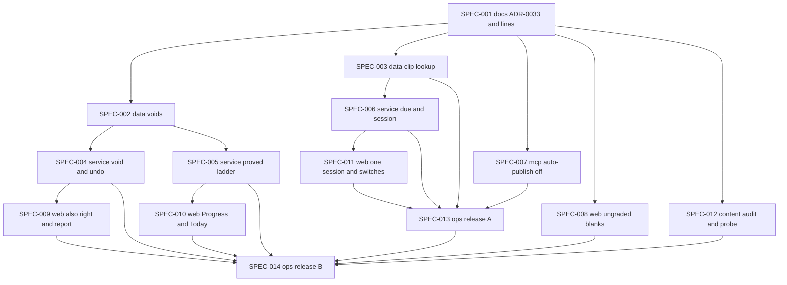

# INIT-038: Today you can trust, and Progress that tells you where you are

**Initiative ID:** INIT-038 · **Status:** on_track · **Created:** 2026-11-09 · **Owner:** Brian Nelson
**Discipline Profile:** `software` · **Ticket:** none · **Branch:** `main` (deliberately not a worktree: the checkout carries many line-ending-only modified files, and this repo's initiatives, such as INIT-036 and INIT-037, work in place on `main`)
**Source:** [BRAIN-001](../../brainstorms/BRAIN-001-is-the-hebrew-app-built-right/decision-document.md), Option B, Stage 1 only, from its [spec skeleton](../../brainstorms/BRAIN-001-is-the-hebrew-app-built-right/spec-skeleton.md). Brian's go, his agreement to the process guardrails, and his instruction to close the older initiatives were given on 2026-11-09.
**Clock:** Stage 1 must finish within 21 days of the go, by **2026-11-30**. Release B must land by **2026-11-23**, to leave a week of use before the exit check.

## What we found

Brian, 2026-11-09: "Asking me questions like pick one, i____, eat, sleep, walk. Only one is right but technically all are right. I do a review, spell words, go to progress and it says you don't know any words … it's frustrating to not be able to know where I really am."

The core is sound: the answer log, FSRS scheduling, the lexicon, the learner model, the audio cache, and the MCP server. What fails is trust and measurement:

- **Wrong grades the app cannot prove.**
  - A lesson's answer buttons are chosen at play time from every taught word (`internal/web/lesson.go`, `wideChoices` and `lessonChoices`). Only an exact gloss match is excluded (`glossKey`, `lesson.go:1678`), so unit 1 lesson 2's "אַתָּה __ פֹּה?" has three right buttons.
  - Report a problem hides a unit but leaves its wrong answers counting (`ReportUnit`, `internal/db/learner_publish.go:296`).
  - Units 12 to 34 were unpublished on 2026-11-08, but their answers still count.
- **Listening is effectively off.**
  - Review drops due listening cards whose word has no clip (`filterReviewAskable`, `internal/session/mix.go:267`), so they stay "due" forever.
  - Review looks for a clip only in `lexemes.audio_id`, which no code writes. Lessons find clips by text in `audio_assets`, so the clips exist but review never sees them.
- **"Known" is too strict to read.** It needs a recall probability of at least 0.85, the last three answers right, and success on two study days (`internal/learner/state.go:56-63`, `IsKnown` at `:157`). A second copy of the rule lives in `internal/db/learner.go:565` (`skillOldKnown`). The page shows several counts that contradict each other.
- **"Due" includes cards he cannot be asked today.** Same-day learning steps and clipless listening cards both inflate the count.
- **AI-written units can still publish themselves.** `put_unit` with `publish: true` publishes a learner unit (`internal/mcp/tool_publish_unit.go:120`, `publishLearnerDraft`).
- **The process is a treadmill.** Ten initiatives were open at once, and same-day complaints became specs.

## What you get

- **No unfair wrong grade.**
  - Blanks with more than one possible answer stop being graded.
  - A "My answer was also right" tap takes back any wrong grade, exactly.
  - Reporting a lesson clears its wrong answers.
  - Answers from units 12 to 34, and from blanks with no English cue, stop counting. They are flagged, not deleted.
- **Listening questions come back** in review, with a clip for every taught word.
- **"Due" means due today,** and Today offers one session of about 25 minutes, weighted toward typing the Hebrew.
- **Progress says what you can do:** "Understand by ear" and "Hebrew from English", proved and recalled, out of the words you were taught. The old, after-void, and new numbers are shown side by side once, so you can see why they moved.
- **No AI-written lesson can reach Today.** Isaiah, Roots, placement, and the check-in are hidden behind switches. No code is deleted.
- **A measurement you can trust over time:** a day-0 baseline, a held-out listening and production probe, a cold check of about 40 words you may already know, and an audit of the tutor's class folder that decides whether Stage 2 happens.

## Specs

| Spec | Domain | Title | Blocked by | Effort | Status |
| --- | --- | --- | --- | --- | --- |
| [SPEC-001](specs/SPEC-001-docs-adr-and-pass-fail-lines.md) | docs | ADR-0033 and the pass and fail lines | — | 3h | complete 2026-11-09 |
| [SPEC-002](specs/SPEC-002-data-voids-beside-answers.md) | data | Voids beside answers, and the study-day span | SPEC-001 | 4h | in_review |
| [SPEC-003](specs/SPEC-003-data-one-clip-lookup.md) | data | One way to find a word's clip, and no listening card without one | SPEC-001 | 3h | in_review |
| [SPEC-004](specs/SPEC-004-service-void-and-undo.md) | service | Void with a true undo, and the one-time void command | SPEC-002 | 6h | in_review |
| [SPEC-005](specs/SPEC-005-service-proved-ladder.md) | service | The "proved" ladder at rule version 5 | SPEC-002 | 5h | in_review |
| [SPEC-006](specs/SPEC-006-service-due-today-one-session.md) | service | Due means due today, and one session sized in minutes | SPEC-001, SPEC-003 | 5h | in_review |
| [SPEC-007](specs/SPEC-007-mcp-auto-publish-off.md) | mcp | Auto-publish off, and tool text that stops restating rules | SPEC-001 | 3h | in_review |
| [SPEC-008](specs/SPEC-008-web-lessons-stop-unprovable-grades.md) | web | Lessons stop grading what they cannot prove | SPEC-001 | 4h | in_review |
| [SPEC-009](specs/SPEC-009-web-also-right-and-report-voids.md) | web | "My answer was also right", and Report a problem voids | SPEC-004 | 4h | in_review |
| [SPEC-010](specs/SPEC-010-web-progress-leads-with-ladder.md) | web | Progress and Today lead with the ladder | SPEC-005 | 5h | in_review |
| [SPEC-011](specs/SPEC-011-web-today-one-session-and-switches.md) | web | Today offers one session, and side features sit behind switches | SPEC-006 | 3h | in_review |
| [SPEC-012](specs/SPEC-012-content-audit-and-probe.md) | content | Tutor-material audit and the held-out probe | SPEC-001 | 4h | in_review (audit passed 2026-11-09; probe clips refused) |
| [SPEC-013](specs/SPEC-013-ops-release-a.md) | ops | Release A: listening on, one session, and the cold check | SPEC-003, SPEC-006, SPEC-007, SPEC-011 | 3h | planned |
| [SPEC-014](specs/SPEC-014-ops-release-b.md) | ops | Release B: one announced change | SPEC-004, SPEC-005, SPEC-008, SPEC-009, SPEC-010, SPEC-012, SPEC-013 | 4h | planned |

**Total:** 56h, of which 42h is code (SPEC-002 to SPEC-011).

**How this differs from the skeleton.** The skeleton had 14 specs including Security Review and Diagrams. Three changes:
- **Security Review and Diagrams are no longer specs.** Under ADR-0060 (`create-initiative.md:540`) they run as `complete-initiative` Phase 3.5 and Phase 3.6; see "Completion phases" below.
- **Two splits.** The skeleton's data spec is split so the clip fix (SPEC-003) can ship in release A without the voids (SPEC-002). Its web "no unfair wrong grade" spec is split into the lesson grading change (SPEC-008) and the tap and report (SPEC-009), so neither sits at the 6-hour ceiling.
- **The pace and tier gate change moves to Stage 2.** Only `get_lesson_brief` reads `PaceFor` and `TierFor` (`internal/brief/build.go:546`, `:587`). Lesson writing is paused in Stage 1, so changing them would change nothing Brian sees. This follows "delete first", and the skeleton's open question A5 named it as the candidate.

**Critical path.** Three paths are each 21h:
- SPEC-001 → SPEC-002 → SPEC-004 → SPEC-009 → SPEC-014;
- SPEC-001 → SPEC-002 → SPEC-005 → SPEC-010 → SPEC-014;
- SPEC-001 → SPEC-003 → SPEC-006 → SPEC-011 → SPEC-013 → SPEC-014.

Realistic: 21h × 1.3 ≈ 27h, about 5 calendar days if the three tracks run side by side. With one agent working in sequence: 56h × 1.3 ≈ 73h, about 12 working days. That still meets the clock (release B by about day 12, exit check about day 19), but with little slack. See Risks.

**Parallel tracks after SPEC-001:**
- **Void track:** SPEC-002, SPEC-004, SPEC-009.
- **Ladder track:** SPEC-005, SPEC-010 (after SPEC-002).
- **Session track:** SPEC-003, SPEC-006, SPEC-011.

SPEC-007, SPEC-008, and SPEC-012 need only SPEC-001.

**Files more than one spec edits, so land them in sequence:**
- `internal/db/learner.go`: SPEC-002 adds void-aware reads and the study-day span; SPEC-005 replaces `skillOldKnown`.
- `internal/evidence`: SPEC-004 adds the void; SPEC-006 moves same-day steps to the next study day in the recorder.
- `internal/web/views/today.templ`: SPEC-010 changes the headline; SPEC-011 changes the main action.
- `internal/web/lesson.go`: SPEC-008 changes grading; SPEC-009 adds the tap to the feedback.

### Two releases

- **Release A (week 1), SPEC-013:** SPEC-003, SPEC-006, SPEC-007, and SPEC-011. No migration. None of these changes what a Progress number means; listening coming back changes his numbers only through real answers.
- **Release B (week 2), SPEC-014:** SPEC-002, SPEC-004, SPEC-005, SPEC-008, SPEC-009, and SPEC-010, with migration 023. Together they are the one announced change: the void, the ladder, and the side-by-side numbers land on the same day.
- **Release A's image must contain no release B spec.** Production deploys a commit of `main`, so a release B spec committed early would ship the ladder or the void with release A. Commit release B specs only after release A is deployed; until then they may be built but stay uncommitted.
- SPEC-008 waits for release B at little cost. Today offers review only (since INIT-037 SPEC-001), and review has no sentence blanks (`internal/activity/types.go:15-23`).

## Decisions

These settle the skeleton's open questions in section 7B.

- **A void is a flag with a reason, never a delete.** The reasons are `unit_12_34`, `no_cue_blank`, `also_right`, and `report`. A void undoes by batch.
- **Proved** means right on 3 study days spanning at least 7 days, with the latest answer right. There is no calendar decay. It is frozen for 90 days from release B.
- **Taught words** are ADR-0032 D1 (any word with a card) minus cards that only placement created (`internal/db/placement.go:280`). Until tutor words are recorded, the label says "out of words the app has taught you".
- **Which reader uses which rung.** The Progress headline reads "proved". The AI's view (digest, `get_context`) and `knownLexemes` read "recalled or proved", so cold-check passes count as recalled, never as proved.
- **No AI-written sentence is graded.** Blanks with buttons become reveals in every unit. `order` steps and multi-word `listen_pick` steps in AI-written units become ungraded too, because their key is an AI-written sentence. This is the wider reading of the skeleton's question B9; Brian can narrow it in SPEC-001's review.
- **The cold check is delivered with no new subsystem.** About 40 words from the tutor material and the mistakes bank, ones the app calls unseen or learning, are recorded with `record_taught_words` after their clips exist, so that their first review asks are the check. Only typed and listening answers count.
- **The probe is an agent-led sitting.**
  - Clips come from `generate_audio`.
  - Brian types his answers.
  - Scoring is a fixed comparison: unpointed, with the `fsrs.GradeTyped` normalization, and English prompts graded on target words only.
  - The dated result is kept outside the learner model, so the items stay unpractised.
- **Correctness rules for the exit sweep** are listed by rule id in SPEC-001. Rule classes wait for Stage 2.
- **Matching past blanks to their step.** Attempts store no step index, so SPEC-004 matches each lesson cloze answer to its step in the unit revision. If that match is unreliable, the fallback is to void every wrong lesson cloze answer.
- **The local check is a documented command.** It is not a hook script; SPEC-001 writes it down.
- **Security Review before release B's data write.** Phase 3.5 normally runs at completion. Release B writes to Brian's record, so SPEC-014 runs the Phase 3.5 checklist on the void path first, by an agent that built none of the specs, and waits for no open Critical or High finding.
- **No speech-to-text check on the new clips in Stage 1.** It is the first content-quality item for Stage 2 (skeleton question A4).

## Process guardrails

These are part of the decision, not advice. Brian agreed to them on 2026-11-09.

- **One initiative in flight, each with Brian's explicit go.** On 2026-11-09 the older open initiatives were closed, each with its reason; see "Depends on / unblocks".
- **Every spec says what Brian will see differently.** Where the change is visible, the completion summary includes a screenshot. Where it is not, the spec says why it is still needed.
- **Complaints go on one weekly list after a 24-hour cooling-off.** A same-day "fix this" goes on the list; it does not become a spec. SPEC-001 creates the list at `sdd/complaints.md`.
- **A rule budget:** a new validator rule retires an old one. Stage 1 adds no validator rule.
- **Delete first:** every spec lists what it removes.
- **No agent assesses its own work.** The audit, the exit check, and the Security Review are done by agents that built none of the specs they judge. The plan-quality score below is labelled a self-review.
- **A one-command local Docker check runs before every push.** SPEC-001 writes the command down.
- **Generated code is never edited by hand.** Every `*_templ.go` change comes from `templ generate`.

## Data safety

- No `attempts`, `review_log`, or `confusion_misses` row is removed or edited. Migration 023 is additive.
- Voiding runs before any unit is ever archived, because the void needs `unit_id`. No unit is archived in Stage 1.
- Units are archived, never deleted. Deleting a unit row cascades to `unit_revisions`, `lesson_items`, `lesson_runs`, and `unit_reports`.
- A backup comes before every production data job (`hebrew backup --to`).
- Each freeze, and the auto-publish stop, is undone by one config change.

## Threat model

- **New: a learner action that changes the learner's own record** (SPEC-009). It is limited to the signed-in learner's own attempts, is CSRF-checked, and never accepts an attempt id from another learner. It only voids; it never credits.
- **New: a production data job** (SPEC-004's `hebrew void-evidence`, run in SPEC-014). It dry-runs by default, needs `--backup-taken` to apply, prints counts and never answer text, and undoes by batch id.
- **New: config switches** (SPEC-007, SPEC-011). They default to the safe side, and `publish_unit` cannot bypass the auto-publish switch.
- **The audit reads Google Drive read-only** (SPEC-012). It writes counts only. No tutor text and none of Brian's typed lines are committed to the repo until Brian decides on reuse. MCP rule: send extracted words and corrections only, never transcript text, recordings, or other people's names.
- **Live writes are gated:**
  - SPEC-013: `deploy` and `production_content_write` (clips and `record_taught_words`);
  - SPEC-014: `db_migration`, `deploy`, and `production_data_write`, with Brian's approval of the void counts;
  - SPEC-012: `production_content_write` for probe clips.

## Risks

| Risk | Probability | Impact | Mitigation |
| --- | --- | --- | --- |
| One agent working in sequence leaves little slack before 2026-11-30 | M | H | Run the three tracks side by side where possible; release B by 2026-11-23 or invoke the abandon rule |
| The card replay does not reproduce the stored card exactly | M | H | Fuzz is off (`internal/fsrs/review.go:30`); SPEC-004's acceptance compares every field on fixtures and on a production copy before release B |
| Brian's numbers fall after the void and the ladder, and he loses trust | M | M | One announced change, with old, after-void, and new numbers side by side and the reason in one line |
| Matching past blanks to their step is unreliable | M | L | Void every wrong lesson cloze answer instead (decision above) |
| The "also right" tap is overused and hides real mistakes | L | M | The stop line: more than one tap per 50 graded items in a week fails the exit |
| Voice credits run short for every taught word, the cold check, and the probe | M | M | Check the ElevenLabs balance before SPEC-013 and SPEC-012; clips for due listening cards first |
| A side-feature switch hides something Brian uses | L | L | One config change restores it |
| The image auto-updater is out of sync | H | L | Pin the image in `home_k3` by hand and check `/version` |

## Depends on / unblocks

- **Builds on:** ADR-0031 (rule version 4, which SPEC-005 replaces), ADR-0032 D1 (taught words), INIT-037 SPEC-009's read-only sweep, and `hebrew history rebuild` (`cmd/hebrew/history.go`).
- **Closed on 2026-11-09 so that only this initiative is in flight:**
  - INIT-005, INIT-009, INIT-010, INIT-011, and both INIT-014 folders: Node-era or teacher-facing work that the Go port and BRAIN-001 made unnecessary.
  - INIT-023 and INIT-024: their remaining word-page form work is frozen as reference.
  - INIT-031: it would have extended AI-written units.
  - INIT-032: its remaining "also right" work is replaced here by SPEC-008 and SPEC-009.
  - INIT-036: the sound-contrast drill needs a native-speaker checker.
  - INIT-028: marked complete.

  Each folder's status line states its reason.
- **Unblocks:** the Stage 2 initiative, only through the gate below.

## Done when (Stage 1 exit)

All of these must hold. They are checked at `complete-initiative`, at least 7 days after release B, by an agent that built none of the specs.

1. **Zero graded steps reachable from Today fail a correctness rule,** by INIT-037 SPEC-009's read-only sweep restricted to the rule ids SPEC-001 names.
2. **At most one "My answer was also right" tap per 50 graded items** in the 7 days before the check. This is counted from void rows with reason `also_right` against graded attempts.
3. **Brian answers yes to "Do I trust Today now?"** It is recorded with the date, beside his study minutes for that week.
4. **All of it by 2026-11-30.**

The spec acceptance criteria also prove these:
- After a void, a card equals its state before the answer.
- No listening card exists without a word clip, and `CountReviewSkippedNoAudio` is 0.
- Every daily snapshot is stamped rule version 5.
- `put_unit` with `publish: true` on a learner scope saves a draft.
- No lesson blank writes an attempt.

## Gate to Stage 2

Stage 2, re-centering the app on the tutor's lessons, is a separate initiative. It opens only when all of these hold, and only with Brian's explicit go:

1. The Stage 1 exit is met.
2. **The tutor-material audit passes:** about 150 or more usable tutor-written lines, **and** 5 of the last 10 classes loadable without Brian. Both counts are required.
3. Brian decides whether the tutor's text may be reused privately.
4. **There is enough evidence under the new rules.** The window ends at whichever comes later: one week after release B, or the point where all of these are reached:
   - about 150 graded answers;
   - the "also right" rate under the stop line;
   - at least 50 delayed reviews.
5. No abandon condition below has fired.

If the audit fails, Stage 2's import is not built. Brian adds words through `record_taught_words`, and practice stays review plus ungraded stories.

**Success measures** (written into SPEC-001):
- **Primary:**
  - study minutes, from 64 a week now to at least 120 by week 4;
  - the share of words taught 14 or more days ago that are proved in "Hebrew from English";
  - the monthly held-out probe.
- **Guardrails:**
  - study days per week;
  - the lesson abandon rate, from `lesson_runs`;
  - the "also right" tap rate;
  - reviewable cards due at the start of the day.

## Abandon conditions (fallback: Option D)

If any of these happens, stop building, make the app review-only, and move tutor material to Anki or the worksheet player in `Aharon's code/`:
- Stage 1 is not finished by 2026-11-30;
- a second initiative opens before Stage 1 closes;
- Brian's study time has not reached about 120 minutes a week by week 4;
- the monthly held-out probe is flat for two months.

## Deferred to Stage 2

These are held out on purpose so the closed list stays closed. The full table, with who raised each item and why it waits, is in the [skeleton, section 5](../../brainstorms/BRAIN-001-is-the-hebrew-app-built-right/spec-skeleton.md).

- **Grading and checking:** a robot run-through of every graded item; one question engine; buttons frozen per revision; an ambiguity detector. A judge model is rejected in both stages.
- **Rules and docs:** authoring docs generated from the rule catalog; rule classes and a nightly sweep.
- **New logging and learning from it:** playback speed, replays, and number of options; a per-step exclusion list built from taps.
- **The card model and scheduler:** stopping reading and spelling cards; fitting FSRS weights; within-learner experiments.
- **Tooling:** a pre-push hook script; a scripted smoke test; repairing the image auto-updater.
- **Tutor-facing work:** a closing summary for the session; a self-rating after each class; a weekly note for the tutor.
- **Retiring the old pipeline:** archiving units 12 to 34; retiring the unit pipeline; any deletion of placement, Isaiah, Roots, or multi-user code.
- **Added by this plan:** the pace and tier gate change in `internal/brief`, and a speech-to-text check on new clips.

## Completion phases (not specs, per ADR-0060)

- **Phase 3.5, Security Review.** Scope:
  - **The void tap:** own answers only, CSRF, and no way to name another learner's attempt id. The read-only MCP token cannot void.
  - **The void command:** a backup is required, it dry-runs by default, and it prints no answer text.
  - **The switches:** safe defaults, and `publish_unit` cannot bypass auto-publish off.
  - **The audit's Drive read:** read-only, counts only, and nothing copied into the repo.
  - **Measurement integrity:** a tap voids and never credits.

  It runs early on the void path before SPEC-014 applies anything, and again in full at completion. Any open Critical or High finding blocks.
- **Phase 3.6, Architecture and Design Diagrams.** Diagrams of:
  - the answer, void, and card-replay flow;
  - the clip lookup and every place a listening card is created;
  - the ladder states per skill;
  - the order of the two releases and the one-time jobs, including "void before archive".

## Plan quality (Phase 5.5 self-review, not independent)

Completeness 8, accuracy 8, clarity 8, feasibility 7, guardrails 9: 40/50, confidence 0.75. Feasibility is the weakest point: 56 hours against a 21-day clock that includes a week of use, with three specs at 5 to 6 hours that touch the scheduler or the card replay. The guardrails score is high because every spec names what it removes and what Brian will see.

## Disclosures

- **Kit tools missing.** `<KIT>/scripts/dev/` has no `next_adr_number.py`, `prior_art.py`, `expertise_state.py`, or `model_tier.py` on this machine. So:
  - ADR-0033 was taken by hand, with no reservation made.
  - The prior-art search and the expertise check were not run. Prior art is recorded as unknown.
  - Every spec uses `primary_prompt: none`, as this repo's other initiatives do, and complexity was set by hand.
- **Numbers by hand.** INIT-037 is the highest initiative folder, so this is INIT-038. Migration 022 is the highest, so the new one is 023.
- **Guard.** `guard_identities` is empty, so the git guard is inert. No commit was made.
