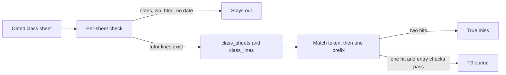
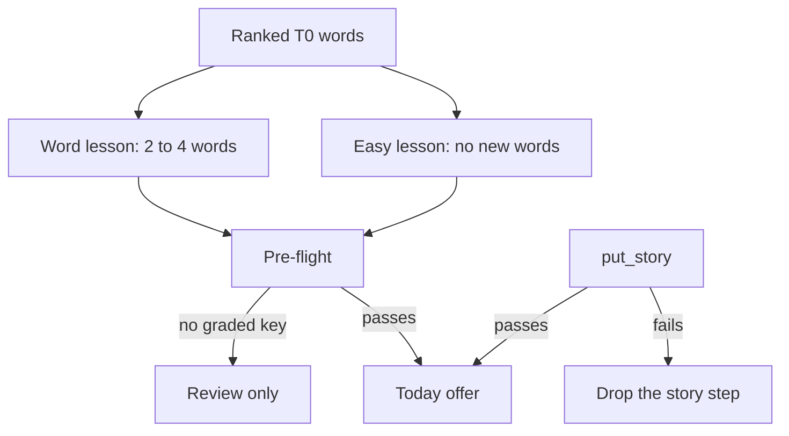
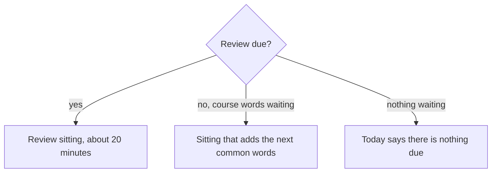
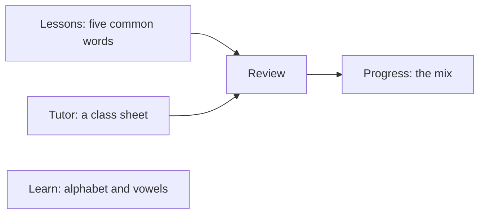
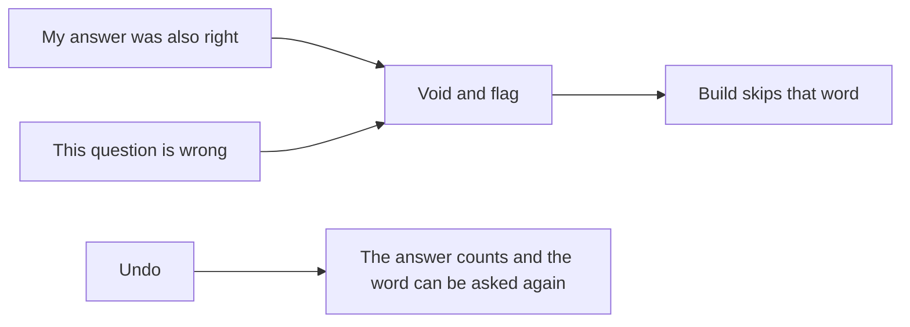

# INIT-039 diagrams

How a class becomes a lesson. Nothing here is a production deploy.

## Class load and the queue

## Assemble, freeze, and the story

Kept in the code. Today does not call it (ADR-0034 D1).

## Today

ADR-0034 D1 and D5. The class-sheet assembler stays in the code and is not what Today offers.

## Five sections

ADR-0035. One player, the review player.

## Flag

## Retirement

The old player, the old validator, and units 1 to 34 stay. A later initiative archives units 12 to 34 after the new lessons have been on Today. Nothing in this picture deletes a learning record.
