# Three looks for Today and a lesson step

Static pages. Open any `today.html` from the file system. No server and no build. Rubik is the self-hosted face in `shared/fonts/` (SIL OFL), loaded with a relative `@font-face`.

Each look shows the same two screens:

- **Today** — one next lesson (`בוקר בבית הקפה`, the words שָׁלוֹם, קָפֶה, בֹּקֶר) and a count of words due.
- **Lesson step** — an ADR-0003 `introduction`: קָפֶה with its English gloss, a picture placeholder, and השמעה in one cluster, then `#miss`, where the attempt לילה stays and the correct form בֹּקֶר is shown.

`node spikes/look/check.js` measures contrast (text at least 4.5:1, controls and picture strokes at least 3:1), target size (24px, primary 44px), and reduced motion. The scheme radios follow the system, or force light or dark. These shots are the light scheme.

## Recommendation

**a-calm-type** is the closest match to RSCH-006.

It keeps one word on the meet screen, one learning action on Today, and puts that action on the bottom edge of a phone. It does not add a banner, a word index, or a bar of extra destinations. The one trade-off is the example sentence under the cluster, which ADR-0003's introduction asks the learner to read.

b trades the "no extra decoration" rule (the sun, the hill, the filled cup) and does not park the phone action in the thumb zone. c trades one-item, one-action, and the thumb zone: three words are listed at once, and Today has three top-level links in a bar.

## a — calm type

Follows rules 1–10 and 12–18. Trades off rule 11 (the example sentence only).

| Screen | 360px | 1280px |
| --- | --- | --- |
| Today | 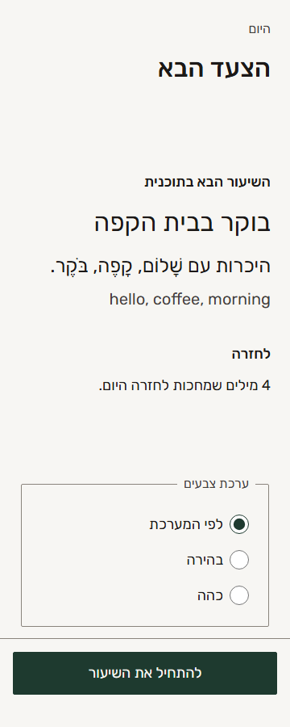 | 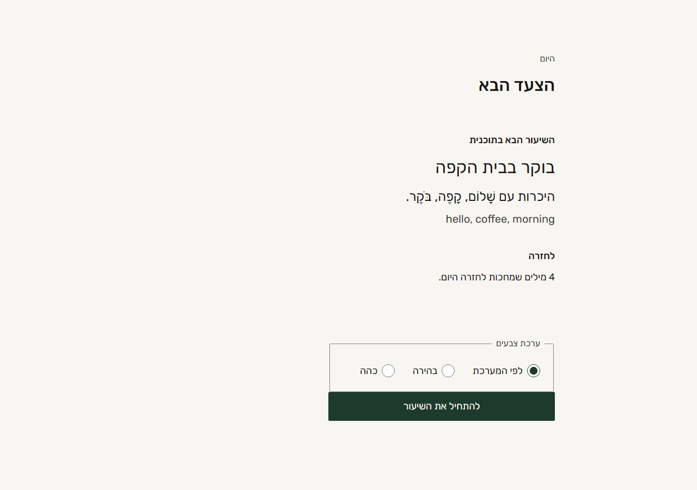 |
| Lesson | 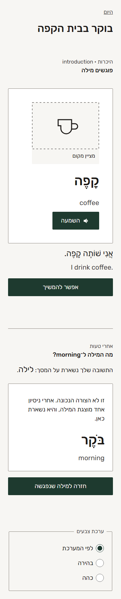 | 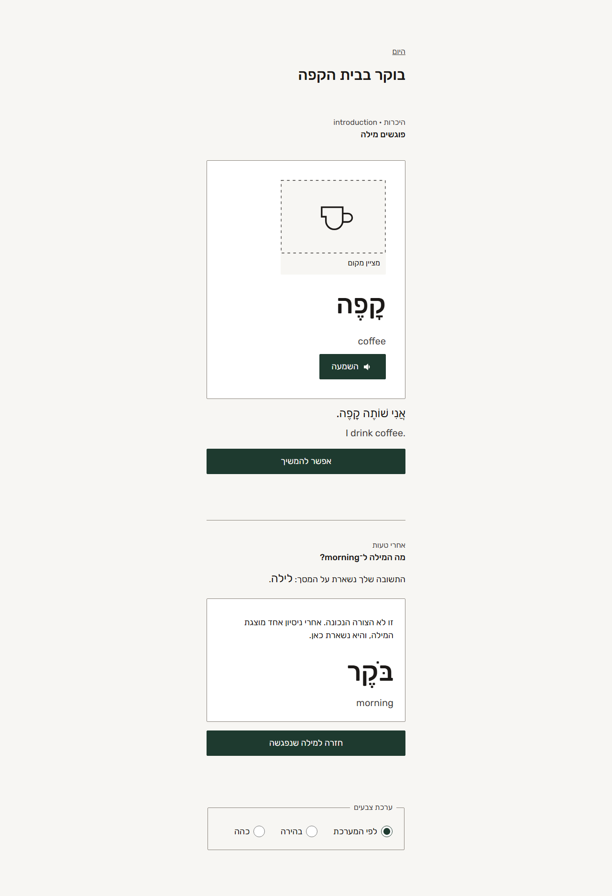 |

## b — warm illustrated

Follows the type, contrast, cluster, miss, and one-action rules. Trades off rule 11 (banner and filled placeholder) and rule 17 (the start button sits in the card).

| Screen | 360px | 1280px |
| --- | --- | --- |
| Today | 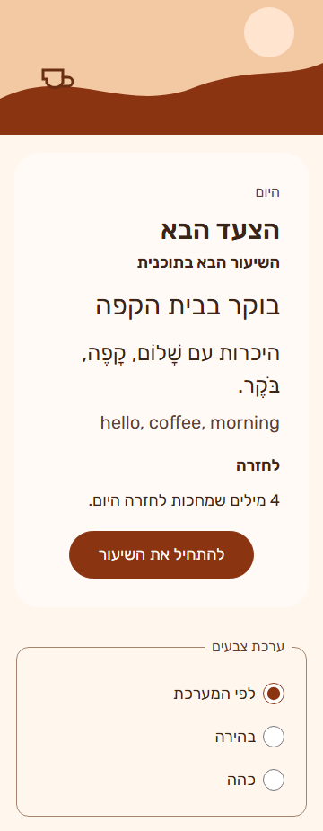 | 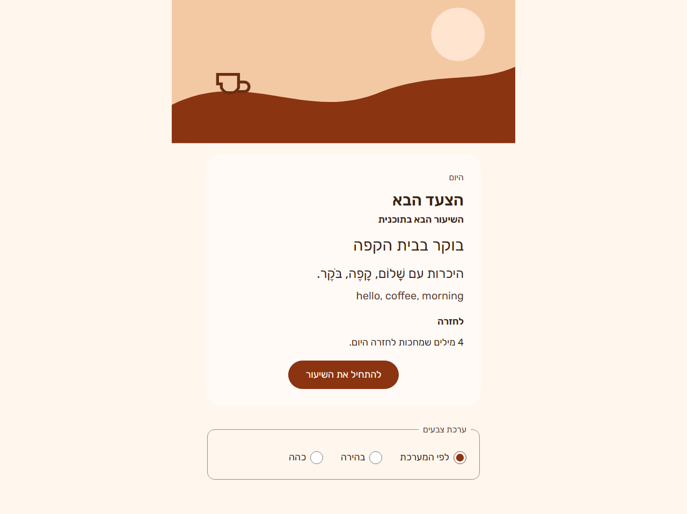 |
| Lesson | 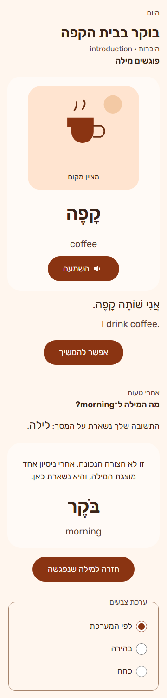 | 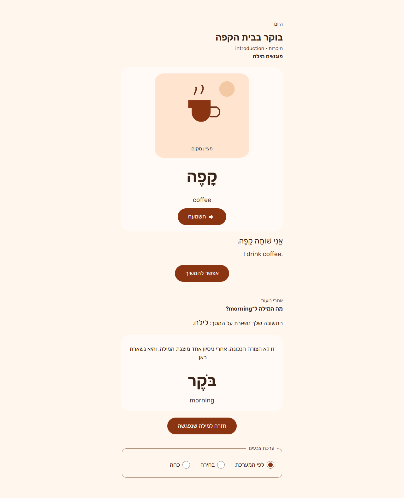 |

## c — dense tool

Follows the type, contrast, cluster, and miss rules. Trades off rule 10 (the index lists three words), rule 11 (bar, panels, row labels), rule 16 (three top-level links), and rule 17 (the main action is in the top bar).

| Screen | 360px | 1280px |
| --- | --- | --- |
| Today | 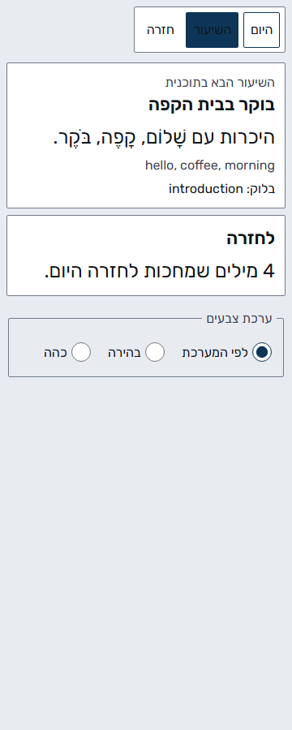 | 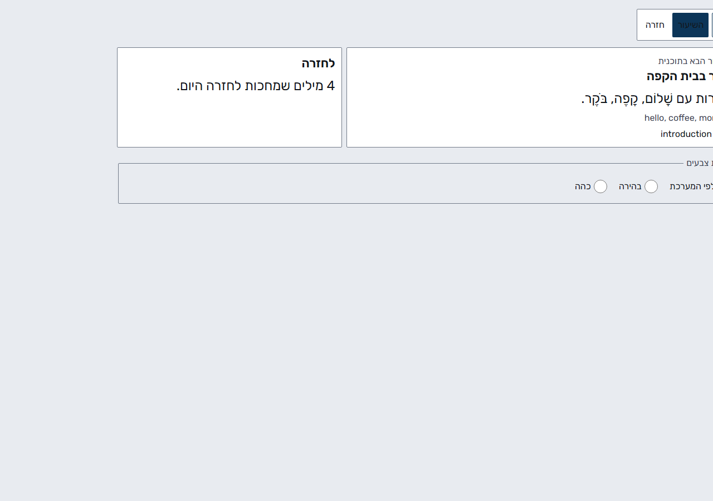 |
| Lesson | 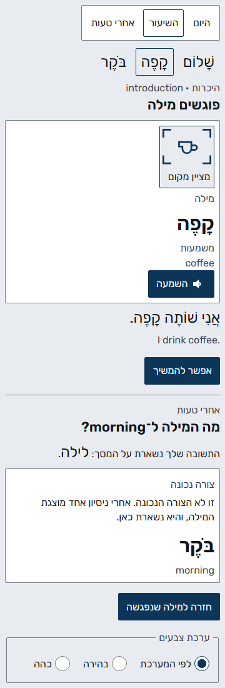 | 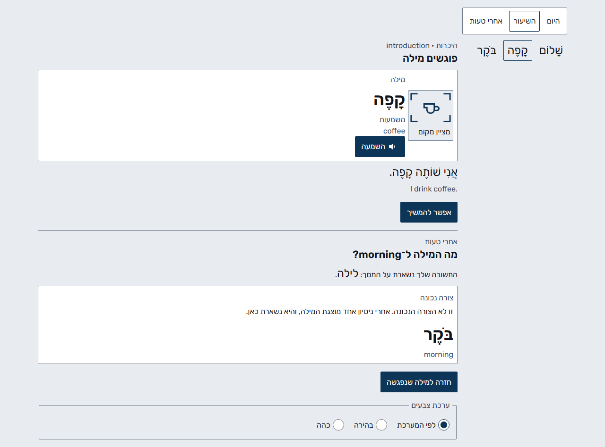 |

## Where each rule shows up

| # | Covered by |
| --- | --- |
| 1–9 | All three. a sets the pointed word the largest. |
| 10 | a and b show one word, then an advance link. c lists שָׁלוֹם, קָפֶה, and בֹּקֶר together. |
| 11 | a keeps only the example sentence. b adds drawings. c adds tool chrome. |
| 12–15, 18 | All three. |
| 16 | a and b have one learning action. c has a three-link bar. |
| 17 | a sticks the phone action to the bottom. b and c do not. |

No learner names, transcripts, or secrets are in these pages.
